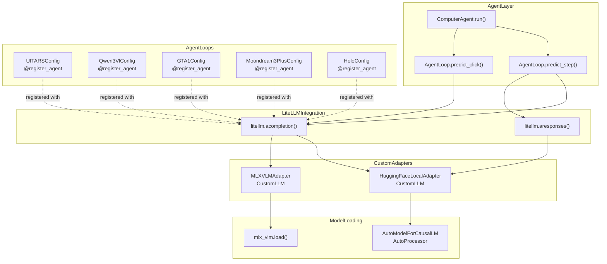
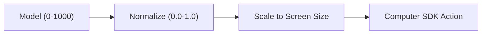
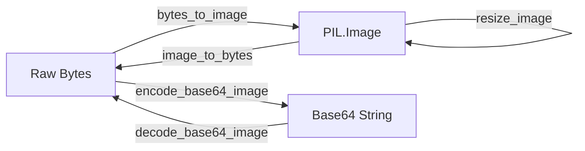

<!-- source: DeepWiki mcp.deepwiki.com · repo trycua/cua · page 7.4 Local Model Adapters · fetched 2026-10-29 -->

# Local Model Adapters

Relevant source files

The following files were used as context for generating this wiki page:

- [Makefile](Makefile)
- [libs/python/agent/.bumpversion.cfg](libs/python/agent/.bumpversion.cfg)
- [libs/python/agent/README.md](libs/python/agent/README.md)
- [libs/python/agent/pyproject.toml](libs/python/agent/pyproject.toml)
- [libs/python/core/.bumpversion.cfg](libs/python/core/.bumpversion.cfg)
- [libs/python/core/README.md](libs/python/core/README.md)
- [libs/python/core/pyproject.toml](libs/python/core/pyproject.toml)
- [libs/python/som/.bumpversion.cfg](libs/python/som/.bumpversion.cfg)
- [libs/python/som/README.md](libs/python/som/README.md)
- [libs/python/som/pyproject.toml](libs/python/som/pyproject.toml)

## Purpose and Scope

This document describes the local model adapter system that enables Cua agents to run vision-language models locally, bypassing cloud API calls. The adapter system integrates with `litellm`'s custom LLM interface and provides two primary adapters: `HuggingFaceLocalAdapter` for general model support via Transformers, and `MLXVLMAdapter` for Apple Silicon optimized inference.

Local models are integrated through agent loops that implement the `AsyncAgentConfig` protocol and handle model-specific prompting, parsing, and coordinate conversion. Key implementations include **UI-TARS** for full agent capabilities, **Qwen3-VL** for function calling, and grounding-only models like **GTA1**, **Moondream3**, and **Holo** for element localization.

For information about how grounding models are composed with planning models, see page 7.3 (Composed and Grounding Models).

Sources: [libs/python/agent/pyproject.toml:13-25]()

---

## Architecture Overview

The local model adapter system consists of two parallel paths: HuggingFace Transformers and MLX for Apple Silicon. Both integrate with `litellm` as `CustomLLM` implementations and are accessed through agent loops that handle model-specific formatting and parsing.

**Diagram: Local Model Adapter Architecture**

The system routes model requests based on model name prefixes:
- `huggingface-local/` → `HuggingFaceLocalAdapter`
- `mlx/` or `mlx-community/` → `MLXVLMAdapter`

Agent loops are registered with regex patterns (e.g., `r".*UI-TARS.*"`) and handle model-specific:
- Prompt construction (action space, system prompts)
- Response parsing (extracting coordinates, actions from text)
- Coordinate space conversions (normalized ↔ pixel coordinates)

Sources: [libs/python/agent/pyproject.toml:43-75](), [libs/python/agent/pyproject.toml:101-124]()

---

## HuggingFaceLocalAdapter

The `HuggingFaceLocalAdapter` implements `litellm`'s `CustomLLM` interface, enabling local HuggingFace models to be used through `litellm`'s unified API. It handles model loading, message format conversion, and async execution.

### Async Execution Pattern

The adapter typically uses a `ThreadPoolExecutor` to prevent blocking the event loop during model inference. This allows CPU/GPU-bound model inference to run in a separate thread while maintaining async compatibility with the agent system.

### Dependency Management

The `HuggingFaceLocalAdapter` relies on several optional dependency groups defined in the `cua-agent` package:

| Group | Dependencies | Use Case |
|-------|--------------|----------|
| `uitars-hf` | `accelerate`, `torch`, `transformers>=4.54.0` | Standard local transformers inference [libs/python/agent/pyproject.toml:47-51]() |
| `internvl-hf` | `einops`, `timm`, `torch`, `transformers>=4.55.0` | InternVL specific local execution [libs/python/agent/pyproject.toml:64-70]() |
| `opencua-hf` | `tiktoken`, `blobfile`, `torch`, `transformers>=4.53.0` | OpenCUA specific local execution [libs/python/agent/pyproject.toml:57-63]() |
| `moondream3` | `accelerate`, `torch`, `transformers>=4.55.0` | Moondream3 local grounding [libs/python/agent/pyproject.toml:71-75]() |
| `glm45v-hf` | `accelerate`, `torch`, `transformers>=5.0.0rc3` | GLM-4.5V local execution [libs/python/agent/pyproject.toml:52-56]() |

Sources: [libs/python/agent/pyproject.toml:47-75]()

---

## MLXVLMAdapter

The `MLXVLMAdapter` provides Apple Silicon optimized inference using the MLX framework. It is the primary adapter for users running Cua on macOS.

### Key Features and Requirements

| Feature | Implementation Detail |
|---------|-----------------------|
| Platform | Apple Silicon (Darwin) [libs/python/agent/pyproject.toml:45-45]() |
| Core Library | `mlx-vlm>=0.1.27` [libs/python/agent/pyproject.toml:45-45]() |
| Image Scaling | `smart_resize` (typically 28px factor) |
| Coordination | Pixel-to-Normalized scaling |

### Smart Resize and Memory Management

Local models, especially on Apple Silicon, require careful memory management. The `smart_resize` logic ensures that images are large enough for the vision encoder to detect UI elements but small enough to fit in unified memory.

Sources: [libs/python/agent/pyproject.toml:44-46](), [libs/python/agent/pyproject.toml:103-103]()

---

## UI-TARS Agent Loop

The `UITARSConfig` implements a complete agent loop for ByteDance's UI-TARS model. Unlike grounding-only models, UI-TARS supports full agent capabilities including action planning and execution.

### Action Space

UI-TARS uses a custom action space that includes `click`, `drag`, `type`, `scroll`, and `wait`. These are parsed from the model's textual output and converted into standard `computer_call` items.

### Coordinate Space Conversion

**Diagram: UI-TARS Coordinate Pipeline**

The system handles the transformation between the model's internal 1000-point coordinate system and the actual pixel dimensions of the target environment (e.g., a 1280x800 Docker container or a 2560x1600 macOS VM).

Sources: [libs/python/agent/pyproject.toml:43-51](), [libs/python/agent/pyproject.toml:102-106]()

---

## Qwen3-VL Agent Loop

The `Qwen3VlConfig` implements function calling for Qwen3-VL models. It utilizes specific utilities for visual token processing.

### Implementation Dependencies

The Qwen implementation requires specific utilities for image processing and agent orchestration:
- `qwen-vl-utils`: For processing visual tokens and image resizing [libs/python/agent/pyproject.toml:36-36]().
- `qwen-agent`: For managing the Qwen-specific tool-calling format [libs/python/agent/pyproject.toml:37-37]().

Sources: [libs/python/agent/pyproject.toml:35-39](), [libs/python/agent/pyproject.toml:121-124]()

---

## Image Processing Utilities

The local model adapters rely on a set of common image utilities provided in `cua-computer` to handle data flow between the agent and the model runtime.

**Diagram: Image Data Flow**

### Key Functions
- `resize_image`: Resizes an image by a scale factor using `Image.Resampling.LANCZOS` [libs/python/computer/computer/utils.py:40-54]().
- `draw_box`: Overlays visual indicators on screenshots, useful for debugging grounding results [libs/python/computer/computer/utils.py:57-90]().
- `get_image_size`: Extracts dimensions (width, height) for coordinate normalization [libs/python/computer/computer/utils.py:93-103]().

Sources: [libs/python/computer/computer/utils.py:11-103]()

---

## Installation and Environment Setup

Local model support is divided into specific "extras" to minimize the base install size.

### Installation Table

| Target Model/Backend | Command |
|----------------------|---------|
| Apple Silicon (MLX) | `pip install cua-agent[uitars-mlx]` [libs/python/agent/pyproject.toml:44-46]() |
| HuggingFace (Torch) | `pip install cua-agent[uitars-hf]` [libs/python/agent/pyproject.toml:47-51]() |
| InternVL | `pip install cua-agent[internvl-hf]` [libs/python/agent/pyproject.toml:64-70]() |
| Moondream3 | `pip install cua-agent[moondream3]` [libs/python/agent/pyproject.toml:71-75]() |
| OpenCUA | `pip install cua-agent[opencua-hf]` [libs/python/agent/pyproject.toml:57-63]() |
| GLM-4.5V | `pip install cua-agent[glm45v-hf]` [libs/python/agent/pyproject.toml:52-56]() |
| Everything | `pip install cua-agent[all]` [libs/python/agent/pyproject.toml:102-125]() |

### Runtime Hardware Requirements

| Backend | Requirement |
|---------|-------------|
| MLX | Apple Silicon (M1/M2/M3/M4) [libs/python/agent/pyproject.toml:45-45]() |
| HF (CUDA) | NVIDIA GPU with `torch` + `accelerate` [libs/python/agent/pyproject.toml:48-49]() |
| HF (CPU) | 16GB+ RAM (Performance will be slow) |

Sources: [libs/python/agent/pyproject.toml:43-75](), [libs/python/agent/pyproject.toml:102-125]()

---

