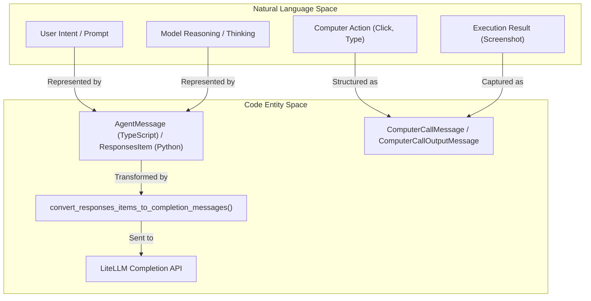
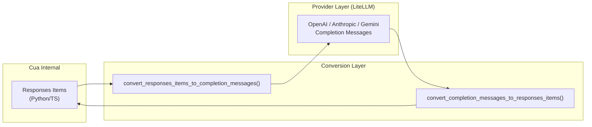

<!-- source: DeepWiki mcp.deepwiki.com · repo trycua/cua · page 7.5 Message Format System · fetched 2026-10-29 -->

# Message Format System

<details>
<summary>Relevant source files</summary>

The following files were used as context for generating this wiki page:

- [Makefile](Makefile)
- [libs/python/agent/.bumpversion.cfg](libs/python/agent/.bumpversion.cfg)
- [libs/python/agent/README.md](libs/python/agent/README.md)
- [libs/python/agent/pyproject.toml](libs/python/agent/pyproject.toml)
- [libs/python/core/.bumpversion.cfg](libs/python/core/.bumpversion.cfg)
- [libs/python/core/README.md](libs/python/core/README.md)
- [libs/python/core/pyproject.toml](libs/python/core/pyproject.toml)
- [libs/python/som/.bumpversion.cfg](libs/python/som/.bumpversion.cfg)
- [libs/python/som/README.md](libs/python/som/README.md)
- [libs/python/som/pyproject.toml](libs/python/som/pyproject.toml)

</details>


## Purpose and Scope

The Message Format System defines the standardized message schemas used throughout Cua's agent infrastructure, along with the conversion functions that transform messages between the internal Responses API format and provider-specific formats (OpenAI, Anthropic, etc.). This system ensures consistent message handling across different agent loops while maintaining compatibility with diverse LLM providers.

For information about agent loop implementations that use these formats, see **Agent Loop Architecture (7.1)**. For callback preprocessing/postprocessing of messages, see **Callback System (9.1)**.

## Overview

Cua uses the **Responses API format** (based on OpenAI's Responses API specification) as its internal standard for representing agent conversations, actions, and outputs. This format provides a unified schema that encompasses user/assistant text, computer control actions, function calls, and reasoning traces.

The message format system consists of three layers:
1.  **Core Schema Definitions**: Type-safe message structures defined using Pydantic in Python and TypeScript interfaces.
2.  **Conversion Functions**: Bidirectional transformers between Responses format and provider formats (LiteLLM, Anthropic, etc.).
3.  **Factory Functions**: Helpers for creating well-formed message items.

### System Mapping: Message Flow

The following diagram maps the Natural Language concepts to the specific Code Entities responsible for message handling.


Sources: [libs/python/agent/pyproject.toml:24-24]()

## Core Message Types

The Responses format defines primary message types, each with specific schemas maintained across both Python and TypeScript implementations.

### Message (User/Assistant)
Standard conversational messages with multimodal content support. In TypeScript, these are represented by `UserMessage` and `AssistantMessage`.

```typescript
// Example User Message structure in TypeScript
export interface UserMessage {
  type?: 'message';
  role: 'user' | 'system' | 'developer';
  content: string | InputContent[];
}
```

### Computer Call
Represents an agent's intent to perform a computer control action. In the TypeScript SDK, this is the `ComputerCallMessage` interface.

| Action Type | Description | Key Parameters |
| :--- | :--- | :--- |
| `click` | Single mouse click | `x`, `y`, `button` |
| `double_click`| Double mouse click | `x`, `y` |
| `keypress` | Keyboard shortcut/key | `keys` (list of strings) |
| `type` | Text input | `text` |
| `scroll` | Mouse wheel scroll | `scroll_x`, `scroll_y` |
| `drag` | Drag and drop | `path` (list of coordinates) |
| `screenshot` | Capture screen | N/A |
| `left_mouse_down`| Anthropic specific action | `x`, `y` |

### Computer Call Output
Result of executing a computer action, typically containing a screenshot. Represented as `ComputerCallOutputMessage` in TypeScript.

```typescript
export interface ComputerCallOutputMessage {
  type: 'computer_call_output';
  call_id: string;
  output: ComputerResultContent;
}

export interface ComputerResultContent {
  type: 'computer_screenshot' | 'input_image';
  image_url: string;
}
```

### Reasoning
Model's internal reasoning or thought process. Represented as `ReasoningMessage`.

```typescript
export interface ReasoningMessage {
  type: 'reasoning';
  summary: SummaryContent[];
}
```

## Conversion and Integration with LiteLLM

Cua relies on `litellm` (pinned to version 1.86.2) for multi-provider support [libs/python/agent/pyproject.toml:24-24](). The system provides bidirectional conversion between the internal Responses format and the OpenAI-compatible completion format used by LiteLLM.

### Conversion Architecture



**Key transformations:**
- `computer_call` items are converted to `tool_calls` in assistant messages.
- `computer_call_output` items are converted to `tool` role messages with the screenshot result.
- `reasoning` items are often appended to assistant messages as text or specific metadata depending on provider support.

Sources: [libs/python/agent/pyproject.toml:24-24]()

## Function Calls

Represented as `FunctionCallMessage` and `FunctionCallOutputMessage` in the TypeScript SDK. These allow the agent to interact with arbitrary Python/TS tools outside of the core computer-use set.

```typescript
export interface FunctionCallMessage {
  type: 'function_call';
  call_id: string;
  status: 'completed' | 'failed' | 'pending';
  name: string;
  arguments: string; // JSON string of arguments
}
```

## Coordinate Systems and Grounding

The message format supports different coordinate systems depending on the model and environment:
1.  **Absolute Pixels**: Standard pixel coordinates (e.g., 1920x1080).
2.  **Normalized (0-1000)**: Used by models like **UITARS** [libs/python/agent/pyproject.toml:42-42]() to remain resolution-independent.
3.  **Element IDs**: Used by grounding models like **OmniParser** (via `cua-som`) [libs/python/agent/pyproject.toml:39-41]() where the agent refers to numeric labels (e.g., "Click element 5").

The system includes utilities to convert between these formats before and after LLM calls to ensure the `computer_call` items contain the correct pixel coordinates for execution by the Computer SDK.

Sources: [libs/python/agent/pyproject.toml:39-42](), [libs/python/som/README.md:58-79](), [libs/python/som/pyproject.toml:6-8]()

## Message Sanitization

To manage memory and token usage, the system provides sanitization utilities. This is crucial when dealing with high-resolution screenshots in `computer_call_output` messages, allowing the system to omit or downsample images in historical context while retaining the text-based action logs.

Sources: [libs/python/agent/pyproject.toml:6-25]()

---

