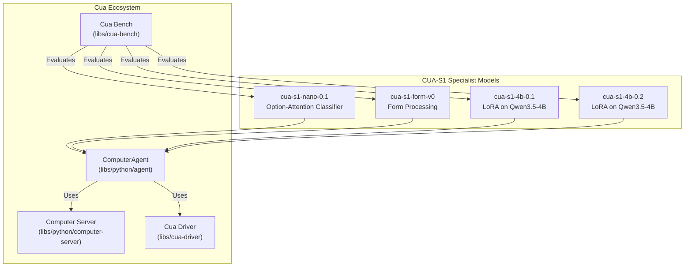

<!-- source: DeepWiki mcp.deepwiki.com · repo trycua/cua · page 7.6 CUA-S1 Specialist Models · fetched 2026-10-29 -->

# CUA-S1 Specialist Models

<details>
<summary>Relevant source files</summary>

The following files were used as context for generating this wiki page:

- [.github/scripts/tests/test_ci_cua_s1_weights_workflow.py](.github/scripts/tests/test_ci_cua_s1_weights_workflow.py)
- [.github/workflows/ci-cua-s1-weights.yml](.github/workflows/ci-cua-s1-weights.yml)
- [.github/workflows/ci-cua-s1.yml](.github/workflows/ci-cua-s1.yml)
- [libs/cua-driver/examples/jev-use/decision-models.md](libs/cua-driver/examples/jev-use/decision-models.md)
- [libs/cua-driver/examples/jev-use/fixtures/jev-choice-negative-v1.json](libs/cua-driver/examples/jev-use/fixtures/jev-choice-negative-v1.json)
- [libs/cua-driver/examples/jev-use/fixtures/jev-choice-negative-v1.png](libs/cua-driver/examples/jev-use/fixtures/jev-choice-negative-v1.png)
- [libs/cua-driver/examples/jev-use/fixtures/jev-choice-request-v1.png](libs/cua-driver/examples/jev-use/fixtures/jev-choice-request-v1.png)
- [libs/cua-driver/examples/jev-use/python/choose_action.py](libs/cua-driver/examples/jev-use/python/choose_action.py)
- [libs/cua-driver/examples/jev-use/python/choose_decision.py](libs/cua-driver/examples/jev-use/python/choose_decision.py)
- [libs/cua-driver/examples/jev-use/python/decision_models.py](libs/cua-driver/examples/jev-use/python/decision_models.py)
- [libs/cua-driver/examples/jev-use/python/tests/test_action_policy.py](libs/cua-driver/examples/jev-use/python/tests/test_action_policy.py)
- [libs/cua-driver/examples/jev-use/python/tests/test_decision_models.py](libs/cua-driver/examples/jev-use/python/tests/test_decision_models.py)
- [libs/cua-driver/examples/jev-use/typescript/choose_action.ts](libs/cua-driver/examples/jev-use/typescript/choose_action.ts)
- [libs/cua-driver/examples/jev-use/typescript/tasks.ts](libs/cua-driver/examples/jev-use/typescript/tasks.ts)
- [libs/cua-driver/examples/jev-use/verify_decision_cli.py](libs/cua-driver/examples/jev-use/verify_decision_cli.py)
- [libs/cua-driver/rust/crates/cua-driver-e2e/tests/perception_s1_decision_loop_test.rs](libs/cua-driver/rust/crates/cua-driver-e2e/tests/perception_s1_decision_loop_test.rs)
- [libs/cua-s1/MODEL_CARD.md](libs/cua-s1/MODEL_CARD.md)
- [libs/cua-s1/README.md](libs/cua-s1/README.md)
- [libs/cua-s1/ci/fetch_pinned_weights.py](libs/cua-s1/ci/fetch_pinned_weights.py)
- [libs/cua-s1/python/pyproject.toml](libs/cua-s1/python/pyproject.toml)
- [libs/cua-s1/python/tests/test_pdf.py](libs/cua-s1/python/tests/test_pdf.py)
- [libs/cua-s1/python/tests/test_training.py](libs/cua-s1/python/tests/test_training.py)
- [libs/cua-s1/python/uv.lock](libs/cua-s1/python/uv.lock)
- [libs/cua-s1/training/train.py](libs/cua-s1/training/train.py)
- [skills/jev-use/SKILL.md](skills/jev-use/SKILL.md)

</details>


This page documents the `libs/cua-s1` research component, which encompasses the System-1 specialist model family within the Cua platform. These models focus on specialist computer-use tasks rather than general-purpose capabilities. The CUA-S1 family includes:

- `cua-s1-nano-0.1`: an ~855K-parameter option-attention classifier scoring candidates in a single forward pass;
- `cua-s1-form-v0`: a finetuned text-only variant specialized for form-oriented UI tasks;
- `cua-s1-4b-0.1` and `cua-s1-4b-0.2`: LoRA adapters on top of the open-weight base model `Qwen/Qwen3.5-4B` for general computer-use decision making.

This page covers the `cua_s1` Python package implementation, synthetic data generation, training and evaluation pipelines, checkpoint loading with `safetensors` only, MODEL_CARD guidance for responsible use, and optional integration with `cua-driver`.

Sources:
- [libs/cua-s1/README.md:1-127]()
- [libs/cua-s1/MODEL_CARD.md:1-127]()

---

## 1. CUA-S1 Model Family Overview

The CUA-S1 family is a research project built for studying small, specialist computer-use models. Unlike large generalist agents, these models target defined interface tasks with narrow contracts.

| Model Checkpoint       | Description                                                                                           | Architecture                             | Usage                                                                                                                               |
|-----------------------|---------------------------------------------------------------------------------------------------|----------------------------------------|------------------------------------------------------------------------------------------------------------------------------------|
| `cua-s1-form-v0`      | Finetuned text-only variant specialized to forms; 706k parameters                                  | Byte-level transformer encoder with option-attention classification head | Form-filling and form-oriented UI tasks                                                                                             |
| `cua-s1-nano-0.1`     | ~855k option-attention classifier trained from scratch, scoring candidates in a single pass       | Option-attention model                  | General low-parameter closed-set option classification                                                                              |
| `cua-s1-4b-0.1`       | LoRA fine-tune adapter on frozen `Qwen3.5-4B`                                                      | LoRA adapters (text and multimodal)    | General computer-use decision making via closed candidate scoring, text and image input modes                                       |
| `cua-s1-4b-0.2`       | Two separate LoRA adapters for text and multimodal modalities, each with supervised and RL stages | LoRA adapters on `Qwen3.5-4B`          | Improved multimodal specialist model; doesn't replace `cua-s1-4b-0.1`                                                              |

The `4b` adapters require significant system resources (e.g., minimum ~9.3GB memory) and optionally leverage Apple silicon's MPS backend with `float16` or `bfloat16` precision for inference.

**Important:** None of these models are general-purpose assistants or reliable outside their documented task boundaries. Consult each checkpoint's `MODEL_CARD.md` for intended scope, limitations, and evaluation results.

**Loading:** `cua_s1` only loads `safetensors` format checkpoints for security and performance.

### Diagram: CUA-S1 Model Family in the Cua Ecosystem



Sources:
- [libs/cua-s1/README.md:3-26]()
- [libs/cua-s1/README.md:9-23]()
- [libs/python/agent/pyproject.toml:1-133]()
- [libs/python/computer-server/pyproject.toml:1-97]()
- [libs/python/computer/pyproject.toml:1-51]()

---

## 2. The `cua_s1` Python Package

The `cua_s1` package, source-distributed in `libs/cua-s1/python`, exposes the implementation of all CUA-S1 research primitives without shipping any model weights or datasets. It supports:

- Model architectures and checkpoint loading (`cua_s1.nano`, `cua_s1.four_b`, etc.).
- Synthetic data generation for training (`cua_s1.synth`).
- Training and evaluation pipelines (`cua_s1.training.train`).
- Utilities for PDF entity extraction supporting annotation (`cua_s1.pdf`).
- Schema definitions for choice and candidate options (`cua_s1.schema`).

**Installation & Extras:**

- The base package can be installed in development mode.
- The `four-b` extra adds dependency on Transformers 5.x and torchvision, required for Qwen3.5-4B based adapters.
- The `nano-vision` extra enables vision backbone support for `cua-s1-nano-0.1`.
- The extras are mutually exclusive due to dependency conflicts between Transformers 4.x and 5.x versions.

The recommended installation commands for stable usage and testing are found in the root `README.md`.

Sources:
- [libs/cua-s1/README.md:45-90]()
- [libs/cua-s1/.github/workflows/ci-cua-s1.yml:10-190]()

---

## 3. Synthetic Data Generation

Synthetic data is generated for training the specialist models, especially the form-oriented and option-attention classifiers. The `cua_s1.synth` module produces fictional episodes and diverse UI interaction traces using:

- Dummy protected identifiers like reserved phone numbers and `.invalid` domains.
- Artificial brands and entity values to simulate realistic UI forms.
- Controlled variations and augmentations to improve generalization.

This data is represented in JSONL format with contextual descriptions, option sets, and ground truth labels.

Synthetic generation supports reproducibility via seeded runs and configurable train/validation/test splits for model evaluation.

Sources:
- [libs/cua-s1/README.md:38-41]()
- [libs/cua-s1/training/train.py:20-84]()

---

## 4. Training and Evaluation Pipelines

The training pipeline, mainly implemented in `libs/cua-s1/training/train.py`, supports training from scratch of the form-specialist scorer (`cua_s1.model`'s architecture). It uses the synthetic datasets described above and includes:

- **MetaDataset**: Lazy, validated JSONL dataset loading that preserves line numbers for error reporting.
- **Deterministic seeding**: Configures reproducibility by seeding randomness and enabling Torch's deterministic algorithms.
- **Batch processing**: DataLoader usage with custom collators to prepare training batches.
- **Metrics**: Evaluation computes accuracy, negative log-likelihood (NLL), expected calibration error (ECE), per-action accuracy, and throughput.
- **Checkpointing**: Saves model weights and optimizer state using safe methods.
- **Safety checks**: Example validation with line references on load errors.

Evaluation can be customized for shuffled context tokens. Validation metrics provide insight into model calibration and performance on meaningful action categories.

Sources:
- [libs/cua-s1/training/train.py:20-168]()
- [libs/cua-s1/python/tests/test_training.py:10-80]()

---

## 5. Safetensors-Only Checkpoint Loading

All CUA-S1 models load weights exclusively via the `safetensors` format, rejecting other formats such as PyTorch pickle files. This design prioritizes security by avoiding arbitrary code execution risks.

Notable points:

- Checkpoints for `tiny` and `tinyx` sized models (like `cua-s1-form-v0`) are stored as pairs of `.safetensors` weight files and JSON configuration.
- The `cua-s1-4b-0.1` and `cua-s1-4b-0.2` LoRA adapters follow PEFT's on-disk layout, located under `text/` and `multimodal/` subdirectories, each with adapter configs and safetensors weights.
- The base `Qwen/Qwen3.5-4B` model is frozen and loaded separately when using LoRA adapters.
- Loading is implemented in `cua_s1.checkpoint` and `cua_s1.four_b`.

Using `safetensors` ensures safe model deployment and fast IO, recommended for all CUA-S1 usage.

Sources:
- [libs/cua-s1/README.md:62-66]()
- [libs/cua-s1/README.md:113-125]()

---

## 6. MODEL_CARD and SECURITY Guidance

Each CUA-S1 checkpoint publishes a detailed `MODEL_CARD.md` which includes:

- **Model Family Description**: Research profile, architecture overview.
- **Intended Tasks and Scope**: Explicitly restricted to specialist task classes, not general computer use or open-ended operation.
- **Limitations**: Behavior on OOD inputs, failure modes (e.g., high-confidence skips on unseen forms).
- **Training Data**: Mostly synthetic datasets with no real user data.
- **Evaluation**: Accuracy and calibration details, benchmark results on datasets like `cua-bench-s1`.
- **Use Warnings**: Advisories against unsupervised operation on sensitive data or use in critical domains without verification.
- **Licensing**: Apache-2.0 or MIT licenses for adapters; base models keep their own licenses.

The `SECURITY.md` guidance (not shown here) complements the MODEL_CARD to instruct on deployment safety, user data privacy, and model risk mitigation.

Sources:
- [libs/cua-s1/MODEL_CARD.md:1-127]()
- [libs/cua-s1/README.md:33-36]()

---

## 7. Optional `cua-driver` Integration for Decision Making

The CUA-S1 specialist models can be integrated into a decision pipeline with the `cua-driver` background computer-use driver, particularly exemplified in the `jev-use` example in `libs/cua-driver/examples/jev-use`.

Key integration points:

- `cua-driver` provides rich UI context information via accessibility trees, visual regions, and capture IDs.
- The S1 models receive compact observations and a fixed set of candidate element/action options.
- The decision model returns probabilistic scores over the closed candidate set.
- The external caller validates the candidate selection, performs authorization and stale data checks.
- Only authorized and fully verified actions are dispatched via `cua-driver`.
- The driver enforces a no-foreground contract, enabling background computer use without stealing user focus.

The `choose_decision.py` Python example illustrates how to wrap the CUA-S1 model scoring logic and ensure correctness. The system supports fallback to mock or online TypeSafe Jev models and can interpret both text-only and multimodal inputs.

### Diagram: Integration of CUA-S1 Models with `cua-driver` Closed-Candidate Decision Loop

```mermaid
graph LR
    subgraph "Closed-Candidate Decision Loop"
        DR["DecisionRequest (goal, capture_id, regions, history, candidates)"]
        DM["DecisionModel (e.g., CUA-S1 4B adapter)"]
        DS["DecisionResult (selected_id, confidence, probabilities)"]
    end

    subgraph "CUA Driver Example (jev-use)"
        CD["cua-driver: Background input/output driver"]
        CL["Caller: candidate construction, verification, and Driver action dispatch"]
    end

    DR --> DM
    DM --> DS
    DS --> CL
    CL --> CD
    CD --> DR

    note right of DM
        Scores closed candidate options.
        Validates probabilities and rejects invalid responses.
    end note
```

Sources:
- [libs/cua-driver/examples/jev-use/decision-models.md:1-131]()
- [libs/cua-driver/examples/jev-use/python/decision_models.py:1-182]()
- [libs/cua-driver/examples/jev-use/python/choose_decision.py]()
- [libs/cua-s1/README.md:97-123]()

---

# Summary

The `libs/cua-s1` component implements the CUA-S1 family of specialist models to handle narrowly scoped computer-use tasks. It includes model definitions, synthetic data generation, secure checkpoint loading, and rigorous training and evaluation pipelines. Each checkpoint is accompanied by comprehensive MODEL_CARD documentation detailing intended use, limitations, and evaluation results. 

Optional integration with the `cua-driver` background computer-use driver supports closed-candidate decision loops that enable safe, verified computer interactions in native or browser environments, as illustrated in the `jev-use` example.

Users harnessing CUA-S1 specialist models should carefully respect the MODEL_CARD warnings, confirm proper data freshness and candidate availability, and maintain independent verification of actions for safe and reproducible results.

Sources:
- [libs/cua-s1/README.md:1-127]()
- [libs/cua-s1/MODEL_CARD.md:1-127]()
- [libs/cua-s1/training/train.py:1-195]()
- [libs/cua-driver/examples/jev-use/decision-models.md:1-131]()
- [libs/cua-driver/examples/jev-use/python/decision_models.py:1-182]()
- [libs/cua-driver/examples/jev-use/verify_decision_cli.py]()

---

