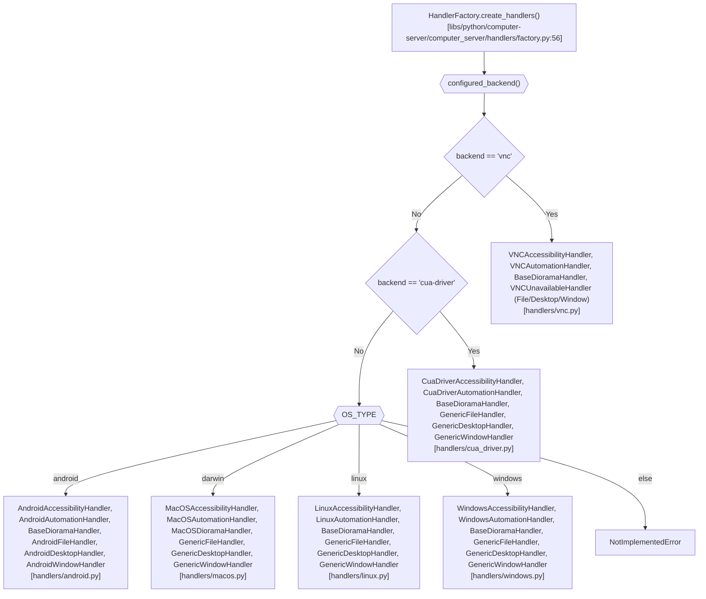
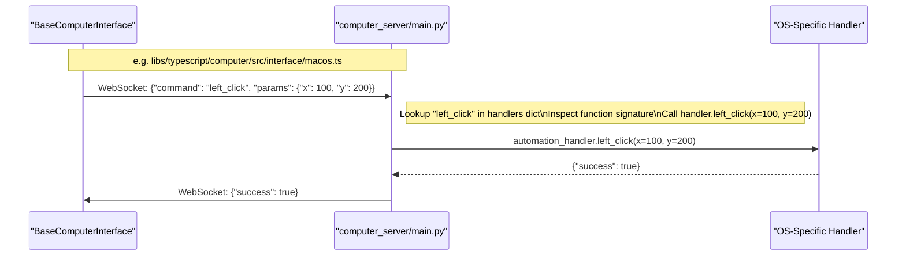

<!-- source: DeepWiki mcp.deepwiki.com · repo trycua/cua · page 8.1 Server Architecture · fetched 2026-10-29 -->

# Server Architecture

Relevant source files

The following files were used as context for generating this wiki page:

- [docs/content/docs/cua-sdk/reference/runtime-support.mdx](docs/content/docs/cua-sdk/reference/runtime-support.mdx)
- [libs/python/cua-sandbox/CHANGELOG.md](libs/python/cua-sandbox/CHANGELOG.md)
- [libs/python/cua-sandbox/README.md](libs/python/cua-sandbox/README.md)
- [libs/python/cua-sandbox/VERSION](libs/python/cua-sandbox/VERSION)
- [libs/python/cua-sandbox/cua_sandbox/__init__.py](libs/python/cua-sandbox/cua_sandbox/__init__.py)
- [libs/python/cua-sandbox/cua_sandbox/pool.py](libs/python/cua-sandbox/cua_sandbox/pool.py)
- [libs/python/cua-sandbox/cua_sandbox/sandbox.py](libs/python/cua-sandbox/cua_sandbox/sandbox.py)
- [libs/python/cua-sandbox/cua_sandbox/sync/__init__.py](libs/python/cua-sandbox/cua_sandbox/sync/__init__.py)
- [libs/python/cua-sandbox/cua_sandbox/transport/fleet.py](libs/python/cua-sandbox/cua_sandbox/transport/fleet.py)
- [libs/python/cua-sandbox/cua_sandbox/transport/fleet_cloud.py](libs/python/cua-sandbox/cua_sandbox/transport/fleet_cloud.py)
- [libs/python/cua-sandbox/pyproject.toml](libs/python/cua-sandbox/pyproject.toml)
- [libs/python/cua-sandbox/tests/test_fleet_cloud_client.py](libs/python/cua-sandbox/tests/test_fleet_cloud_client.py)
- [libs/python/cua-sandbox/tests/test_fleet_cloud_transport.py](libs/python/cua-sandbox/tests/test_fleet_cloud_transport.py)
- [libs/python/cua-sandbox/tests/test_fleet_sdk_distribution.py](libs/python/cua-sandbox/tests/test_fleet_sdk_distribution.py)
- [libs/python/cua-sandbox/tests/test_fleet_sdk_packaging.py](libs/python/cua-sandbox/tests/test_fleet_sdk_packaging.py)
- [libs/python/cua-sandbox/tests/test_fleet_transport.py](libs/python/cua-sandbox/tests/test_fleet_transport.py)
- [libs/python/cua-sandbox/tests/test_pool.py](libs/python/cua-sandbox/tests/test_pool.py)
- [libs/python/cua-sandbox/tests/test_sandbox_fleet_lifecycle.py](libs/python/cua-sandbox/tests/test_sandbox_fleet_lifecycle.py)
- [libs/python/cua-sandbox/tests/test_vm_cleanup.py](libs/python/cua-sandbox/tests/test_vm_cleanup.py)
- [libs/python/cua-sandbox/uv.lock](libs/python/cua-sandbox/uv.lock)

## Purpose and Scope

This document details the architecture of the **computer_server**, a FastAPI-based HTTP and WebSocket server designed to run inside virtual machines or containers. It provides a unified, low-level API for computer automation and control across multiple operating systems including macOS, Linux, Windows, and Android.

The server exposes interfaces enabling mouse and keyboard input, screen capture, clipboard access, window and desktop management, file operations, and accessibility inspection. This layer underpins the Computer SDKs by offering a rich backend accessible over WebSocket or HTTP.

Key architectural elements covered in this document include the FastAPI application setup, connection and authentication management, the handler factory which instantiates OS-specific handler classes, the diorama system for UI state representation, and how backend policy is applied.

---

## Architecture Overview

The server is architected as a layered system with a central FastAPI application that routes incoming WebSocket and HTTP requests to handler functions. Core managers—`ConnectionManager` and `AuthenticationManager`—manage WebSocket lifecycle and security. Handler instances encapsulate OS-specific implementations and are provided through a `HandlerFactory`.

**Computer Server Component Architecture**

```mermaid
graph TB
    subgraph "Client Layer"
        PyClient["BaseComputerInterface<br/>libs/python/computer/interface/base.py"]
        TsClient["BaseComputerInterface<br/>libs/typescript/computer/src/interface/base.ts"]
    end
    
    subgraph "FastAPI Application (main.py)"
        App["app = FastAPI()<br/>[libs/python/computer-server/computer_server/main.py:120]"]
        WSEndpoint["@app.websocket('/ws')<br/>websocket_endpoint()<br/>[libs/python/computer-server/computer_server/main.py:388]"]
        HTTPEndpoint["@app.post('/cmd')<br/>cmd_endpoint()<br/>[libs/python/computer-server/computer_server/main.py:510]"]
        MCPEndpoint["@app.mount('/mcp')<br/>_mcp_http_app<br/>[libs/python/computer-server/computer_server/main.py:99]"]
    end
    
    subgraph "Core Managers (main.py)"
        ConnMgr["manager = ConnectionManager()<br/>active_connections list<br/>[libs/python/computer-server/computer_server/main.py:367]"]
        AuthMgr["auth_manager = AuthenticationManager()<br/>sessions cache, _hash_credentials()<br/>[libs/python/computer-server/computer_server/main.py:368]"]
    end
    
    subgraph "Command Routing"
        HandlersDict["handlers: Dict[str, Callable]<br/>[libs/python/computer-server/computer_server/main.py:295-359]"]
    end
    
    subgraph "Handler Creation"
        Factory["HandlerFactory.create_handlers()<br/>[libs/python/computer-server/computer_server/handlers/factory.py:56]"]
    end
    
    subgraph "Handler Instances"
        AccessHandler["accessibility_handler<br/>get_accessibility_tree, find_element"]
        AutoHandler["automation_handler<br/>mouse, keyboard, screen, clipboard"]
        DioramaHandler["diorama_handler<br/>get_diorama_state"]
        FileHandler["file_handler<br/>read, write, list, delete"]
        DesktopHandler["desktop_handler<br/>get_desktop_environment"]
        WindowHandler["window_handler<br/>open, launch, activate"]
    end
    
    subgraph "OS-Specific Implementations"
        MacOS["macOS handlers:<br/>PyObjC, Quartz, AppKit<br/>[libs/python/computer-server/computer_server/handlers/macos.py]"]
        Linux["Linux handlers:<br/>pynput, PIL<br/>[libs/python/computer-server/computer_server/handlers/linux.py]"]
        Windows["Windows handlers:<br/>pynput, pywin32<br/>[libs/python/computer-server/computer_server/handlers/windows.py]"]
        Android["Android handlers:<br/>ADB, gRPC EmulatorController<br/>[libs/python/computer-server/computer_server/handlers/android.py]"]
        CuaDriver["Cua Driver handlers<br/>[libs/python/computer-server/computer_server/handlers/cua_driver.py]"]
        VNC["VNC handlers<br/>[libs/python/computer-server/computer_server/handlers/vnc.py]"]
        Generic["Generic handlers<br/>[libs/python/computer-server/computer_server/handlers/generic.py]"]
    end
    
    PyClient -->|"WebSocket/HTTP"| App
    TsClient -->|"WebSocket/HTTP"| App
    
    App --> WSEndpoint
    App --> HTTPEndpoint
    App --> MCPEndpoint
    
    WSEndpoint --> ConnMgr
    WSEndpoint --> AuthMgr
    HTTPEndpoint --> AuthMgr
    
    WSEndpoint --> HandlersDict
    HTTPEndpoint --> HandlersDict
    
    Factory --> AccessHandler
    Factory --> AutoHandler
    Factory --> DioramaHandler
    Factory --> FileHandler
    Factory --> DesktopHandler
    Factory --> WindowHandler
    
    HandlersDict --> AccessHandler
    HandlersDict --> AutoHandler
    HandlersDict --> DioramaHandler
    HandlersDict --> FileHandler
    HandlersDict --> DesktopHandler
    HandlersDict --> WindowHandler
    
    AccessHandler --> MacOS
    AccessHandler --> Linux
    AccessHandler --> Windows
    AccessHandler --> Android
    AccessHandler --> CuaDriver
    AccessHandler --> VNC
    AutoHandler --> MacOS
    AutoHandler --> Linux
    AutoHandler --> Windows
    AutoHandler --> Android
    AutoHandler --> CuaDriver
    AutoHandler --> VNC
    DioramaHandler --> MacOS
    DioramaHandler --> Generic
    FileHandler --> Android
    FileHandler --> Generic
    FileHandler --> VNC
    DesktopHandler --> Android
    DesktopHandler --> Generic
    DesktopHandler --> VNC
    WindowHandler --> Android
    WindowHandler --> Generic
    WindowHandler --> VNC
```

### Explanation

- **Client Layer:** The Python and TypeScript SDKs provide `BaseComputerInterface` implementations that communicate with the backend.
- **FastAPI Application:** Central entry point exposing WebSocket `/ws`, HTTP `/cmd`, and MCP server `/mcp` endpoints.
- **Core Managers:** `ConnectionManager` tracks WebSocket clients, `AuthenticationManager` validates tokens and authorizations.
- **Command Routing:** Incoming commands are dispatched via a handlers dictionary mapping command names to handler functions.
- **Handler Factory:** Instantiates OS-specific handler objects implementing defined interfaces.
- **Handler Instances:** Core handler types provide OS-agnostic facades backed by OS-specific implementations.
- **OS-Specific Implementations:** Platform-specific modules implement system-level actions using platform native APIs or libraries.

**Sources:** [libs/python/computer-server/computer_server/main.py:88-368](), [libs/python/computer-server/computer_server/handlers/factory.py:50-145](), [libs/python/computer/computer/interface/base.py:10-213](), [libs/typescript/computer/src/interface/base.ts:7-33]()

---

## FastAPI Application Structure

The server is implemented as a FastAPI app with modular endpoints and middleware to enforce backend policies.

### Core Components

| Component          | Type                 | Description                                              | Location                                                         |
|--------------------|----------------------|----------------------------------------------------------|-----------------------------------------------------------------|
| `app`              | `FastAPI`             | Main FastAPI application instance                        | [main.py:120]()                                                  |
| `handlers`         | `Dict[str, Callable]` | Command name to handler function mapping                 | [main.py:295-359]()                                              |
| `manager`          | `ConnectionManager`   | Manages WebSocket client connections                     | [main.py:367]()                                                  |
| `auth_manager`     | `AuthenticationManager` | Authenticates clients, caches validated sessions       | [main.py:368]()                                                  |
| `_mcp_http_app`    | `FastMCP` (optional)  | Mounted MCP server at `/mcp` for tool integration        | [main.py:99]()                                                   |

### Middleware Policy

`UnavailableWithoutContainerMiddleware` blocks all incoming requests unless a `CONTAINER_NAME` environment variable is set, if `UNAVAILABLE_WITHOUT_CONTAINER_NAME` is set in environment. This prevents unauthorized access in cloud deployments without a container context. The error status code (default `503`) can be configured via `UNAVAILABLE_STATUS_CODE` environment variable.

**Sources:** [libs/python/computer-server/computer_server/main.py:40-199]()

---

## Handler System

The server uses a **factory pattern** (`HandlerFactory`) to provide context-appropriate handler instances depending on environment configuration and OS type.

### Handler Factory Selection Logic

### Handler Types and Responsibilities

Each handler type implements a subset of the computer control domain, inheriting from abstract base classes designed to standardize their interface.

| Handler Type   | Base Class                  | Responsibilities                                               | Location                                                      |
|----------------|-----------------------------|----------------------------------------------|---------------------------------------------------------------|
| Accessibility  | `BaseAccessibilityHandler`  | UI tree inspection, element finding                         | [handlers/base.py:10-23]()                                    |
| Automation     | `BaseAutomationHandler`     | Mouse/keyboard input, screen capture, clipboard access       | [handlers/base.py:213-332]()                                  |
| Diorama        | `BaseDioramaHandler`        | Provides visual UI state for grounding and testability       | [diorama/base.py:1-5]()                                       |
| File           | `BaseFileHandler`           | File system read/write, directory listing, deletion          | [handlers/base.py:26-91]()                                    |
| Desktop        | `BaseDesktopHandler`        | Desktop environment info, wallpaper                            | [handlers/base.py:93-111]()                                   |
| Window         | `BaseWindowHandler`         | Application launching, window activates and management        | [handlers/base.py:113-187]()                                  |

The factory dynamically instantiates appropriate concrete handlers depending on OS detected and backend configuration.

**Sources:** [libs/python/computer-server/computer_server/handlers/factory.py:50-168](), [libs/python/computer-server/computer_server/handlers/base.py:1-332](), [libs/python/computer-server/computer_server/diorama/base.py:1-5]()

---

## Connection and Authentication Management

### ConnectionManager

- Tracks active WebSocket connections in `active_connections` list.
- Provides methods to add new connections and to `disconnect()` existing connections.
- Ensures clean resource handling on client disconnect.

### AuthenticationManager

Authentication is enforced differently depending on deployment mode:

- **Local Mode (no CONTAINER_NAME):** All connections are allowed without credential checks.
- **Cloud Mode:** Validates identity and authorization in two steps:
  1. Checks that the requested `container_name` in the auth handshake matches the server container environment.
  2. Validates the provided API key by querying the Cua Cloud API, ensuring permission to connect.
  
- Caches validation results in a session dictionary keyed by hashed credentials, with TTL of 60 seconds to optimize repeated validation requests.

This ensures that only authorized clients can connect to the server in production cloud deployments.

**Sources:** [libs/python/computer-server/computer_server/main.py:221-282]()

---

## Client-Server Interaction

Clients communicate with the server by sending JSON command objects over WebSocket or HTTP POST to control the computer environment.

### Command Dispatch Flow

- On receiving a command, the server looks up the corresponding handler function by command name from the `handlers` dictionary.
- Uses Python's `inspect` to analyze the handler's function signature to map parameters dynamically.
- If the handler function is synchronous, runs it within `asyncio.to_thread` to avoid blocking the event loop.
- Returns the JSON response back to the client over the same WebSocket or HTTP channel.

This architecture provides robust, low-latency, and extensible command handling for complex automation tasks.

**Sources:** 
- [libs/python/computer-server/computer_server/main.py:388-507]()
- [libs/python/computer/computer/interface/base.py:103-113]()
- [libs/typescript/computer/src/interface/macos.ts:39-41]()

---

# Summary

The **computer_server** combines a FastAPI-based network interface with dynamic handler factories and OS-specific code modules. It manages authentication carefully to provide secure access, while its command routing system efficiently dispatches client requests to low-level computer automation capabilities like input injection, screen capture, and UI introspection.

This unified server architecture enables cohesive cross-OS automation via the Cua platform's Python and TypeScript SDKs and underpins advanced computer-use agent workflows.

---

**Sources:**

- libs/python/computer-server/computer_server/main.py:40-601
- libs/python/computer-server/computer_server/handlers/factory.py:50-168
- libs/python/computer-server/computer_server/handlers/base.py:1-332
- libs/python/computer-server/computer_server/diorama/base.py:1-5
- libs/python/computer/computer/interface/base.py:10-213
- libs/typescript/computer/src/interface/base.ts:7-33
- libs/typescript/computer/src/interface/macos.ts:39-41

---

