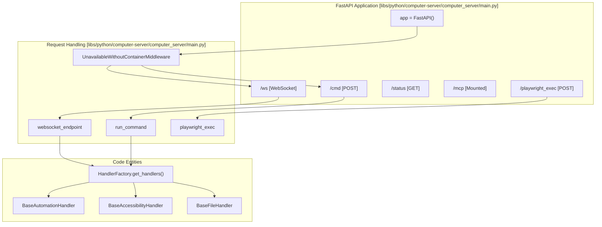
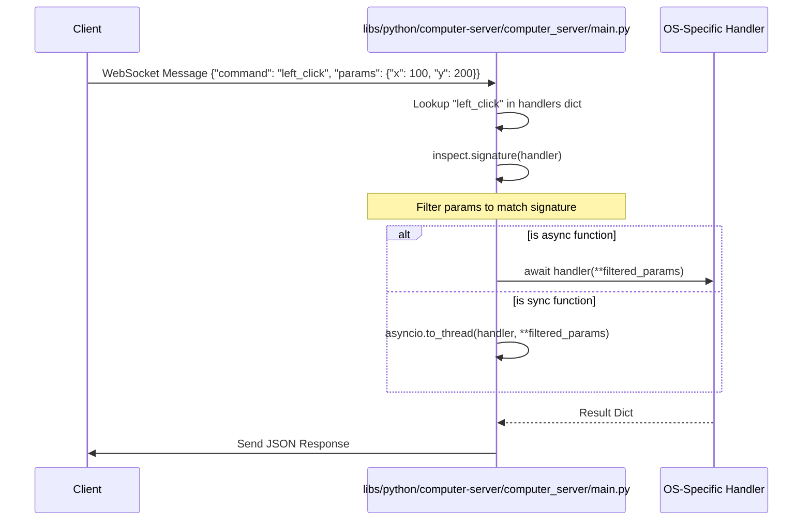

<!-- source: DeepWiki mcp.deepwiki.com · repo trycua/cua · page 8.2 FastAPI and WebSocket API · fetched 2026-10-29 -->

# FastAPI and WebSocket API

<details>
<summary>Relevant source files</summary>

The following files were used as context for generating this wiki page:

- [docs/content/docs/cua-sdk/reference/runtime-support.mdx](docs/content/docs/cua-sdk/reference/runtime-support.mdx)
- [libs/python/cua-sandbox/CHANGELOG.md](libs/python/cua-sandbox/CHANGELOG.md)
- [libs/python/cua-sandbox/README.md](libs/python/cua-sandbox/README.md)
- [libs/python/cua-sandbox/VERSION](libs/python/cua-sandbox/VERSION)
- [libs/python/cua-sandbox/cua_sandbox/__init__.py](libs/python/cua-sandbox/cua_sandbox/__init__.py)
- [libs/python/cua-sandbox/cua_sandbox/pool.py](libs/python/cua-sandbox/cua_sandbox/pool.py)
- [libs/python/cua-sandbox/cua_sandbox/sandbox.py](libs/python/cua-sandbox/cua_sandbox/sandbox.py)
- [libs/python/cua-sandbox/cua_sandbox/sync/__init__.py](libs/python/cua-sandbox/cua_sandbox/sync/__init__.py)
- [libs/python/cua-sandbox/cua_sandbox/transport/fleet.py](libs/python/cua-sandbox/cua_sandbox/transport/fleet.py)
- [libs/python/cua-sandbox/cua_sandbox/transport/fleet_cloud.py](libs/python/cua-sandbox/cua_sandbox/transport/fleet_cloud.py)
- [libs/python/cua-sandbox/pyproject.toml](libs/python/cua-sandbox/pyproject.toml)
- [libs/python/cua-sandbox/tests/test_fleet_cloud_client.py](libs/python/cua-sandbox/tests/test_fleet_cloud_client.py)
- [libs/python/cua-sandbox/tests/test_fleet_cloud_transport.py](libs/python/cua-sandbox/tests/test_fleet_cloud_transport.py)
- [libs/python/cua-sandbox/tests/test_fleet_sdk_distribution.py](libs/python/cua-sandbox/tests/test_fleet_sdk_distribution.py)
- [libs/python/cua-sandbox/tests/test_fleet_sdk_packaging.py](libs/python/cua-sandbox/tests/test_fleet_sdk_packaging.py)
- [libs/python/cua-sandbox/tests/test_fleet_transport.py](libs/python/cua-sandbox/tests/test_fleet_transport.py)
- [libs/python/cua-sandbox/tests/test_pool.py](libs/python/cua-sandbox/tests/test_pool.py)
- [libs/python/cua-sandbox/tests/test_sandbox_fleet_lifecycle.py](libs/python/cua-sandbox/tests/test_sandbox_fleet_lifecycle.py)
- [libs/python/cua-sandbox/tests/test_vm_cleanup.py](libs/python/cua-sandbox/tests/test_vm_cleanup.py)
- [libs/python/cua-sandbox/uv.lock](libs/python/cua-sandbox/uv.lock)

</details>


The Computer Server provides a high-performance interface for remote computer control, implemented using FastAPI. It exposes a WebSocket endpoint for real-time interaction, multiple HTTP endpoints for command execution and status monitoring, and a specialized proxy for agent execution. The server is designed to run inside various execution environments (VMs, containers, or host OS) and serves as the bridge between high-level agent logic and low-level OS primitives.

## API Architecture and Endpoints

The server architecture centers on a FastAPI application that routes requests to specialized handlers based on the underlying operating system.

Title: Computer Server Architecture and Request Routing


**Sources:** [libs/python/computer-server/computer_server/main.py:100-122](), [libs/python/computer-server/computer_server/main.py:125-153](), [libs/python/computer-server/computer_server/main.py:210-216](), [libs/python/computer-server/computer_server/handlers/factory.py:1-50]()

### Primary Endpoints

| Endpoint | Method | Description |
| :--- | :--- | :--- |
| `/ws` | `WebSocket` | Real-time bidirectional command interface. Supports 10MB message sizes [libs/python/computer-server/computer_server/main.py:85](). |
| `/cmd` | `POST` | Executes a single computer command via HTTP with streaming response [libs/python/computer-server/computer_server/main.py:367](). |
| `/status` | `GET` | Returns server health, OS type, and protocol version [libs/python/computer-server/computer_server/main.py:246](). |
| `/playwright_exec` | `POST` | Executes arbitrary Playwright code within the server's browser context [libs/python/computer-server/computer_server/main.py:284](). |
| `/mcp` | `SSE/HTTP` | Mounted Model Context Protocol (MCP) server for integration with tools like Claude Code [libs/python/computer-server/computer_server/main.py:91-95](). |

**Sources:** [libs/python/computer-server/computer_server/main.py:84-122](), [libs/python/computer-server/computer_server/main.py:192-193](), [libs/python/computer-server/README.md:9-14]()

## WebSocket API Reference (`/ws`)

The WebSocket interface is the preferred method for low-latency automation. It handles persistent connections and provides a structured command/response loop.

### Connection and Lifecycle
Upon connection, the server enters a loop where it waits for JSON messages. Each message must contain a `command` and an optional `params` dictionary [libs/python/computer-server/computer_server/main.py:318-326]().

### Command Dispatch Logic
The server uses a dynamic dispatch mechanism that inspects handler function signatures to filter parameters.

Title: WebSocket Command Execution Flow


**Sources:** [libs/python/computer-server/computer_server/main.py:314-344](), [libs/python/computer-server/computer_server/main.py:428-438]()

## Message Format

### Request Format
All requests to `/ws` and `/cmd` follow this JSON structure:
```json
{
  "command": "string",
  "params": {
    "key": "value"
  }
}
```

### Response Format
Responses include a success flag and the data returned by the handler:
```json
{
  "success": true,
  "result": {},
  "error": "Optional error message"
}
```

**Sources:** [libs/python/computer-server/computer_server/main.py:321-326](), [libs/python/computer-server/computer_server/main.py:339-344]()

## Specialized Handlers and Commands

The server maps high-level commands to methods on OS-specific classes (e.g., `MacOSAutomationHandler`, `WindowsAutomationHandler`, `AndroidAutomationHandler`).

### Automation Commands (Mouse/Keyboard)
- `mouse_down`, `mouse_up`, `move_cursor`: Low-level cursor control.
- `left_click`, `right_click`, `double_click`: Higher-level click interactions.
- `type_text`, `press_key`, `hotkey`: Keyboard input primitives.
- `screenshot`: Captures the screen. On macOS, this uses `ImageGrab.grab()` [libs/python/computer-server/computer_server/handlers/macos.py:83-86](). On Android, it uses `adb` commands or the gRPC `EmulatorController` [libs/python/computer-server/computer_server/handlers/android.py:14]().

### Accessibility Commands
- `get_accessibility_tree`: Returns a hierarchical view of UI elements. On macOS, this leverages `AXUIElement` APIs [libs/python/computer-server/computer_server/handlers/macos.py:17-44](). On Windows, it enumerates child windows using `win32gui` [libs/python/computer-server/computer_server/handlers/windows.py:106-137](). On Android, it dumps XML via `uiautomator` [libs/python/computer-server/computer_server/handlers/android.py:66-75]().
- `find_element`: Searches the UI tree based on `role`, `title`, or `value`.

### `cua-driver` Handler
The `CuaDriverAutomationHandler` [libs/python/computer-server/computer_server/handlers/cua_driver.py:101-108]() and `CuaDriverAccessibilityHandler` [libs/python/computer-server/computer_server/handlers/cua_driver.py:30-32]() provide compatibility with the `cua-driver` SDK. This handler translates the legacy automation API calls to the generated typed `cua-driver` Python SDK. It supports two modes: `embedded` (default) where `computer-server` directly creates an in-process `cua-driver` instance, and `daemon` where it connects to an external `cua-driver` daemon via a socket [libs/python/computer-server/computer_server/handlers/cua_driver.py:121-134]().

The `CuaDriverAutomationHandler` manages a session with `cua-driver`, ensuring it's started and escalated if necessary [libs/python/computer-server/computer_server/handlers/cua_driver.py:184-200](). It implements various automation actions like `move_cursor`, `click`, `drag`, `scroll`, `type_text`, `press_key`, and `hotkey` by calling the corresponding methods on the `_driver` instance [libs/python/computer-server/computer_server/handlers/cua_driver.py:400-600]().

The `CuaDriverAccessibilityHandler` explicitly marks accessibility queries as unsupported, as the `cua-driver` contract does not expose them [libs/python/computer-server/computer_server/handlers/cua_driver.py:33-39]().

Title: `CuaDriverAutomationHandler` Interaction with `cua-driver` SDK
```mermaid
graph TD
    A[Computer Server] --> B{CuaDriverAutomationHandler}
    B --> C[cua_driver SDK]
    C --> D[cua-driver (embedded or daemon)]

    subgraph "CuaDriverAutomationHandler [libs/python/computer-server/computer_server/handlers/cua_driver.py]"
        B_init["__init__(...)"]
        B_ensure_session["_ensure_session()"]
        B_move_cursor["move_cursor(...)"]
        B_click["click(...)"]
        B_type_text["type_text(...)"]
    end

    subgraph "cua_driver SDK (mocked in tests) [libs/python/computer-server/tests/test_cua_driver_handler.py]"
        C_CuaDriver["CuaDriver.create() / .connect()"]
        C_StartSessionInput["StartSessionInput"]
        C_CallTool["call_tool(name, args_json)"]
        C_Result["_Result"]
    end

    subgraph "cua-driver (Rust binary)"
        D_start_session["start_session"]
        D_call_tool["call_tool"]
        D_move_cursor["move_cursor"]
        D_click["click"]
        D_type_text["type_text"]
    end

    A -- "Instantiates" --> B_init
    B_init -- "Loads SDK" --> C_CuaDriver
    B_init -- "Creates/Connects Driver" --> D

    B_move_cursor -- "Calls" --> C_CallTool
    C_CallTool -- "Invokes" --> D_move_cursor
    D_move_cursor -- "Returns" --> C_Result
    C_Result -- "Processed by" --> B_move_cursor

    B_ensure_session -- "Calls" --> C_StartSessionInput
    C_StartSessionInput -- "Invokes" --> D_start_session

    style B fill:#f9f,stroke:#333,stroke-width:2px
    style C fill:#ccf,stroke:#333,stroke-width:2px
    style D fill:#cfc,stroke:#333,stroke-width:2px
```

**Sources:** [libs/python/computer-server/computer_server/handlers/macos.py:13-50](), [libs/python/computer-server/computer_server/handlers/windows.py:73-144](), [libs/python/computer-server/computer_server/handlers/android.py:63-137](), [libs/python/computer-server/computer_server/handlers/linux.py:38-80](), [libs/python/computer-server/computer_server/handlers/cua_driver.py:101-108](), [libs/python/computer-server/computer_server/handlers/cua_driver.py:30-32](), [libs/python/computer-server/computer_server/handlers/cua_driver.py:121-134](), [libs/python/computer-server/computer_server/handlers/cua_driver.py:184-200](), [libs/python/computer-server/computer_server/handlers/cua_driver.py:400-600](), [libs/python/computer-server/computer_server/handlers/cua_driver.py:33-39](), [libs/python/computer-server/tests/test_cua_driver_handler.py:1-224]()

## Playwright Execution API (`/playwright_exec`)

This endpoint allows clients to execute arbitrary Python code that interacts with a managed browser instance. This is useful for complex web automation that goes beyond simple computer-use clicks.

- **Implementation**: Uses `get_browser_manager()` to obtain a singleton `BrowserManager` [libs/python/computer-server/computer_server/main.py:29]().
- **Data Flow**: The client sends a `code` string. The server executes this code in an environment where `page`, `browser`, and `context` variables are pre-defined [libs/python/computer-server/computer_server/main.py:284-307]().
- **Output**: Captures `stdout` and `stderr` and returns them to the client [libs/python/computer-server/computer_server/main.py:302-307]().

**Sources:** [libs/python/computer-server/computer_server/main.py:284-307]()

## Error Handling and Validation

### Middleware Rejection
The `UnavailableWithoutContainerMiddleware` protects the server in cloud environments. If `UNAVAILABLE_WITHOUT_CONTAINER_NAME` is enabled and `CONTAINER_NAME` is missing, the server rejects requests with a `503 Service Unavailable` status [libs/python/computer-server/computer_server/main.py:125-153]().

### WebSocket Errors
If a command fails, the server catches the exception, logs the traceback, and returns a JSON response with `success: false` and the error details [libs/python/computer-server/computer_server/main.py:339-344]().

### Resolution Scaling
The server supports coordinate scaling via CLI flags `--width` and `--height`. This ensures that screenshots are resized and click coordinates are scaled between the target resolution seen by the AI and the actual screen resolution [libs/python/computer-server/computer_server/cli.py:17-26](), [libs/python/computer-server/README.md:80-88]().

**Sources:** [libs/python/computer-server/computer_server/main.py:125-153](), [libs/python/computer-server/computer_server/cli.py:17-26](), [libs/python/computer-server/README.md:80-88]()

---

