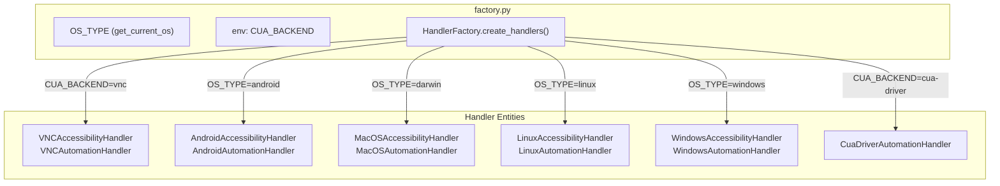

<!-- source: DeepWiki mcp.deepwiki.com · repo trycua/cua · page 8.3 OS-Specific Handlers · fetched 2026-10-29 -->

# OS-Specific Handlers

Relevant source files

The following files were used as context for generating this wiki page:

- [docs/content/docs/cua-sdk/reference/runtime-support.mdx](docs/content/docs/cua-sdk/reference/runtime-support.mdx)
- [libs/python/cua-sandbox/CHANGELOG.md](libs/python/cua-sandbox/CHANGELOG.md)
- [libs/python/cua-sandbox/README.md](libs/python/cua-sandbox/README.md)
- [libs/python/cua-sandbox/VERSION](libs/python/cua-sandbox/VERSION)
- [libs/python/cua-sandbox/cua_sandbox/__init__.py](libs/python/cua-sandbox/cua_sandbox/__init__.py)
- [libs/python/cua-sandbox/cua_sandbox/pool.py](libs/python/cua-sandbox/cua_sandbox/pool.py)
- [libs/python/cua-sandbox/cua_sandbox/sandbox.py](libs/python/cua-sandbox/cua_sandbox/sandbox.py)
- [libs/python/cua-sandbox/cua_sandbox/sync/__init__.py](libs/python/cua-sandbox/cua_sandbox/sync/__init__.py)
- [libs/python/cua-sandbox/cua_sandbox/transport/fleet.py](libs/python/cua-sandbox/cua_sandbox/transport/fleet.py)
- [libs/python/cua-sandbox/cua_sandbox/transport/fleet_cloud.py](libs/python/cua-sandbox/cua_sandbox/transport/fleet_cloud.py)
- [libs/python/cua-sandbox/pyproject.toml](libs/python/cua-sandbox/pyproject.toml)
- [libs/python/cua-sandbox/tests/test_fleet_cloud_client.py](libs/python/cua-sandbox/tests/test_fleet_cloud_client.py)
- [libs/python/cua-sandbox/tests/test_fleet_cloud_transport.py](libs/python/cua-sandbox/tests/test_fleet_cloud_transport.py)
- [libs/python/cua-sandbox/tests/test_fleet_sdk_distribution.py](libs/python/cua-sandbox/tests/test_fleet_sdk_distribution.py)
- [libs/python/cua-sandbox/tests/test_fleet_sdk_packaging.py](libs/python/cua-sandbox/tests/test_fleet_sdk_packaging.py)
- [libs/python/cua-sandbox/tests/test_fleet_transport.py](libs/python/cua-sandbox/tests/test_fleet_transport.py)
- [libs/python/cua-sandbox/tests/test_pool.py](libs/python/cua-sandbox/tests/test_pool.py)
- [libs/python/cua-sandbox/tests/test_sandbox_fleet_lifecycle.py](libs/python/cua-sandbox/tests/test_sandbox_fleet_lifecycle.py)
- [libs/python/cua-sandbox/tests/test_vm_cleanup.py](libs/python/cua-sandbox/tests/test_vm_cleanup.py)
- [libs/python/cua-sandbox/uv.lock](libs/python/cua-sandbox/uv.lock)
- [libs/qemu-docker/windows/Dockerfile](libs/qemu-docker/windows/Dockerfile)
- [libs/qemu-docker/windows/README.md](libs/qemu-docker/windows/README.md)
- [libs/qemu-docker/windows/src/entry.sh](libs/qemu-docker/windows/src/entry.sh)
- [libs/qemu-docker/windows/src/vm/setup/install.bat](libs/qemu-docker/windows/src/vm/setup/install.bat)
- [libs/qemu-docker/windows/src/vm/setup/on-logon.ps1](libs/qemu-docker/windows/src/vm/setup/on-logon.ps1)
- [libs/qemu-docker/windows/src/vm/setup/setup-utils.psm1](libs/qemu-docker/windows/src/vm/setup/setup-utils.psm1)
- [libs/qemu-docker/windows/src/vm/setup/setup.ps1](libs/qemu-docker/windows/src/vm/setup/setup.ps1)
- [libs/qemu-docker/windows/src/vm/setup/tools_config.json](libs/qemu-docker/windows/src/vm/setup/tools_config.json)

## Purpose and Scope

OS-specific handlers provide the low-level automation interface for mouse, keyboard, screen, clipboard, file system, and accessibility operations on Windows, macOS, Linux, and Android. These handlers are instantiated by the `HandlerFactory` [libs/python/computer-server/computer_server/handlers/factory.py:56-66]() based on the detected operating system and exposed through the Computer Server's command dispatch system. Each platform requires specific native APIs, libraries, or protocols (like ADB for Android) to perform equivalent operations.

---

## Handler Architecture Overview

The handler system uses an abstract base class pattern where platform-independent interfaces are defined in base classes and OS-specific implementations override these methods with platform-native code.

**Diagram: Handler Class Hierarchy and Factory Pattern**

```mermaid
graph TB
    subgraph "Base Abstract Classes"
        BaseAccessibility["BaseAccessibilityHandler<br/>base.py:10"]
        BaseAutomation["BaseAutomationHandler<br/>base.py:213"]
        BaseFile["BaseFileHandler<br/>base.py:26"]
        BaseWindow["BaseWindowHandler<br/>base.py:113"]
        BaseDesktop["BaseDesktopHandler<br/>base.py:93"]
    end
    
    subgraph "Windows Implementation"
        WinAccessibility["WindowsAccessibilityHandler<br/>windows.py:73"]
        WinAutomation["WindowsAutomationHandler<br/>windows.py:255"]
    end
    
    subgraph "macOS Implementation"
        MacAccessibility["MacOSAccessibilityHandler<br/>macos.py:680"]
        MacAutomation["MacOSAutomationHandler<br/>macos.py:927"]
    end
    
    subgraph "Linux Implementation"
        LinuxAccessibility["LinuxAccessibilityHandler<br/>linux.py:38"]
        LinuxAutomation["LinuxAutomationHandler<br/>linux.py:117"]
    end

    subgraph "Android Implementation"
        AndroidAccessibility["AndroidAccessibilityHandler<br/>android.py:63"]
        AndroidAutomation["AndroidAutomationHandler<br/>android.py:192"]
    end
    
    subgraph "Factory & Integration"
        HandlerFactory["HandlerFactory.create_handlers()<br/>factory.py:56"]
        MainHandlers["Handler Initialization<br/>main.py:111"]
    end
    
    BaseAccessibility --> WinAccessibility
    BaseAccessibility --> MacAccessibility
    BaseAccessibility --> LinuxAccessibility
    BaseAccessibility --> AndroidAccessibility
    
    BaseAutomation --> WinAutomation
    BaseAutomation --> MacAutomation
    BaseAutomation --> LinuxAutomation
    BaseAutomation --> AndroidAutomation
    
    HandlerFactory --> WinAccessibility
    HandlerFactory --> MacAccessibility
    HandlerFactory --> LinuxAccessibility
    HandlerFactory --> AndroidAccessibility
```

Sources: [libs/python/computer-server/computer_server/handlers/base.py:10-212](), [libs/python/computer-server/computer_server/handlers/factory.py:56-145](), [libs/python/computer-server/computer_server/main.py:111-112]()

---

## Base Handler Classes

The system defines several abstract base classes that establish the contract for all OS-specific implementations:

### BaseAccessibilityHandler
Defines methods for querying the OS accessibility tree. [libs/python/computer-server/computer_server/handlers/base.py:10-24]()
*   `get_accessibility_tree()`: Extract the full accessibility hierarchy. [libs/python/computer-server/computer_server/handlers/base.py:14-16]()
*   `find_element(role, title, value)`: Search for a specific UI element. [libs/python/computer-server/computer_server/handlers/base.py:19-23]()

### BaseAutomationHandler
Defines methods for controlling mouse, keyboard, screen, and clipboard. [libs/python/computer-server/computer_server/handlers/base.py:213-286]()
*   **Mouse**: `mouse_down`, `mouse_up`, `left_click`, `right_click`, `double_click`, `move_cursor`, `drag_to`, `drag`. [libs/python/computer-server/computer_server/handlers/base.py:66-188]()
*   **Keyboard**: `key_down`, `key_up`, `type_text`, `press_key`, `hotkey`. [libs/python/computer-server/computer_server/handlers/base.py:191-240]()
*   **Screen**: `screenshot`, `get_screen_size`, `get_cursor_position`. [libs/python/computer-server/computer_server/handlers/base.py:277-283]()

### BaseFileHandler & BaseWindowHandler
*   `BaseFileHandler`: Methods for file/directory CRUD operations including `read_text`, `write_text`, and binary operations. [libs/python/computer-server/computer_server/handlers/base.py:26-91]()
*   `BaseWindowHandler`: Methods for window management such as `open`, `launch`, `maximize`, `minimize`, and `set_window_size`. [libs/python/computer-server/computer_server/handlers/base.py:113-187]()

Sources: [libs/python/computer-server/computer_server/handlers/base.py:10-286]()

---

## macOS Handler Implementation (PyObjC)

The macOS implementation leverages Apple's native frameworks via PyObjC. [libs/python/computer-server/computer_server/handlers/macos.py:13-50]()

**Key Implementation Details:**
*   **Cursor Warp**: Replaces `pynput` default position setter with `_CGWarpPosition` using `CGWarpMouseCursorPosition` to support macOS VMs running under `Virtualization.framework` (Tart/Lume) where standard events often fail. [libs/python/computer-server/computer_server/handlers/macos.py:96-114]()
*   **Accessibility**: Uses `AXUIElement` APIs (`AXUIElementCopyAttributeValue`, `AXUIElementCreateSystemWide`, etc.) to build deep trees. [libs/python/computer-server/computer_server/handlers/macos.py:17-44]()
*   **Automation**: Uses `Quartz.CoreGraphics` for event posting and `AppKit` for workspace and window management. [libs/python/computer-server/computer_server/handlers/macos.py:49-50]()
*   **Diorama Integration**: The `Diorama` class provides a virtual desktop manager for macOS, allowing automation of specific apps by taking focus before actions. [libs/python/computer-server/computer_server/diorama/diorama.py:28-34]()

Sources: [libs/python/computer-server/computer_server/handlers/macos.py:1-114](), [libs/python/computer-server/computer_server/diorama/diorama.py:28-111]()

---

## Windows Handler Implementation (pywin32)

The Windows implementation uses `pynput` for automation and `pywin32` for system introspection. [libs/python/computer-server/computer_server/handlers/windows.py:53-64]()

**Key Implementation Details:**
*   **Security Check**: Includes a `require_unlocked_desktop` decorator to prevent automation failures on the Windows Secure Desktop (locked screen) where OS security blocks input. [libs/python/computer-server/computer_server/handlers/windows.py:20-38]()
*   **Accessibility**: Uses `win32gui.EnumChildWindows` to build a hierarchy of window information including class names and titles. [libs/python/computer-server/computer_server/handlers/windows.py:107-137]()
*   **Automation**: Relies on `pynput.keyboard.Controller` and `pynput.mouse.Controller` for input and `PIL.ImageGrab` for screenshots. [libs/python/computer-server/computer_server/handlers/windows.py:41-45]()

Sources: [libs/python/computer-server/computer_server/handlers/windows.py:20-137]()

---

## Linux Handler Implementation (python-xlib)

The Linux implementation targets X11 environments (often via `Xvfb` in sandboxes). [libs/python/computer-server/computer_server/handlers/linux.py:1-9]()

**Key Implementation Details:**
*   **Headless Support**: Designed to run with `xvfb-run` for headless automation in CI or containerized environments. [libs/python/computer-server/computer_server/linux.py:6-9]()
*   **Accessibility**: Linux currently uses a **simulated** accessibility tree returning a minimal dummy structure as there is no unified accessibility API equivalent to macOS AX in the current server scope. [libs/python/computer-server/computer_server/handlers/linux.py:41-62]()
*   **Automation**: Uses `pynput` for input and `ImageGrab` (which works with X11/Xvfb) for screenshots and screen size detection. [libs/python/computer-server/computer_server/handlers/linux.py:101-115]()

Sources: [libs/python/computer-server/computer_server/handlers/linux.py:1-115]()

---

## Android Handler Implementation (ADB/gRPC)

The Android handler is unique as it controls a remote or emulated device via ADB and gRPC. [libs/python/computer-server/computer_server/handlers/android.py:39-60]()

**Key Implementation Details:**
*   **Transport**: Uses `CommandExecutor` to run `adb` shell commands and a gRPC `EmulatorControllerStub` for high-performance interaction with emulators. [libs/python/computer-server/computer_server/handlers/android.py:39-60]()
*   **Accessibility**: Parses XML output from `uiautomator dump` into the standard format by recursively parsing XML nodes. [libs/python/computer-server/computer_server/handlers/android.py:66-137]()
*   **Key Mapping**: Maps common key names (e.g., "enter", "back", "home") to Android keycodes via `ANDROID_KEY_MAP`. [libs/python/computer-server/computer_server/handlers/android.py:21-36]()

Sources: [libs/python/computer-server/computer_server/handlers/android.py:21-137]()

---

## Cross-Platform Integration

### Generic Handlers
The `GenericDesktopHandler` and `GenericWindowHandler` provide fallback logic using cross-platform libraries like `pywinctl`, `webbrowser`, and `subprocess`. [libs/python/computer-server/computer_server/handlers/generic.py:42-109]()
*   `GenericWindowHandler.open()`: Uses `webbrowser.open` for URLs and OS-specific commands (`open` on macOS, `xdg-open` on Linux, `os.startfile` on Windows) for local files. [libs/python/computer-server/computer_server/handlers/generic.py:90-107]()
*   `GenericWindowHandler`: Uses `pywinctl` to provide window management (getting handles, titles, positions) across platforms. [libs/python/computer-server/computer_server/handlers/generic.py:120-187]()

### Handler Selection Logic
The `HandlerFactory` selects handlers based on the `OS_TYPE` and the `CUA_BACKEND` environment variable. [libs/python/computer-server/computer_server/handlers/factory.py:67-145]()

**Diagram: Code Entity Space - Handler Selection**

Sources: [libs/python/computer-server/computer_server/handlers/factory.py:19-145]()

---

