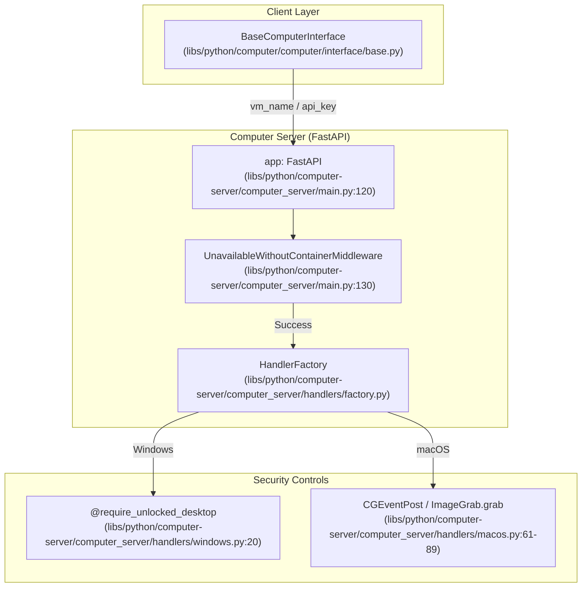
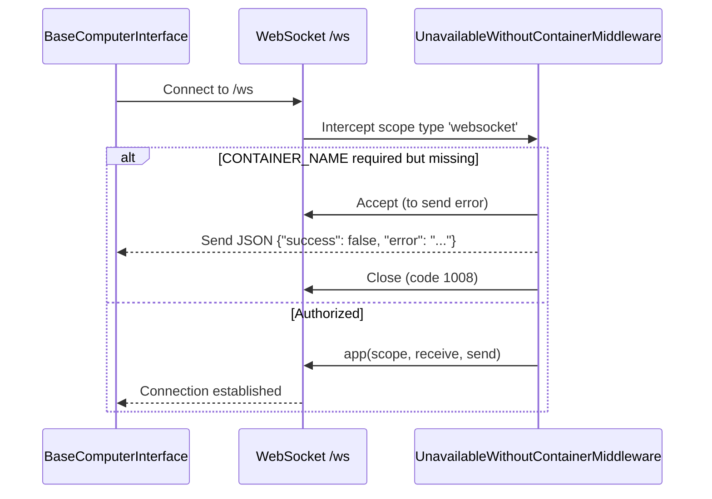

<!-- source: DeepWiki mcp.deepwiki.com · repo trycua/cua · page 8.4 Authentication and Security · fetched 2026-10-29 -->

# Authentication and Security

Relevant source files

The following files were used as context for generating this wiki page:

- [docs/content/docs/cua-sdk/reference/runtime-support.mdx](docs/content/docs/cua-sdk/reference/runtime-support.mdx)
- [libs/python/cua-sandbox/CHANGELOG.md](libs/python/cua-sandbox/CHANGELOG.md)
- [libs/python/cua-sandbox/README.md](libs/python/cua-sandbox/README.md)
- [libs/python/cua-sandbox/VERSION](libs/python/cua-sandbox/VERSION)
- [libs/python/cua-sandbox/cua_sandbox/__init__.py](libs/python/cua-sandbox/cua_sandbox/__init__.py)
- [libs/python/cua-sandbox/cua_sandbox/pool.py](libs/python/cua-sandbox/cua_sandbox/pool.py)
- [libs/python/cua-sandbox/cua_sandbox/sandbox.py](libs/python/cua-sandbox/cua_sandbox/sandbox.py)
- [libs/python/cua-sandbox/cua_sandbox/sync/__init__.py](libs/python/cua-sandbox/cua_sandbox/sync/__init__.py)
- [libs/python/cua-sandbox/cua_sandbox/transport/fleet.py](libs/python/cua-sandbox/cua_sandbox/transport/fleet.py)
- [libs/python/cua-sandbox/cua_sandbox/transport/fleet_cloud.py](libs/python/cua-sandbox/cua_sandbox/transport/fleet_cloud.py)
- [libs/python/cua-sandbox/pyproject.toml](libs/python/cua-sandbox/pyproject.toml)
- [libs/python/cua-sandbox/tests/test_fleet_cloud_client.py](libs/python/cua-sandbox/tests/test_fleet_cloud_client.py)
- [libs/python/cua-sandbox/tests/test_fleet_cloud_transport.py](libs/python/cua-sandbox/tests/test_fleet_cloud_transport.py)
- [libs/python/cua-sandbox/tests/test_fleet_sdk_distribution.py](libs/python/cua-sandbox/tests/test_fleet_sdk_distribution.py)
- [libs/python/cua-sandbox/tests/test_fleet_sdk_packaging.py](libs/python/cua-sandbox/tests/test_fleet_sdk_packaging.py)
- [libs/python/cua-sandbox/tests/test_fleet_transport.py](libs/python/cua-sandbox/tests/test_fleet_transport.py)
- [libs/python/cua-sandbox/tests/test_pool.py](libs/python/cua-sandbox/tests/test_pool.py)
- [libs/python/cua-sandbox/tests/test_sandbox_fleet_lifecycle.py](libs/python/cua-sandbox/tests/test_sandbox_fleet_lifecycle.py)
- [libs/python/cua-sandbox/tests/test_vm_cleanup.py](libs/python/cua-sandbox/tests/test_vm_cleanup.py)
- [libs/python/cua-sandbox/uv.lock](libs/python/cua-sandbox/uv.lock)

This document describes the authentication and security mechanisms used by the Computer Server to protect access to VM control APIs. It covers the two-layer authentication model, middleware-based rejection logic, and OS-specific security constraints for Windows, macOS, and Android.

For information about the Computer Server architecture and API endpoints, see [libs/python/computer-server/computer_server/main.py]() and [libs/python/computer-server/computer_server/handlers/factory.py](). For OS-specific handler implementations, see [libs/python/computer-server/computer_server/handlers/macos.py](), [libs/python/computer-server/computer_server/handlers/windows.py](), and [libs/python/computer-server/computer_server/handlers/android.py]().

## Overview

The Computer Server implements a flexible authentication system that adapts to different deployment environments:

- **Local Development Mode**: No authentication required when the `CONTAINER_NAME` environment variable is not set [libs/python/computer-server/computer_server/main.py:58-61]().
- **Cloud Mode**: Authentication is enforced based on VM identity and API key validation. The server uses the presence of `CONTAINER_NAME` to determine if it is running in a managed environment [libs/python/computer-server/computer_server/main.py:58-59]().
- **Service Availability Enforcement**: The server can be configured via `UNAVAILABLE_WITHOUT_CONTAINER_NAME` to reject all requests if a container name is required but missing, preventing accidental exposure in local dev mode when cloud-like behavior is expected [libs/python/computer-server/computer_server/main.py:125-136]().
- **Transport Security**: Clients automatically select secure protocols (`wss`/`https`) when an API key is provided for Cloud Providers.
- **OS-Level Security Gatekeeping**: Handlers for Windows and macOS include specific checks for desktop lock states and TCC permissions [libs/python/computer-server/computer_server/handlers/windows.py:20-38](), [libs/python/computer-server/computer_server/handlers/macos.py:61-89]().

## Authentication Architecture

The following diagram bridges the natural language concepts of "Cloud Auth" to the specific code entities in the `computer-server` and `computer` SDKs.

Title: Authentication and Security Entity Mapping

**Sources:** [libs/python/computer-server/computer_server/main.py:120-199](), [libs/python/computer-server/computer_server/handlers/factory.py:50-155](), [libs/python/computer-server/computer_server/handlers/windows.py:20-38](), [libs/python/computer-server/computer_server/handlers/macos.py:61-89]()

## Two-Layer Authentication Model

The authentication system verifies both VM identity and API key ownership when operating in cloud mode:

| Layer | Check | Implementation |
|-------|-------|----------------|
| **Layer 1** | VM Identity | Verification of the client's provided container name against the server's `CONTAINER_NAME` environment variable [libs/python/computer-server/computer_server/main.py:58-61](). |
| **Layer 2** | API Key | Verification of the `api_key` provided by the client, stored in the interface configuration [libs/python/computer/computer/interface/base.py:18-34](). |

### VM Identity Verification
The server checks the `CONTAINER_NAME` environment variable. If it is required but unset, the `UnavailableWithoutContainerMiddleware` rejects the request with a `503 Service Unavailable` or WebSocket policy violation code [libs/python/computer-server/computer_server/main.py:125-194]().

### API Key Validation
`BaseComputerInterface` stores the `api_key` in its constructor [libs/python/computer/computer/interface/base.py:33](). This key is used by subclasses to authenticate requests to the remote computer-server instance.

**Sources:** [libs/python/computer-server/computer_server/main.py:49-76](), [libs/python/computer/computer/interface/base.py:10-35]()

## WebSocket Authentication Flow

Title: WebSocket Rejection and Acceptance Flow

**Server-Side Implementation**:
The `UnavailableWithoutContainerMiddleware` intercepts `http` and `websocket` scopes [libs/python/computer-server/computer_server/main.py:143-154](). For WebSockets, it accepts the connection first to send a structured JSON error message before closing with code `1008` (Policy Violation) to ensure clients receive a descriptive error rather than a silent drop [libs/python/computer-server/computer_server/main.py:171-191]().

**Client-Side Implementation**:
`BaseComputerInterface` in Python [libs/python/computer/computer/interface/base.py:10-35]() and TypeScript [libs/typescript/computer/src/interface/macos.ts:9-215]() store the `api_key` and `vm_name` (or `container_name`) used for establishing these authenticated connections.

**Sources:** [libs/python/computer-server/computer_server/main.py:125-194](), [libs/python/computer/computer/interface/base.py:10-35]()

## Availability Middleware

The `UnavailableWithoutContainerMiddleware` is an ASGI middleware that proactively rejects requests if the server is intended for cloud use but misconfigured [libs/python/computer-server/computer_server/main.py:125-136]().

- **Trigger**: Enabled via `UNAVAILABLE_WITHOUT_CONTAINER_NAME=1` or `true` [libs/python/computer-server/computer_server/main.py:49-50, 60-61]().
- **Rejection Logic**: If `CONTAINER_NAME` is missing, it returns a status code configured by `UNAVAILABLE_WITHOUT_CONTAINER_NAME_RESPONSE_STATUS_CODE` (default 503) [libs/python/computer-server/computer_server/main.py:62-71]().
- **WebSocket Handling**: It sends a JSON payload with `success: False` and the error detail `Service unavailable: CONTAINER_NAME is required but not configured` before closing the socket [libs/python/computer-server/computer_server/main.py:138, 178-191]().

**Sources:** [libs/python/computer-server/computer_server/main.py:49-76](), [libs/python/computer-server/computer_server/main.py:125-194]()

## OS-Specific Security Considerations

### Windows Desktop Locking
The Windows implementation includes a `require_unlocked_desktop` decorator [libs/python/computer-server/computer_server/handlers/windows.py:20-38](). This prevents automation actions from executing if the desktop is locked, as Windows security blocks input on the Secure Desktop [libs/python/computer-server/computer_server/handlers/windows.py:31-35]().

### macOS Permissions
The macOS handler attempts to trigger system accessibility and screen recording permission prompts upon initialization [libs/python/computer-server/computer_server/handlers/macos.py:61-89](). It uses `CGEventPost` to trigger an accessibility prompt and `ImageGrab.grab()` to trigger a screen recording prompt [libs/python/computer-server/computer_server/handlers/macos.py:74-86]().

### Android gRPC Security
The Android handler communicates with the emulator via gRPC on a port defined by `ANDROID_GRPC_PORT` (default 8554) [libs/python/computer-server/computer_server/handlers/android.py:42](). It uses an insecure channel for local communication with the emulator stub [libs/python/computer-server/computer_server/handlers/android.py:52-59]().

**Sources:** [libs/python/computer-server/computer_server/handlers/windows.py:20-38](), [libs/python/computer-server/computer_server/handlers/macos.py:61-89](), [libs/python/computer-server/computer_server/handlers/android.py:41-60]()

## Security Configuration Summary

| Variable | Default | Description |
|----------|---------|-------------|
| `CONTAINER_NAME` | `None` | The unique identifier for the VM/Container instance [libs/python/computer-server/computer_server/main.py:58](). |
| `UNAVAILABLE_WITHOUT_CONTAINER_NAME` | `false` | If true, the server rejects all traffic if `CONTAINER_NAME` is unset [libs/python/computer-server/computer_server/main.py:60](). |
| `UNAVAILABLE_WITHOUT_CONTAINER_NAME_RESPONSE_STATUS_CODE` | `503` | HTTP status code used for rejections when container name is missing [libs/python/computer-server/computer_server/main.py:64-67](). |
| `ANDROID_GRPC_PORT` | `8554` | Port for the Android Emulator gRPC controller [libs/python/computer-server/computer_server/handlers/android.py:42](). |

**Sources:** [libs/python/computer-server/computer_server/main.py:49-76](), [libs/python/computer-server/computer_server/handlers/android.py:41-45]()

---

