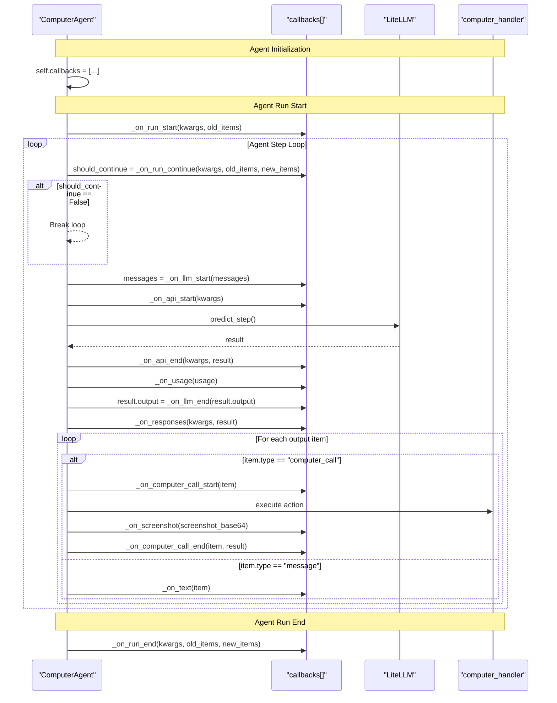
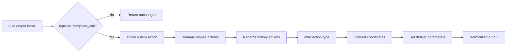
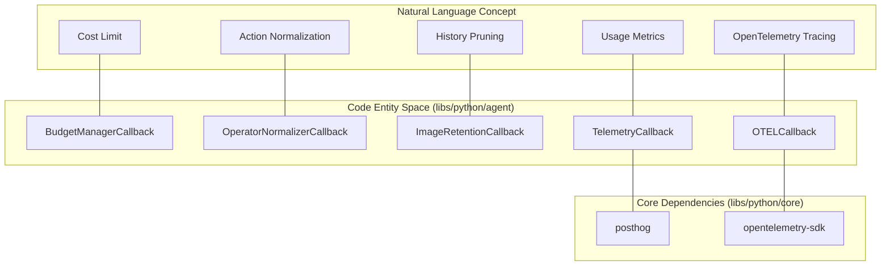
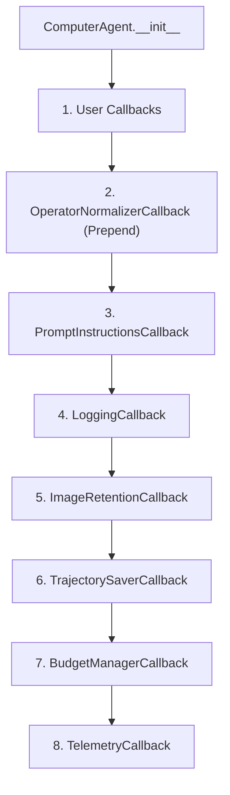

<!-- source: DeepWiki mcp.deepwiki.com · repo trycua/cua · page 9.1 Callback System · fetched 2026-10-29 -->

# Callback System

Relevant source files

The following files were used as context for generating this wiki page:

- [Makefile](Makefile)
- [libs/python/agent/.bumpversion.cfg](libs/python/agent/.bumpversion.cfg)
- [libs/python/agent/README.md](libs/python/agent/README.md)
- [libs/python/agent/pyproject.toml](libs/python/agent/pyproject.toml)
- [libs/python/core/.bumpversion.cfg](libs/python/core/.bumpversion.cfg)
- [libs/python/core/README.md](libs/python/core/README.md)
- [libs/python/core/pyproject.toml](libs/python/core/pyproject.toml)
- [libs/python/som/.bumpversion.cfg](libs/python/som/.bumpversion.cfg)
- [libs/python/som/README.md](libs/python/som/README.md)
- [libs/python/som/pyproject.toml](libs/python/som/pyproject.toml)

The callback system provides extensible hooks for monitoring, validating, and processing data during agent execution. Callbacks implement the `AsyncCallbackHandler` protocol and are invoked at key lifecycle points such as run start/end, LLM calls, computer actions, and usage tracking.

## Overview

The Cua agent framework implements an asynchronous callback architecture that allows custom logic to be injected at various points in the agent execution lifecycle. Callbacks are used for:

- **Validation and normalization**: Fixing common LLM output errors via `OperatorNormalizerCallback`.
- **Data persistence**: Saving trajectories with screenshots and action logs via `TrajectorySaverCallback`.
- **Resource management**: Limiting screenshot history via `ImageRetentionCallback` and managing costs via `BudgetManagerCallback`.
- **Observability**: Logging execution details via `LoggingCallback` and collecting telemetry via `TelemetryCallback`.
- **Prompt engineering**: Injecting instructions into the message history via `PromptInstructionsCallback`.

Callbacks are registered during `ComputerAgent` initialization and execute asynchronously during agent runs.

Sources: [libs/python/agent/cua_agent/agent.py:27-35](), [libs/python/agent/cua_agent/agent.py:231-298]()

## AsyncCallbackHandler Base Class

All callbacks inherit from or implement the `AsyncCallbackHandler` protocol, which defines async methods for each lifecycle hook. All methods are optional and default to no-op implementations.

Title: Callback Class Hierarchy

```mermaid
graph TB
    subgraph "AsyncCallbackHandler Protocol"
        BaseClass["AsyncCallbackHandler"]
        BaseClass --> RunHooks["on_run_start()<br/>on_run_end()<br/>on_run_continue()"]
        BaseClass --> LLMHooks["on_llm_start()<br/>on_llm_end()"]
        BaseClass --> ActionHooks["on_computer_call_start()<br/>on_computer_call_end()<br/>on_function_call_start()<br/>on_function_call_end()"]
        BaseClass --> ObsHooks["on_api_start()<br/>on_api_end()<br/>on_usage()<br/>on_responses()<br/>on_screenshot()<br/>on_text()"]
    end
    
    subgraph "Built-in Implementations"
        OperatorNormalizerCallback
        TrajectorySaverCallback
        ImageRetentionCallback
        BudgetManagerCallback
        LoggingCallback
        PromptInstructionsCallback
        TelemetryCallback
        OTELCallback
    end
    
    BaseClass -.implements.-> OperatorNormalizerCallback
    BaseClass -.implements.-> TrajectorySaverCallback
    BaseClass -.implements.-> ImageRetentionCallback
    BaseClass -.implements.-> BudgetManagerCallback
    BaseClass -.implements.-> LoggingCallback
    BaseClass -.implements.-> PromptInstructionsCallback
    BaseClass -.implements.-> TelemetryCallback
    BaseClass -.implements.-> OTELCallback
```

The callback methods fall into four categories:

1. **Run lifecycle**: `on_run_start`, `on_run_end`, `on_run_continue` - Called at the beginning/end of agent runs and between steps.
2. **LLM processing**: `on_llm_start`, `on_llm_end` - Called before/after LLM calls to preprocess and postprocess messages.
3. **Tool execution**: `on_computer_call_start/end`, `on_function_call_start/end` - Called when executing computer or function tools.
4. **Observability**: `on_api_start/end`, `on_usage`, `on_responses`, `on_screenshot`, `on_text` - Called for tracking and monitoring.

Sources: [libs/python/agent/cua_agent/agent.py:357-467]()

## Callback Lifecycle

Callbacks are invoked at specific points during agent execution. The `ComputerAgent` maintains a list of callbacks and calls each one sequentially at the appropriate time.

Title: Callback Invocation Flow

Each callback method in `ComputerAgent` iterates through `self.callbacks` and invokes the corresponding method if it exists. For transformation methods like `_on_llm_start`, the results are chained.

Sources: [libs/python/agent/cua_agent/agent.py:357-461](), [libs/python/agent/cua_agent/agent.py:599-718]()

## Built-in Callbacks

### OperatorNormalizerCallback
The `OperatorNormalizerCallback` fixes common LLM output errors in computer action syntax. It runs during `on_llm_end` and normalizes action types, parameter names, and data formats before the agent attempts to execute them.

Title: Normalization Pipeline

Example normalizations:
- `left_click` -> `click` with `button="left"`
- `hotkey` -> `keypress`
- `coordinate: [x, y]` -> `x: x, y: y`

Sources: [libs/python/agent/cua_agent/agent.py:234]()

### TrajectorySaverCallback
Records agent execution trajectories to disk, including screenshots, action logs, and metadata. It implements `on_run_start` to create directories and `on_screenshot` / `on_responses` to save data.

Sources: [libs/python/agent/cua_agent/agent.py:248-253]()

### ImageRetentionCallback
Limits the number of screenshots retained in the message history to reduce token usage. It implements `on_llm_start` to prune old images from the message list before it is sent to the LLM.

Sources: [libs/python/agent/cua_agent/agent.py:244-246]()

### BudgetManagerCallback
Tracks token usage and costs, stopping agent execution when budget limits are exceeded. It implements `on_usage` to track consumption and `on_run_continue` to signal the agent loop to stop.

Sources: [libs/python/agent/cua_agent/agent.py:255-260]()

### LoggingCallback
Outputs structured logs during agent execution. It is automatically added if `verbosity` is set during agent initialization.

Sources: [libs/python/agent/cua_agent/agent.py:240-242]()

### PromptInstructionsCallback
Injects system-like instructions into the message history. It implements `on_llm_start` to prepend instructions as a user message.

Sources: [libs/python/agent/cua_agent/agent.py:236-238]()

### TelemetryCallback
Collects anonymized usage metrics and performance data using `cua-core` telemetry utilities. It tracks events like `agent_session_start`, `agent_run_start`, and `agent_usage`. The `cua-agent` package depends on `cua-core` [libs/python/agent/pyproject.toml:21](), which in turn specifies `posthog` as a dependency [libs/python/core/pyproject.toml:14]().

Sources: [libs/python/agent/cua_agent/agent.py:293-298](), [libs/python/core/pyproject.toml:6-15](), [libs/python/agent/pyproject.toml:21]()

### OTELCallback
Integrates with OpenTelemetry for operational metrics, tracking the "Four Golden Signals" (Latency, Traffic, Errors, Saturation). The `cua-core` package provides an optional `otel` dependency group for this [libs/python/core/pyproject.toml:20-24]().

Sources: [libs/python/core/pyproject.toml:20-24]()

## Integration with Core Systems

The callback system bridges the high-level agent logic with operational monitoring and data persistence.

Title: Natural Language Space to Code Entity Space

Sources: [libs/python/agent/cua_agent/agent.py:231-298](), [libs/python/core/pyproject.toml:14-15](), [libs/python/core/pyproject.toml:21-23]()

## Callback Registration Order

Callbacks are registered during `ComputerAgent.__init__` in a specific order to ensure proper operation (e.g., normalizers run before savers).

Title: Registration Order Logic

Sources: [libs/python/agent/cua_agent/agent.py:231-298]()

---

