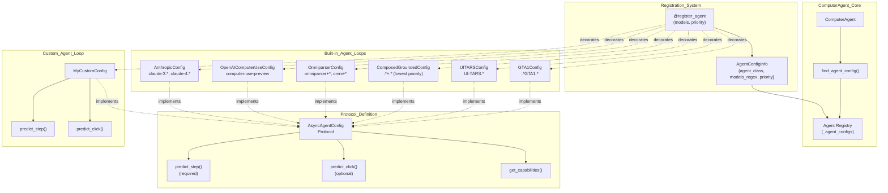
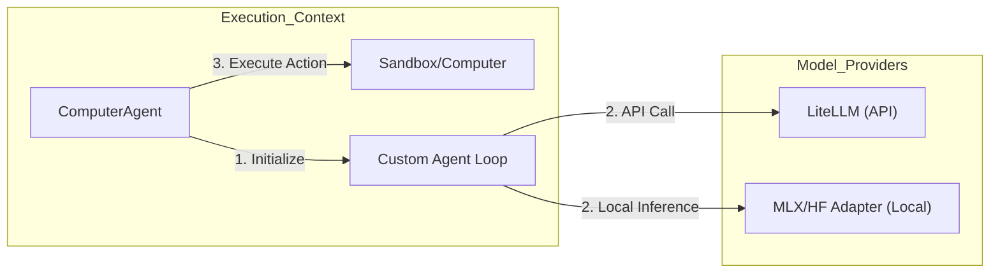

<!-- source: DeepWiki mcp.deepwiki.com · repo trycua/cua · page 9.2 Custom Agent Loops · fetched 2026-10-29 -->

# Custom Agent Loops

<details>
<summary>Relevant source files</summary>

The following files were used as context for generating this wiki page:

- [Makefile](Makefile)
- [libs/python/agent/.bumpversion.cfg](libs/python/agent/.bumpversion.cfg)
- [libs/python/agent/README.md](libs/python/agent/README.md)
- [libs/python/agent/pyproject.toml](libs/python/agent/pyproject.toml)
- [libs/python/core/.bumpversion.cfg](libs/python/core/.bumpversion.cfg)
- [libs/python/core/README.md](libs/python/core/README.md)
- [libs/python/core/pyproject.toml](libs/python/core/pyproject.toml)
- [libs/python/som/.bumpversion.cfg](libs/python/som/.bumpversion.cfg)
- [libs/python/som/README.md](libs/python/som/README.md)
- [libs/python/som/pyproject.toml](libs/python/som/pyproject.toml)

</details>


This document explains how to implement custom agent loops for integrating new AI models with the `ComputerAgent` system. An agent loop is a model-specific adapter class that handles prompting, API calls, and response parsing for a particular model or family of models.

For information about using the callback system to extend agent behavior without implementing a full agent loop, see [9.1 Callback System](). For information about the overall agent architecture, see [7.1 Agent Loop Architecture]().

## Overview

The agent loop system uses a protocol-based architecture where each supported model family has a corresponding agent loop implementation. Custom agent loops allow you to:

- Integrate proprietary or local models not natively supported.
- Customize prompting strategies for specific models.
- Implement specialized message format conversions.
- Add model-specific capabilities (e.g., grounding, element detection).

All agent loops are registered via the `@register_agent` decorator and discovered automatically at runtime through regex pattern matching.

Sources: [libs/python/agent/agent/decorators.py:1-62](), [libs/python/agent/agent/agent.py:166-772]()

## Agent Loop Architecture

Title: Agent Loop Registration and Selection Flow


Sources: [libs/python/agent/agent/decorators.py:1-62](), [libs/python/agent/agent/loops/base.py:1-81](), [libs/python/agent/agent/loops/__init__.py:1-37]()

## The AsyncAgentConfig Protocol

All agent loops must implement the `AsyncAgentConfig` protocol, which defines three core methods. The protocol is defined in `libs/python/agent/agent/loops/base.py`.

### Method: predict_step

The `predict_step` method is the primary entry point for agent execution. It receives messages in Responses API format, calls the underlying model, and returns structured output.

**Signature:**
```python
async def predict_step(
    self,
    messages: List[Dict[str, Any]],
    model: str,
    tools: Optional[List[Dict[str, Any]]] = None,
    max_retries: Optional[int] = None,
    stream: bool = False,
    computer_handler=None,
    _on_api_start=None,
    _on_api_end=None,
    _on_usage=None,
    _on_screenshot=None,
    **generation_config,
) -> Dict[str, Any]:
```

**Parameters:**
- `messages`: Conversation history in Responses API format.
- `model`: Full model string (e.g., `"anthropic/claude-3-5-sonnet-20241022"`).
- `tools`: List of tool schemas (computer tools and function tools).
- `computer_handler`: `AsyncComputerHandler` instance for computer operations.
- `_on_api_start`, `_on_api_end`, `_on_usage`, `_on_screenshot`: Lifecycle callback hooks.
- `**generation_config`: Provider-specific parameters (api_key, api_base, temperature, etc.).

**Return Value:**
```python
{
    "output": [...],  # List of response items (messages, computer_calls, etc.)
    "usage": {        # Token usage and cost tracking
        "prompt_tokens": int,
        "completion_tokens": int,
        "total_tokens": int,
        "response_cost": float
    }
}
```

Sources: [libs/python/agent/agent/loops/base.py:14-50](), [libs/python/agent/agent/agent.py:679-685]()

### Method: predict_click

The `predict_click` method provides grounding capabilities for click coordinate prediction. This is used by composed agent loops and for click-only evaluations.

**Signature:**
```python
async def predict_click(
    self, 
    model: str, 
    image_b64: str, 
    instruction: str, 
    **generation_config
) -> Optional[Tuple[int, int]]:
```

**Parameters:**
- `model`: Full model string.
- `image_b64`: Base64-encoded screenshot (without data URI prefix).
- `instruction`: Element description (e.g., "red submit button", "search text field").
- `**generation_config`: Provider-specific parameters.

**Return Value:**
- `Tuple[int, int]`: Pixel coordinates (x, y) in absolute screen space.
- `None`: If prediction fails or is not supported.

Sources: [libs/python/agent/agent/loops/base.py:52-70](), [libs/python/agent/agent/agent.py:722-757]()

### Method: get_capabilities

The `get_capabilities` method declares which capabilities this agent loop supports.

**Signature:**
```python
def get_capabilities(self) -> List[AgentCapability]:
```

**Return Value:**
- List of capability strings: `["step"]`, `["click"]`, or `["step", "click"]`.

Sources: [libs/python/agent/agent/loops/base.py:72-80]()

## The @register_agent Decorator

Agent loops are registered using the `@register_agent` decorator, which maintains a global registry and handles model matching.

```python
@register_agent(models=r".*GTA1.*", priority=0)
class GTA1Config(AsyncAgentConfig):
    # Implementation
```

**Parameters:**
- `models`: Regex pattern for matching model strings (case-sensitive by default).
- `priority`: Integer priority for selection when multiple patterns match (higher = selected first).

**Pattern Matching Examples:**

| Pattern | Priority | Matches | Loop Class |
|---------|----------|---------|------------|
| `r"claude-4|claude-opus-4|..."` | 2 | `anthropic/claude-4-opus` | `AnthropicConfig` |
| `r".*(^/)computer-use-preview"` | 0 | `openai/computer-use-preview` | `OpenAIComputerUseConfig` |
| `r"omniparser\+.*|omni\+.*"` | 2 | `omni+gemini/gemini-1.5-pro` | `OmniparserConfig` |
| `r".*\+.*"` | 1 | `gta1+anthropic/claude-3-5-sonnet` | `ComposedGroundedConfig` |
| `r"(?i).*qwen.*"` | -1 | `qwen/qwen-3-vl` | `Qwen3VlConfig` |

Sources: [libs/python/agent/agent/decorators.py:13-48]()

## Agent Loop Selection Process

Title: Runtime Loop Discovery
```mermaid
sequenceDiagram
    participant User
    participant CA as "ComputerAgent.__init__()"
    participant Finder as "find_agent_config()"
    participant Registry as "_agent_configs"
    participant Loop as "Agent Loop Instance"
    
    User->>CA: "model='omni+anthropic/claude-3-5-sonnet'"
    CA->>Finder: "find_agent_config(model)"
    Finder->>Registry: "Iterate configs by priority"
    
    loop "For each AgentConfigInfo (sorted by priority)"
        Registry->>Registry: "matches_model(model) via regex"
        alt "Pattern matches"
            Registry-->>Finder: "Return AgentConfigInfo"
        end
    end
    
    Finder-->>CA: "AgentConfigInfo{agent_class, models_regex, priority}"
    CA->>Loop: "agent_loop = agent_class()"
    CA-->>User: "ComputerAgent instance"
```

The selection process at `libs/python/agent/agent/agent.py` follows these steps:

1. Call `find_agent_config(model)` with user-provided model string [libs/python/agent/agent/agent.py:290]().
2. Iterate through `_agent_configs` sorted by priority (highest first) [libs/python/agent/agent/decorators.py:56-61]().
3. For each `AgentConfigInfo`, test if `models_regex` matches the model string.
4. Return the first matching `AgentConfigInfo`.
5. Raise `ValueError` if no match found.
6. Instantiate the agent loop class [libs/python/agent/agent/agent.py:300]().

Sources: [libs/python/agent/agent/agent.py:290-300](), [libs/python/agent/agent/decorators.py:56-61]()

## Message Format and Conversions

Agent loops work with two message format systems:

### Responses API Format (Internal)

The standardized format used by `ComputerAgent` for all message passing. It is defined by OpenAI's Responses API specification.

**Example Computer Call:**
```python
{
    "type": "computer_call",
    "call_id": "call_xyz",
    "action": {
        "type": "click",
        "x": 100,
        "y": 200,
        "button": "left"
    }
}
```

Sources: [libs/python/agent/agent/responses.py:1-800](), [libs/python/agent/agent/agent.py:319-324]()

### Completion API Format (Provider-Specific)

Most providers (OpenAI, Anthropic, etc.) use the standard completion message format. Agent loops must convert between Responses format and their provider's format. The `cua-agent` package uses `litellm` for standardized API interaction across many providers [libs/python/agent/pyproject.toml:24]().

**Helper Functions:**

| Function | Purpose | Location |
|----------|---------|----------|
| `convert_responses_items_to_completion_messages()` | Convert Responses → Completion | [libs/python/agent/agent/responses.py:354-527]() |
| `convert_completion_messages_to_responses_items()` | Convert Completion → Responses | [libs/python/agent/agent/responses.py:530-800]() |

Sources: [libs/python/agent/agent/responses.py:354-800]()

## Lifecycle Hooks

The `predict_step` method receives callback hooks for tracking API calls, usage, and screenshots. These hooks enable telemetry, budget management, and trajectory recording.

| Hook | Signature | Purpose |
|------|-----------|---------|
| `_on_api_start` | `async (kwargs: Dict) -> None` | Called before LLM API request |
| `_on_api_end` | `async (kwargs: Dict, response: Any) -> None` | Called after LLM API response |
| `_on_usage` | `async (usage: Dict) -> None` | Called with token/cost usage |
| `_on_screenshot` | `async (screenshot: str, name: str) -> None` | Called when screenshots are taken |

Sources: [libs/python/agent/agent/agent.py:446-468]()

## Integration with Infrastructure

Custom loops are typically implemented in `libs/python/agent/agent/loops/`. For example, `UITARSConfig` integrates with local MLX or HuggingFace adapters for Apple Silicon or Linux execution environments, utilizing specific dependencies like `mlx-vlm` or `transformers` [libs/python/agent/pyproject.toml:43-50]().

The `cua-agent` package defines various optional dependencies for different model integrations, such as `openai`, `anthropic`, `qwen`, `uitars`, `glm45v-hf`, `opencua-hf`, `internvl-hf`, `moondream3`, and `gemini` [libs/python/agent/pyproject.toml:33-89](). The `cloud` extra provides API-only dependencies for cloud/container deployments, excluding local model requirements [libs/python/agent/agent/pyproject.toml:91-101]().

Title: Agent Loop Execution Context


Sources: [libs/python/agent/pyproject.toml:13-124](), [libs/python/agent/agent/agent.py:166-300]()

---

