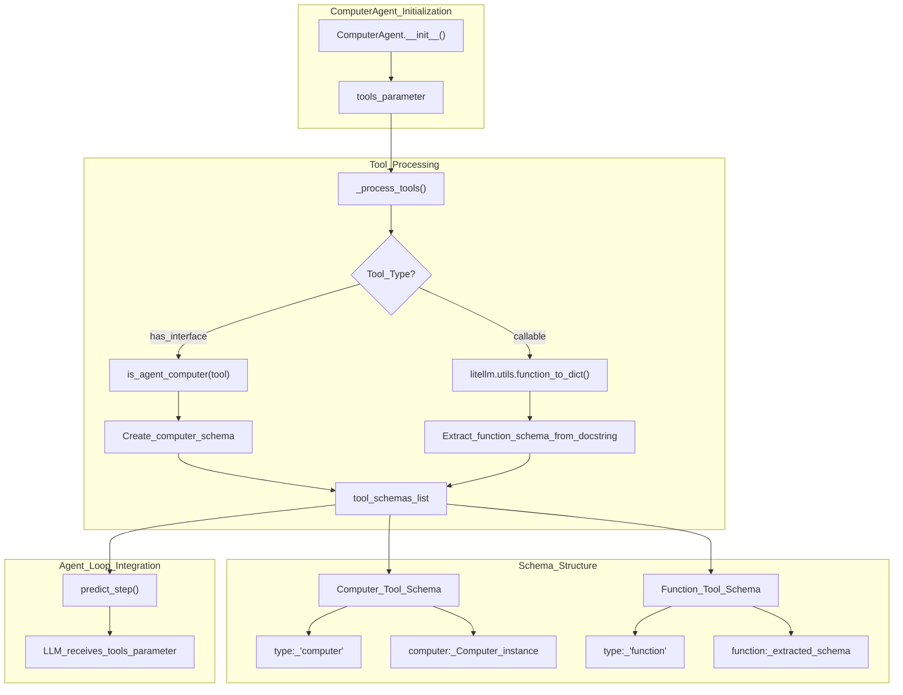
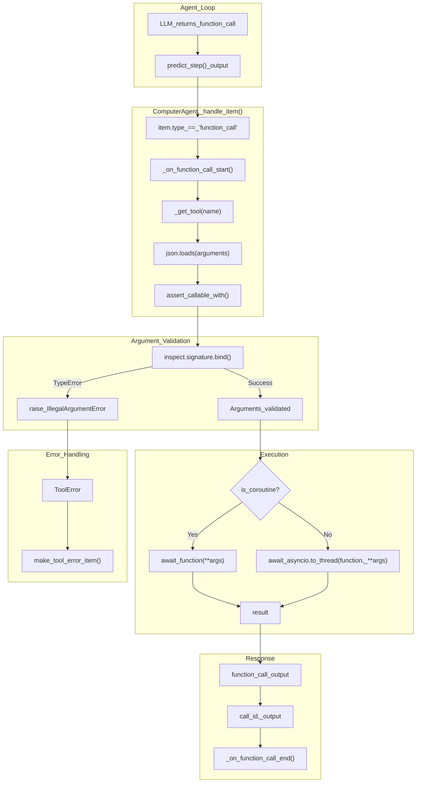
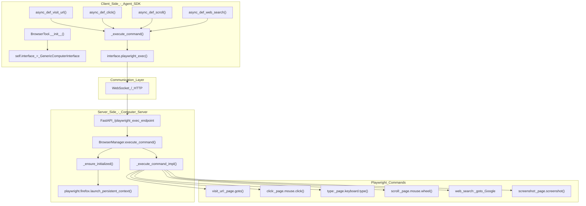
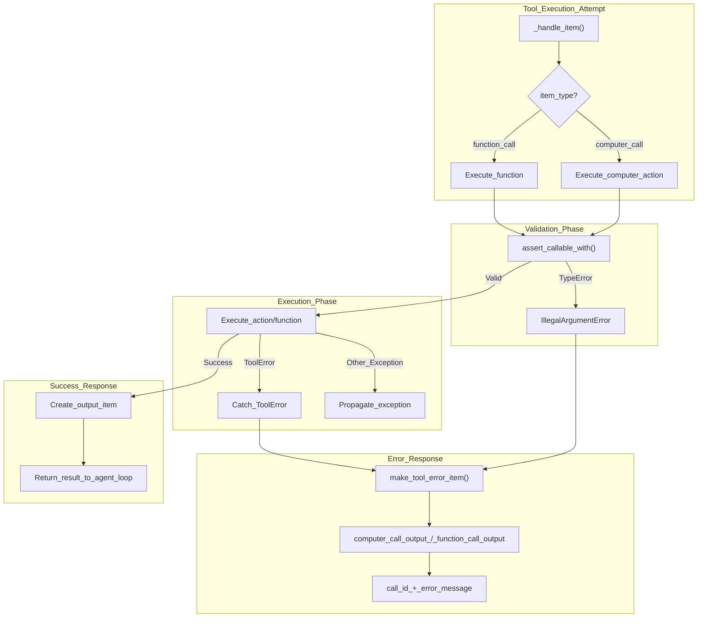

<!-- source: DeepWiki mcp.deepwiki.com · repo trycua/cua · page 9.3 Custom Tools · fetched 2026-10-29 -->

# Custom Tools

<details>
<summary>Relevant source files</summary>

The following files were used as context for generating this wiki page:

- [Makefile](Makefile)
- [libs/cua-driver/python/src/cua_driver/_native.py](libs/cua-driver/python/src/cua_driver/_native.py)
- [libs/cua-driver/python/tests/test_uniffi_loader.py](libs/cua-driver/python/tests/test_uniffi_loader.py)
- [libs/cua-driver/rust/crates/cua-driver-core/src/authorization.rs](libs/cua-driver/rust/crates/cua-driver-core/src/authorization.rs)
- [libs/cua-driver/rust/crates/cua-driver-core/src/session_authorization.rs](libs/cua-driver/rust/crates/cua-driver-core/src/session_authorization.rs)
- [libs/cua-driver/rust/crates/cua-driver-core/src/tool.rs](libs/cua-driver/rust/crates/cua-driver-core/src/tool.rs)
- [libs/cua-driver/rust/crates/cua-driver-sdk/src/abi.rs](libs/cua-driver/rust/crates/cua-driver-sdk/src/abi.rs)
- [libs/cua-driver/rust/crates/cua-driver-sdk/src/lib.rs](libs/cua-driver/rust/crates/cua-driver-sdk/src/lib.rs)
- [libs/cua-driver/rust/crates/cua-driver-sdk/src/runtime.rs](libs/cua-driver/rust/crates/cua-driver-sdk/src/runtime.rs)
- [libs/cua-driver/typescript/src/native/cua_driver_sdk-ffi.ts](libs/cua-driver/typescript/src/native/cua_driver_sdk-ffi.ts)
- [libs/cua-driver/typescript/src/native/cua_driver_sdk.ts](libs/cua-driver/typescript/src/native/cua_driver_sdk.ts)
- [libs/python/agent/.bumpversion.cfg](libs/python/agent/.bumpversion.cfg)
- [libs/python/agent/README.md](libs/python/agent/README.md)
- [libs/python/agent/pyproject.toml](libs/python/agent/pyproject.toml)
- [libs/python/core/.bumpversion.cfg](libs/python/core/.bumpversion.cfg)
- [libs/python/core/README.md](libs/python/core/README.md)
- [libs/python/core/pyproject.toml](libs/python/core/pyproject.toml)
- [libs/python/som/.bumpversion.cfg](libs/python/som/.bumpversion.cfg)
- [libs/python/som/README.md](libs/python/som/README.md)
- [libs/python/som/pyproject.toml](libs/python/som/pyproject.toml)

</details>


This document describes how to add custom tools to agents in the Cua framework. Custom tools extend agent capabilities beyond basic computer control by exposing deterministic functions or specialized interfaces that the agent can invoke during task execution.

For information about the core agent execution system, see [libs/python/agent/cua_agent/agent.py:1-733](). For details on computer control interfaces, see [libs/python/computer/computer/interface.py:1-243](). For information about callbacks and other extension mechanisms, see **9.1 Callback System**.

## Tool Types

The Cua agent system supports two categories of custom tools:

| Tool Type | Description | Schema Generation | Execution Model |
|-----------|-------------|-------------------|-----------------|
| **Function Tools** | Regular Python functions decorated with docstrings | `litellm.utils.function_to_dict()` extracts schema from docstring | Executed via `asyncio.to_thread` for sync functions, direct await for async |
| **Computer Tools** | Objects with an `interface` attribute providing computer control methods | Agent loop defines computer_use tool schema | Executed through Computer interface's action handlers |

Function tools provide deterministic, stateless operations (e.g., calculations, API calls, data transformations). Computer tools extend the base computer control interface with specialized capabilities (e.g., browser control, application-specific automation).

Sources: [libs/python/agent/pyproject.toml:24](), [libs/python/agent/cua_agent/agent.py:323-342]()

---

## Tool Processing Flow



**Diagram: Tool Processing Pipeline in ComputerAgent**

The tool processing occurs during `ComputerAgent` initialization and converts raw tool objects into schemas that agent loops can pass to LLMs. The distinction between computer tools and function tools determines schema generation strategy and execution path.

Sources: [libs/python/agent/cua_agent/agent.py:303-342](), [libs/python/agent/cua_agent/computers.py:14-17]()

---

## Creating Function Tools

Function tools are standard Python functions with properly formatted docstrings. The agent extracts tool schemas from these docstrings using LiteLLM's schema extraction.

### Function Tool Requirements

1.  **Type Annotations**: All parameters must have type hints.
2.  **Docstring Format**: Must follow a parseable format (Google or NumPy style) for `litellm` to extract descriptions.
3.  **Return Documentation**: Return type and description should be documented.
4.  **Synchronous or Asynchronous**: Both `def` and `async def` are supported.

### Registering Function Tools

Pass function tools to `ComputerAgent` via the `tools` parameter:

```python
agent = ComputerAgent(
    model="openai/computer-use-preview",
    tools=[computer, calculate_percentage],  # Mix computer and function tools
)
```

The agent automatically:
1.  Extracts the schema using `litellm.utils.function_to_dict()` [libs/python/agent/cua_agent/agent.py:333-334]().
2.  Validates arguments against the function signature during execution using `assert_callable_with` [libs/python/agent/cua_agent/agent.py:572-573]().
3.  Handles async/sync execution appropriately [libs/python/agent/cua_agent/agent.py:575-578]().

Sources: [libs/python/agent/cua_agent/agent.py:323-342](), [libs/python/agent/cua_agent/agent.py:562-578]()

---

## Function Tool Execution Flow



**Diagram: Function Tool Execution Path**

When the agent loop returns a `function_call` item, `ComputerAgent._handle_item()` validates arguments against the function signature using Python's `inspect.signature().bind()` via the `assert_callable_with` utility [libs/python/agent/cua_agent/agent.py:45-52](), then executes the function. Synchronous functions are executed in a thread pool via `asyncio.to_thread` to avoid blocking the async event loop [libs/python/agent/cua_agent/agent.py:578]().

Sources: [libs/python/agent/cua_agent/agent.py:472-593](), [libs/python/agent/cua_agent/agent.py:45-52]()

---

## Creating Computer Tools

Computer tools are classes that interact with the `Computer` interface to provide specialized automation capabilities. The canonical example is `BrowserTool`, which adds programmatic browser control through Playwright.

### Computer Tool Structure

A computer tool must:
1.  Accept a `GenericComputerInterface` instance in `__init__`.
2.  Store the interface as `self.interface`.
3.  Implement command methods that use `self.interface` to interact with the computer.

### BrowserTool Implementation



**Diagram: BrowserTool Architecture - Client to Server**

The `BrowserTool` demonstrates the pattern for computer tools that extend beyond basic desktop automation. The tool wraps multiple Playwright operations into high-level methods that agents can use for web interaction. The actual execution happens on the `computer-server` via the `playwright_exec` interface method.

Sources: [libs/python/agent/cua_agent/tools/browser_tool.py:15-136](), [libs/python/computer/computer/interface.py:165-177]()

---

## BrowserTool Example

### Tool Definition

The `BrowserTool` class exposes browser control methods to agents. Each method calls `self.interface.playwright_exec(command, params)`, which routes the command to the computer server.

[libs/python/agent/cua_agent/tools/browser_tool.py:15-136]()

Key methods:
- `visit_url(url: str)` - Navigate to a URL.
- `click(x: int, y: int)` - Click at screen coordinates.
- `type(text: str)` - Type text into focused element.
- `scroll(delta_x: int, delta_y: int)` - Scroll the page.
- `web_search(query: str)` - Perform Google search.
- `screenshot()` - Capture browser screenshot.

### Server-Side Handler

The computer server implements browser commands using Playwright. The handler lazily initializes a persistent browser context and handles command execution with automatic recovery. The browser typically runs visibly on the desktop (`headless=False`) so visual agents can see it alongside their computer control actions.

Sources: [libs/python/agent/cua_agent/tools/browser_tool.py:15-136](), [libs/python/computer/computer/interface.py:165-177]()

---

## Tool Schema Generation

### Function Tool Schema Extraction

The agent uses LiteLLM's schema extractor to convert function docstrings into tool schemas [libs/python/agent/cua_agent/agent.py:333-337]():

```python
try:
    function_schema = litellm.utils.function_to_dict(tool)
    schemas.append({"type": "function", "function": function_schema})
except Exception as e:
    print(f"Warning: Could not process tool {tool}: {e}")
```

### Computer Tool Detection

Computer tools are identified by the presence of an `interface` attribute [libs/python/agent/cua_agent/computers.py:14-17]():

```python
def is_agent_computer(obj: Any) -> bool:
    """Check if an object is an agent computer."""
    return hasattr(obj, "interface")
```

Computer tools produce a different schema structure in the `ComputerAgent` internal registry [libs/python/agent/cua_agent/agent.py:330]():
`{"type": "computer", "computer": tool}`

Sources: [libs/python/agent/cua_agent/agent.py:323-342](), [libs/python/agent/cua_agent/computers.py:14-17]()

---

## Tool Argument Validation

Before executing any tool, the agent validates arguments using Python's introspection capabilities via `assert_callable_with` [libs/python/agent/cua_agent/agent.py:45-52]():

```python
def assert_callable_with(f, *args, **kwargs):
    """Check if function can be called with given arguments."""
    try:
        inspect.signature(f).bind(*args, **kwargs)
        return True
    except TypeError as e:
        sig = inspect.signature(f)
        raise IllegalArgumentError(
            f"Expected {sig}, got args={args} kwargs={kwargs}"
        ) from e
```

The validation occurs in:
- `_handle_computer_call` [libs/python/agent/cua_agent/agent.py:517]() for computer actions.
- `_handle_function_call` [libs/python/agent/cua_agent/agent.py:572]() for custom function calls.

Sources: [libs/python/agent/cua_agent/agent.py:45-52](), [libs/python/agent/cua_agent/agent.py:562-578]()

---

## Tool Execution Error Handling



**Diagram: Tool Error Handling Flow**

Tool errors are caught and converted into output items using `make_tool_error_item` [libs/python/agent/cua_agent/responses.py:73-84]() that inform the LLM about the failure, allowing it to retry or adjust its approach [libs/python/agent/cua_agent/agent.py:590-591]().

Sources: [libs/python/agent/cua_agent/agent.py:472-593](), [libs/python/agent/cua_agent/responses.py:73-84]()

---

## Integration with ComputerAgent

### Tool Initialization Lifecycle

[libs/python/agent/cua_agent/agent.py:303-316]()

```python
async def _initialize_computers(self):
    """Initialize computer objects"""
    if not self.tool_schemas:
        # Process tools and create tool schemas
        self.tool_schemas = self._process_tools()
        
        # Find computer tool and create interface adapter
        computer_handler = None
        for schema in self.tool_schemas:
            if schema["type"] == "computer":
                computer_handler = await make_computer_handler(schema["computer"])
                break
        self.computer_handler = computer_handler
```

The `_initialize_computers()` method identifies the computer tool and creates a computer handler for action execution via `make_computer_handler()` [libs/python/agent/cua_agent/computers.py:35-120]().

### Tool Usage in Agent Loop

During `agent.run()`, tool schemas are passed to the agent loop's `predict_step()` [libs/python/agent/cua_agent/agent.py:666-674](). The agent loop converts these internal Cua schemas into provider-specific formats (Anthropic `tools`, OpenAI `tools`, etc.).

Sources: [libs/python/agent/cua_agent/agent.py:303-316](), [libs/python/agent/cua_agent/agent.py:666-674]()

---

## Tool Execution Context

### Computer Handler Creation

When a computer tool is detected, the agent creates an `AsyncComputerHandler` wrapper via `make_computer_handler()` [libs/python/agent/cua_agent/computers.py:35-120](). This function extracts the `Computer` instance, calls `computer.run()` to initialize the execution environment [libs/python/agent/cua_agent/computers.py:112](), and wraps the interface.

### Handler Interface Methods

The `AsyncComputerHandler` [libs/python/agent/cua_agent/computers.py:35-104]() provides action execution methods like `screenshot()`, `click()`, `type_text()`, and `scroll()`. These methods map directly to the `GenericComputerInterface` but handle coordination with the agent loop and coordinate scaling.

Sources: [libs/python/agent/cua_agent/computers.py:35-120](), [libs/python/agent/cua_agent/agent.py:496-560]()

---

