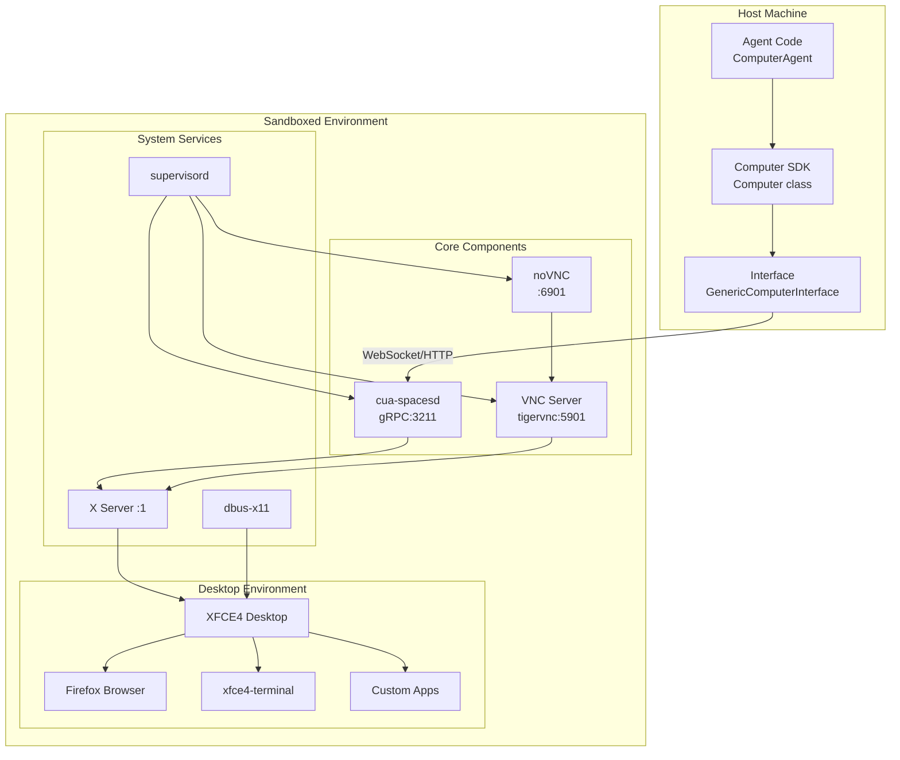

<!-- source: DeepWiki mcp.deepwiki.com · repo trycua/cua · page 9.4 Sandboxed Execution · fetched 2026-10-29 -->

# Sandboxed Execution

<details>
<summary>Relevant source files</summary>

The following files were used as context for generating this wiki page:

- [.github/workflows/cd-container-xfce.yml](.github/workflows/cd-container-xfce.yml)
- [.github/workflows/ci-container-xfce.yml](.github/workflows/ci-container-xfce.yml)
- [libs/kasm/Dockerfile](libs/kasm/Dockerfile)
- [libs/kasm/README.md](libs/kasm/README.md)
- [libs/lumier/.bumpversion.cfg](libs/lumier/.bumpversion.cfg)
- [libs/lumier/VERSION](libs/lumier/VERSION)
- [libs/qemu-docker/android/.bumpversion.cfg](libs/qemu-docker/android/.bumpversion.cfg)
- [libs/qemu-docker/android/Dockerfile](libs/qemu-docker/android/Dockerfile)
- [libs/qemu-docker/android/VERSION](libs/qemu-docker/android/VERSION)
- [libs/qemu-docker/android/dev.Dockerfile](libs/qemu-docker/android/dev.Dockerfile)
- [libs/qemu-docker/android/src/entry.sh](libs/qemu-docker/android/src/entry.sh)
- [libs/xfce/.bumpversion.cfg](libs/xfce/.bumpversion.cfg)
- [libs/xfce/Development.md](libs/xfce/Development.md)
- [libs/xfce/Dockerfile](libs/xfce/Dockerfile)
- [libs/xfce/Dockerfile.dev](libs/xfce/Dockerfile.dev)
- [libs/xfce/README.md](libs/xfce/README.md)
- [libs/xfce/VERSION](libs/xfce/VERSION)
- [libs/xfce/requirements-cua-driver.txt](libs/xfce/requirements-cua-driver.txt)
- [libs/xfce/src/supervisor/supervisord.conf](libs/xfce/src/supervisor/supervisord.conf)
- [libs/xfce/src/xfce-config/xfce4-power-manager.xml](libs/xfce/src/xfce-config/xfce4-power-manager.xml)
- [libs/xfce/src/xfce-config/xfce4-session.xml](libs/xfce/src/xfce-config/xfce4-session.xml)

</details>


## Purpose and Scope

This document explains how to create and customize sandboxed execution environments for Cua agents. A sandboxed environment is an isolated system (VM, container, or virtualized desktop) where agents execute their tasks safely without affecting the host machine. This page covers Docker image customization, XFCE/noVNC setup, custom software installation, and security isolation patterns across different platforms (Linux, Windows, and Android).

For information about VM provider architecture and how sandboxes are selected, see [Provider Architecture](). For details on the computer-server that runs inside sandboxes, see [Computer Server]().

---

## Sandbox Architecture Overview

Cua agents execute inside sandboxed environments to provide isolation, reproducibility, and safety. Each sandbox runs `cua-spacesd`, a gRPC server that provides the Computer API for agents to control the OS.

**Sandbox Architecture**


Sources: [libs/xfce/Dockerfile:1-165](), [libs/xfce/src/supervisor/supervisord.conf:1-42]()

---

## Base Execution Environments

Cua provides several production-ready environments for sandboxed execution. The `cua-xfce` image is the primary reference implementation for containers, while QEMU-based setups support full OS virtualization.

### Docker-based Sandboxes
| Image | Base | User | Desktop | Use Case |
|-------|------|------|---------|----------|
| `trycua/lumier:latest` | Ubuntu 22.04 | `kasm-user` | Kasm XFCE | Production, full-featured KasmVNC [libs/lumier/.bumpversion.cfg:1-8]() |
| `trycua/cua-xfce:latest` | Debian Bookworm / KiCad 9 | `cua` | Vanilla XFCE | Lightweight, KiCad/Engineering tasks [libs/xfce/Dockerfile:5-44]() |
| `trycua/cua-kasm:latest` | Kasmweb Ubuntu Jammy | `kasm-user` | Kasm XFCE | Kasm-based Ubuntu desktop [libs/kasm/Dockerfile:1-2]() |

**Core Image Components (cua-xfce):**
- **Python 3.13**: Satisfies `cua-bench-ui` requirements [libs/xfce/Dockerfile:76-82]().
- **Desktop**: `xfce4` with `tigervnc-standalone-server` [libs/xfce/Dockerfile:43-49]().
- **Web Access**: `noVNC` and `websockify` for browser-based desktop access [libs/xfce/Dockerfile:101-104]().
- **Cua Driver**: Includes the released `cua-driver` Python SDK and its bundled executable for background computer-use [libs/xfce/Dockerfile:130-138]().
- **`cua-spacesd`**: The in-sandbox daemon providing the gRPC API [libs/xfce/Dockerfile:139-160]().

### QEMU-based Sandboxes
For full OS isolation, Cua supports Windows and Linux QEMU environments. These are initialized via setup scripts that install the necessary agent components.
- **Windows**: Uses a scheduled task `Cua-Computer-Server` to run the server via a VBScript wrapper (`start-server-hidden.vbs`) for background execution (not provided in current context).
- **Linux**: Uses a `systemd` service `cua-computer-server.service` targeting `graphical.target` (not provided in current context).
- **Android**: The `trycua/cua-qemu-android` image provides an Android emulator runtime [libs/qemu-docker/android/.bumpversion.cfg:1-8](). The `entry.sh` script starts the emulator and `cua-spacesd` [libs/qemu-docker/android/src/entry.sh:1-25]() (not provided in current context).

Sources: [libs/xfce/Dockerfile:1-165](), [libs/lumier/.bumpversion.cfg:1-8](), [libs/xfce/README.md:1-12](), [libs/qemu-docker/android/.bumpversion.cfg:1-8](), [libs/kasm/Dockerfile:1-2](), [libs/qemu-docker/android/src/entry.sh:1-25]()

---

## Customizing Docker Images

### Building a Custom Image
To customize a sandbox, extend the `cua-xfce` base. The image uses `uv` for high-performance Python package management [libs/xfce/Dockerfile:78-80]().

**Example: Adding Custom Software**
```dockerfile
FROM trycua/cua-xfce:latest
USER root
RUN apt-get update && apt-get install -y vim nodejs
RUN uv pip install --python /opt/venv/bin/python3 pandas
USER cua
```

### Development Workflow
For iterative development, `Dockerfile.dev` allows building the container using local source code for the `cua-spacesd` package [libs/xfce/Dockerfile.dev:125-131]().

```bash
cd libs/xfce
docker build -f Dockerfile.dev -t cua-xfce:dev ..
```
The build context must be the parent directory to allow access to `libs/cua-spacesd` [libs/xfce/Development.md:8-12]().

Sources: [libs/xfce/Dockerfile.dev:1-169](), [libs/xfce/Development.md:1-29]()

---

## `cua-spacesd` Integration

The `cua-spacesd` daemon is managed by `supervisord` in Docker containers [libs/xfce/src/supervisor/supervisord.conf:35-42]() or `systemd` in QEMU environments (not provided in current context).

**Service Management Logic**
- **Docker (XFCE)**: `start-spacesd.sh` waits for the X server (`xdpyinfo`) to be ready before launching `cua-spacesd` on `CUA_ENV_PORT` (default 3211) [libs/xfce/src/scripts/start-spacesd.sh:5-13]() (not provided in current context).
- **Docker (Kasm)**: `start-spacesd.sh` is copied to `$STARTUPDIR/custom_startup.sh` and executed at session start. It generates an `env-token` if `CUA_ENV_TOKEN` is not provided [libs/kasm/Dockerfile:87-90]().
- **Windows**: A PowerShell script `start-server.ps1` runs in an infinite loop, automatically updating `cua-computer-server` via `uv add` before each restart (not provided in current context).
- **Linux (QEMU)**: A similar `while true` loop in `start-server.sh` ensures the server remains active on port 5000 (not provided in current context).

Sources: [libs/xfce/src/supervisor/supervisord.conf:1-42](), [libs/kasm/Dockerfile:87-90]()

---

## Browser and UI Automation

### Programmatic Browser Control
The sandbox includes a `BrowserManager` utilizing Playwright to control a visible Firefox instance.

**Key Configuration:**
- **Headless Mode**: Set to `False` so the agent can see the browser on the desktop.
- **Persistent Context**: Uses `~/.playwright-firefox` to maintain sessions.
- **Anti-Detection**: Injects scripts to patch `navigator.webdriver`.

### Browser-based Tasks
For `cua-bench` tasks, the sandbox includes `pywebview` with the GTK backend and `cua-bench-ui` [libs/xfce/Dockerfile:110-112](). This allows agents to interact with custom HTML/JS interfaces rendered natively within the XFCE environment.

Sources: [libs/xfce/Dockerfile:107-127]()

---

## Security and Isolation

### Resource Constraints
- **Screensaver/Power Management**: Removed or disabled via autostart to prevent lock screens [libs/xfce/Dockerfile:85-90](), [libs/xfce/Dockerfile:160-164]().
- **XFCE Session**: Configured via `xfce4-session.xml` to disable splash screens and session saving [libs/xfce/src/xfce-config/xfce4-session.xml:1-55]() (not provided in current context).
- **User Permissions**: The `cua` user has passwordless sudo for software installation but runs as an unprivileged user by default [libs/xfce/Dockerfile:92-95]().

### Port Exposure
- **5901**: VNC (Raw desktop stream) [libs/xfce/Dockerfile:13]().
- **6901**: noVNC (WebSocket-based web view) [libs/xfce/Dockerfile:14]().
- **3211**: `cua-spacesd` (gRPC/gRPC-Web) [libs/xfce/Dockerfile:15]().

Sources: [libs/xfce/Dockerfile:171-172](), [libs/xfce/src/supervisor/supervisord.conf:1-42]()

---

