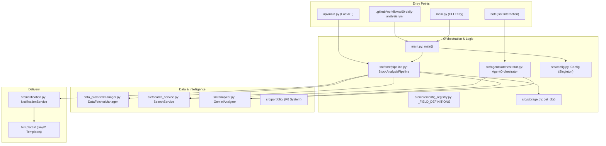
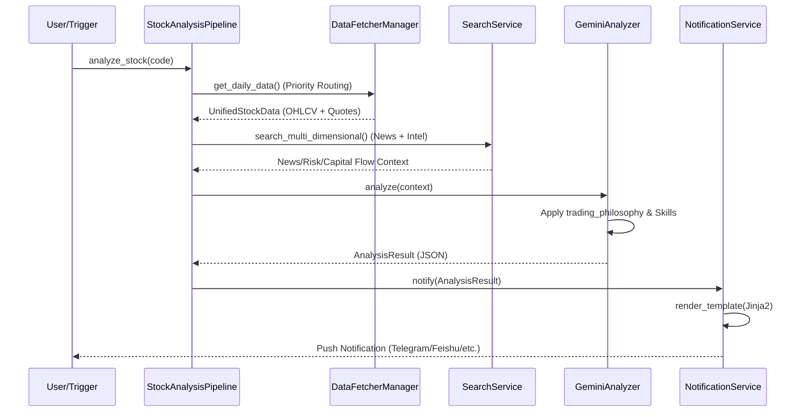

<!-- source: DeepWiki mcp.deepwiki.com · repo ZhuLinsen/daily_stock_analysis · page 1 Overview · fetched 2026-10-29 -->

# Overview

Relevant source files

The following files were used as context for generating this wiki page:

- [.env.example](.env.example)
- [README.md](README.md)
- [docs/CHANGELOG.md](docs/CHANGELOG.md)
- [docs/README_CHT.md](docs/README_CHT.md)
- [docs/README_EN.md](docs/README_EN.md)
- [docs/full-guide.md](docs/full-guide.md)
- [docs/full-guide_EN.md](docs/full-guide_EN.md)
- [src/config.py](src/config.py)
- [src/core/pipeline.py](src/core/pipeline.py)

This document provides a high-level introduction to the **A-share/HK/US Intelligent Stock Analysis System**, an AI-driven platform for automated stock market analysis. The system performs daily technical and fundamental analysis of user-selected stocks across Chinese A-shares, Hong Kong, US, Japanese, Korean, and Taiwan markets, delivering actionable "decision dashboards" (决策仪表盘) via multiple notification channels.

**Purpose**: Automate the complex workflow of data gathering, technical indicator calculation, news sentiment analysis, and multi-market strategy evaluation using Large Language Models (LLMs).

**Sources**: [README.md:3-18](), [docs/full-guide.md:1-24]()

---

## System Purpose

The system transforms raw market data into structured investment intelligence by coordinating several specialized modules:

1.  **Multi-Source Data Acquisition**: Fetches OHLCV data, real-time quotes, chip distribution, and market news from a tiered hierarchy of providers (EFinance, AkShare, Tushare, Pytdx, Baostock, YFinance, TickFlow, and Longbridge) with automatic failover and circuit breaking [README.md:53-61](), [src/core/pipeline.py:28-30]().
2.  **AI-Driven Analysis Engine**: Utilizes LLMs (Gemini, Claude, DeepSeek, OpenAI, Ollama) via a unified interface to generate investment conclusions guided by embedded trading disciplines [README.md:54-58](), [src/analyzer.py:31-38]().
3.  **Multi-Agent Strategy (Skill) System**: Supports complex multi-turn strategy Q&A with 15+ built-in trading strategies (e.g., Mean Reversion, Wave Theory, Event-Driven) implemented as "skills" [README.md:46-48](), [src/config.py:185-204]().
4.  **Intelligent Search & Context Enrichment**: Aggregates news, risk alerts, and capital flow from specialized search APIs (Anspire, Tavily, Bocha, SerpAPI, Brave) to provide the AI with up-to-date fundamental context [README.md:58-60](), [src/search_service.py:49-50]().
5.  **Multi-Channel Notification**: Distributes reports to 10+ channels including Telegram, Discord, WeChat Work, Feishu, Slack, and Email with platform-specific formatting [README.md:48-50](), [docs/full-guide.md:70-108]().
6.  **Performance Validation & Portfolio Management**: An integrated backtesting engine evaluates AI accuracy, while the Portfolio P0 system tracks actual holdings and performance [README.md:45-47](), [docs/CHANGELOG.md:98-99]().

**Sources**: [README.md:39-63](), [src/core/pipeline.py:1-65](), [docs/full-guide.md:70-108]()

---

## High-Level Architecture

The system follows a modular orchestration pattern, separating data acquisition, intelligence processing, and delivery.

### Code Entity Relationship Diagram

This diagram bridges the conceptual "Natural Language Space" to the specific "Code Entity Space" used in the repository.

**Architecture Description**:
*   **Entry Points**: Users interact via GitHub Actions (serverless), CLI, or a React-based Web UI [README.md:65-152]().
*   **StockAnalysisPipeline**: The central coordinator that manages the lifecycle of a single analysis task, from fetching data to triggering notifications [src/core/pipeline.py:165-207]().
*   **AgentOrchestrator**: Manages multi-agent workflows and "skill" routing for complex strategy analysis [docs/CHANGELOG.md:28-29](), [src/config.py:144-146]().
*   **DataFetcherManager**: Implements priority-based routing to ensure data availability across markets [src/core/pipeline.py:28-30](), [.env.example:42-52]().
*   **Config System**: A singleton configuration system that manages environment variables and provides structured validation [src/config.py:7-11](), [src/config.py:83-101]().

**Sources**: [src/core/pipeline.py:165-207](), [src/config.py:1-75](), [README.md:65-152](), [docs/full-guide.md:7-24]()

---

## Core Components & Data Flow

The system processes a stock analysis request through a linear pipeline with heavy enrichment at each stage.

### Data Flow Pipeline

### Key Functional Entities

| Component | Code Entity | Responsibility |
| :--- | :--- | :--- |
| **Orchestrator** | `StockAnalysisPipeline` | Manages per-stock lifecycle and concurrency [src/core/pipeline.py:165-173](). |
| **Data Fetcher** | `DataFetcherManager` | Routes to TickFlow, AkShare, Tushare, Longbridge, etc. [src/core/pipeline.py:28](). |
| **AI Engine** | `GeminiAnalyzer` | Universal LLM interface via LiteLLM; handles prompt construction [src/core/pipeline.py:31-33](). |
| **Agent System** | `AgentOrchestrator` | Multi-agent coordination with per-agent timeout clamping [docs/CHANGELOG.md:28-29](). |
| **Intelligence** | `SearchService` | Queries Anspire, Tavily, or SerpAPI for recent news/intel [src/core/pipeline.py:49](). |
| **Portfolio** | `PortfolioP0` | Core ledger for tracking holdings and performance [docs/CHANGELOG.md:117-118](). |

**Sources**: [src/core/pipeline.py:1-90](), [docs/CHANGELOG.md:27-38](), [README.md:39-63]()

---

## Trading Philosophy & Rules

The system's AI analysis is constrained by a specific trading philosophy and structured "skills" injected into prompts.

*   **Strict Entry (严进策略)**: Rules-based entry logic embedded in AI prompts to avoid chasing high-risk positions [README.md:43](), [docs/full-guide.md:50-52]().
*   **Trend Trading (趋势交易)**: Analysis prioritizes price action and technical alignment [README.md:46-48]().
*   **Multi-Agent Specialization**: Includes specialized agents (TechnicalAgent, IntelAgent, RiskAgent, DecisionAgent) each with distinct focus areas [docs/CHANGELOG.md:28-29]().
*   **Skill-Based Analysis**: Uses YAML-defined strategies (e.g., 均线, 缠论, 波浪) to guide AI reasoning across 15+ built-in types [README.md:46-48](), [src/config.py:185-204]().

**Sources**: [README.md:39-52](), [docs/CHANGELOG.md:28-29](), [src/config.py:162-204]()

---

## Deployment & Configuration

The system is designed for maximum flexibility:

*   **GitHub Actions**: Zero-cost, serverless execution using repository Secrets [README.md:65-151]().
*   **Docker / Docker Compose**: Recommended for persistent Web UI and backend services [README.md:152-167](), [docs/full-guide.md:31]().
*   **Desktop Application**: Electron-based shell for Windows/macOS with portable mode support [docs/CHANGELOG.md:16-17](), [docs/CHANGELOG.md:38]().

**Configuration Management**:
The `Config` singleton manages all environment variables, including hot-reloading and validation [src/config.py:7-11]().
*   **Stock Lists**: `STOCK_LIST` supports A-shares, HK, US, JP, KR, and TW codes with smart delimiters [docs/CHANGELOG.md:18](), [.env.example:6-9]().
*   **AI Channels**: Configured via `GENERATION_BACKEND` with support for `litellm` and local CLI backends like `codex_cli` [docs/CHANGELOG.md:107-110](), [.env.example:128-134]().

**Sources**: [README.md:63-167](), [src/config.py:1-50](), [docs/CHANGELOG.md:10-49](), [.env.example:1-134]()

---

