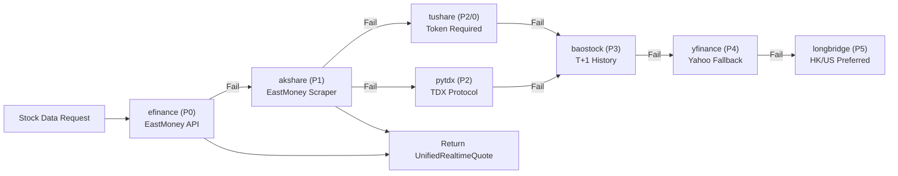

<!-- source: DeepWiki mcp.deepwiki.com · repo ZhuLinsen/daily_stock_analysis · page 10.2 Dependencies · fetched 2026-10-29 -->

# Dependencies

Relevant source files

The following files were used as context for generating this wiki page:

- [api/v1/endpoints/alphasift.py](api/v1/endpoints/alphasift.py)
- [apps/dsa-web/src/api/__tests__/alphasift.test.ts](apps/dsa-web/src/api/__tests__/alphasift.test.ts)
- [apps/dsa-web/src/api/alphasift.ts](apps/dsa-web/src/api/alphasift.ts)
- [apps/dsa-web/src/api/error.ts](apps/dsa-web/src/api/error.ts)
- [apps/dsa-web/src/pages/StockScreeningPage.tsx](apps/dsa-web/src/pages/StockScreeningPage.tsx)
- [apps/dsa-web/src/pages/__tests__/StockScreeningPage.test.tsx](apps/dsa-web/src/pages/__tests__/StockScreeningPage.test.tsx)
- [docs/alphasift-integration.md](docs/alphasift-integration.md)
- [requirements.txt](requirements.txt)
- [src/services/alphasift_service.py](src/services/alphasift_service.py)
- [tests/test_alphasift_api.py](tests/test_alphasift_api.py)
- [tests/test_docker_entrypoint.py](tests/test_docker_entrypoint.py)

## Purpose

This document provides a comprehensive reference of all Python dependencies used by the A-share/HK/US intelligent stock analysis system. Each dependency is categorized by its role in the system architecture, with explanations of why it was chosen and which components require it.

For configuration of these dependencies (API keys, tokens, etc.), see [Configuration Reference](2.2). For deployment-specific installation instructions, see [Deployment Guide](7).

---

## Dependency Architecture Overview

The system's dependencies are organized into distinct functional layers, each supporting a specific aspect of the analysis pipeline. The system follows a "Multi-Source Data Strategy" and a "Unified LLM Adapter" pattern to ensure resilience.

### System Dependency Map

Title: Dependency Functional Mapping

```mermaid
graph TB
    subgraph "Core Runtime"
        dotenv["python-dotenv<br/>Config Management"]
        tenacity["tenacity<br/>Retry Logic"]
        sqlalchemy["SQLAlchemy<br/>Database ORM"]
        schedule["schedule<br/>Task Scheduling"]
        calendars["exchange-calendars<br/>Trading Days"]
    end
    
    subgraph "Data Provider Layer (Priority 0-5)"
        efinance["efinance<br/>Priority 0"]
        akshare["akshare<br/>Priority 1"]
        tushare["tushare Pro<br/>Priority 2/0"]
        pytdx["pytdx<br/>Priority 2"]
        baostock["baostock<br/>Priority 3"]
        yfinance["yfinance<br/>Priority 4"]
        longbridge["longbridge<br/>Priority 5"]
        alphasift["alphasift<br/>External Screening"]
    end
    
    subgraph "Data Processing"
        pandas["pandas<br/>DataFrame Operations"]
        numpy["numpy<br/>Numerical Computation"]
        jsonrepair["json-repair<br/>JSON Parsing"]
        pypinyin["pypinyin<br/>Name Resolver"]
    end
    
    subgraph "AI Analysis Chain"
        litellm["LiteLLM<br/>Unified Router"]
        tiktoken["tiktoken<br/>Token Counting"]
        openai_sdk["openai<br/>SDK Bridge"]
    end
    
    subgraph "Intelligence Search"
        tavily["tavily-python<br/>News Search"]
        serpapi["google-search-results<br/>Web Search"]
    end
    
    subgraph "Notification & Bot"
        requests["requests<br/>HTTP Webhooks"]
        markdown2["markdown2<br/>HTML Conversion"]
        imgkit["imgkit<br/>Image Generation"]
        larkoapi["lark-oapi<br/>Feishu API"]
        dingtalk["dingtalk-stream<br/>DingTalk Bot"]
        discordpy["discord.py<br/>Discord Bot"]
    end
    
    subgraph "Web Interface"
        fastapi["FastAPI<br/>API Framework"]
        uvicorn["uvicorn<br/>ASGI Server"]
    end
    
    dotenv --> sqlalchemy
    tenacity --> efinance
    tenacity --> akshare
    tenacity --> tushare
    
    pandas --> efinance
    pandas --> akshare
    
    litellm --> jsonrepair
    litellm --> tiktoken
    
    requests --> tavily
    requests --> serpapi
```

Sources: [requirements.txt:5-74](), [src/services/alphasift_service.py:33-47]()

---

## Core Dependencies

These dependencies provide fundamental runtime capabilities required by all system components.

### Configuration & Environment Management

| Dependency | Version | Purpose | Used By |
|------------|---------|---------|---------|
| `python-dotenv` | ≥1.0.0 | Load environment variables from `.env` files | `Config` singleton [requirements.txt:6-6]() |

**Purpose:** Enables configuration via `.env` files for local deployment while maintaining compatibility with environment variables in Docker and GitHub Actions. The `Config` class uses this to initialize the global state.

### Retry & Resilience

| Dependency | Version | Purpose | Used By |
|------------|---------|---------|---------|
| `tenacity` | ≥8.2.0 | Exponential backoff retry mechanism | All data fetchers, AI analyzers, search services [requirements.txt:7-7]() |

**Implementation:** Used extensively to handle network instability and rate limits. The system relies on `tenacity` for robust API interactions across all data providers and AI calls.

### Database & Scheduling

| Dependency | Version | Purpose | Used By |
|------------|---------|---------|---------|
| `sqlalchemy` | ≥2.0.0 | ORM for database operations | Persistent storage of analysis results and portfolio [requirements.txt:8-8]() |
| `schedule` | ≥1.2.0 | Internal task scheduler | `main.py` execution modes [requirements.txt:9-9]() |
| `exchange-calendars`| ≥4.13.0 | Market-specific trading calendars | Market review logic and trading day validation [requirements.txt:10-10]() |

Sources: [requirements.txt:6-10]()

---

## Data Provider Dependencies

The system implements a priority-based failover chain across multiple providers, managed by the `DataFetcherManager`.

Title: Data Fetcher Priority Flow

### Fetcher Implementations

*   **efinance (Priority 0):** Highest priority for A-share real-time data [requirements.txt:13-13]().
*   **akshare (Priority 1):** Main crawler-based source for A-shares/HK/US [requirements.txt:14-14]().
*   **tushare (Priority 2):** Pro API. Elevates in priority when a token is provided [requirements.txt:15-15]().
*   **pytdx (Priority 2):** Connects to Tongdaxin quote servers [requirements.txt:16-16]().
*   **baostock (Priority 3):** Historical data provider [requirements.txt:17-17]().
*   **yfinance (Priority 4):** Fallback for international markets [requirements.txt:18-18]().
*   **longbridge (Priority 5):** Specialized SDK for HK/US stocks [requirements.txt:21-23]().
*   **alphasift:** External screening engine integrated via `alphasift.dsa_adapter` [requirements.txt:26-26](), [docs/alphasift-integration.md:5-5]().

Sources: [requirements.txt:13-26](), [src/services/alphasift_service.py:33-47]()

---

## AI & Search Dependencies

### AI Analysis Engine

The system uses `litellm` as a unified interface for multiple LLM providers.

| Dependency | Version | Purpose |
|------------|---------|---------|
| `litellm` | ≥1.80.10 | Unified LLM client router [requirements.txt:40-40]() |
| `json-repair` | ≥0.55.1 | Repairs malformed JSON in AI responses [requirements.txt:36-36]() |
| `tiktoken` | ≥0.8.0 | BPE tokenizer for LLM token counting [requirements.txt:41-41]() |
| `openai` | ≥1.0.0 | Transitive dependency for OpenAI-compatible APIs [requirements.txt:42-42]() |

**Implementation Detail:** `litellm` allows the system to switch between Gemini, OpenAI, and DeepSeek without code changes. `json-repair` is critical for parsing results from models that occasionally fail to produce perfect JSON blocks [requirements.txt:36-43]().

### Search Intelligence

The `SearchService` coordinates multiple providers to enrich the analysis context.

| Dependency | Version | Purpose |
|------------|---------|---------|
| `tavily-python` | ≥0.3.0 | AI-optimized news search [requirements.txt:46-46]() |
| `google-search-results` | ≥2.4.0 | SerpAPI for general web search [requirements.txt:47-47]() |
| `newspaper3k` | ≥0.2.8 | Article content extraction [requirements.txt:64-64]() |

Sources: [requirements.txt:40-65]()

---

## UI & Notification Dependencies

### Web Interface (FastAPI)

The system provides a REST API and Web UI using FastAPI.

*   **fastapi (≥0.109.0):** Core web framework [requirements.txt:71-71]().
*   **uvicorn (≥0.27.0):** ASGI server [requirements.txt:72-72]().
*   **python-multipart:** Form upload support for stock list importing [requirements.txt:73-73]().

### Notification Channels

| Dependency | Channel | Purpose |
|------------|---------|---------|
| `lark-oapi` | Feishu | Feishu API integration [requirements.txt:29-29]() |
| `dingtalk-stream` | DingTalk | DingTalk Stream SDK [requirements.txt:55-55]() |
| `discord.py` | Discord | Discord bot development [requirements.txt:60-60]() |
| `PyNaCl` | Discord | Signature verification for webhooks [requirements.txt:61-61]() |
| `jinja2` | Universal | Template engine for HTML/Markdown reports [requirements.txt:68-68]() |

Sources: [requirements.txt:29-73]()

---

## Data Processing & Utilities

*   **pandas (≥2.0.0):** Primary data structure for analysis [requirements.txt:32-32]().
*   **numpy (≥1.24.0):** Numeric computing support [requirements.txt:35-35]().
*   **pypinyin (≥0.50.0):** Stock name-to-code resolution [requirements.txt:33-33]().
*   **openpyxl:** Excel (.xlsx) parsing [requirements.txt:34-34]().
*   **fake-useragent:** Rotates headers for scrapers [requirements.txt:53-53]().
*   **markdown2:** Converts report Markdown to HTML [requirements.txt:51-51]().
*   **imgkit:** Converts Markdown/HTML to images [requirements.txt:52-52]().

Sources: [requirements.txt:32-53]()

---

