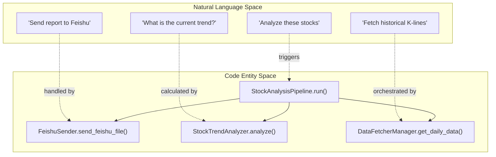
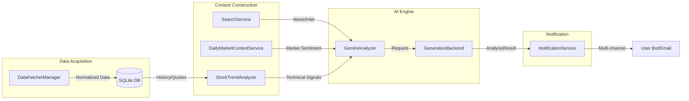

<!-- source: DeepWiki mcp.deepwiki.com · repo ZhuLinsen/daily_stock_analysis · page 11 Glossary · fetched 2026-10-29 -->

# Glossary

Relevant source files

The following files were used as context for generating this wiki page:

- [.env.example](.env.example)
- [.github/workflows/00-daily-analysis.yml](.github/workflows/00-daily-analysis.yml)
- [README.md](README.md)
- [data_provider/akshare_fetcher.py](data_provider/akshare_fetcher.py)
- [data_provider/baostock_fetcher.py](data_provider/baostock_fetcher.py)
- [data_provider/base.py](data_provider/base.py)
- [data_provider/efinance_fetcher.py](data_provider/efinance_fetcher.py)
- [data_provider/pytdx_fetcher.py](data_provider/pytdx_fetcher.py)
- [data_provider/tushare_fetcher.py](data_provider/tushare_fetcher.py)
- [data_provider/yfinance_fetcher.py](data_provider/yfinance_fetcher.py)
- [docs/CHANGELOG.md](docs/CHANGELOG.md)
- [docs/README_CHT.md](docs/README_CHT.md)
- [docs/README_EN.md](docs/README_EN.md)
- [docs/bot/feishu-bot-config.md](docs/bot/feishu-bot-config.md)
- [docs/full-guide.md](docs/full-guide.md)
- [docs/full-guide_EN.md](docs/full-guide_EN.md)
- [docs/market-support.md](docs/market-support.md)
- [docs/notifications.md](docs/notifications.md)
- [docs/run-diagnostics-p0.md](docs/run-diagnostics-p0.md)
- [src/agent/executor.py](src/agent/executor.py)
- [src/agent/orchestrator.py](src/agent/orchestrator.py)
- [src/analyzer.py](src/analyzer.py)
- [src/config.py](src/config.py)
- [src/core/pipeline.py](src/core/pipeline.py)
- [src/core/trading_calendar.py](src/core/trading_calendar.py)
- [src/data/stock_index_loader.py](src/data/stock_index_loader.py)
- [src/market_context.py](src/market_context.py)
- [src/notification.py](src/notification.py)
- [src/notification_sender/feishu_sender.py](src/notification_sender/feishu_sender.py)
- [src/services/stock_code_utils.py](src/services/stock_code_utils.py)
- [tests/test_a_share_fetcher_code_conversion.py](tests/test_a_share_fetcher_code_conversion.py)
- [tests/test_agent_executor.py](tests/test_agent_executor.py)
- [tests/test_data_fetcher_prefetch_stock_names.py](tests/test_data_fetcher_prefetch_stock_names.py)
- [tests/test_jp_kr_market_support.py](tests/test_jp_kr_market_support.py)
- [tests/test_multi_agent.py](tests/test_multi_agent.py)
- [tests/test_notification.py](tests/test_notification.py)
- [tests/test_notification_sender.py](tests/test_notification_sender.py)
- [tests/test_stock_code_bse.py](tests/test_stock_code_bse.py)
- [tests/test_stock_code_utils.py](tests/test_stock_code_utils.py)
- [tests/test_stock_index_loader.py](tests/test_stock_index_loader.py)
- [tests/test_trading_calendar.py](tests/test_trading_calendar.py)

This page defines codebase-specific terms, financial jargon, and system concepts used within the `daily_stock_analysis` project. It serves as a technical reference for onboarding engineers to understand how domain concepts map to code entities.

## 1. Core System Concepts

### 1.1. Pipeline (StockAnalysisPipeline)
The central orchestration engine that manages the lifecycle of a stock analysis task. It coordinates data fetching, technical analysis, news searching, AI processing, and notification dispatching [src/core/pipeline.py:7-12](). It handles concurrency via `ThreadPoolExecutor` [src/core/pipeline.py:19-22]().

### 1.2. Decision Dashboard (决策仪表盘)
The structured output generated by the AI, containing a "core conclusion," "scoring," "trend prediction," "entry/exit levels," and "risk alerts" [README.md:41-45]().

### 1.3. Agent Skill (策略技能)
Modular trading rules or analytical capabilities (e.g., `严进策略` - strict entry, `趋势交易` - trend trading) embedded as system prompts or YAML-based skills [src/analyzer.py:25-31](). These guide the AI's decision-making logic.

### 1.4. Multi-Agent Orchestrator
An advanced execution mode where specialized agents (Technical, Intel, Risk, Decision, Research) collaborate via a ReAct loop [docs/CHANGELOG.md:27-28](). It supports orchestration modes like `quick`, `standard`, and `full`.

### 1.5. Generation Backend
An abstraction layer allowing the system to switch between different LLM execution environments. While `litellm` is the default, the system also supports local CLI backends like `codex_cli`, `claude_code_cli`, and `opencode_cli` [src/config.py:128-134]().

**Sources:** [src/core/pipeline.py:7-22](), [README.md:41-45](), [src/analyzer.py:25-31](), [docs/CHANGELOG.md:27-28](), [src/config.py:128-134]().

---

## 2. Financial & Market Terms (Domain Jargon)

| Term | Chinese | Definition | Code Entity |
|:---|:---|:---|:---|
| **MA** | 均线 | Moving Average. Technical indicator used for trend detection [README.md:46-48](). | `StockTrendAnalyzer` |
| **Chip Distribution** | 筹码分布 | Analysis of investor cost basis, including profit ratios and concentration [src/core/pipeline.py:30-31](). | `ChipDistribution` |
| **Three Major Institutions** | 三大法人 | Specific to the Taiwan market (TW), refers to Foreign Investors, Investment Trusts, and Dealers [docs/CHANGELOG.md:47-48](). | `TwInstitutionalFetcher` |
| **Market Phase** | 交易时段 | The current status of the market (e.g., `premarket`, `intraday`, `closing_auction`, `non_trading`) [src/analyzer.py:175-181](). | `market_phase_context` |
| **Signal Attribution** | 信号归因 | The process of identifying which specific factors (technical, news, or risk) led to a particular AI decision [docs/CHANGELOG.md:98](). | `DecisionSignal` |
| **FIFO / AVG Cost** | 财务计价 | Methods for calculating portfolio cost basis: First-In-First-Out or Average Cost [docs/full-guide.md:37-38](). | `Portfolio P0 System` |

**Sources:** [README.md:46-48](), [src/core/pipeline.py:30-31](), [docs/CHANGELOG.md:47-98](), [src/analyzer.py:175-181]().

---

## 3. Technical Abbreviations & Code Entities

### 3.1. Data Fetchers
The system uses a **Strategy Pattern** for data acquisition, managed by `DataFetcherManager` [data_provider/base.py:7-10]().

*   **EF (EFinance)**: Priority 0. Primary source for real-time quotes and A-share data [data_provider/base.py:43-45]().
*   **AK (AkShare)**: Priority 1. Broad coverage for Chinese markets [data_provider/base.py:31]().
*   **TS (Tushare)**: Priority 2. Professional API requiring a token [.env.example:23-24]().
*   **LB (Longbridge)**: Priority 5. Preferred for HK/US stocks, providing advanced metrics like volume ratio [.env.example:78-82]().
*   **YF (YFinance)**: Priority 4. Used for US/JP/KR/TW market data [data_provider/base.py:32]().

### 3.2. Mapping Natural Language to Code Entities

**Title: System Concept to Code Mapping**

**Sources:** [src/core/pipeline.py:165-180](), [src/notification_sender/feishu_sender.py:27](), [data_provider/base.py:7-15](), [src/analyzer.py:80-81]().

---

## 4. System Architecture Flow

**Title: Analysis Pipeline Data Flow**

**Sources:** [src/core/pipeline.py:7-12](), [src/analyzer.py:54-65](), [src/config.py:128-134](), [src/notification.py:177-192]().

---

## 5. Configuration Terms

*   **STOCK_LIST**: A flexible, comma-separated string of stock codes supporting multiple delimiters (comma, space, newline) [.env.example:6-9]().
*   **REPORT_LANGUAGE**: Controls the output language (`zh`, `en`, `ko`) for prompts, templates, and UI [docs/CHANGELOG.md:43]().
*   **FAIL-OPEN**: A resilience pattern where the system continues execution even if non-critical components (like a specific news source) fail [docs/CHANGELOG.md:19]().
*   **CIRCUIT BREAKER**: A mechanism in `DataFetcherManager` to temporarily disable failing data sources [data_provider/base.py:33]().
*   **HERMES**: A reserved internal HTTP generation channel for local model integration [src/config.py:61-72]().

**Sources:** [.env.example:6-9](), [docs/CHANGELOG.md:19-43](), [data_provider/base.py:33](), [src/config.py:61-72]().

---

## 6. Codebase Specific File Roles

| File Path | Role |
|:---|:---|
| `main.py` | Entry point for CLI, API server, and scheduled analysis tasks [docs/full-guide.md:11](). |
| `src/config.py` | Singleton manager for environment variables and runtime settings [src/config.py:7-11](). |
| `src/analyzer.py` | Orchestrates LLM prompt construction and response parsing [src/analyzer.py:7-11](). |
| `src/core/pipeline.py` | Manages the end-to-end stock analysis workflow [src/core/pipeline.py:7-12](). |
| `data_provider/base.py` | Defines the interface and management for multi-source data fetching [data_provider/base.py:7-15](). |
| `src/notification.py` | Handles report generation and multi-channel distribution [src/notification.py:7-16](). |

**Sources:** [docs/full-guide.md:11](), [src/config.py:7-11](), [src/analyzer.py:7-11](), [src/core/pipeline.py:7-12](), [data_provider/base.py:7-15](), [src/notification.py:7-16]().