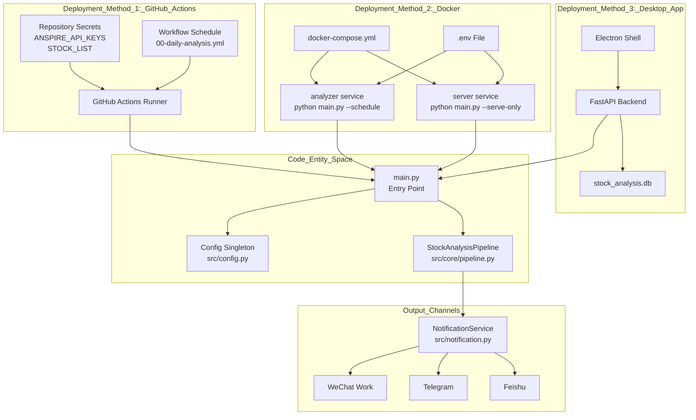
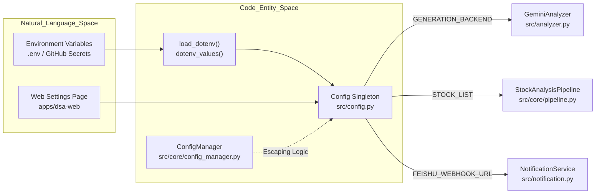

<!-- source: DeepWiki mcp.deepwiki.com · repo ZhuLinsen/daily_stock_analysis · page 2 Getting Started · fetched 2026-10-29 -->

# Getting Started

Relevant source files

The following files were used as context for generating this wiki page:

- [.env.example](.env.example)
- [README.md](README.md)
- [docs/CHANGELOG.md](docs/CHANGELOG.md)
- [docs/README_CHT.md](docs/README_CHT.md)
- [docs/README_EN.md](docs/README_EN.md)
- [docs/full-guide.md](docs/full-guide.md)
- [docs/full-guide_EN.md](docs/full-guide_EN.md)
- [src/config.py](src/config.py)
- [src/core/pipeline.py](src/core/pipeline.py)

This page provides an overview of initial setup requirements and deployment options for the A-share/HK/US intelligent stock analysis system. After reading this page, you will understand the system prerequisites, deployment method trade-offs, and minimum configuration needed to run your first analysis.

For detailed step-by-step installation instructions, see [Quick Start Guide](#2.1). For comprehensive configuration reference, see [Configuration Reference](#2.2). For deployment-specific details, see [Deployment Guide](#7).

**Sources:** [README.md:1-164](), [docs/full-guide.md:1-40]()

---

## System Prerequisites

Before deploying the system, ensure your environment meets the following requirements:

| Component | Requirement | Notes |
|-----------|-------------|-------|
| **Python** | 3.10 or higher | Required for all deployment methods except GitHub Actions [README.md:8]() |
| **Operating System** | Linux, macOS, or Windows | Windows installation support and desktop builds provided [docs/CHANGELOG.md:42,49]() |
| **Memory** | 512MB minimum | 1GB+ recommended for concurrent analysis [README.md:123]() |
| **Network** | Internet connection | Required for API calls to AI models, data sources, and notifications |

**Optional Dependencies:**

| Tool | Purpose | Installation |
|------|---------|--------------|
| `wkhtmltopdf` | Markdown-to-image conversion | Required if `MD2IMG_ENGINE=wkhtmltoimage` [docs/full-guide.md:130]() |
| `markdown-to-file` | Enhanced emoji support for images | Required if `MD2IMG_ENGINE=markdown-to-file` [docs/full-guide.md:130]() |
| Docker & Compose | Containerized deployment | Recommended for Web UI usage [docs/full-guide.md:31]() |
| Node.js / npm | Web UI development | Required for building the `apps/dsa-web` frontend [docs/CHANGELOG.md:18,59]() |

**Sources:** [README.md:8,123](), [docs/full-guide.md:31,130](), [docs/CHANGELOG.md:18,42,49,59](), [src/config.py:105]()

---

## Deployment Architecture Overview

The system supports multiple deployment methods, all converging on the orchestration logic defined in `main.py` and the `StockAnalysisPipeline`.

Title: System Deployment and Execution Flow

**Deployment Method Comparison:**

| Method | Pros | Cons | Best For |
|--------|------|------|----------|
| **GitHub Actions** | Zero cost, no server needed [README.md:69]() | Limited to scheduled runs | Individual users |
| **Docker** | Consistent environment, Web UI [docs/full-guide.md:31]() | Requires server resources | Multi-user / 24/7 service |
| **Desktop App** | GUI-driven, portable mode [docs/CHANGELOG.md:17,44]() | OS-specific builds | Local desktop users |

**Sources:** [README.md:65-151](), [docs/full-guide.md:31-50](), [docs/CHANGELOG.md:17,44](), [src/core/pipeline.py:165]()

---

## Minimum Configuration Requirements

The system requires three categories of configuration via environment variables (Secrets or `.env`).

### 1. AI Model Provider (Required - Choose One)

The system uses `litellm` as the default generation backend [src/config.py:134]().

| Provider | Key Variable | Notes |
|----------|--------------|-------|
| **Anspire** | `ANSPIRE_API_KEYS` | All-in-one model and search [README.md:84]() |
| **AIHubMix** | `AIHUBMIX_KEY` | Unified access to multiple model families [README.md:86]() |
| **Gemini** | `GEMINI_API_KEY` | Free tier via Google AI Studio [README.md:87]() |
| **DeepSeek** | `DEEPSEEK_API_KEY` | Cost-effective performance [.env.example:153]() |

### 2. Notification Channel (Required - Choose At Least One)

| Channel | Variables | Setup |
|---------|-----------|-------|
| **WeChat Work** | `WECHAT_WEBHOOK_URL` | Simple Webhook [README.md:97]() |
| **Feishu** | `FEISHU_WEBHOOK_URL` | Supports file upload and signatures [docs/CHANGELOG.md:27]() |
| **Telegram** | `TELEGRAM_BOT_TOKEN` | Paired with `TELEGRAM_CHAT_ID` [README.md:99]() |
| **DingTalk** | `DINGTALK_WEBHOOK_URL` | New support for group bots [docs/CHANGELOG.md:42]() |

### 3. Stock Watchlist (Required)

Define stocks in `STOCK_LIST` as a comma-separated string [.env.example:9]().
- **A-shares**: `600519`, `300750`
- **HK stocks**: `hk00700` [README.md:110]()
- **US stocks**: `AAPL` [README.md:110]()
- **Global**: Supports `.T` (JP), `.KS` (KR), `.TW` (TW) [README.md:110]()

**Sources:** [README.md:78-111](), [docs/CHANGELOG.md:27,42](), [.env.example:1-163](), [src/config.py:102-110]()

---

## Configuration Loading Flow

Title: Configuration to Code Mapping

**Key Configuration Logic:**
- **Singleton Pattern**: The `Config` class manages global settings from `.env` and environment [src/config.py:8-11]().
- **Normalization**: Input like `STOCK_LIST` is parsed to handle multiple separators (commas, spaces, newlines) [docs/CHANGELOG.md:18]().
- **Validation**: `ConfigIssue` objects track configuration errors/warnings during startup [src/config.py:83-99]().

**Sources:** [src/config.py:1-99](), [docs/CHANGELOG.md:18](), [src/core/pipeline.py:198-207]()

---

## Basic Analysis Workflow

Once configured, the system follows this execution flow managed by the orchestrator.

1.  **Data Acquisition**: `DataFetcherManager` coordinates multi-source fetching. For HK/US, `Longbridge` is preferred for fields like turnover ratio [README.md:136]().
2.  **Context Enrichment**:
    *   **Intelligence**: `IntelligenceService` pulls news and sentiment [src/core/pipeline.py:61]().
    *   **Search**: Integrated search providers (Anspire, SerpAPI) provide real-time context [README.md:118-120]().
3.  **AI Analysis**: The `StockAnalysisPipeline` coordinates the `GeminiAnalyzer` to produce an `AnalysisResult` [src/core/pipeline.py:31-38]().
4.  **Notification**: `NotificationService` renders reports (Simple/Full/Brief) and pushes to channels [docs/full-guide.md:118-119]().

**Sources:** [src/core/pipeline.py:1-80](), [README.md:112-138](), [docs/full-guide.md:113-140]()

---

## Verification Steps

After setup, verify your installation using these methods:

1.  **Startup Diagnostics**: Check logs for "未配置" (unconfigured) warnings; these are often informational and don't prevent execution if fallbacks exist [README.md:130]().
2.  **CLI Check**: Validate notification configuration without running a full analysis:
    `python main.py --check-notify` [docs/full-guide.md:72]()
3.  **Manual Trigger**: Use GitHub Actions `Run workflow` button to test the cloud setup [README.md:146]().

**Sources:** [README.md:130-151](), [docs/full-guide.md:72]()

---

## Next Steps

*   **[Quick Start Guide](#2.1)**: Step-by-step walkthrough for first-time setup on GitHub Actions or Local.
*   **[Configuration Reference](#2.2)**: Detailed reference for all environment variables and multi-channel LLM settings.
*   **[Deployment Guide](#7)**: Advanced deployment instructions (Docker, Systemd, Desktop App).

**Sources:** [README.md:18-20](), [docs/full-guide.md:26-38]()

---

