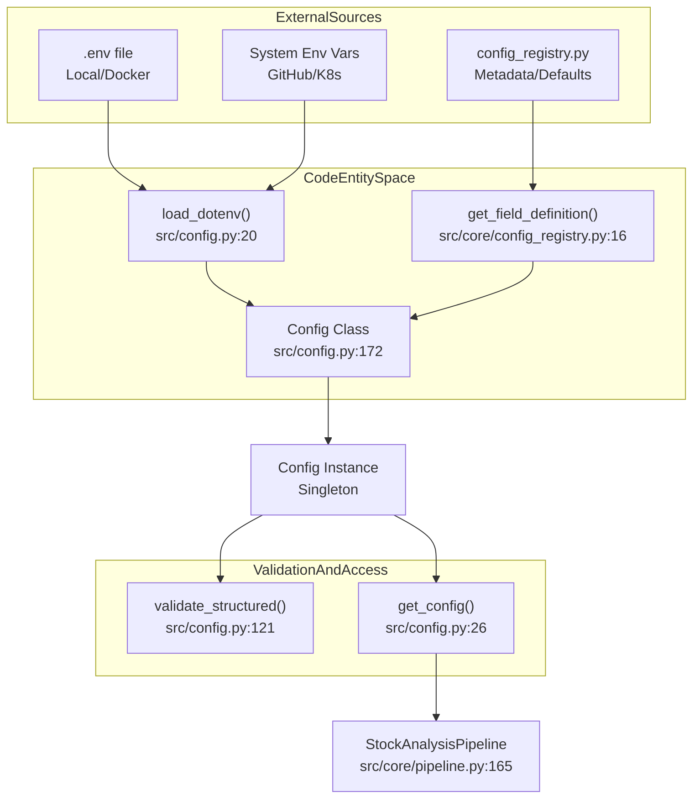
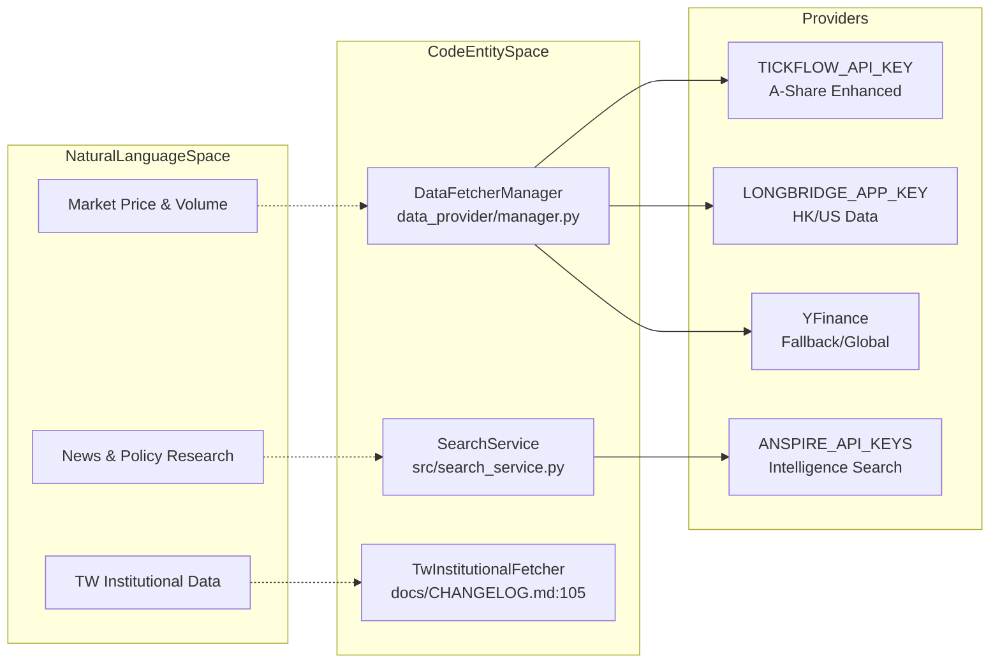

<!-- source: DeepWiki mcp.deepwiki.com · repo ZhuLinsen/daily_stock_analysis · page 2.2 Configuration Reference · fetched 2026-10-29 -->

# Configuration Reference

<details>
<summary>Relevant source files</summary>

The following files were used as context for generating this wiki page:

- [.env.example](.env.example)
- [apps/dsa-web/src/locales/settingsHelp.ts](apps/dsa-web/src/locales/settingsHelp.ts)
- [apps/dsa-web/src/utils/systemConfigI18n.ts](apps/dsa-web/src/utils/systemConfigI18n.ts)
- [docs/CHANGELOG.md](docs/CHANGELOG.md)
- [docs/full-guide.md](docs/full-guide.md)
- [docs/full-guide_EN.md](docs/full-guide_EN.md)
- [src/config.py](src/config.py)
- [src/core/config_registry.py](src/core/config_registry.py)
- [src/core/pipeline.py](src/core/pipeline.py)
- [tests/test_config_registry.py](tests/test_config_registry.py)
- [tests/test_config_validate_structured.py](tests/test_config_validate_structured.py)

</details>


This page provides a comprehensive reference for all environment variables and configuration options in the A-share/HK/US intelligent stock analysis system. All configuration is managed through the `Config` singleton class, which loads settings from environment variables and `.env` files, providing a unified interface for the entire codebase.

**Scope**: This document covers configuration syntax, available options, default values, and validation rules. For deployment-specific setup instructions, see [Environment Variables Guide](#7.5). For quick start instructions, see [Quick Start Guide](#2.1).

---

## Configuration System Overview

The system uses a centralized configuration management pattern with the following characteristics:

- **Singleton Pattern**: Global configuration accessed via `Config.get_instance()` or the `get_config()` helper [src/config.py:26]().
- **Multi-Source Loading**: Reads from `.env` files via `python-dotenv` and system environment variables [src/config.py:20]().
- **Type Safety**: Configuration fields are defined as typed dataclass attributes with specialized parsers for booleans, integers, and floats [src/config.py:207-250]().
- **Hot Reload**: Supports runtime refresh of parameters like `STOCK_LIST` or `SCHEDULE_TIMES` without application restart [docs/CHANGELOG.md:18, 110]().
- **Metadata Registry**: Centralized field definitions including categories, UI controls, and validation hints [src/core/config_registry.py:23-72]().

**Sources:** [src/config.py:1-26]() | [src/core/config_registry.py:1-72]() | [.env.example:1-10]()

---

## Configuration Loading Flow

The following diagram illustrates how configuration moves from external sources into the system's runtime memory.

**Title: Configuration Initialization and Resolution Flow**


**Sources:** [src/config.py:20-165]() | [src/core/config_registry.py:1-22]() | [src/core/pipeline.py:165-207]()

---

## Configuration Categories

Configuration is organized into functional categories to simplify management via the Web UI and environment files.

| Category | Title | Description |
| :--- | :--- | :--- |
| `base` | Base Settings | Watchlist and foundational application settings [src/core/config_registry.py:24-29](). |
| `ai_model` | AI Model | Model providers, model names, and inference parameters [src/core/config_registry.py:30-35](). |
| `data_source` | Data Source | Market data provider credentials and priority settings [src/core/config_registry.py:37-41](). |
| `notification` | Notification | Bot, webhook, and push channel related settings [src/core/config_registry.py:42-47](). |
| `agent` | Agent | Agent mode and strategy-skill settings [src/core/config_registry.py:54-59](). |
| `system` | System | Runtime, scheduling, and logging controls [src/core/config_registry.py:48-53](). |
| `backtest` | Backtest | Backtest engine behavior and evaluation parameters [src/core/config_registry.py:60-65](). |

**Sources:** [src/core/config_registry.py:23-72]() | [apps/dsa-web/src/utils/systemConfigI18n.ts:4-25]()

---

## AI Model Configuration (Generation Backends)

The system supports multiple generation backends beyond traditional API calls. The primary orchestrator is `litellm`, but local CLI-based backends are available for experimental use.

### Core Generation Parameters

| Variable | Type | Default | Description |
| :--- | :--- | :--- | :--- |
| `GENERATION_BACKEND` | `str` | `litellm` | Generation method: `litellm`, `codex_cli`, `claude_code_cli`, `opencode_cli` [src/core/config_registry.py:121-136](). |
| `GENERATION_FALLBACK_BACKEND` | `str` | `litellm` | Backend-level fallback if the primary backend fails [src/core/config_registry.py:180-194](). |
| `LITELLM_MODEL` | `str` | `None` | Primary model in `provider/model` format [src/core/config_registry.py:103-119](). |
| `LLM_TEMPERATURE` | `float` | `0.7` | Sampling temperature for text generation [src/core/config_registry.py:170-180](). |
| `GENERATION_BACKEND_TIMEOUT_SECONDS`| `int` | `300` | Timeout for local CLI backend execution [src/config.py:54, 140](). |

### Multi-Channel Mode
When `LLM_CHANNELS` is defined, the system enables unified channel management. Each channel is configured using the prefix `LLM_{CHANNEL_NAME}_` [docs/full-guide.md:120-123]().

**Example:**
```env
LLM_CHANNELS=deepseek,aihubmix
LLM_DEEPSEEK_API_KEY=sk-xxx
LLM_AIHUBMIX_API_KEY=sk-yyy
```

**Sources:** [src/config.py:40-72]() | [src/core/config_registry.py:121-194]() | [.env.example:115-145]()

---

## Agent & Strategy Configuration

Controls the ReAct Agent's behavior, multi-agent orchestration, and specialized sub-agent timeouts.

| Variable | Type | Default | Description |
| :--- | :--- | :--- | :--- |
| `AGENT_MODE` | `bool` | `false` | Enable Agent-based strategy analysis [apps/dsa-web/src/utils/systemConfigI18n.ts:187](). |
| `AGENT_ORCHESTRATOR_MODE` | `str` | `standard` | Orchestration depth: `quick`, `standard`, `full`, `specialist` [apps/dsa-web/src/utils/systemConfigI18n.ts:193](). |
| `AGENT_MAX_STEPS` | `int` | `10` | Maximum reasoning steps for the Agent loop [src/config.py:162](). |
| `AGENT_LITELLM_MODEL` | `str` | `None` | Specific model for Agent tasks (inherits `LITELLM_MODEL` if empty) [apps/dsa-web/src/utils/systemConfigI18n.ts:85](). |

**Agent Timeouts (Phase 6a):**
Sub-agents now support independent timeout clamps to prevent one agent from exhausting the entire pipeline budget [docs/CHANGELOG.md:28](). Variables include `TECHNICAL_AGENT_TIMEOUT`, `INTEL_AGENT_TIMEOUT`, `RISK_AGENT_TIMEOUT`, etc.

**Sources:** [src/config.py:162-204]() | [docs/CHANGELOG.md:28]() | [apps/dsa-web/src/utils/systemConfigI18n.ts:187-196]()

---

## Notification & Delivery Configuration

The `NotificationService` manages delivery to 10+ channels with support for localization and integrity checks.

### Global Delivery Settings
| Variable | Type | Default | Description |
| :--- | :--- | :--- | :--- |
| `REPORT_LANGUAGE` | `str` | `zh` | Language for reports: `zh`, `en`, `ko` [docs/CHANGELOG.md:43, 119](). |
| `SINGLE_STOCK_NOTIFY` | `bool` | `false` | Push immediately after each stock analysis [docs/full-guide.md:117](). |
| `REPORT_TYPE` | `str` | `simple` | Verbosity: `simple`, `full`, `brief` [docs/full-guide.md:118](). |
| `FEISHU_SEND_AS_FILE` | `bool` | `false` | Send report as a file instead of a text message on Feishu [docs/CHANGELOG.md:27](). |

**Sources:** [docs/full-guide.md:70-140]() | [docs/CHANGELOG.md:27, 43]() | [src/config.py:113-137]()

---

## Data Source & Search Configuration

The system manages a priority-based failover for market data and intelligence search.

**Title: Data Acquisition and Search Integration Map**


### Enhanced Data Sources
- **TickFlow**: Provides high-priority A-share daily K-lines and real-time quotes [docs/CHANGELOG.md:11, 116]().
- **Longbridge**: Preferred source for HK/US volume ratios and turnover [docs/full-guide.md:78-82]().
- **Anspire**: Unified key for LLM and Chinese-optimized web search [docs/full-guide.md:60]().

**Sources:** [docs/full-guide.md:56-107]() | [docs/CHANGELOG.md:11, 105, 116]() | [.env.example:22-110]()

---

## System & Scheduling Configuration

| Variable | Type | Default | Description |
| :--- | :--- | :--- | :--- |
| `STOCK_LIST` | `str` | `None` | Comma-separated stock codes (e.g., `600519,AAPL,00700`) [src/core/config_registry.py:88-105](). |
| `SCHEDULE_TIMES` | `str` | `None` | Multiple execution times (e.g., `09:30,15:00,18:00`) [docs/CHANGELOG.md:110](). |
| `WEBUI_HOST` | `str` | `127.0.0.1` | WebUI binding address [docs/CHANGELOG.md:12, 60](). |
| `NEWS_INTEL_AUTO_FETCH_ENABLED` | `bool` | `false` | Automatically refresh local RSS/News news pool [docs/CHANGELOG.md:19](). |

**Sources:** [src/config.py:73, 138-160]() | [docs/CHANGELOG.md:12, 19, 110]() | [src/core/config_registry.py:88-117]()

---

