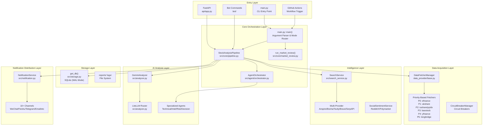
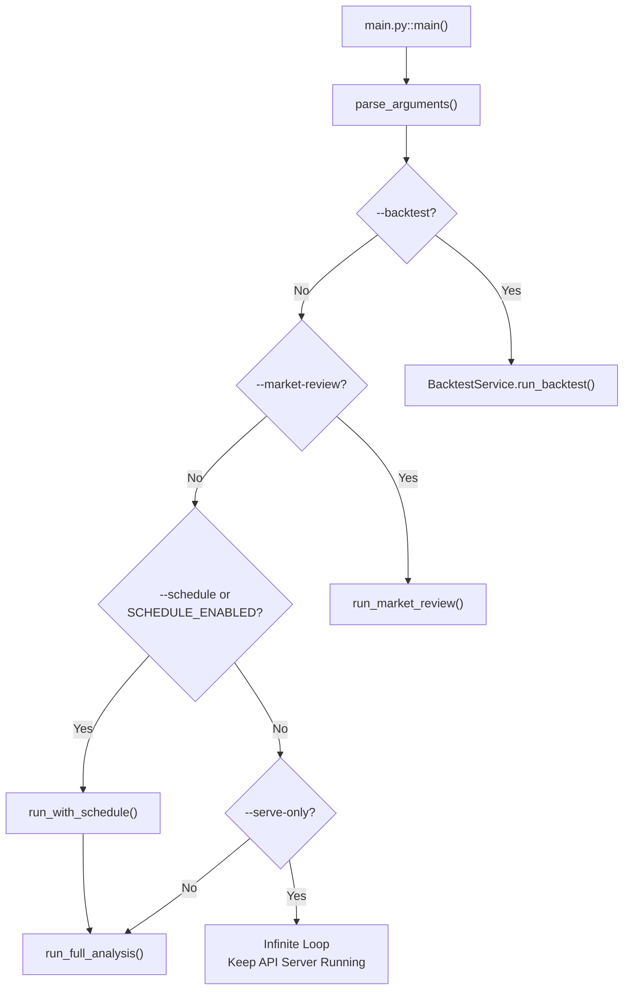
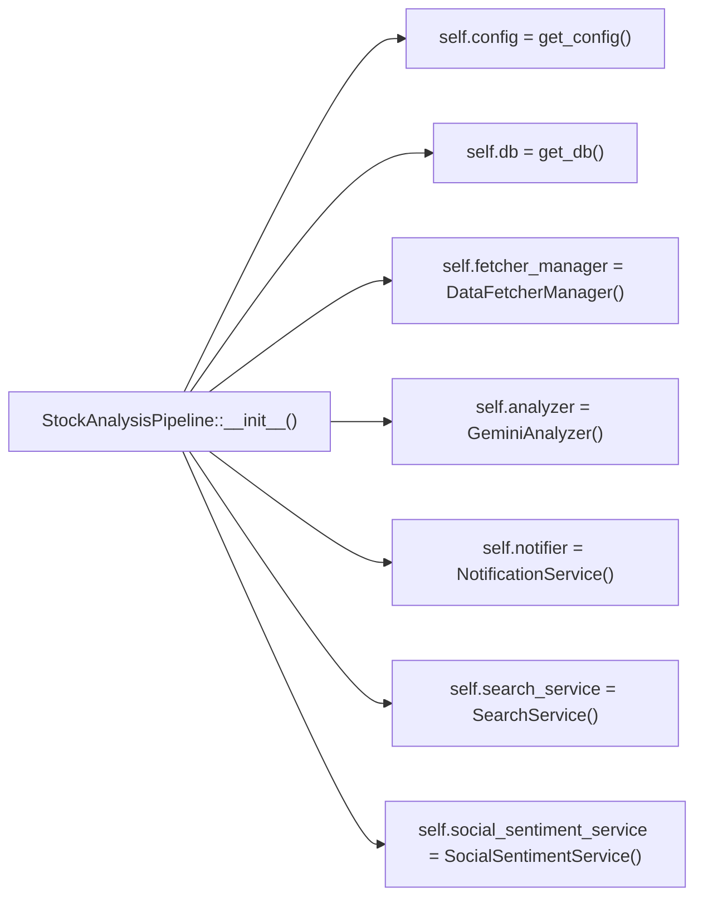
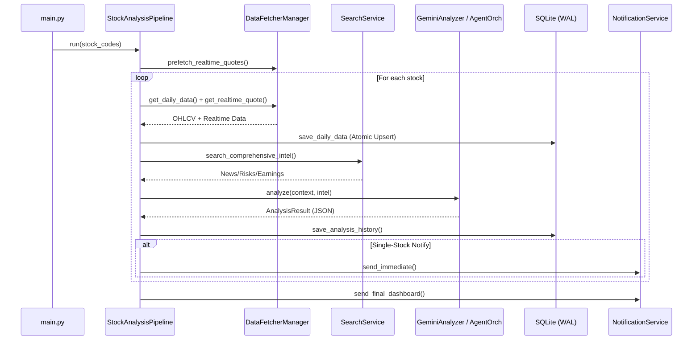

<!-- source: DeepWiki mcp.deepwiki.com · repo ZhuLinsen/daily_stock_analysis · page 3 System Architecture · fetched 2026-10-29 -->

# System Architecture

Relevant source files

The following files were used as context for generating this wiki page:

- [.env.example](.env.example)
- [README.md](README.md)
- [api/app.py](api/app.py)
- [api/v1/endpoints/__init__.py](api/v1/endpoints/__init__.py)
- [api/v1/endpoints/alerts.py](api/v1/endpoints/alerts.py)
- [api/v1/router.py](api/v1/router.py)
- [docs/CHANGELOG.md](docs/CHANGELOG.md)
- [docs/README_CHT.md](docs/README_CHT.md)
- [docs/README_EN.md](docs/README_EN.md)
- [docs/full-guide.md](docs/full-guide.md)
- [docs/full-guide_EN.md](docs/full-guide_EN.md)
- [src/config.py](src/config.py)
- [src/core/pipeline.py](src/core/pipeline.py)
- [tests/test_static_assets_consistency.py](tests/test_static_assets_consistency.py)

This document describes the high-level architecture of the A-share/HK/US intelligent stock analysis system, explaining the major components, their interactions, and the design patterns used throughout the codebase. It focuses on the system's structural organization and data flow patterns.

For details on specific components, see:
- [Core Architecture Patterns](#3.1) — Key architectural patterns including orchestration, strategy-based fetching, and resilience.
- [Data Flow Pipeline](#3.2) — Complete flow of data from acquisition to notification.
- [AI Analysis Philosophy](#3.3) — Embedded trading philosophy rules and the multi-agent strategy system.
- [External Service Integrations](#3.4) — Overview of AI APIs, data sources, and notification channels.

---

## Architectural Overview

The system implements a **layered architecture** with clear separation of concerns, organized into primary layers: Entry Points, Core Orchestration, Data Acquisition, Intelligence, AI Analysis, Storage, and Notification Distribution.

### System Layers Diagram

**Sources:** [main.py:1-42](), [src/core/pipeline.py:165-210](), [docs/full-guide.md:7-24](), [src/config.py:128-145]()

---

## Entry Points and Execution Modes

The system provides multiple entry mechanisms, all converging on the core processing engine:

### Entry Points Table

| Entry Point | File | Primary Class/Function | Execution Context |
|-------------|------|------------------------|-------------------|
| Command Line | `main.py` | `main()` | Direct Python execution |
| GitHub Actions | `.github/workflows/` | Triggers `main.py` | Serverless CI/CD |
| FastAPI Server | `api/app.py` | `create_app()` | HTTP REST API / Web UI |
| Bot Platforms | `bot/` | Bot interaction modules | Interactive messaging |

### Execution Mode Routing

**Key Implementation Details:**

The `main()` function acts as a **mode router**, dispatching to different execution paths based on command-line arguments and environment variables. The system now supports a sophisticated local CLI backend option (`codex_cli`, `claude_code_cli`) as an alternative to the default `litellm` generation backend [src/config.py:128-145]().

- **Backtest Mode**: Validates historical AI analysis accuracy using `--backtest` flags.
- **Market-Only Mode**: Executes only market review analysis via `--market-review`.
- **Schedule Mode**: Runs daily at configured time using an internal scheduler.
- **Serve-Only Mode**: Starts FastAPI server without auto-execution using `--serve-only`.
- **Normal Mode**: Single-run execution with full analysis.

**Sources:** [main.py:57-213](), [src/config.py:134-143]()

---

## Core Orchestration Layer

The orchestration layer coordinates the entire analysis workflow. For details, see [Core Architecture Patterns](#3.1).

### StockAnalysisPipeline

The `StockAnalysisPipeline` class ([src/core/pipeline.py:165-210]()) is the primary orchestrator. It manages the lifecycle from data fetching to notification distribution, including handling new features like `daily_market_context` [src/core/pipeline.py:188-190]().

**Initialization and Dependencies:**

**Sources:** [src/core/pipeline.py:175-210]()

---

## Data Acquisition Architecture

The data layer implements a **priority-based failover strategy** with multi-source support. For details, see [External Service Integrations](#3.4).

### DataFetcherManager Priority Chain

The `DataFetcherManager` orchestrates multiple fetchers. It now includes enhanced support for Taiwan stocks (TWSE/TPEx) and refined handling for `TickFlow` as a high-priority A-share source [docs/CHANGELOG.md:95-105]().

| Priority | Fetcher | Markets | Source |
|----------|---------|---------|--------|
| 0 | `EfinanceFetcher` | A/HK/US | East Money |
| 1 | `AkshareFetcher` | A/HK/US | Multiple (EM/Sina) |
| 2 | `TushareFetcher` | A-Share | Tushare Pro (Token req.) |
| 2 | `PytdxFetcher` | A-Share | Tongdaxin Servers |
| 3 | `BaostockFetcher` | A-Share | Baostock |
| 4 | `YfinanceFetcher` | HK/US/TW | Yahoo Finance |
| 5 | `LongbridgeFetcher` | HK/US | Longbridge OpenAPI |

**Resilience Features:**
- **Circuit Breakers**: Tracks source health and skips failing providers.
- **Atomic Upsert**: SQLite uses `WAL` mode and atomic upserts to handle concurrent writes during parallel analysis.
- **Fail-open Logic**: News intelligence and AlphaSift fetching now support fail-open initialization to prevent pipeline blocks [docs/CHANGELOG.md:19-23]().

**Sources:** [data_provider/base.py:1-50](), [.env.example:42-68](), [docs/CHANGELOG.md:52-56]()

---

## Intelligence and Search Layer

The `SearchService` class ([src/search_service.py]()) gathers multi-dimensional intelligence with provider rotation. For details, see [External Service Integrations](#3.4).

### Multi-Dimensional Search Architecture

The system searches across five dimensions:
1. **Latest News**: General updates.
2. **Risk Screening**: Negative news and regulatory issues.
3. **Earnings Outlook**: Financial reports and analyst expectations.
4. **Policy Impact**: Macro and industry policy changes.
5. **Technical Analysis**: External technical viewpoints.

**Providers**: Anspire (Chinese optimized), Bocha, Tavily, Brave (US optimized), and SerpAPI.

**Sources:** [src/core/pipeline.py:49-61](), [.env.example:113-134]()

---

## AI Analysis & Multi-Agent Engine

The AI layer supports both a standard single-analyzer flow and a sophisticated multi-agent orchestration. For details, see [AI Analysis Philosophy](#3.3).

### Multi-Agent Orchestration Modes

When `AGENT_ARCH=multi` is configured, the system uses `AgentOrchestrator` with specialized agents. Recent updates introduced independent timeout clamping for each sub-agent (Technical, Intel, Risk, Decision, etc.) to ensure balanced resource allocation [docs/CHANGELOG.md:28-29]().

### GeminiAnalyzer & Generation Backends

The system has moved towards a more abstract `GenerationBackend` model. While `litellm` remains the default, it now supports local CLI backends like `codex_cli` and `opencode_cli` for specific generation-only tasks [src/config.py:134-145]().

- **Model Cascading**: Primary → Fallback.
- **JSON Repair**: Automatic fixing of malformed LLM outputs.
- **Integrity Checks**: Validates mandatory fields in the analysis result.

**Sources:** [src/analyzer.py:31-38](), [src/config.py:40-59](), [docs/CHANGELOG.md:41-46]()

---

## Notification Distribution System

The `NotificationService` distributes reports across 10+ channels. For details, see [External Service Integrations](#3.4).

### Notification Modes

- **Single-Stock**: Pushes immediately after each individual stock analysis.
- **Batch/Dashboard**: Collects all results and sends a comprehensive "Decision Dashboard".
- **Merged**: Combines stock analysis and market review into a single message.
- **New Features**: Feishu now supports sending reports as files via `FEISHU_SEND_AS_FILE` [docs/CHANGELOG.md:27]().

**Sources:** [src/notification.py:1-40](), [docs/full-guide.md:70-110]()

---

## Configuration Management

The `Config` class ([src/config.py]()) is a singleton managing environment variables and UI settings.

### Configuration Hierarchy

1. **Environment Variables**: `.env` file or OS environment.
2. **Web UI Settings**: Stored in the database; hot-reload mechanisms allow runtime updates without restart [docs/CHANGELOG.md:97-98]().
3. **Registry Metadata**: Defines categories, descriptions, and validation rules for the Web UI.

**Sources:** [src/config.py:7-11](), [src/services/system_config_service.py:1-20]()

---

## Data Flow Summary

The complete data flow for a single stock analysis:

**Sources:** [src/core/pipeline.py:175-323](), [main.py:57-213]()

---

