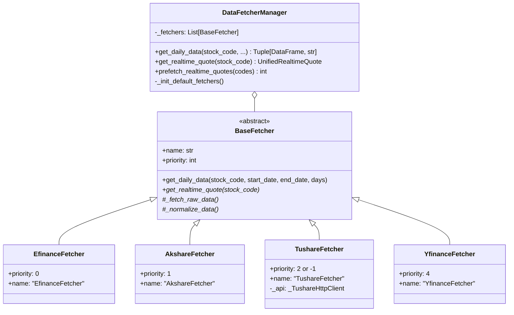
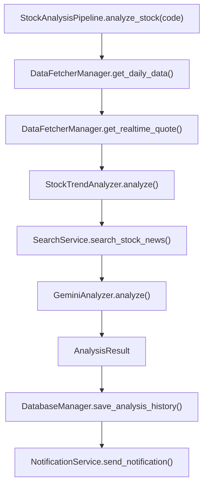
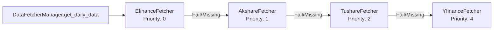

<!-- source: DeepWiki mcp.deepwiki.com · repo ZhuLinsen/daily_stock_analysis · page 3.1 Core Architecture Patterns · fetched 2026-10-29 -->

# Core Architecture Patterns

<details>
<summary>Relevant source files</summary>

The following files were used as context for generating this wiki page:

- [.env.example](.env.example)
- [api/v1/endpoints/analysis.py](api/v1/endpoints/analysis.py)
- [api/v1/endpoints/history.py](api/v1/endpoints/history.py)
- [api/v1/schemas/history.py](api/v1/schemas/history.py)
- [apps/dsa-web/src/types/analysis.ts](apps/dsa-web/src/types/analysis.ts)
- [data_provider/akshare_fetcher.py](data_provider/akshare_fetcher.py)
- [data_provider/baostock_fetcher.py](data_provider/baostock_fetcher.py)
- [data_provider/base.py](data_provider/base.py)
- [data_provider/efinance_fetcher.py](data_provider/efinance_fetcher.py)
- [data_provider/pytdx_fetcher.py](data_provider/pytdx_fetcher.py)
- [data_provider/tushare_fetcher.py](data_provider/tushare_fetcher.py)
- [data_provider/yfinance_fetcher.py](data_provider/yfinance_fetcher.py)
- [docs/CHANGELOG.md](docs/CHANGELOG.md)
- [docs/full-guide.md](docs/full-guide.md)
- [docs/full-guide_EN.md](docs/full-guide_EN.md)
- [docs/run-diagnostics-p0.md](docs/run-diagnostics-p0.md)
- [src/config.py](src/config.py)
- [src/core/pipeline.py](src/core/pipeline.py)
- [src/services/history_service.py](src/services/history_service.py)
- [src/storage.py](src/storage.py)
- [tests/test_a_share_fetcher_code_conversion.py](tests/test_a_share_fetcher_code_conversion.py)
- [tests/test_analysis_api_contract.py](tests/test_analysis_api_contract.py)
- [tests/test_analysis_history.py](tests/test_analysis_history.py)
- [tests/test_data_fetcher_prefetch_stock_names.py](tests/test_data_fetcher_prefetch_stock_names.py)
- [tests/test_stock_code_bse.py](tests/test_stock_code_bse.py)
- [tests/test_storage.py](tests/test_storage.py)

</details>


## Purpose and Scope

This document describes the core architectural patterns that structure the A-share/HK/US intelligent stock analysis system. These patterns define how major components interact, how the system achieves reliability through fault tolerance, and how it maintains flexibility through abstraction.

For information about how data flows through the system end-to-end, see [Data Flow Pipeline](3.2). For details on the AI analysis philosophy embedded in these patterns, see [AI Analysis Philosophy](3.3).

---

## Pattern Overview

The system implements five key architectural patterns:

| Pattern | Primary Location | Purpose |
|---------|-----------------|---------|
| **Strategy Pattern** | [data_provider/base.py:7-15]() | Multi-source data fetching with pluggable providers |
| **Circuit Breaker Pattern** | [data_provider/akshare_fetcher.py:19-20]() | Fault isolation for unreliable external APIs |
| **Pipeline/Orchestration Pattern** | [src/core/pipeline.py:4-12]() | Coordinated multi-step stock analysis workflow |
| **Priority-Based Failover** | [data_provider/base.py:13-15]() | Automatic data source switching on failure |
| **Singleton Configuration** | [src/config.py:7-11]() | Centralized configuration management |

These patterns work together to create a resilient, maintainable system that gracefully handles external service failures while maintaining consistent analysis quality.

---

## 1. Strategy Pattern: Pluggable Data Providers

### Architecture

The Strategy Pattern enables the system to abstract away data source differences behind a unified interface. The `BaseFetcher` abstract class defines the contract, while concrete implementations (`EfinanceFetcher`, `AkshareFetcher`, `TushareFetcher`, etc.) provide market-specific logic.

#### Class Hierarchy Diagram


**Sources:** [data_provider/base.py:7-15](), [data_provider/base.py:21-34](), [data_provider/akshare_fetcher.py:47-51]()

### Key Implementation Details

#### Unified Interface (BaseFetcher)

The abstract base class defines the contract all data providers must implement:

```python
# data_provider/base.py:21-34
class BaseFetcher(ABC):
    """
    数据源基类
    """
    @abstractmethod
    def get_daily_data(self, stock_code: str, days: int = 30) -> pd.DataFrame:
        pass

    @abstractmethod
    def get_realtime_quote(self, stock_code: str) -> Optional[UnifiedRealtimeQuote]:
        pass
```
The template method `get_daily_data()` orchestrates the fetch-normalize-clean-calculate workflow, while subclasses implement the source-specific data acquisition.

**Sources:** [data_provider/base.py:21-34]()

#### Dynamic Priority Assignment

The system demonstrates dynamic priority adjustment based on configuration, particularly for premium sources like Tushare or Longbridge. When a `TUSHARE_TOKEN` is configured, the fetcher's priority is elevated to allow it to override free sources.

**Sources:** [.env.example:23-24](), [.env.example:42-46]()

---

## 2. Circuit Breaker Pattern: Resilient External API Calls

### Architecture

The Circuit Breaker Pattern protects the system from cascading failures when external APIs (real-time quotes, chip distribution) become unreliable. It tracks failure rates and temporarily disables ("trips") misbehaving sources.

#### Circuit Breaker State Machine

```mermaid
stateDiagram-v2
    [*] --> "Closed": "is_available=True"
    "Closed" --> "Open": "failure_count >= threshold"
    "Open" --> "HalfOpen": "cooldown_period elapsed"
    "HalfOpen" --> "Closed": "success"
    "HalfOpen" --> "Open": "failure"
    
    note right of "Closed"
        "Normal operation"
        "Requests pass through"
    end note
    
    note right of "Open"
        "Circuit tripped"
        "Requests blocked"
        "Source skipped"
    end note
```
**Sources:** [data_provider/akshare_fetcher.py:19-20](), [data_provider/base.py:33-34]()

### Implementation: CircuitBreaker Integration

#### Failure Recording and State Management

The `CircuitBreaker` instances are managed via `get_realtime_circuit_breaker` and `get_chip_circuit_breaker`. These monitors ensure that if a source like EastMoney or Sina starts returning 403 or 500 errors, the system stops hammering them.

```python
# data_provider/akshare_fetcher.py:47-51
from .realtime_types import (
    UnifiedRealtimeQuote, ChipDistribution, RealtimeSource,
    get_realtime_circuit_breaker, get_chip_circuit_breaker,
    safe_float, safe_int
)
```
After reaching a failure threshold, the circuit trips and blocks subsequent requests for a cooldown period (typically 20 minutes, defined by the 1200s TTL in `AkshareFetcher`).

**Sources:** [data_provider/akshare_fetcher.py:47-51](), [data_provider/akshare_fetcher.py:80-88]()

---

## 3. Pipeline/Orchestration Pattern: Multi-Step Stock Analysis

### Architecture

The `StockAnalysisPipeline` class orchestrates a complex multi-stage workflow. It coordinates components including the `DataFetcherManager`, `StockTrendAnalyzer`, `SearchService`, and `GeminiAnalyzer` through a structured sequence.

#### Pipeline Flow Diagram


**Sources:** [src/core/pipeline.py:4-12](), [src/core/pipeline.py:165-173]()

### Key Components

#### 1. Pipeline Initialization

The constructor assembles all required services, ensuring a consistent environment for the analysis run:

```python
# src/core/pipeline.py:198-207
def __init__(
    self,
    config: Optional[Config] = None,
    max_workers: Optional[int] = None,
    ...
):
    self.config = config or get_config()
    self.fetcher_manager = DataFetcherManager()
    self.analyzer = GeminiAnalyzer(config=self.config)
```
**Sources:** [src/core/pipeline.py:198-207]()

#### 2. Concurrency Control

The pipeline uses `ThreadPoolExecutor` to handle multiple stocks simultaneously while maintaining safety via locks for notification and shared services.

**Sources:** [src/core/pipeline.py:15-19](), [src/core/pipeline.py:94-98]()

---

## 4. Priority-Based Failover: Graceful Degradation

### Architecture

The system implements a tiered failover strategy where data sources are attempted in priority order. If Priority 0 (`EfinanceFetcher`) fails or is unconfigured, the system automatically falls back to Priority 1 (`AkshareFetcher`).

#### Failover Sequence Diagram


**Sources:** [data_provider/base.py:7-15](), [.env.example:42-46]()

### Implementation Details

#### Code Normalization Fail-Open
The `normalize_stock_code` function ensures that input strings like `SH600519`, `600519.SH`, or `AAPL` are converted to the format expected by specific fetchers, preventing failure due to string mismatch.

**Sources:** [data_provider/base.py:70-97]()

---

## 5. Singleton Configuration: Centralized Settings

### Architecture

The `Config` class (accessed via `get_config()`) manages global settings, environment variables, and multi-source configuration. It uses a singleton pattern to ensure all components see the same runtime parameters.

```python
# src/config.py:7-11
"""
职责：
1. 使用单例模式管理全局配置
2. 从 .env 文件加载敏感配置
3. 提供类型安全的配置访问接口
"""
```
**Sources:** [src/config.py:7-11](), [src/config.py:82-95]()

### Summary: Pattern Benefits

| Pattern | Benefit | Implementation Reference |
|---------|---------|-------------------------|
| **Strategy** | Pluggable data sources | `BaseFetcher` [data_provider/base.py:21-34]() |
| **Circuit Breaker** | Fault isolation | `CircuitBreaker` [data_provider/akshare_fetcher.py:47-51]() |
| **Pipeline** | Structured workflow | `StockAnalysisPipeline` [src/core/pipeline.py:165-173]() |
| **Failover** | High availability | `DataFetcherManager` [data_provider/base.py:7-15]() |
| **Singleton** | Consistency | `Config` [src/config.py:7-11]() |

**Sources:** [data_provider/base.py:7-15](), [src/core/pipeline.py:4-12](), [src/config.py:7-11]()

---

