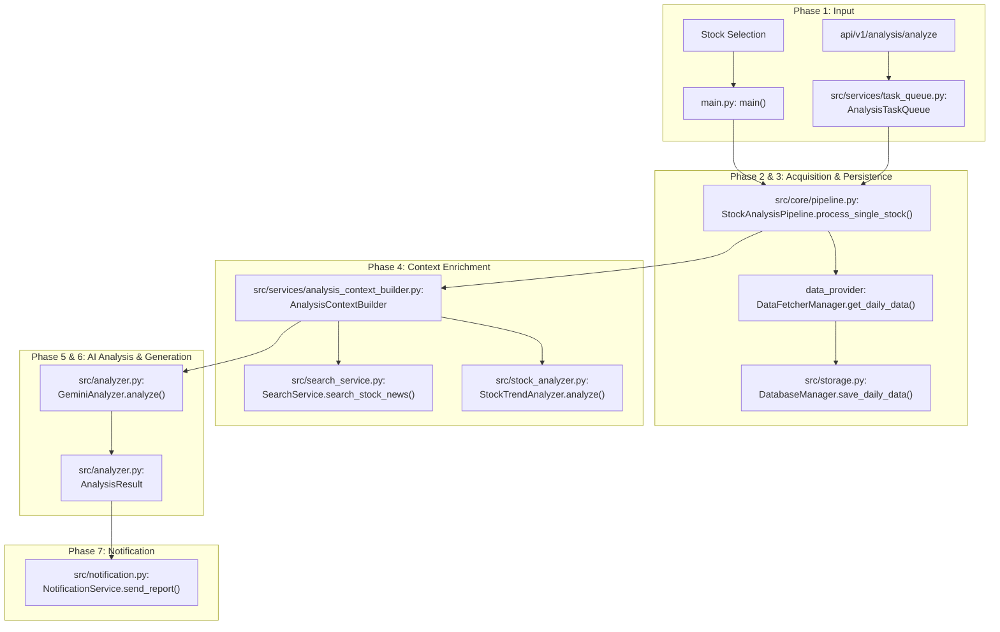
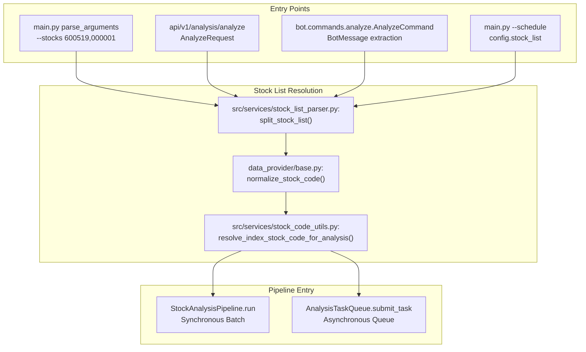
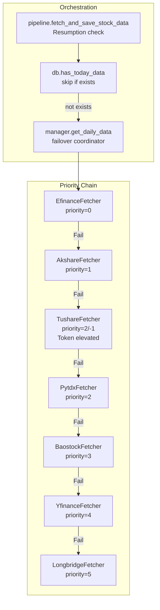
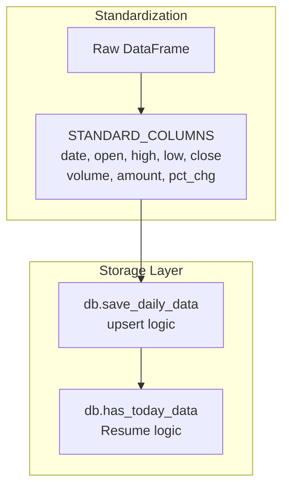
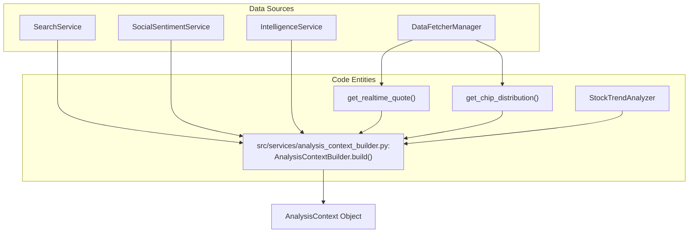
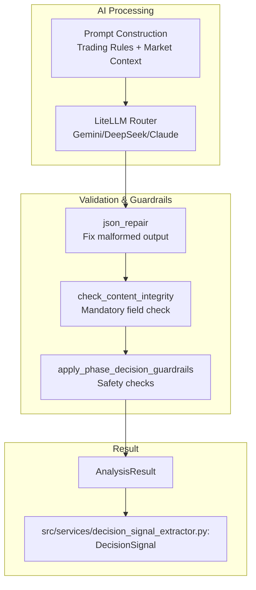
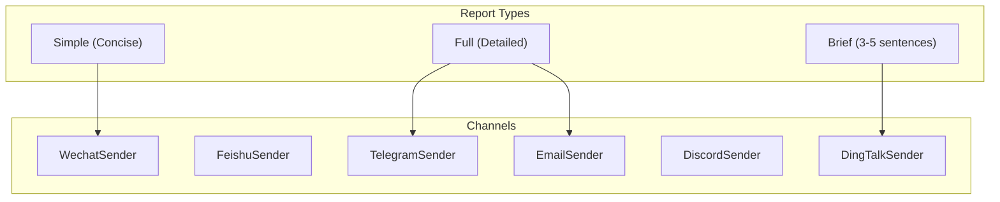

<!-- source: DeepWiki mcp.deepwiki.com · repo ZhuLinsen/daily_stock_analysis · page 3.2 Data Flow Pipeline · fetched 2026-10-29 -->

# Data Flow Pipeline

Relevant source files

The following files were used as context for generating this wiki page:

- [.env.example](.env.example)
- [api/v1/schemas/analysis.py](api/v1/schemas/analysis.py)
- [apps/dsa-web/src/api/analysis.ts](apps/dsa-web/src/api/analysis.ts)
- [docs/CHANGELOG.md](docs/CHANGELOG.md)
- [docs/full-guide.md](docs/full-guide.md)
- [docs/full-guide_EN.md](docs/full-guide_EN.md)
- [main.py](main.py)
- [src/config.py](src/config.py)
- [src/core/pipeline.py](src/core/pipeline.py)
- [src/services/analysis_service.py](src/services/analysis_service.py)
- [src/services/task_queue.py](src/services/task_queue.py)
- [tests/test_main_schedule_mode.py](tests/test_main_schedule_mode.py)

## Purpose and Scope

This document traces the complete data flow through the stock analysis system, from initial stock code input through data acquisition, enrichment, AI analysis, and final notification delivery. It maps high-level processing stages to specific code modules and classes.

For architectural patterns that enable this pipeline (Strategy, Circuit Breaker, etc.), see **3.1 Core Architecture Patterns**. For AI analysis philosophy and trading rules, see **3.3 AI Analysis Philosophy**. For external service integrations, see **3.4 External Service Integrations**.

---

## Pipeline Overview

The analysis pipeline consists of sequential phases, orchestrated by `StockAnalysisPipeline` and executed concurrently via `ThreadPoolExecutor` [src/core/pipeline.py:19-22](). It supports both synchronous (CLI/Scheduled) and asynchronous (Web API) execution modes.

### System-to-Code Mapping
The following diagram bridges the high-level functional stages to the primary classes and methods responsible for their execution.

**Sources:** [src/core/pipeline.py:165-173](), [main.py:4-11](), [src/services/task_queue.py:151-162](), [src/analyzer.py:31-38](), [src/services/analysis_context_builder.py:62-65]()

---

## Phase 1: Input & Stock Selection

Stock codes enter the pipeline through distinct entry points, converging on `StockAnalysisPipeline`.

**Key Code Entities:**
- `STOCK_LIST`: Environment variable for default watchlist [main.py:9]().
- `split_stock_list()`: Parses input strings into lists, supporting multiple delimiters (comma, newline, etc.) [docs/CHANGELOG.md:18]().
- `normalize_stock_code()`: Strips prefixes and suffixes [data_provider/base.py:29]().
- `AnalysisTaskQueue`: Manages lifecycle of async tasks and prevents duplicates via `_dedupe_stock_code_key` [src/services/task_queue.py:42-50]().

**Sources:** [main.py:71-72](), [src/services/task_queue.py:42-50](), [data_provider/base.py:29](), [api/v1/schemas/analysis.py:33-45]()

---

## Phase 2: Data Acquisition with Priority-Based Failover

Historical data is acquired through `DataFetcherManager`, implementing a priority-based strategy pattern.

**Fetcher Priority Resolution:**
- **Tushare Elevation:** If `TUSHARE_TOKEN` is configured, `TushareFetcher` priority is elevated to 0 [docs/full-guide.md:22]().
- **Longbridge Integration:** Preferred source for HK/US stocks (PE, Turnover, Volume Ratio) [docs/full-guide.md:78-79]().
- **TickFlow Enhancement:** Optional source for A-share daily K-lines and real-time quotes [docs/CHANGELOG.md:116-117]().

**Sources:** [src/core/pipeline.py:28](), [docs/full-guide.md:22](), [docs/CHANGELOG.md:116-117]()

---

## Phase 3: Data Persistence

Acquired data is standardized and persisted to SQLite.

**Persistence Logic:**
- **Resume Capability:** `StockAnalysisPipeline` checks if the database already has the latest trading day's data before initiating network requests [src/core/pipeline.py:83-84]().
- **Context Snapshots:** The system can persist the entire analysis context via `SAVE_CONTEXT_SNAPSHOT` (default `true`) for historical debugging [docs/full-guide.md:128]().

**Sources:** [src/core/pipeline.py:83-84](), [docs/full-guide.md:128]()

---

## Phase 4: Context Enrichment

The pipeline enriches historical data with real-time indicators and news intelligence via `AnalysisContextBuilder` [src/services/analysis_context_builder.py:62-63]().

### Enrichment Data Flow
This diagram shows how different data streams are merged into the final `AnalysisContext`.

**Enrichment Components:**
- **Real-time Quotes:** Unified structure including price, change, and volume [src/core/pipeline.py:30]().
- **Chip Distribution:** Profit ratio and concentration analysis [src/core/pipeline.py:30]().
- **Intelligence Search:** Aggregates news, risks, and policy via `SearchService` [src/core/pipeline.py:49]().
- **Market Phase Summary:** Contextualizes analysis based on whether it is pre-market, intraday, or post-market [src/core/pipeline.py:52]().

**Sources:** [src/core/pipeline.py:30-52](), [src/services/analysis_context_builder.py:62-65]()

---

## Phase 5: AI Analysis & Decision Generation

The `GeminiAnalyzer` (orchestrated via LiteLLM) processes the context into a structured decision [src/analyzer.py:32-33]().

**AI Workflow:**
- **Decision Guardrails:** Applies `apply_phase_decision_guardrails` to ensure AI suggestions adhere to strict entry and trend trading rules [src/core/pipeline.py:54]().
- **Signal Extraction:** Extracted signals are persisted via `extract_and_persist_from_analysis_result` for historical tracking [src/core/pipeline.py:77]().
- **Multi-Agent Mode:** Can optionally trigger the `Multi-Agent Orchestrator` for deep research [docs/CHANGELOG.md:28]().

**Sources:** [src/core/pipeline.py:54-77](), [src/analyzer.py:32-33](), [docs/CHANGELOG.md:28]()

---

## Phase 6: Notification Distribution

The `NotificationService` handles report generation and delivery across multiple channels [src/notification.py:39]().

**Notification Features:**
- **Concurrency Control:** Uses `_single_stock_notify_lock` to prevent race conditions during parallel analysis [src/core/pipeline.py:96]().
- **Report Language:** Supports `zh`, `en`, and `ko` [docs/full-guide.md:119]().
- **Batching:** Supports merging multiple stock reports into a single email via `MERGE_EMAIL_NOTIFICATION` [docs/full-guide.md:129]().

**Sources:** [src/core/pipeline.py:39-103](), [docs/full-guide.md:119-129]()

---

## Performance & Resilience Summary

| Feature | Implementation | File Reference |
| :--- | :--- | :--- |
| **Concurrency** | `ThreadPoolExecutor` with `max_workers` from config | [src/core/pipeline.py:199]() |
| **Failover** | Priority-based fetcher chain with automatic fallback | [data_provider/__init__.py:12-29]() |
| **Circuit Breakers** | Source health management and connection cooldowns | [docs/full-guide.md:91-92]() |
| **Integrity** | `REPORT_INTEGRITY_ENABLED` with retry logic | [docs/full-guide.md:124-125]() |
| **Diagnosis** | `activate_run_diagnostic_context` for trace tracking | [src/core/pipeline.py:66-67]() |

**Sources:** [src/core/pipeline.py:19-199](), [data_provider/__init__.py:12-29](), [docs/full-guide.md:91-125]()

---

