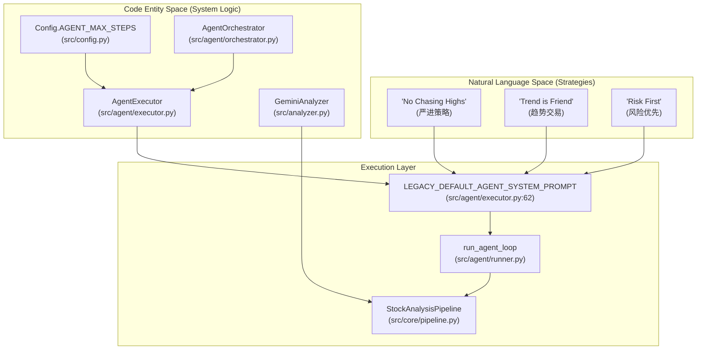
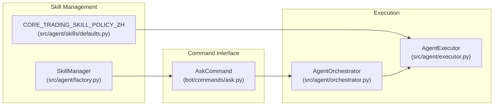

<!-- source: DeepWiki mcp.deepwiki.com · repo ZhuLinsen/daily_stock_analysis · page 3.3 AI Analysis Philosophy · fetched 2026-10-29 -->

# AI Analysis Philosophy

Relevant source files

The following files were used as context for generating this wiki page:

- [.env.example](.env.example)
- [bot/commands/ask.py](bot/commands/ask.py)
- [docs/CHANGELOG.md](docs/CHANGELOG.md)
- [docs/full-guide.md](docs/full-guide.md)
- [docs/full-guide_EN.md](docs/full-guide_EN.md)
- [src/agent/executor.py](src/agent/executor.py)
- [src/agent/orchestrator.py](src/agent/orchestrator.py)
- [src/agent/skills/aggregator.py](src/agent/skills/aggregator.py)
- [src/agent/skills/router.py](src/agent/skills/router.py)
- [src/analyzer.py](src/analyzer.py)
- [src/config.py](src/config.py)
- [src/core/pipeline.py](src/core/pipeline.py)
- [tests/test_agent_executor.py](tests/test_agent_executor.py)
- [tests/test_ask_command.py](tests/test_ask_command.py)
- [tests/test_multi_agent.py](tests/test_multi_agent.py)
- [tests/test_skill_load_warning.py](tests/test_skill_load_warning.py)

This document explains the embedded trading philosophy rules that guide AI analysis in the system. These rules are encoded in the system prompt and enforced through both AI reasoning and programmatic validation.

**Purpose**: Define the strict trading principles (严进策略, 趋势交易, 效率优先, etc.) that constrain AI decision-making to prevent common investment mistakes like chasing highs or trading against trends.

**Scope**: This page covers the philosophical framework, rule encoding, and the transition from natural language strategies (Skills) to code-level constraints.

---

## Overview: Philosophy as System Constraint

The system embeds a **conservative trend-trading philosophy** directly into the AI's decision-making process via a structured system prompt. Unlike typical LLM applications that rely purely on model reasoning, this system uses **dual enforcement**:

1.  **AI-level**: Philosophy encoded in `LEGACY_DEFAULT_AGENT_SYSTEM_PROMPT` or dynamic `skill_instructions` guides LLM reasoning [src/agent/executor.py:62-215]().
2.  **Code-level**: Programmatic validation checks and pre-computed indicators enforce hard limits, such as score-band normalization [src/analyzer.py:96-99]() and decision signal extraction [src/core/pipeline.py:77-78]().

### Philosophy to Code Mapping
The following diagram illustrates how abstract trading principles are transformed into system prompts and code-level constraints.

**Natural Language Space to Code Entity Space**

**Sources**: [src/agent/executor.py:62-215](), [src/analyzer.py:96-99](), [src/core/pipeline.py:165-173](), [src/agent/orchestrator.py:76-83]()

---

## Core Trading Principles

The system implements core principles, each with specific quantitative thresholds and enforcement mechanisms defined in the system prompts.

### 1. 严进策略 (Strict Entry) - No Chasing Highs
**Philosophy**: Prohibit buying when the price has deviated too far from moving averages.
*   **Logic**: The system prompt defines "Low Bias" (低乖离率 < 2%) as the optimal buy point [src/agent/executor.py:177]().
*   **Scoring Logic**: A score of 40-59 (Wait/Watch) is assigned if the bias is > 5%, indicating high chasing risk [src/agent/executor.py:189]().

### 2. 趋势交易 (Trend Trading) - MA Alignment
**Philosophy**: Only trade stocks in bullish MA alignment.
*   **Required Pattern**: `MA5 > MA10 > MA20` (多头排列) [src/agent/executor.py:176]().
*   **Logic**: The system prompt explicitly defines "Strong Buy" as having this specific alignment [src/agent/executor.py:176]().

### 3. 效率优先 (Efficiency First) - Chip Structure
**Philosophy**: Prefer stocks with concentrated chip distributions.
*   **Logic**: AI evaluates `chip_structure` based on profit ratios and average cost [src/agent/executor.py:121]().
*   **Rule**: Healthy chip structure (筹码集中健康) is a prerequisite for a "Strong Buy" rating [src/agent/executor.py:179]().

### 4. 买点偏好 (Pullback Preference)
**Philosophy**: Optimal entries occur at pullbacks to support levels.
*   **Best Buy**: Shrinking volume pullback (缩量回调) [src/agent/executor.py:178]().
*   **Secondary Buy**: Breakout with volume (放量突破) [src/agent/executor.py:178]().

### 5. 风险优先 (Risk Priority)
**Philosophy**: Always screen for risks (insider selling, earnings warnings, regulatory issues) before recommending an action [src/agent/executor.py:90]().

**Sources**: [src/agent/executor.py:175-198](), [src/agent/executor.py:84-91](), [.env.example:175-180]()

---

## Skill-Based Strategy System

The system uses a **Skill/Strategy System** to allow users to switch between different trading methodologies via the `/ask` command or the Web UI.

### Skill Interaction Flow

**Implementation Details**:
*   **Skill Loading**: `AskCommand` loads available skills via the `SkillManager` [bot/commands/ask.py:125-133]().
*   **Skill Alias Mapping**: Skills can be invoked via display names or aliases (e.g., "缠论" for `chan_theory`) [bot/commands/ask.py:146-160]().
*   **Instruction Injection**: Skill-specific instructions are passed to the `AgentOrchestrator` and eventually injected into the agent's system prompt [src/agent/orchestrator.py:88-91]().

**Sources**: [bot/commands/ask.py:125-160](), [src/agent/orchestrator.py:84-94](), [src/agent/executor.py:82]()

---

## Decision Dashboard Framework

The system forces the AI to output analysis in a structured **Decision Dashboard** (JSON format), ensuring every philosophical rule is addressed.

### Dashboard Architecture (JSON Schema)
The `AgentExecutor` expects a specific JSON structure from the LLM [src/agent/executor.py:99-170]().

| Module | Key Fields | Philosophy Link |
| :--- | :--- | :--- |
| **Core Conclusion** | `signal_type`, `one_sentence` | Principle 1 & 2 (Verdict) |
| **Data Perspective** | `trend_status`, `price_position`, `chip_structure` | Principle 1, 2, 3 |
| **Intelligence** | `latest_news`, `risk_alerts` | Principle 5 (Risk) |
| **Battle Plan** | `sniper_points`, `position_strategy` | Principle 4 (Entry) |
| **Signal Attribution**| `technical_indicators`, `news_sentiment` | Weighting Logic |

### Scoring and Evaluation System
The system uses a **100-point scale** (Sentiment Score) with strict tier-based logic [src/agent/executor.py:175-198]().

| Score | Signal | Philosophy Requirement |
| :--- | :--- | :--- |
| **80-100** | 强烈买入 (Strong Buy) | MA alignment + Bias < 2% + Healthy Chips [src/agent/executor.py:175-180]() |
| **60-79** | 买入 (Buy) | Bullish trend + Bias < 5% [src/agent/executor.py:182-186]() |
| **40-59** | 观望 (Wait) | Bias > 5% (Chase high) OR Trend unclear [src/agent/executor.py:188-192]() |
| **0-39** | 卖出 (Sell) | Bearish alignment OR Major risk [src/agent/executor.py:193-198]() |

**Sources**: [src/agent/executor.py:99-170](), [src/agent/executor.py:175-198]()

---

## Rule Enforcement Mechanisms

### 1. Multi-Stage Workflow
The AI is forced to follow a 4-stage ReAct loop to ensure data integrity before making a decision [src/agent/executor.py:66-80]().
*   **Stage 1**: Quotes & K-Lines (Data Foundation)
*   **Stage 2**: Technicals & Chips (Analysis)
*   **Stage 3**: Intelligence Search (Context)
*   **Stage 4**: Report Generation (Synthesis)

### 2. Orchestrator Modes
The `AgentOrchestrator` manages different analysis depths via modes [src/agent/orchestrator.py:8-12]():
*   **quick**: Technical only → Decision.
*   **standard**: Technical → Intel → Decision (Default).
*   **full**: Technical → Intel → Risk → Decision.
*   **specialist**: Adds specialist evaluation for complex strategies.

### 3. Time-Aware Decision Guardrails
The system applies phase-specific guardrails (e.g., `closing_auction` vs `premarket`) to ensure the AI's advice is actionable given the current market status [src/agent/executor.py:135-143]().

**Sources**: [src/agent/executor.py:66-80](), [src/agent/orchestrator.py:8-12](), [src/agent/executor.py:135-143]()

---

