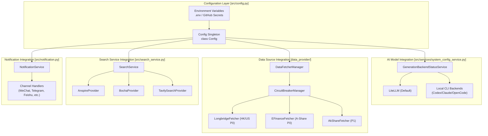
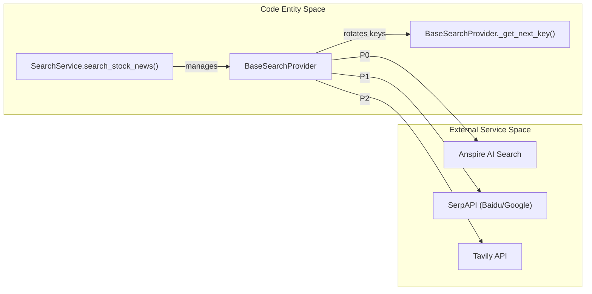
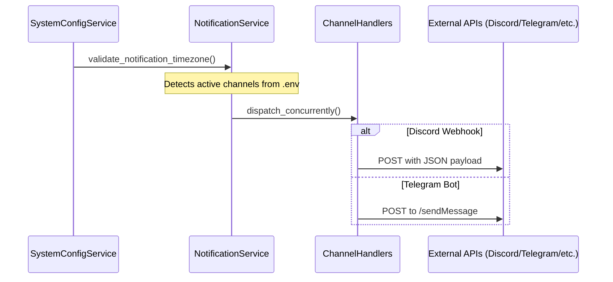

<!-- source: DeepWiki mcp.deepwiki.com · repo ZhuLinsen/daily_stock_analysis · page 3.4 External Service Integrations · fetched 2026-10-29 -->

# External Service Integrations

Relevant source files

The following files were used as context for generating this wiki page:

- [README.md](README.md)
- [apps/dsa-web/src/components/settings/LLMChannelEditor.tsx](apps/dsa-web/src/components/settings/LLMChannelEditor.tsx)
- [apps/dsa-web/src/components/settings/__tests__/LLMChannelEditor.test.tsx](apps/dsa-web/src/components/settings/__tests__/LLMChannelEditor.test.tsx)
- [docs/LLM_CONFIG_GUIDE.md](docs/LLM_CONFIG_GUIDE.md)
- [docs/LLM_CONFIG_GUIDE_EN.md](docs/LLM_CONFIG_GUIDE_EN.md)
- [docs/README_CHT.md](docs/README_CHT.md)
- [docs/README_EN.md](docs/README_EN.md)
- [docs/llm-providers.md](docs/llm-providers.md)
- [src/search_service.py](src/search_service.py)
- [src/services/system_config_service.py](src/services/system_config_service.py)
- [tests/test_search_news_freshness.py](tests/test_search_news_freshness.py)
- [tests/test_search_service_concurrency.py](tests/test_search_service_concurrency.py)
- [tests/test_search_tavily_provider.py](tests/test_search_tavily_provider.py)
- [tests/test_system_config_service.py](tests/test_system_config_service.py)

## Purpose and Scope

This document provides a technical overview of all external service integrations within the `daily_stock_analysis` system. It details how the codebase interfaces with AI model providers, financial data sources, search engines, and notification channels. The system is designed with a high degree of modularity, employing strategy and adapter patterns to ensure resilience through multi-provider fallbacks and circuit breakers.

---

## Integration Architecture Overview

The system orchestrates interactions across four functional domains. Configuration is centralized in a singleton `Config` class [src/config.py:20-38](), which manages environment variables and provides validated settings to specialized service modules.

Title: System Integration Map

Sources: [src/config.py:1-40](), [src/services/system_config_service.py:120-159](), [src/search_service.py:157-173](), [README.md:52-61]()

---

## AI Model Provider Integration

The system utilizes a dual-layer approach for text generation: **LiteLLM** for cloud-based providers and specialized **Local CLI Backends** for experimental local execution.

### Generation Backends
Managed by `SystemConfigService`, the system supports multiple generation backends defined in `GENERATION_BACKEND` [docs/LLM_CONFIG_GUIDE.md:32-38]():
1.  **LiteLLM**: The default production-grade adapter supporting OpenAI, Gemini, Claude, DeepSeek, and Anspire [docs/llm-providers.md:72-91]().
2.  **Local CLI (Experimental)**: Direct integration with `codex_cli`, `claude_code_cli`, and `opencode_cli` [docs/LLM_CONFIG_GUIDE.md:43-50](). These backends bypass LiteLLM to use local executable presets.

### Configuration Tiers
The `SystemConfigService` manages three configuration levels [docs/llm-providers.md:13-19]():
-   **YAML Configuration**: `LITELLM_CONFIG` for complex routing and load balancing.
-   **Channel Mode**: `LLM_CHANNELS` (e.g., `LLM_DEEPSEEK_API_KEY`) for multi-provider management [src/services/system_config_service.py:160-163]().
-   **Legacy Mode**: Direct keys like `GEMINI_API_KEY` or `OPENAI_API_KEY`.

### Thinking & Vision Capabilities
-   **Thinking Models**: The system detects and supports reasoning models like DeepSeek-R1 or Qwen-Thinking [docs/llm-providers.md:88-89]().
-   **Vision Integration**: Uses `OPENAI_VISION_MODEL` or compatible Gemini/Claude models for image-to-stock extraction [src/services/system_config_service.py:148-149]().

---

## Financial Data Source Integration

The system implements a priority-based failover mechanism for fetching market data, managed by `DataFetcherManager`.

### Provider Priority and Failover
Data sources are queried in order of their assigned priority. **Longbridge OpenAPI** is the preferred source for HK/US stocks when configured [README.md:133-138]().

| Market | Primary Source (Priority 0) | Secondary / Fallback |
| :--- | :--- | :--- |
| **A-Share** | `EFinance` | `AkShare` → `Tushare` → `Pytdx` → `Baostock` |
| **HK Stock** | `Longbridge` | `AkShare` |
| **US Stock** | `Longbridge` | `YFinance` |
| **US Indices**| `YFinance` | N/A |

Sources: [README.md:54-61](), [README.md:128-138]()

---

## Search Service Integration

The `SearchService` gathers news and market intelligence through a unified `BaseSearchProvider` interface [src/search_service.py:157-173]().

### Provider Ecosystem
-   **Anspire Search**: Recommended for global financial news and A-share sentiment [README.md:118-119]().
-   **SerpAPI / Bocha**: Optimized for Chinese search results and real-time financial news [README.md:120-121]().
-   **Tavily / Brave**: Used for general news and US market intelligence [src/search_service.py:9-12]().

### News Freshness Strategy
The system implements strict date filtering based on `NEWS_STRATEGY_PROFILE` [src/search_service.py:36-40]():
-   **Windows**: Profiles like `short` (3 days), `medium` (7 days), and `long` (30 days) define the lookback period [tests/test_search_news_freshness.py:76-85]().
-   **Filtering**: Results with future dates (> +1 day) or dates older than the window are discarded [tests/test_search_news_freshness.py:96-115]().

Title: Search Provider and Tool Integration

Sources: [src/search_service.py:157-204](), [README.md:112-126]()

---

## Notification Channel Integration

The system supports 10+ notification channels, configured via environment variables and managed by a centralized notification service.

### Channel Security & Verification
-   **Feishu/WeChat**: Supports both Webhook URLs and App Bot configurations for group or private delivery [src/services/system_config_service.py:70-75]().
-   **Webhook Security**: Supports `FEISHU_WEBHOOK_SECRET` for signature-based verification [src/services/system_config_service.py:213-214]().
-   **Endpoint Resolution**: Custom logic for resolving `Gotify` and `Ntfy` endpoints [src/services/system_config_service.py:77-78]().

### Delivery Configuration
Users can configure at least one channel from the following supported list:
-   **Instant Messaging**: WeChat Work, Feishu, DingTalk, Telegram, Discord, Slack [README.md:93-102]().
-   **Push Services**: PushPlus, ServerChan3, Pushover, Gotify, Ntfy, Bark [src/services/system_config_service.py:192-207]().
-   **Email**: SMTP-based delivery with support for HTML and attachments [README.md:102-103]().

Title: Notification and Reporting Flow

Sources: [src/services/system_config_service.py:76-78](), [README.md:93-105](), [src/services/system_config_service.py:192-207]()

---

