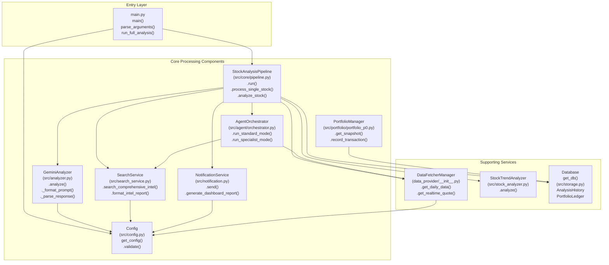
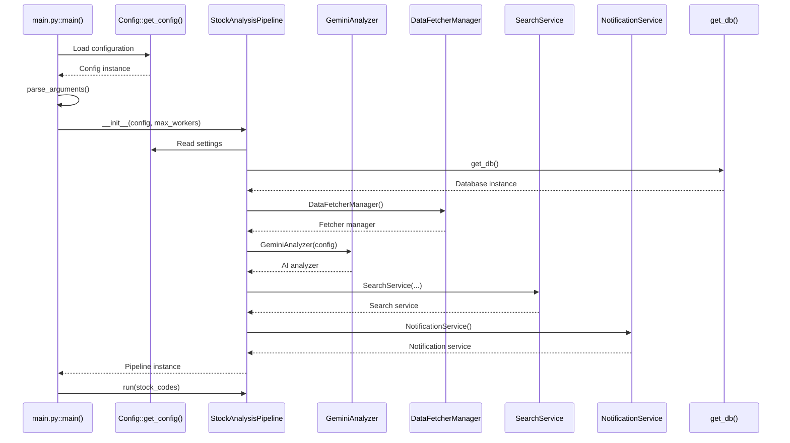

<!-- source: DeepWiki mcp.deepwiki.com · repo ZhuLinsen/daily_stock_analysis · page 4 Core Components · fetched 2026-10-29 -->

# Core Components

Relevant source files

The following files were used as context for generating this wiki page:

- [.env.example](.env.example)
- [docs/CHANGELOG.md](docs/CHANGELOG.md)
- [docs/full-guide.md](docs/full-guide.md)
- [docs/full-guide_EN.md](docs/full-guide_EN.md)
- [main.py](main.py)
- [src/config.py](src/config.py)
- [src/core/pipeline.py](src/core/pipeline.py)
- [tests/test_main_schedule_mode.py](tests/test_main_schedule_mode.py)

This page provides an overview of the system's core processing components that implement the stock analysis functionality. These components work together to orchestrate data acquisition, AI analysis, market reviews, and notification delivery.

For data acquisition details, see [Data Provider System](#5). For user interfaces (CLI, Web UI, Bot), see [User Interfaces](#6). For notification channel configuration, see [Notification Channels](#8).

## Purpose and Scope

The core components layer sits between the entry points (CLI, Web API, Bot) and the lower-level services (data providers, storage, external APIs). This layer contains:

- **Main Orchestrator** - Entry point coordination and argument parsing.
- **Stock Analysis Pipeline** - Individual stock analysis workflow and concurrency management.
- **AI Analysis Engine** - LLM-based decision generation with trading philosophy integration.
- **Multi-Agent Orchestrator** - Specialized agents (Technical, Intel, Risk, Decision, Research) for deep reasoning.
- **Search Service** - Multi-dimensional intelligence gathering (news, risks, earnings).
- **Configuration System** - Centralized configuration management with validation.
- **Notification Service** - Multi-channel report distribution and formatting.
- **Backtesting Engine** - Historical recommendation validation and metrics tracking.
- **Portfolio P0 System** - Core ledger for tracking actual holdings and performance.

---

## Component Architecture

The following diagram maps the system's natural language descriptions to their actual code entities:

**Sources:** [main.py:1-45](), [src/core/pipeline.py:165-210](), [src/config.py:1-11](), [src/analyzer.py:1-49](), [src/search_service.py:1-41]()

---

## Component Initialization Sequence

The following diagram shows how components are instantiated and initialized during a typical execution:

**Sources:** [main.py:61-112](), [src/core/pipeline.py:175-225](), [src/config.py:75-100]()

---

## Component Responsibilities

### Main Orchestrator (`main.py`)

The entry point that coordinates all system operations. It handles environment setup, CLI parsing, and manages the transition between analysis, serving, and scheduling modes. For details, see [Main Orchestrator (main.py)](#4.1).

**Key Functions:**
- `argparse.ArgumentParser` [main.py:61-73]() - Defines 20+ CLI flags for debugging, dry-runs, and specific stock lists.
- `_bootstrap_environment()` [main.py:142-163]() - Idempotent loading of `.env` and proxy settings.
- `_resolve_web_service_bind()` [main.py:107-111]() - Resolves host/port binding with CLI priority over config.

**Sources:** [main.py:1-230]()

---

### Stock Analysis Pipeline (`StockAnalysisPipeline`)

The core workflow orchestrator for individual stock analysis. It manages the lifecycle from data fetching to AI-driven decision generation. For details, see [Stock Analysis Pipeline](#4.2).

**Key Responsibilities:**
- **Concurrency Control**: Uses `ThreadPoolExecutor` for parallel stock processing [src/core/pipeline.py:19]().
- **Lifecycle Management**: Orchestrates data fetching, context building, AI analysis, and result persistence [src/core/pipeline.py:165-210]().
- **Market Review**: Supports region-specific market phase summaries (e.g., CN, JP, KR) [src/core/pipeline.py:51-54]().

**Sources:** [src/core/pipeline.py:1-210]()

---

### AI Analysis Engine (`GeminiAnalyzer`)

A sophisticated LLM wrapper that converts technical and fundamental data into actionable trading advice. It supports multi-model fallback and structured JSON output. For details, see [AI Analysis Engine](#4.3).

**Core Logic:**
- **Prompt Construction**: Dynamically builds prompts incorporating embedded trading rules like "Strict Entry" (严进策略) [main.py:18-23]().
- **Decision Stabilization**: Uses `stabilize_decision_with_structure` to ensure consistent signal output [src/core/pipeline.py:37]().
- **Language Support**: Localizes reports into Chinese, English, or Korean via `REPORT_LANGUAGE` [src/config.py:119]().

**Sources:** [src/analyzer.py:1-91](), [src/config.py:119]()

---

### Multi-Agent Orchestrator (`AgentOrchestrator`)

Coordinates specialized AI agents to perform deep reasoning. It supports different orchestration modes (quick, standard, full, specialist). For details, see [Multi-Agent Orchestrator](#4.4).

**Key Features:**
- **Timeout Management**: Configurable per-agent timeout clamps for `TechnicalAgent`, `IntelAgent`, etc [docs/CHANGELOG.md:28]().
- **ReAct Loop**: Uses `AgentExecutor` for iterative tool interaction and reasoning.
- **Context Compression**: Implements profiles (cost, balanced, long_context) for history management [src/config.py:185-204]().

**Sources:** [src/config.py:185-204](), [docs/CHANGELOG.md:28]()

---

### Search Service (`SearchService`)

A multi-provider search engine aggregator designed for financial intelligence. It implements strict time-window filtering to ensure news freshness. For details, see [Search Service](#4.5).

**Key Features:**
- **Freshness Filtering**: Implements `NEWS_STRATEGY_WINDOWS` (ultra_short to long) to filter out stale data [src/config.py:164-169]().
- **Auto-Fetch**: Optional `NEWS_INTEL_AUTO_FETCH_ENABLED` for automatic RSS/NewsNow pool refreshing [docs/CHANGELOG.md:19]().
- **Provider Failover**: Rotates between search providers like Anspire, Bocha, or Tavily.

**Sources:** [src/config.py:164-169](), [docs/CHANGELOG.md:19]()

---

### Configuration System (`Config`)

A singleton-based configuration manager that provides type-safe access to environment variables. For details, see [Configuration System](#4.6).

**Key Features:**
- **Validation**: Structured `ConfigIssue` tracking for errors and warnings [src/config.py:83-100]().
- **Fallback Chain**: Implements `GENERATION_FALLBACK_BACKEND` for LLM resilience [src/config.py:138]().
- **Hot Reload**: Supports runtime scheduler reconstruction for multi-time triggers [docs/CHANGELOG.md:110]().

**Sources:** [src/config.py:1-150](), [docs/CHANGELOG.md:110]()

---

### Notification Service (`NotificationService`)

A multi-channel distribution engine that formats analysis results for various platforms. For details, see [Notification Service](#4.7).

**Key Capabilities:**
- **Channel Routing**: Supports `NOTIFICATION_REPORT_CHANNELS` and `NOTIFICATION_ALERT_CHANNELS` [docs/full-guide.md:131-132]().
- **Noise Control**: Implements quiet hours, cooldowns, and de-duplication [docs/full-guide.md:134-137]().
- **Template Rendering**: Uses Jinja2 templates from the `templates/` directory [docs/full-guide.md:122]().

**Sources:** [docs/full-guide.md:120-140]()

---

### Backtesting Engine

A system for validating AI recommendations against historical market data. For details, see [Backtesting Engine](#4.8).

**Key Features:**
- **Metric Calculation**: Tracks performance of AI signals over time.
- **Normalizer**: Handles stock code normalization for historical data lookup (e.g., `605066.SH` vs `SS605066`) [docs/CHANGELOG.md:73]().

**Sources:** [docs/CHANGELOG.md:73]()

---

### Portfolio P0 System

A core ledger system for tracking actual holdings, performance, and risk metrics. For details, see [Portfolio P0 System](#4.9).

**Key Features:**
- **Oversell Interceptor**: Prevents selling more shares than currently held.
- **Valuation**: Supports fast valuation (`include_realtime=false`) to avoid UI blocking [docs/CHANGELOG.md:14]().
- **Corporate Actions**: Handles dividends and splits for accurate cost accounting.

**Sources:** [docs/CHANGELOG.md:14](), [docs/CHANGELOG.md:95-98]()

---

