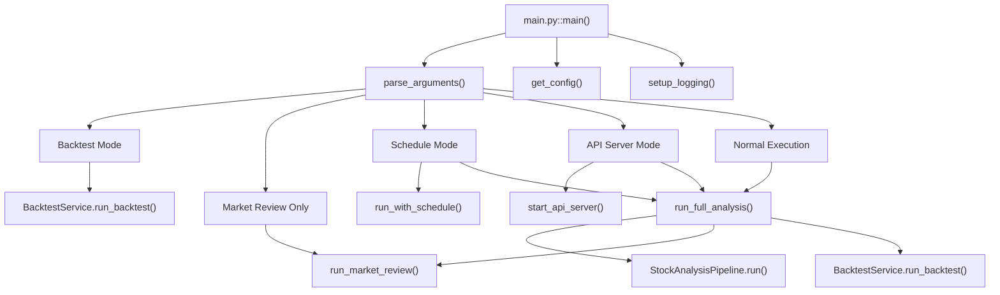
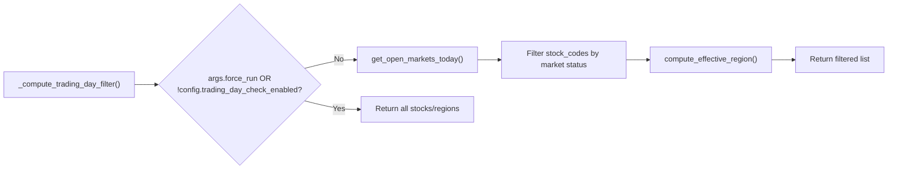
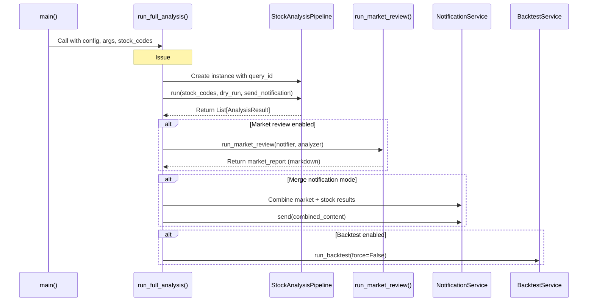
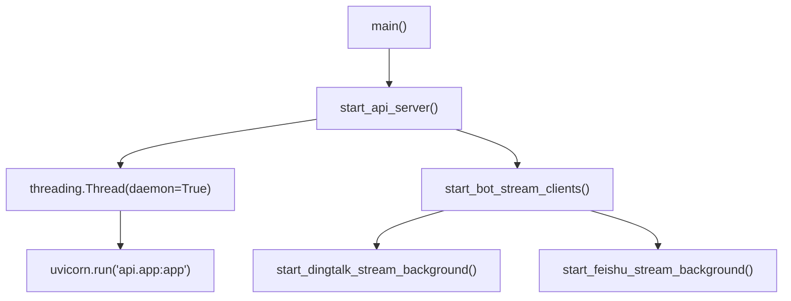
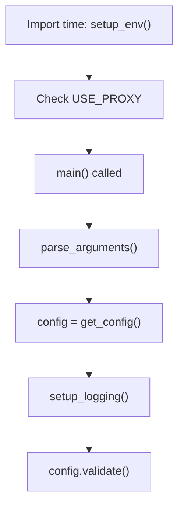

<!-- source: DeepWiki mcp.deepwiki.com · repo ZhuLinsen/daily_stock_analysis · page 4.1 Main Orchestrator (main.py) · fetched 2026-10-29 -->

# Main Orchestrator (main.py)

<details>
<summary>Relevant source files</summary>

The following files were used as context for generating this wiki page:

- [main.py](main.py)
- [tests/test_main_schedule_mode.py](tests/test_main_schedule_mode.py)

</details>


The `main.py` module serves as the primary entry point for the A-share/HK/US intelligent stock analysis system. It implements a unified command-line interface that coordinates all system execution modes, manages configuration initialization, handles global exception catching, and delegates to specialized subsystems for stock analysis, market review, API serving, and backtesting.

---

## System Entry Point Architecture

The orchestrator implements a single-entry-point design pattern where all execution paths converge through the `main()` function, which then branches based on command-line arguments and configuration settings.

Title: Orchestrator Execution Flow


**Sources:** [main.py:616-793]()

---

## Argument Parser

The `parse_arguments()` function defines the complete command-line interface using Python's `argparse` module. It supports over 20 distinct flags organized into functional groups.

### Core Analysis Arguments

| Argument | Type | Purpose |
|----------|------|---------|
| `--debug` | flag | Enable verbose logging to debug log file |
| `--dry-run` | flag | Fetch data only, skip AI analysis |
| `--stocks` | string | Override `STOCK_LIST` config with comma-separated codes |
| `--no-notify` | flag | Suppress all notification channels |
| `--single-notify` | flag | Push after each stock (vs batch at end) |
| `--workers` | int | Override `MAX_WORKERS` config for concurrency |
| `--force-run` | flag | Skip trading day check and force execution |

**Sources:** [main.py:233-294]()

### Execution Mode Arguments

| Argument | Type | Purpose | Incompatible With |
|----------|------|---------|-------------------|
| `--schedule` | flag | Run on daily schedule (respects `SCHEDULE_TIME`) | - |
| `--no-run-immediately` | flag | Suppress initial run on scheduler start | Requires `--schedule` |
| `--market-review` | flag | Execute market analysis only | `--no-market-review` |
| `--no-market-review` | flag | Skip market analysis in full run | `--market-review` |
| `--backtest` | flag | Run backtest evaluation on historical analyses | All others |
| `--backtest-code` | string | Limit backtest to specific stock code | Requires `--backtest` |
| `--backtest-days` | int | Override `BACKTEST_EVAL_WINDOW_DAYS` | Requires `--backtest` |
| `--backtest-force` | flag | Re-evaluate even if results exist | Requires `--backtest` |

**Sources:** [main.py:296-364]()

### API Server Arguments

| Argument | Type | Default | Purpose |
|----------|------|---------|---------|
| `--webui` | flag | - | Start API + execute one full analysis |
| `--webui-only` | flag | - | Start API only (manual triggers only) |
| `--serve` | flag | - | Alias for `--webui` |
| `--serve-only` | flag | - | Alias for `--webui-only` |
| `--host` | string | `None` (uses config) | FastAPI bind address |
| `--port` | int | `None` (uses config) | FastAPI listen port |

**Sources:** [main.py:366-404]()

---

## Trading Day Filtering Logic

The orchestrator includes logic to skip analysis on non-trading days unless forced. This prevents unnecessary API calls and notifications during weekends or market holidays. It supports regional filtering (e.g., `jp,kr`) for multi-market deployments.

Title: Trading Day Check Logic


**Sources:** [main.py:440-496](), [tests/test_main_schedule_mode.py:167-191]()

---

## Full Analysis Orchestration (`run_full_analysis`)

The `run_full_analysis()` function implements the core orchestration logic for a complete analysis cycle, coordinating individual stock analysis and market review with optional notification merging.

### Orchestration Flow

Title: Analysis Pipeline Sequence


### Key Orchestration Features

**Hot-Reload Support** (Issue #529): In scheduled mode, the orchestrator re-reads the `STOCK_LIST` from the configuration service before every run, allowing users to update their watchlist without restarting the process.

```python
# From main.py:512-514
if stock_codes is None:
    config.refresh_stock_list()
    stock_codes = config.stock_list
```

**Notification Merge Logic**: When `merge_notification` is active, the orchestrator combines the `market_report` and the stock analysis results into a single payload to reduce notification noise.

**Analysis Delay**: A configurable `ANALYSIS_DELAY` can be inserted between individual stock analysis and market review to mitigate API rate limiting.

**Sources:** [main.py:498-614]()

---

## API Server and Bot Integration

The orchestrator can start a FastAPI backend server and bot stream clients (DingTalk/Feishu) in background threads.

### Server Startup Flow

Title: Server and Bot Threading


**Thread Safety**: The API server runs in a daemon thread started by `start_api_server()`, using `log_config=None` in `uvicorn.run()` to prevent it from hijacking the main system's logging configuration.

**Sources:** [main.py:643-667](), [main.py:669-700]()

---

## Configuration and Initialization Sequence

The orchestrator follows a strict initialization order to ensure proper dependency resolution and logging setup.

### Initialization Order

Title: System Initialization Sequence


**Proxy Configuration**: The system supports optional HTTP proxy for development via `USE_PROXY`, `PROXY_HOST`, and `PROXY_PORT` environment variables, but automatically disables it in GitHub Actions environments.

**Sources:** [main.py:35-46](), [main.py:142-164](), [main.py:710-733]()

---

## Schedule Mode Implementation

When invoked with `--schedule`, the orchestrator delegates to `src.scheduler.run_with_schedule()`, which implements daily execution at the time defined by `SCHEDULE_TIME`.

**Task Wrapper**: The orchestrator wraps `run_full_analysis()` in a closure to capture the current execution context. In this mode, if `--stocks` was provided via CLI, the system logs a warning that it will ignore that snapshot and re-read the `STOCK_LIST` before each scheduled execution.

**Sources:** [main.py:751-774]()

---

## Error Handling and Exit Codes

The orchestrator implements comprehensive error handling with standardized exit codes:

| Exception Type | Handling | Exit Code |
|----------------|----------|-----------|
| `KeyboardInterrupt` | Log "User Interrupted" | `130` |
| Unhandled `Exception` | Log traceback | `1` |
| Success | - | `0` |

**Sources:** [main.py:796-806]()

---

