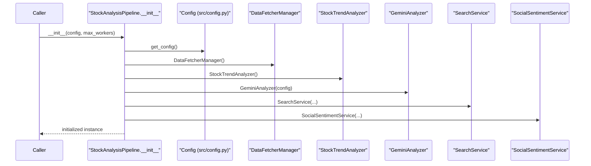
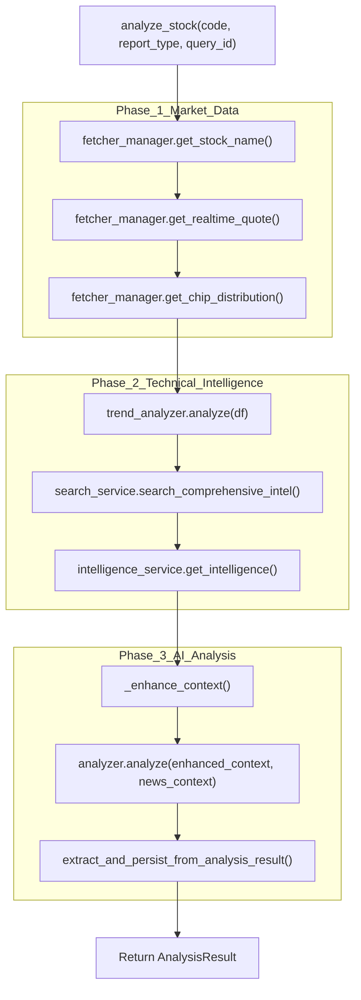

<!-- source: DeepWiki mcp.deepwiki.com · repo ZhuLinsen/daily_stock_analysis · page 4.2 Stock Analysis Pipeline · fetched 2026-10-29 -->

# Stock Analysis Pipeline

Relevant source files

The following files were used as context for generating this wiki page:

- [.env.example](.env.example)
- [docs/CHANGELOG.md](docs/CHANGELOG.md)
- [docs/INDEX.md](docs/INDEX.md)
- [docs/INDEX_EN.md](docs/INDEX_EN.md)
- [docs/analysis-context-pack.md](docs/analysis-context-pack.md)
- [docs/full-guide.md](docs/full-guide.md)
- [docs/full-guide_EN.md](docs/full-guide_EN.md)
- [src/analysis_context_pack_prompt.py](src/analysis_context_pack_prompt.py)
- [src/config.py](src/config.py)
- [src/core/pipeline.py](src/core/pipeline.py)
- [tests/test_analysis_context_pack_docs.py](tests/test_analysis_context_pack_docs.py)
- [tests/test_analysis_context_pack_prompt.py](tests/test_analysis_context_pack_prompt.py)
- [tests/test_pipeline_realtime_indicators.py](tests/test_pipeline_realtime_indicators.py)

## Purpose and Scope

The **Stock Analysis Pipeline** (`StockAnalysisPipeline` class) is the core orchestrator that manages the end-to-end workflow for analyzing individual stocks. It coordinates data acquisition, context enrichment, intelligence search, AI analysis, and result distribution. This document covers the internal mechanics of individual stock processing, including its lifecycle from data fetching through context enrichment to AI analysis.

**Sources:** [src/core/pipeline.py:1-12](), [src/core/pipeline.py:165-173]()

---

## Architecture Overview

The pipeline implements a layered architecture where each layer progressively enriches the analysis context before passing it to the AI model.

### System Components and Code Entities

This diagram bridges the system's functional stages with the specific code entities responsible for them.

```mermaid
graph TB
    subgraph "Pipeline_Orchestration"
        Pipeline["StockAnalysisPipeline<br/>(src/core/pipeline.py)"]
    end
    
    subgraph "Data_Acquisition"
        DFM["DataFetcherManager<br/>(data_provider/__init__.py)"]
        Realtime["get_realtime_quote()<br/>(data_provider/base.py)"]
        Chip["ChipDistribution<br/>(data_provider/realtime_types.py)"]
    end
    
    subgraph "Analysis_Enrichment"
        Trend["StockTrendAnalyzer<br/>(src/stock_analyzer.py)"]
        Search["SearchService<br/>(src/search_service.py)"]
        Intelligence["IntelligenceService<br/>(src/services/intelligence_service.py)"]
        Sentiment["SocialSentimentService<br/>(src/services/social_sentiment_service.py)"]
        ContextBuilder["AnalysisContextBuilder<br/>(src/services/analysis_context_builder.py)"]
        DB["get_db()<br/>(src/storage.py)"]
        Calendar["trading_calendar.py<br/>(src/core/trading_calendar.py)"]
    end
    
    subgraph "AI_Processing"
        AI["GeminiAnalyzer<br/>(src/analyzer.py)"]
    end
    
    subgraph "Result_Distribution"
        Notify["NotificationService<br/>(src/notification.py)"]
    end
    
    Pipeline --> DFM
    Pipeline --> Realtime
    Pipeline --> Chip
    Pipeline --> Trend
    Pipeline --> Search
    Pipeline --> Intelligence
    Pipeline --> Sentiment
    Pipeline --> ContextBuilder
    Pipeline --> DB
    Pipeline --> Calendar
    Pipeline --> AI
    Pipeline --> Notify
```

**Sources:** [src/core/pipeline.py:28-65](), [src/core/pipeline.py:165-173]()

---

## Initialization Phase

The pipeline initializes all required service modules during instantiation, loading configurations and setting up concurrency parameters.

### Initialization Sequence

### Key Initialization Parameters

| Parameter | Type | Default | Purpose |
|-----------|------|---------|---------|
| `config` | `Config` | `get_config()` | System configuration singleton [src/config.py:8-11]() |
| `max_workers` | `int` | `config.max_workers` | Concurrency for batch analysis [src/core/pipeline.py:199-199]() |
| `query_id` | `str` | `None` | Trace ID for the request [src/core/pipeline.py:201-201]() |
| `save_context_snapshot` | `bool` | `config.save_context_snapshot` | Whether to persist context for backtesting [src/core/pipeline.py:204-206]() |
| `analysis_skills` | `List[str]` | `None` | Specific trading strategies/skills to apply [src/core/pipeline.py:208-208]() |

**Sources:** [src/core/pipeline.py:175-225]()

---

## Stock Processing Lifecycle

The lifecycle of a single stock analysis is encapsulated in `analyze_stock()`, which follows a strict sequence of data enrichment and analysis.

### Workflow Execution

### Core Method Responsibilities

| Method | File:Line | Responsibility |
|--------|-----------|----------------|
| `fetch_and_save_stock_data` | [src/core/pipeline.py:343-410]() | Fetches historical OHLCV data and persists to SQLite. Implements "breakpoint resumption" by checking `db.has_today_data`. |
| `analyze_stock` | [src/core/pipeline.py:412-646]() | The primary orchestration method for single stock analysis. Collects realtime, chip, trend, and intelligence data. |
| `_enhance_context` | [src/core/pipeline.py:648-748]() | Merges disparate data points (realtime quotes, technical indicators, chip status) into a unified context dictionary. |
| `run` | [src/core/pipeline.py:1017-1180]() | Orchestrates batch processing of multiple stocks using a `ThreadPoolExecutor`. |

**Sources:** [src/core/pipeline.py:343-1180]()

---

## Market Awareness & Trading Calendar

The pipeline is market-aware, using `trading_calendar.py` to handle timezone-specific logic for A-shares (CN), Hong Kong (HK), US, and Taiwan (TW) markets.

- **Effective Trading Date**: The pipeline resolves the latest "reusable" trading date via `get_effective_trading_date()` [src/core/trading_calendar.py:83-83](). This handles holidays, weekends, and intra-day logic.
- **Market Detection**: `get_market_for_stock()` infers the region based on code format [src/core/trading_calendar.py:84-84]().
- **Market Phase**: `build_market_phase_context()` identifies if the market is in `premarket`, `intraday`, `closing_auction`, or `postmarket` [src/core/trading_calendar.py:82-82]().

**Sources:** [src/core/pipeline.py:81-87](), [src/core/pipeline.py:100-162]()

---

## Context Enrichment Layer

The `_enhance_context` method bridges raw data into the "AI-ready" space. It normalizes data and handles indicators.

### Data Normalization & Enrichment
- **Realtime Integration**: If `enable_realtime_quote` is true, it merges real-time price and change via `_augment_historical_with_realtime` [src/core/pipeline.py:663-674]().
- **Chip Distribution**: Profit ratios and concentration levels are injected into the context [src/core/pipeline.py:676-684]().
- **Technical Indicators**: MA alignment status (Bullish/Bearish/Consolidation) is computed via `_compute_ma_status` [src/core/pipeline.py:686-715]().
- **Guardrails**: `apply_daily_market_context_guardrail` and `apply_phase_decision_guardrails` are applied to ensure AI logic respects market conditions [src/core/pipeline.py:53-54]().

**Sources:** [src/core/pipeline.py:648-748](), [src/analyzer.py:31-38]()

---

## Analysis Context Pack (P1/P2)

The system is migrating towards a structured `AnalysisContextPack` to improve data quality and visibility.

- **P1 Internal Contract**: Defines `AnalysisContextPack` schema with versioning and field-level status (`available`, `missing`, `stale`, etc.) [docs/analysis-context-pack.md:29-41]().
- **P2 Builder**: `AnalysisContextBuilder` assembles artifacts (quote, technicals, news, fundamentals) into the pack without performing new fetches [docs/analysis-context-pack.md:75-79]().
- **Low-Sensitivity Summary**: `format_analysis_context_pack_prompt_section` renders a summary for the LLM prompt, intentionally ignoring raw values to manage prompt size [src/analysis_context_pack_prompt.py:123-133]().

**Sources:** [docs/analysis-context-pack.md:1-100](), [src/analysis_context_pack_prompt.py:1-144]()

---

## Batch Processing and Concurrency

The `run()` method manages parallel execution.

### Batch Execution Logic
1. **Prefetching**: For batch runs, it performs pre-fetches for stock names and real-time quotes to minimize per-thread overhead [src/core/pipeline.py:1072-1080]().
2. **Concurrency**: Uses `ThreadPoolExecutor` with workers limited by `max_workers` [src/core/pipeline.py:1089-1093]().
3. **Throttling**: Respects `ANALYSIS_DELAY` to prevent hitting LLM rate limits [src/core/pipeline.py:1127-1129]().
4. **Notification**: Supports `SINGLE_STOCK_NOTIFY` for real-time delivery vs. batch summary [src/core/pipeline.py:1117-1124]().

**Sources:** [src/core/pipeline.py:1017-1180]()

---

## Persistence and Diagnostics

- **Analysis History**: Results are persisted to SQLite, including a `context_snapshot` if enabled [src/core/pipeline.py:560-572]().
- **Decision Signals**: Structured signals are extracted from AI results via `extract_and_persist_from_analysis_result` [src/core/pipeline.py:77-77]().
- **Run Diagnostics**: The system records diagnostic snapshots for LLM calls and notifications to assist in debugging [src/core/pipeline.py:66-76]().

**Sources:** [src/core/pipeline.py:550-600](), [src/services/run_diagnostics.py:66-76]()

---

