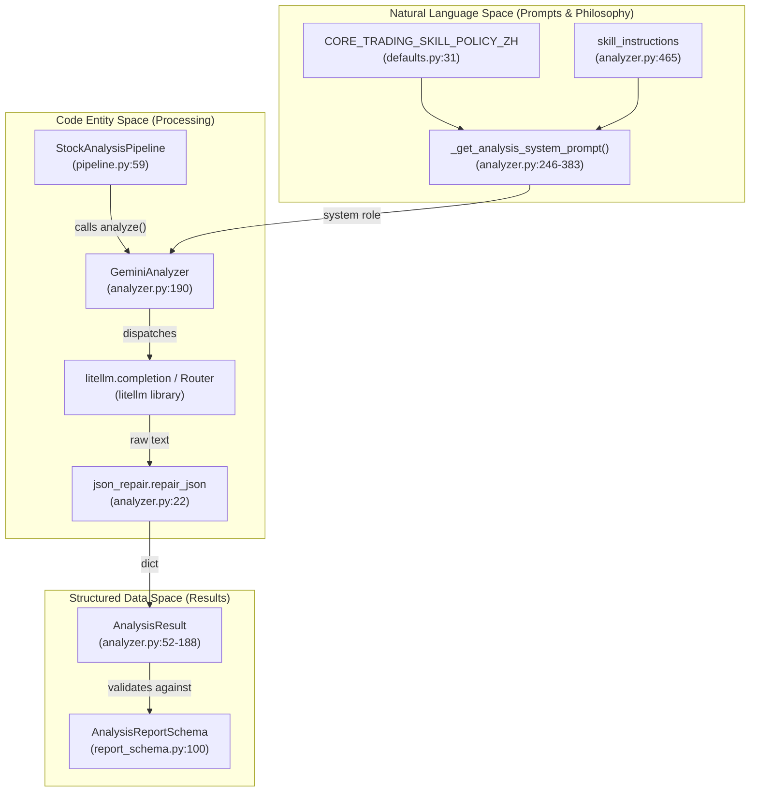
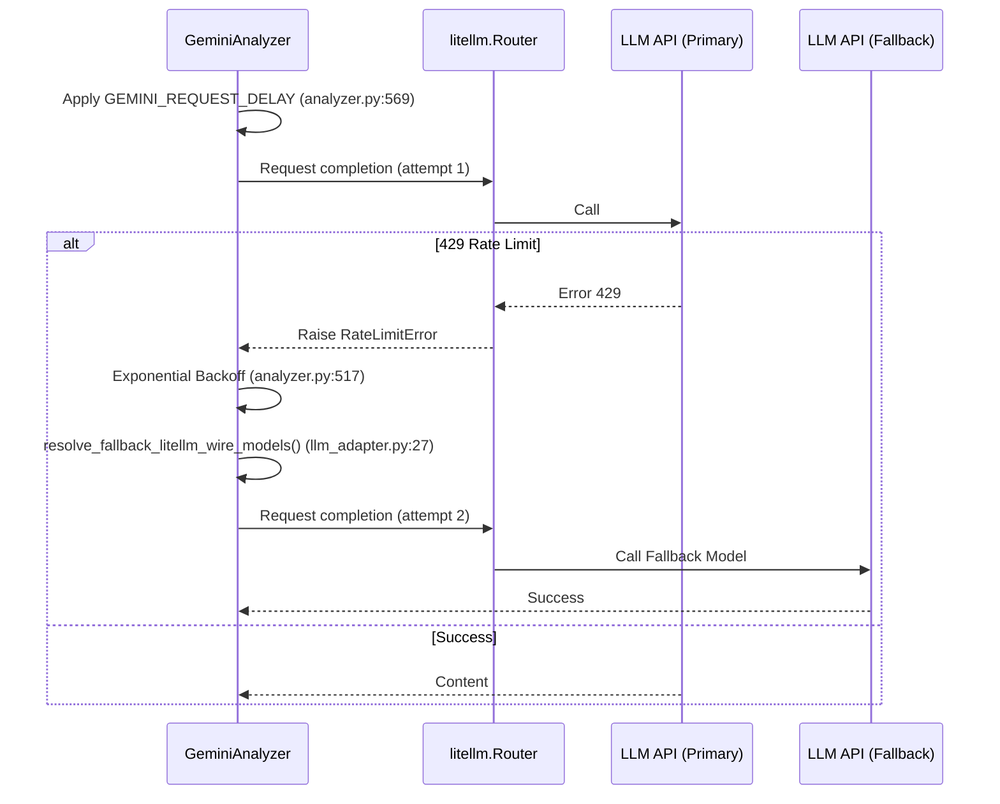

<!-- source: DeepWiki mcp.deepwiki.com · repo ZhuLinsen/daily_stock_analysis · page 4.3 AI Analysis Engine · fetched 2026-10-29 -->

# AI Analysis Engine

Relevant source files

The following files were used as context for generating this wiki page:

- [src/agent/executor.py](src/agent/executor.py)
- [src/agent/llm_adapter.py](src/agent/llm_adapter.py)
- [src/agent/orchestrator.py](src/agent/orchestrator.py)
- [src/analyzer.py](src/analyzer.py)
- [tests/test_agent_executor.py](tests/test_agent_executor.py)
- [tests/test_agent_pipeline.py](tests/test_agent_pipeline.py)
- [tests/test_analyzer_news_prompt.py](tests/test_analyzer_news_prompt.py)
- [tests/test_multi_agent.py](tests/test_multi_agent.py)

The AI Analysis Engine is the core intelligence component responsible for generating actionable trading insights from multi-dimensional stock data. It orchestrates the `GeminiAnalyzer` class to produce structured **Decision Dashboards** that combine technical analysis, fundamental data, sentiment evaluation, and precise trading recommendations based on built-in trading philosophies.

**Scope**: This page covers the `src/analyzer.py` module, including the `GeminiAnalyzer` class, `AnalysisResult` data structure, prompt construction, model fallback chain, and JSON parsing logic.

---

## System Overview

The AI Analysis Engine utilizes `litellm` to provide a unified interface for various LLM providers (Gemini, DeepSeek, OpenAI, etc.). It transforms enriched market data into a comprehensive **Decision Dashboard** v2.0.

### Data Flow & Entity Mapping
The following diagram bridges the conceptual analysis flow with the specific code entities involved in the process.

**Sources**: [src/analyzer.py:190-400](), [src/agent/skills/defaults.py:31](), [src/analyzer.py:22](), [src/analyzer.py:52-188](), [src/analyzer.py:100]()

---

## Core Components

### GeminiAnalyzer Class
The `GeminiAnalyzer` is the primary class for LLM-based analysis. Despite the name, it supports multiple providers via `litellm` and the `GenerationBackend` abstraction.

| Method | Role | File Reference |
|:---|:---|:---|
| `__init__` | Initializes model settings, skill instructions, and language. | [src/analyzer.py:385-400]() |
| `_init_litellm` | Sets up the `litellm.Router` or individual model config. | [src/analyzer.py:402-446]() |
| `analyze` | The main entry point for analyzing a single stock. | [src/analyzer.py:544-663]() |
| `_format_prompt` | Injects data context into the system prompt template. | [src/analyzer.py:665-835]() |
| `_call_api_with_retry` | Handles the network call with exponential backoff. | [src/analyzer.py:477-542]() |
| `_parse_response` | Extracts and repairs JSON from the LLM output. | [src/analyzer.py:859-1003]() |

**Sources**: [src/analyzer.py:190-1039]()

---

## Prompt Construction & Trading Philosophy

The system uses a highly structured system prompt to enforce a specific trading philosophy (严进策略 - Strict Entry).

### Prompt Sections
1.  **Role & Guidelines**: Defined via `get_market_role` and `get_market_guidelines` [src/analyzer.py:101]().
2.  **Trading Skills**: Injected from `CORE_TRADING_SKILL_POLICY_ZH` [src/agent/skills/defaults.py:31]() or custom `skill_instructions`.
3.  **Data Context**: Injected during `_format_prompt`, including:
    *   **Technical Data**: OHLC, MA5/10/20, Volume [src/analyzer.py:702-722]().
    *   **Real-time Metrics**: Volume ratio, turnover, PE/PB [src/analyzer.py:724-739]().
    *   **Chip Distribution**: Profit ratio, average cost, concentration [src/analyzer.py:741-754]().
    *   **News Context**: Filtered news within a specific window (e.g., `news_window_days`) [src/analyzer.py:791-810]().

### Hard Constraints
The prompt enforces strict temporal constraints and trend validation:
*   News without a specific date must be handled with caution [src/analyzer.py:821]().
*   Trend hints like "bullish" are validated using `_contains_trend_hint` to avoid false positives from negations like "not a bullish trend" [tests/test_analyzer_news_prompt.py:25-33]().

**Sources**: [src/analyzer.py:246-383](), [src/analyzer.py:665-835](), [tests/test_analyzer_news_prompt.py:25-33]()

---

## Model Fallback & Retry Chain

The engine implements a robust retry mechanism and fallback chain to handle rate limits (429) and API failures.

### Configuration Priorities
The system resolves which model to use based on a hierarchy:
1.  `LITELLM_CONFIG` (YAML file) [src/config.py:33]().
2.  `LLM_CHANNELS` (Environment variable) [src/config.py:37]().
3.  Legacy keys (e.g., `GEMINI_API_KEY`) [src/config.py:35]().

**Sources**: [src/analyzer.py:448-542](), [src/agent/llm_adapter.py:27](), [src/config.py:33-37]()

---

## AnalysisResult & JSON Parsing

The output from the LLM is parsed into an `AnalysisResult` object. Because LLMs often return malformed JSON, the engine uses `json-repair` and `repair_json` to ensure structural integrity.

### Data Structure: AnalysisResult
Located at [src/analyzer.py:52-188](), it includes:
*   **Sentiment & Decision**: `sentiment_score` (0-100) [src/analyzer.py:66]() and `decision_type` ("buy", "hold", "sell") [src/analyzer.py:83]().
*   **Dashboard**: A dictionary containing `core_conclusion`, `data_perspective`, `intelligence`, and `battle_plan` [src/analyzer.py:74-84]().

### Integrity Checks & Fallbacks
If mandatory fields are missing after parsing, the engine applies:
1.  **`check_content_integrity`**: Validates presence of critical fields [src/analyzer.py:60-91]().
2.  **`apply_placeholder_fill`**: Fills missing fields with localized placeholders (e.g., `get_placeholder_text`) to prevent UI crashes [src/analyzer.py:94-128]().
3.  **`_derive_chip_health`**: If the LLM fails to analyze chips, the system derives `chip_health` from raw data [src/analyzer.py:170-188]().

### Thinking Mode Support
For models like `deepseek-reasoner` or `deepseek-r1`, the engine captures `reasoning_content` and passes it through the `LLMResponse` object [src/agent/llm_adapter.py:89](). It also handles specialized `extra_body` parameters for opt-in thinking models [src/agent/llm_adapter.py:101-103]().

**Sources**: [src/analyzer.py:52-188](), [src/agent/llm_adapter.py:85-95](), [src/agent/llm_adapter.py:101-103]()

---

## Implementation Details

### Usage Persistence
Every successful LLM call persists token usage data via `persist_llm_usage` [src/analyzer.py:79](). This tracks prompt and completion tokens for cost monitoring.

### Local Model Support (Ollama)
The engine supports local backends via `resolve_generation_backend_id` [src/analyzer.py:57](). The `LOCAL_CLI_GENERATION_BACKEND_IDS` allows for execution without external API dependencies [src/analyzer.py:55]().

### Agent Integration
When `agent_mode` is enabled, the pipeline uses `AgentOrchestrator` to coordinate specialized agents (Technical, Intel, Risk) [src/agent/orchestrator.py:76](). This replaces the standard `GeminiAnalyzer` logic with a multi-step ReAct loop [src/agent/executor.py:5]().

**Sources**: [src/analyzer.py:79](), [src/analyzer.py:55-57](), [src/agent/orchestrator.py:76](), [src/agent/executor.py:5]()

---

