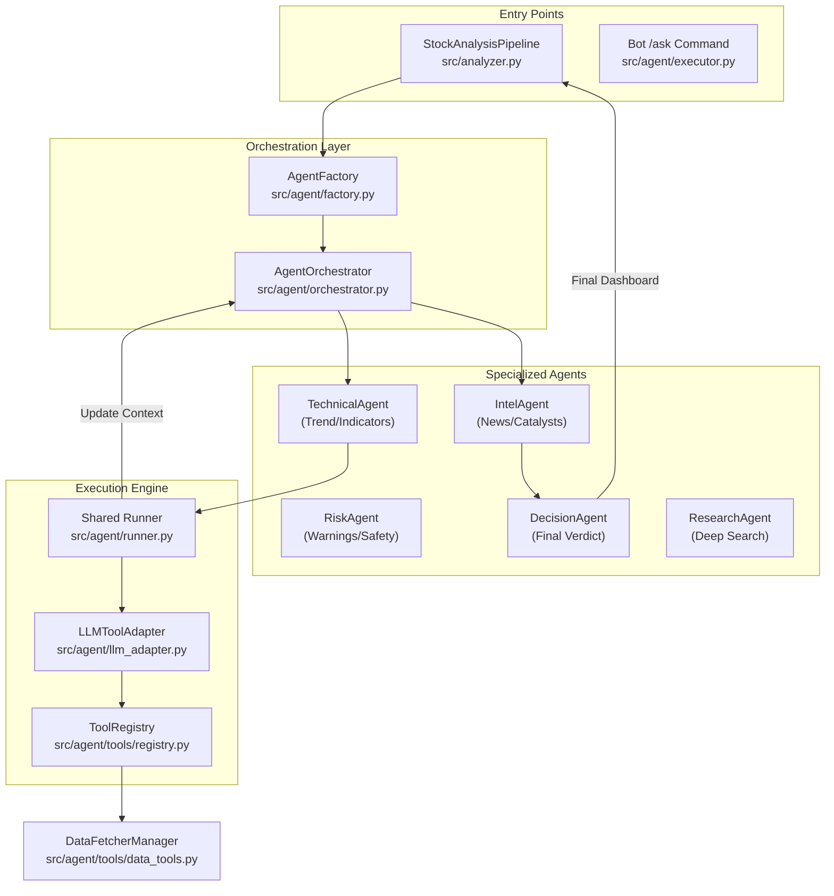
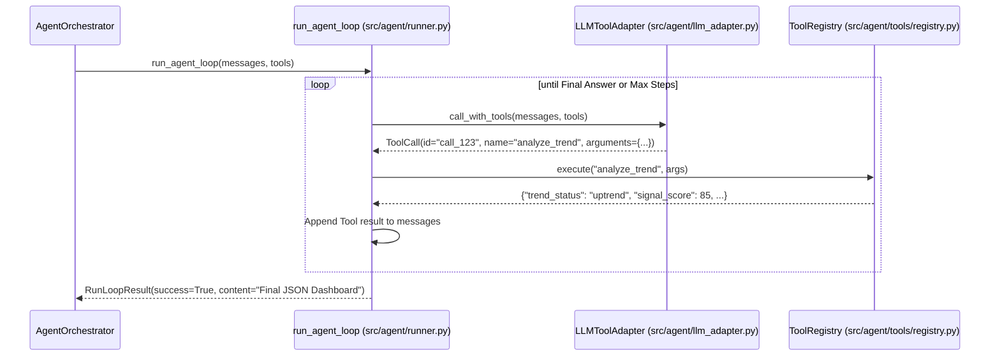

<!-- source: DeepWiki mcp.deepwiki.com · repo ZhuLinsen/daily_stock_analysis · page 4.4 Multi-Agent Orchestrator · fetched 2026-10-29 -->

# Multi-Agent Orchestrator

Relevant source files

The following files were used as context for generating this wiki page:

- [src/agent/executor.py](src/agent/executor.py)
- [src/agent/factory.py](src/agent/factory.py)
- [src/agent/llm_adapter.py](src/agent/llm_adapter.py)
- [src/agent/orchestrator.py](src/agent/orchestrator.py)
- [src/agent/runner.py](src/agent/runner.py)
- [src/agent/stock_scope.py](src/agent/stock_scope.py)
- [src/agent/tool_surface.py](src/agent/tool_surface.py)
- [src/agent/tools/__init__.py](src/agent/tools/__init__.py)
- [src/agent/tools/analysis_tools.py](src/agent/tools/analysis_tools.py)
- [src/agent/tools/backtest_tools.py](src/agent/tools/backtest_tools.py)
- [src/agent/tools/data_tools.py](src/agent/tools/data_tools.py)
- [src/agent/tools/market_tools.py](src/agent/tools/market_tools.py)
- [src/agent/tools/registry.py](src/agent/tools/registry.py)
- [src/agent/tools/search_tools.py](src/agent/tools/search_tools.py)
- [src/analyzer.py](src/analyzer.py)
- [tests/test_agent_executor.py](tests/test_agent_executor.py)
- [tests/test_agent_pipeline.py](tests/test_agent_pipeline.py)
- [tests/test_agent_registry.py](tests/test_agent_registry.py)
- [tests/test_multi_agent.py](tests/test_multi_agent.py)

The Multi-Agent Orchestrator is the high-level coordination layer that manages specialized AI agents to perform deep stock analysis. It transitions the system from a single-prompt analysis model to a multi-stage pipeline where different agents (Technical, Intel, Risk, etc.) collaborate to produce a comprehensive "Decision Dashboard."

## Architecture Overview

The orchestrator manages the lifecycle of a single stock analysis run by sequentially executing specialized agents. It maintains a shared `AgentContext` that accumulates data and opinions as the pipeline progresses.

### System Context & Data Flow

**Sources**: [src/agent/orchestrator.py:5-23](), [src/agent/runner.py:3-14](), [src/agent/tools/data_tools.py:51-64]()

---

## Orchestration Modes

The `AgentOrchestrator` supports four execution modes that trade off between analysis depth and latency/cost. These are configured via the `AGENT_MODE` environment variable.

| Mode | Pipeline Sequence | Best For |
| :--- | :--- | :--- |
| `quick` | Technical → Decision | Fast intraday checks (~2 LLM calls) |
| `standard` | Technical → Intel → Decision | Default balanced analysis |
| `full` | Technical → Intel → Risk → Decision | Comprehensive daily review |
| `specialist` | Technical → Intel → Risk → Specialist → Decision | Deep strategy-specific evaluation |

**Sources**: [src/agent/orchestrator.py:8-12](), [src/agent/orchestrator.py:100-101]()

---

## Specialized Agents

Each agent is a persona defined by a specific system prompt and access to a subset of tools. The orchestrator seeds the `AgentContext` with the user query and stock code before running these agents sequentially.

### 1. TechnicalAgent
Focuses on price action, moving averages, and volume.
*   **Tools**: `get_realtime_quote`, `get_daily_history`, `analyze_trend`, `calculate_ma`.
*   **Goal**: Determine the technical regime (Bullish/Bearish/Neutral) and key support/resistance levels.
*   **Source**: [src/agent/tools/analysis_tools.py:90-107](), [src/agent/tools/data_tools.py:5-10]()

### 2. IntelAgent & ResearchAgent
Scans for market catalysts, news sentiment, and comprehensive intelligence.
*   **Tools**: `search_stock_news`, `search_comprehensive_intel`.
*   **Goal**: Identify "Why is the stock moving?" and summarize recent news sentiment.
*   **Source**: [src/agent/tools/search_tools.py:3-8](), [src/agent/tools/search_tools.py:200-220]()

### 3. RiskAgent
A "Devil's Advocate" agent that specifically looks for red flags.
*   **Goal**: Surface shareholder reductions, earnings warnings, or regulatory issues that other agents might overlook.
*   **Source**: [src/agent/orchestrator.py:5-6](), [src/agent/executor.py:90-91]()

### 4. DecisionAgent
The final aggregator. It takes the accumulated `AgentContext` and synthesizes the final JSON dashboard.
*   **Goal**: Produce the final `operation_advice`, `sentiment_score`, and `decision_type` (buy/hold/sell).
*   **Source**: [src/agent/executor.py:103-105](), [src/agent/orchestrator.py:156-163]()

---

## ReAct Loop & Tool Interaction

The core of every agent execution is the **ReAct (Reasoning + Acting)** loop implemented in `src/agent/runner.py`. This loop allows agents to think, call tools, observe results, and repeat until a final answer is reached.

### Execution Flow (Code Entity Space)

**Sources**: [src/agent/runner.py:5-14](), [src/agent/executor.py:5-10](), [src/agent/llm_adapter.py:75-81]()

### Tool Normalization & Reliability
*   **Stock Code Normalization**: Ensures codes like `600519` are normalized for consistent tool execution and caching [src/agent/tools/search_tools.py:42-45]().
*   **JSON Repair**: Uses `json_repair` to fix malformed JSON blocks produced by LLMs, especially when outputting the complex `Decision Dashboard` [src/agent/runner.py:111-165]().
*   **Tool Caching**: `DataFetcherManager` is maintained as a singleton within the tool layer to prevent expensive re-initialization (e.g., Tushare) across multiple agent steps [src/agent/tools/data_tools.py:51-64]().

---

## Implementation Details

### AgentContext & Protocols
The `AgentContext` is a thread-safe container passed between agents. It stores:
*   **Opinions**: Individual agent verdicts (signal, confidence, reasoning) [src/agent/protocols.py:30-42]().
*   **Stage Results**: Tracks the status and output of each pipeline stage (Technical → Intel → etc.) [src/agent/protocols.py:39-40]().
*   **Run Stats**: Aggregates token usage and duration across all agents [src/agent/protocols.py:38]().

### Timeout & Budget Management
The orchestrator implements a cooperative timeout mechanism.
*   **Global Timeout**: Controlled by `agent_orchestrator_timeout_s`. If the limit is reached, the orchestrator triggers an "Automatic Downgrade" where the `DecisionAgent` generates a report based on partial data from completed stages [src/agent/orchestrator.py:105-116]().
*   **Sub-Agent Clamps**: Individual agents can have specific timeouts (e.g., `agent_technical_agent_timeout_s`) to prevent a single tool-heavy agent from consuming the entire pipeline budget [src/agent/orchestrator.py:117-135]().

### LLM Adapter (LiteLLM)
The `LLMToolAdapter` abstracts provider-specific logic:
*   **Thinking Mode**: Automatically extracts `reasoning_content` (Chain-of-Thought) for models like `deepseek-reasoner` or `r1` [src/agent/llm_adapter.py:89-91]().
*   **Custom Pricing**: Manually registers pricing for models not yet in LiteLLM's internal database (e.g., MiniMax-M3) to ensure accurate cost tracking [src/agent/llm_adapter.py:118-155]().

**Sources**: [src/agent/orchestrator.py:105-153](), [src/agent/llm_adapter.py:7-15](), [src/agent/protocols.py:30-42](), [src/agent/tools/data_tools.py:17-43]()

---

