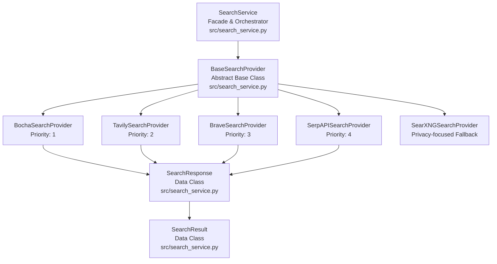
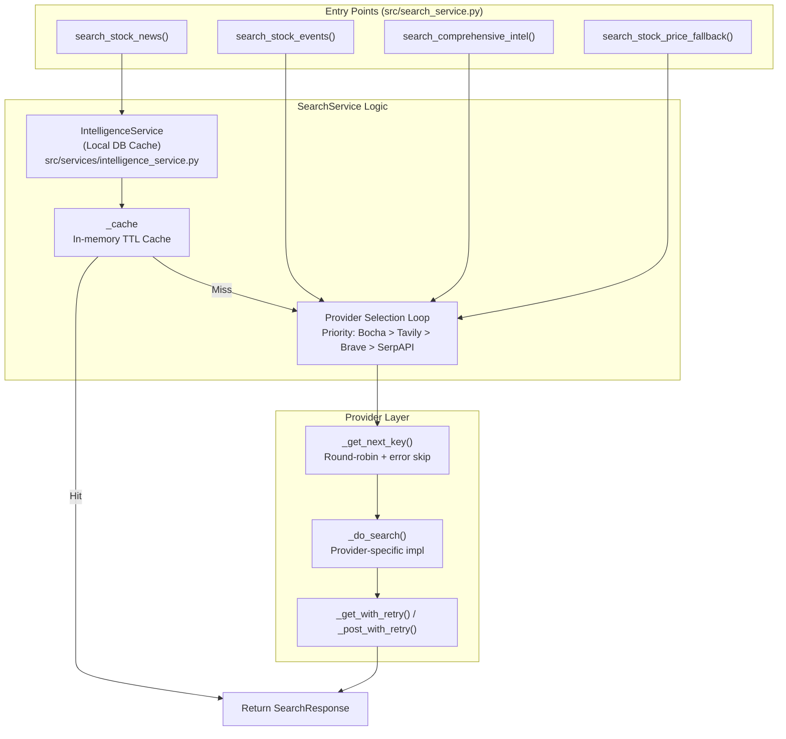
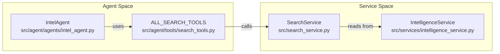

<!-- source: DeepWiki mcp.deepwiki.com · repo ZhuLinsen/daily_stock_analysis · page 4.5 Search Service · fetched 2026-10-29 -->

# Search Service

Relevant source files

The following files were used as context for generating this wiki page:

- [docs/intelligence-sources.md](docs/intelligence-sources.md)
- [src/repositories/intelligence_repo.py](src/repositories/intelligence_repo.py)
- [src/search_service.py](src/search_service.py)
- [src/services/intelligence_service.py](src/services/intelligence_service.py)
- [tests/test_intelligence_analysis_integration.py](tests/test_intelligence_analysis_integration.py)
- [tests/test_intelligence_service.py](tests/test_intelligence_service.py)
- [tests/test_search_news_freshness.py](tests/test_search_news_freshness.py)
- [tests/test_search_service_concurrency.py](tests/test_search_service_concurrency.py)
- [tests/test_search_tavily_provider.py](tests/test_search_tavily_provider.py)

## Purpose and Scope

The Search Service provides multi-dimensional intelligence gathering for stock analysis by integrating multiple search engine providers with automatic failover, load balancing, and result caching. It supports news search, risk screening, earnings outlook, and policy analysis. It is a core dependency of the `StockAnalysisPipeline` [src/core/pipeline.py:107-118]() and the multi-agent system [src/agent/agents/intel_agent.py:27-32](). Additionally, it integrates with the `IntelligenceService` to leverage persisted, compliant news sources [src/services/intelligence_service.py:122-124]().

---

## Architecture Overview

The Search Service implements a provider abstraction pattern with multiple search engine integrations and a unified service interface.

### Provider Class Hierarchy

**Sources:** [src/search_service.py:109-122](), [src/search_service.py:135-143](), [src/search_service.py:157-212](), [src/search_service.py:1330-1412]()

### Data Flow: Intelligence Gathering

**Sources:** [src/search_service.py:54-76](), [src/search_service.py:184-204](), [src/search_service.py:1163-1257](), [src/services/intelligence_service.py:122-138]()

---

## Agent Integration (Tools)

The search service is exposed to the Multi-Agent Orchestrator through specialized tools. These tools allow agents like the `IntelAgent` to perform targeted information gathering.

| Tool Name | Implementation | Description |
|-----------|----------------|-------------|
| `search_stock_news` | `_handle_search_stock_news` | Wraps `service.search_stock_news` for latest articles [src/agent/tools/search_tools.py:24-55]() |
| `search_comprehensive_intel` | `_handle_search_comprehensive_intel` | Wraps `service.search_comprehensive_intel` for 5D reports [src/agent/tools/search_tools.py:84-123]() |

### Code-to-Entity Mapping: Agent & Search

**Sources:** [src/agent/agents/intel_agent.py:24-32](), [src/agent/tools/search_tools.py:148-151](), [src/services/intelligence_service.py:122-138]()

---

## Search Provider Implementations

### 1. BochaSearchProvider (Priority 1)
**Characteristics:** Optimized for Chinese markets with AI-generated summaries.
- **Freshness Filtering:** Supports `oneDay`, `oneWeek`, `oneMonth` [src/search_service.py:588-601]().
- **AI Summary:** Requests `summary=True` from Bocha API to get concise insights [src/search_service.py:580]().
- **Mapping:** Maps `data.webPages.value[]` to `SearchResult` [src/search_service.py:644-660]().

### 2. TavilySearchProvider (Priority 2)
**Characteristics:** AI-optimized search engine with structured content.
- **Topic Support:** Explicitly uses `topic="news"` for time-sensitive queries [src/search_service.py:236]().
- **Date Mapping:** Handles both `published_date` and `publishedDate` fields from Tavily response [tests/test_search_tavily_provider.py:84-104]().

### 3. Intelligence Service (Local/Persisted)
**Characteristics:** Compliant RSS/Atom/NewsNow aggregator.
- **Scope:** Supports `symbol`, `market`, and `sector` levels [src/services/intelligence_service.py:30]().
- **NewsNow Integration:** Built-in templates for 财联社 (CLS), 雪球 (Xueqiu), and 华尔街见闻 (WallStreetCN) [src/services/intelligence_service.py:69-105]().
- **Auto-Fetch:** If `NEWS_INTEL_AUTO_FETCH_ENABLED` is true, the pipeline refreshes these sources before analysis [tests/test_intelligence_analysis_integration.py:78-92]().

---

## Search Strategies and Freshness

### News Freshness Filtering
The system implements strict freshness logic to ensure AI analyzes recent events.

- **Strategy Windows:** Uses `NEWS_STRATEGY_WINDOWS` (short: 3d, medium: 7d, long: 30d) [src/search_service.py:36-40]().
- **Effective Window:** Calculated as `min(profile_days, news_max_age_days)` [tests/test_search_news_freshness.py:76-85]().
- **Strict Filtering:** Results outside the window or more than 1 day in the future are discarded [tests/test_search_news_freshness.py:96-124]().
- **Over-fetching:** Requests `max_results * 2` from providers to account for potential filtering losses [tests/test_search_news_freshness.py:125-136]().

### Multi-Dimensional Intelligence
`search_comprehensive_intel()` splits a stock analysis into 5 dimensions [src/search_service.py:1163-1257]():

| Dimension | Purpose |
|-----------|---------|
| `latest_news` | Recent critical events (Strict filtering) |
| `market_analysis` | Analyst ratings and target prices |
| `risk_check` | Litigation, penalties, or insider selling |
| `earnings` | Revenue growth and performance forecasts |
| `industry` | Sector context and competitor landscape |

---

## Provider Management & Failover

### API Key Rotation
The `BaseSearchProvider` manages multiple keys using a round-robin strategy.

1. **Selection:** `_get_next_key()` uses `itertools.cycle` [src/search_service.py:184-192]().
2. **Circuit Breaking:** If a key accumulates 3 errors, it is skipped [src/search_service.py:197-199]().
3. **Reset:** If all keys are marked as errored, the error counts are reset [src/search_service.py:201-204]().

### Cascading Failover
When `SearchService` executes a query:
1. It checks the in-memory cache [src/search_service.py:1085-1089]().
2. It iterates through providers in priority order [src/search_service.py:1091-1105]().
3. If a provider returns 0 results (even if the API call succeeded), it proceeds to the next provider [tests/test_search_news_freshness.py:137-164]().

---

## Result Caching

The system maintains an in-memory cache to reduce latency and API costs.

- **Cache Key:** Composed of `query`, `max_results`, and `days` [src/search_service.py:1002-1004]().
- **TTL:** 600 seconds (10 minutes) [src/search_service.py:954]().
- **Concurrency:** Uses `_cache_inflight` with `threading.Event` to coalesce multiple concurrent requests for the same query into a single search [tests/test_search_service_concurrency.py:126-186]().

**Sources:** [src/search_service.py:951-1034](), [tests/test_search_service_concurrency.py:73-102](), [src/services/intelligence_service.py:122-138]()

---

