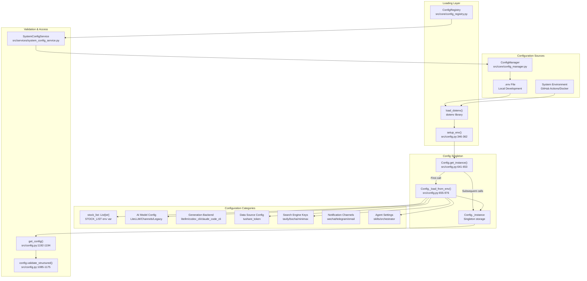
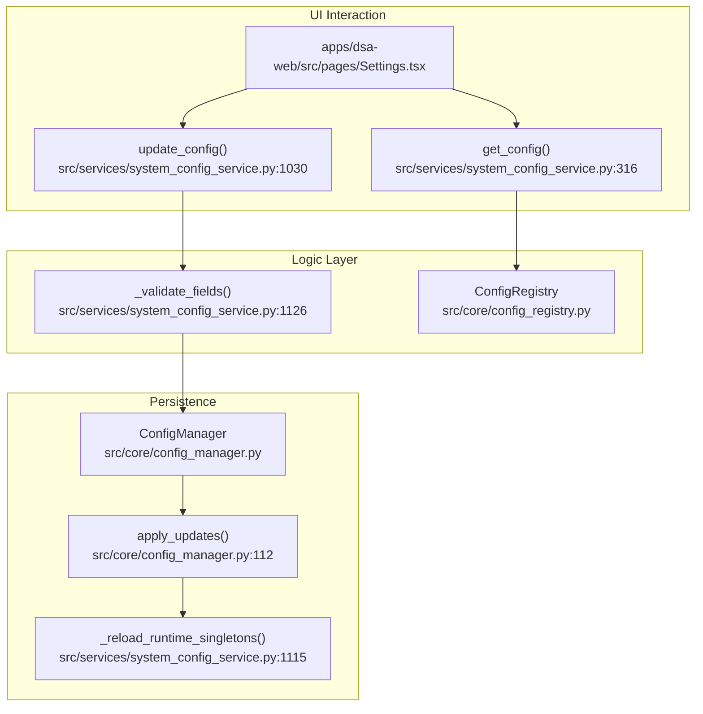

<!-- source: DeepWiki mcp.deepwiki.com · repo ZhuLinsen/daily_stock_analysis · page 4.6 Configuration System · fetched 2026-10-29 -->

# Configuration System

Relevant source files

The following files were used as context for generating this wiki page:

- [api/v1/endpoints/system_config.py](api/v1/endpoints/system_config.py)
- [api/v1/schemas/system_config.py](api/v1/schemas/system_config.py)
- [apps/dsa-web/src/api/systemConfig.ts](apps/dsa-web/src/api/systemConfig.ts)
- [apps/dsa-web/src/components/settings/LLMChannelEditor.tsx](apps/dsa-web/src/components/settings/LLMChannelEditor.tsx)
- [apps/dsa-web/src/components/settings/__tests__/LLMChannelEditor.test.tsx](apps/dsa-web/src/components/settings/__tests__/LLMChannelEditor.test.tsx)
- [apps/dsa-web/src/locales/settingsHelp.ts](apps/dsa-web/src/locales/settingsHelp.ts)
- [apps/dsa-web/src/types/systemConfig.ts](apps/dsa-web/src/types/systemConfig.ts)
- [apps/dsa-web/src/utils/systemConfigI18n.ts](apps/dsa-web/src/utils/systemConfigI18n.ts)
- [docs/LLM_CONFIG_GUIDE.md](docs/LLM_CONFIG_GUIDE.md)
- [docs/LLM_CONFIG_GUIDE_EN.md](docs/LLM_CONFIG_GUIDE_EN.md)
- [docs/llm-providers.md](docs/llm-providers.md)
- [src/core/config_manager.py](src/core/config_manager.py)
- [src/core/config_registry.py](src/core/config_registry.py)
- [src/services/system_config_service.py](src/services/system_config_service.py)
- [tests/test_config_manager.py](tests/test_config_manager.py)
- [tests/test_config_registry.py](tests/test_config_registry.py)
- [tests/test_system_config_api.py](tests/test_system_config_api.py)
- [tests/test_system_config_service.py](tests/test_system_config_service.py)

## Purpose and Scope

The Configuration System manages all environment variables and system settings through a centralized singleton pattern. It provides type-safe access to configuration values, automatic validation, hot reload capabilities, and intelligent proxy management. This page documents the `Config` class architecture, configuration loading lifecycle, validation mechanisms, and the advanced configuration service layer used by the Web UI settings page, including support for local CLI generation backends.

For deployment-specific configuration guides, see [Deployment Guide](). For configuration of individual notification channels, see [Notification Channels](). For data source priority configuration, see [Data Fetcher Architecture]().

---

## Configuration Architecture Overview

The system implements a singleton pattern using a `dataclass`-based configuration class that loads values from environment variables with support for defaults, validation, and multi-tier AI model configuration.

Title: Configuration System Architecture

**Sources:** [src/config.py:346-362](), [src/config.py:641-653](), [src/config.py:1192-1194](), [src/core/config_manager.py:1-210](), [src/core/config_registry.py:23-72]()

---

## Configuration Singleton Pattern

The `Config` class uses a class-level singleton implementation to ensure all modules share the same configuration instance. It includes an atomic `ConfigManager` to handle file I/O and optimistic versioning.

Title: Config Singleton Lifecycle

```mermaid
graph TB
    subgraph "First Access"
        Call1["Module calls<br/>get_config()"]
        Check1["Config._instance<br/>is None?"]
        Load1["Config._load_from_env()<br/>Parse all env vars"]
        Store1["Config._instance = new Config<br/>Store singleton"]
        Return1["Return Config instance"]
    end
    
    subgraph "Subsequent Access"
        Call2["Another module calls<br/>get_config()"]
        Check2["Config._instance<br/>already exists"]
        Return2["Return cached instance<br/>No re-parsing"]
    end
    
    subgraph "Atomic Management"
        ConfigManager["ConfigManager<br/>src/core/config_manager.py:69"]
        AtomicWrite["_atomic_upsert()<br/>src/core/config_manager.py:143"]
        Versioning["get_config_version()<br/>src/core/config_manager.py:93"]
    end
    
    Call1 --> Check1
    Check1 --> |"Yes"| Load1
    Load1 --> Store1
    Store1 --> Return1
    
    Call2 --> Check2
    Check2 --> Return2
    
    AtomicWrite --> Versioning
```

**Sources:** [src/config.py:641-653](), [src/core/config_manager.py:69-141]()

### Key Implementation Details

| Aspect | Implementation | Location |
|--------|---------------|----------|
| **Singleton Storage** | `_instance: Optional['Config'] = None` class variable | [src/config.py:639]() |
| **Access Method** | `get_instance()` class method checks if `_instance` is None | [src/config.py:641-653]() |
| **Initialization** | `_load_from_env()` parses environment variables with fallbacks | [src/config.py:655-976]() |
| **Atomic Writes** | `ConfigManager._atomic_upsert()` uses temporary files for safe `.env` updates | [src/core/config_manager.py:143-182]() |
| **Versioning** | `get_config_version()` returns SHA256 hash of file content for conflict detection | [src/core/config_manager.py:93-101]() |

---

## Configuration Categories

The system organizes configuration into logical categories defined in the `ConfigRegistry` for UI rendering and validation [src/core/config_registry.py:23-72]().

### AI Model Configuration (Generation Backends)

The system introduces a "Generation Backend" layer which is the outer runtime selector for regular analysis tasks.

| Backend ID | Description | Source |
|------------|-------------|--------|
| `litellm` | Default provider-based generation | [src/llm/backend_registry.py:65]() |
| `codex_cli` | Experimental local CLI backend | [src/llm/backend_registry.py:62]() |
| `claude_code_cli` | Experimental local CLI backend | [src/core/config_registry.py:134]() |
| `opencode_cli` | Experimental local CLI backend | [src/core/config_registry.py:135]() |

**Configuration Hierarchy:**
1. **LiteLLM Config**: Path to `litellm_config.yaml` (highest priority) [src/config.py:771-773]().
2. **LLM Channels**: Named channels with independent base URLs and keys [src/config.py:775-800]().
3. **Legacy Environment**: Direct keys like `GEMINI_API_KEY` or `DEEPSEEK_API_KEY` [src/config.py:820-845]().

**Sources:** [src/config.py:62-95](), [src/core/config_registry.py:121-179](), [docs/LLM_CONFIG_GUIDE.md:28-58]()

### Search Engine Configuration

Supports multiple providers with comma-separated key rotation:

| Field | Type | Default | Environment Variable |
|-------|------|---------|---------------------|
| `bocha_api_keys` | `List[str]` | `[]` | `BOCHA_API_KEYS` |
| `tavily_api_keys` | `List[str]` | `[]` | `TAVILY_API_KEYS` |
| `anspire_api_keys` | `List[str]` | `[]` | `ANSPIRE_API_KEYS` |
| `brave_api_keys` | `List[str]` | `[]` | `BRAVE_API_KEYS` |

**Sources:** [src/config.py:104-110](), [apps/dsa-web/src/utils/systemConfigI18n.ts:53-57]()

---

## Configuration Service Layer

The `SystemConfigService` provides a high-level API for the Web UI to manage `.env` settings, including schema generation, validation, and safe updates.

Title: System Configuration Service Flow

**Sources:** [src/services/system_config_service.py:316-360](), [src/services/system_config_service.py:1030-1113](), [src/core/config_manager.py:112-141]()

### Validation and Conflict Handling

The service implements strict validation and optimistic concurrency control:

- **Conflict Detection**: Updates require a `config_version`. If the file has changed on disk since the UI loaded, a `ConfigConflictError` is raised [src/services/system_config_service.py:1037-1042]().
- **Secret Masking**: Sensitive values (API keys, `LLM_USAGE_HMAC_SECRET`) are masked in the UI. The service preserves original values unless the UI submits a non-masked value [src/services/system_config_service.py:1044-1055](), [src/services/system_config_service.py:185-191]().
- **Generation Backend Diagnostics**: Provides structured health checks and "smoke tests" for AI backends without persisting changes [src/services/system_config_service.py:123-163](), [docs/LLM_CONFIG_GUIDE.md:57-58]().

---

## Configuration Registry and UI Metadata

The `ConfigRegistry` serves as the single source of truth for UI metadata, defining how environment variables are rendered in the Web settings page.

| Feature | Implementation | Source |
|---------|----------------|--------|
| **Categories** | Grouped by `base`, `ai_model`, `data_source`, etc. | [src/core/config_registry.py:23-72]() |
| **UI Controls** | `textarea` for `STOCK_LIST`, `select` for `GENERATION_BACKEND` | [src/core/config_registry.py:88-138]() |
| **Validation** | Regex patterns, enums, and min/max bounds | [src/core/config_registry.py:148-165]() |
| **I18n** | Labels and descriptions in Chinese and English | [apps/dsa-web/src/utils/systemConfigI18n.ts:4-48]() |

**Sources:** [src/core/config_registry.py:1-150](), [apps/dsa-web/src/utils/systemConfigI18n.ts:1-100]()

---

## Configuration Validation (Structured)

The `Config.validate_structured()` method provides detailed feedback on the health of the current configuration, categorizing issues by severity (`error`, `warning`, `info`).

| Severity | Example Condition | Field |
|----------|-------------------|-------|
| **Error** | `stock_list` is empty | `STOCK_LIST` |
| **Error** | No AI models available across all tiers | `LLM` |
| **Warning** | `tushare_token` is missing | `TUSHARE_TOKEN` |
| **Info** | No search engine keys configured | `SEARCH` |

**Sources:** [src/config.py:1085-1175](), [src/services/system_config_service.py:1126-1200]()

### Local CLI Backend Validation
For backends like `claude_code_cli` or `opencode_cli`, the system performs capability probes. If a CLI executable is missing, the system returns a structured `command_not_found` diagnostic [docs/LLM_CONFIG_GUIDE.md:47-50](). Execution is subject to hard limits:
- `GENERATION_BACKEND_TIMEOUT_SECONDS`: Max 3600s [src/core/config_registry.py:284]().
- `GENERATION_BACKEND_MAX_OUTPUT_BYTES`: Max 32MB [src/core/config_registry.py:307]().
- `LOCAL_CLI_BACKEND_MAX_CONCURRENCY`: Max 4 [src/core/config_registry.py:353]().

**Sources:** [docs/LLM_CONFIG_GUIDE.md:46-54](), [src/core/config_registry.py:270-360]()

---

