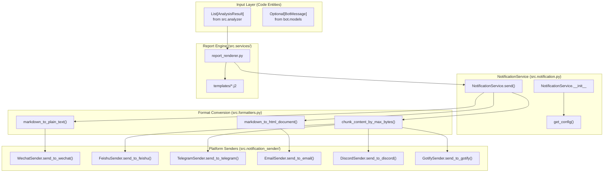
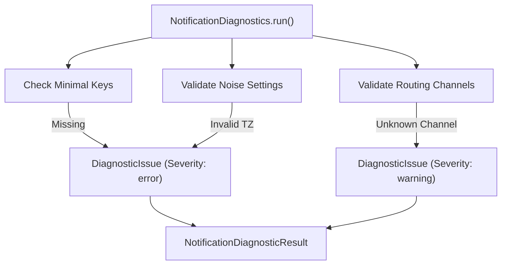

<!-- source: DeepWiki mcp.deepwiki.com · repo ZhuLinsen/daily_stock_analysis · page 4.7 Notification Service · fetched 2026-10-29 -->

# Notification Service

Relevant source files

The following files were used as context for generating this wiki page:

- [.github/workflows/00-daily-analysis.yml](.github/workflows/00-daily-analysis.yml)
- [bot/platforms/__init__.py](bot/platforms/__init__.py)
- [bot/platforms/feishu_stream.py](bot/platforms/feishu_stream.py)
- [docs/bot/feishu-bot-config.md](docs/bot/feishu-bot-config.md)
- [docs/notifications.md](docs/notifications.md)
- [src/formatters.py](src/formatters.py)
- [src/notification.py](src/notification.py)
- [src/notification_routing.py](src/notification_routing.py)
- [src/notification_sender/__init__.py](src/notification_sender/__init__.py)
- [src/notification_sender/feishu_sender.py](src/notification_sender/feishu_sender.py)
- [src/notification_sender/telegram_sender.py](src/notification_sender/telegram_sender.py)
- [src/services/notification_diagnostics.py](src/services/notification_diagnostics.py)
- [src/services/report_renderer.py](src/services/report_renderer.py)
- [templates/report_brief.j2](templates/report_brief.j2)
- [templates/report_markdown.j2](templates/report_markdown.j2)
- [templates/report_wechat.j2](templates/report_wechat.j2)
- [tests/test_feishu_stream.py](tests/test_feishu_stream.py)
- [tests/test_formatters.py](tests/test_formatters.py)
- [tests/test_notification.py](tests/test_notification.py)
- [tests/test_notification_sender.py](tests/test_notification_sender.py)
- [tests/test_pipeline_notification_image_routing.py](tests/test_pipeline_notification_image_routing.py)
- [tests/test_report_renderer.py](tests/test_report_renderer.py)
- [webui.py](webui.py)

The Notification Service (`NotificationService`) is responsible for generating formatted analysis reports and distributing them to multiple notification channels concurrently. It supports 10+ platforms including Telegram, Discord, Email, WeChat Work, Feishu, and custom webhooks, with platform-specific optimizations such as message chunking, format conversion, and Jinja2-based template rendering.

For AI analysis functionality that generates the data consumed by this service, see [AI Analysis Engine](#4.3). For configuration management of notification credentials, see [Configuration System](#4.6).

---

## Architecture Overview

The notification system implements a multi-layer architecture: report generation via Jinja2 templates, format conversion, channel-specific processing, and concurrent distribution. The `NotificationService` class inherits from specialized sender classes for each supported platform.

### System Data Flow and Entity Mapping

**Sources:** [src/notification.py:177-192](), [src/services/report_renderer.py:20-21](), [src/notification_sender/__init__.py:1-15]()

---

## Report Generation and Templates

The system uses Jinja2 templates located in the `templates/` directory to generate Markdown reports. This allows for clean separation between data logic and presentation.

### Template Hierarchy
*   `templates/report_markdown.j2`: The primary template for full analysis reports. [templates/report_markdown.j2:1-200]()
*   `templates/_macros.j2`: Shared components like market snapshots and board rankings. [templates/report_markdown.j2:1]()
*   `templates/report_brief.j2`: Minimalist summary for mobile push notifications. [tests/test_report_renderer.py:182-185]()

### Report Content Control
The service supports several flags to control output:
*   `report_summary_only`: If true, excludes individual stock details and only sends the dashboard summary. [src/notification.py:231-231]()
*   `report_show_llm_model`: Toggles the visibility of the AI model used at the bottom of the report. [src/notification.py:232-232]()

**Sources:** [src/notification.py:223-234](), [templates/report_markdown.j2:16-17](), [tests/test_report_renderer.py:75-83]()

---

## Channel Detection and Routing

### Channel Detection
The `ChannelDetector` provides localized names for channels, while `NotificationService` identifies active channels by checking if their minimal required keys are present in the configuration.

| Channel | Minimal Configuration Keys |
|---------|---------------------------|
| WeChat | `WECHAT_WEBHOOK_URL` |
| Feishu | `FEISHU_WEBHOOK_URL` or (`FEISHU_APP_ID` + `FEISHU_APP_SECRET` + `FEISHU_CHAT_ID`) |
| Telegram | `TELEGRAM_BOT_TOKEN` + `TELEGRAM_CHAT_ID` |
| Email | `EMAIL_SENDER` + `EMAIL_PASSWORD` |
| Discord | `DISCORD_WEBHOOK_URL` or (`DISCORD_BOT_TOKEN` + `DISCORD_MAIN_CHANNEL_ID`) |
| Gotify | `GOTIFY_URL` + `GOTIFY_TOKEN` |

**Sources:** [src/notification.py:147-174](), [src/services/notification_diagnostics.py:79-182](), [docs/notifications.md:7-22]()

### Notification Routing and Noise Control
The system supports advanced routing to prevent alert fatigue:
*   **Routing:** Notifications can be routed to specific channels based on type (report, alert, system_error). [src/notification_routing.py:19-23]()
*   **Noise Suppression:** Implements cooldowns, quiet hours, and minimum severity filters via `evaluate_notification_noise`. [src/notification.py:35-40](), [src/notification_noise.py:12-18]()

---

## Platform-Specific Optimizations

### Feishu (Lark) Dual-Mode Support
`FeishuSender` supports two distinct modes:
1.  **Webhook Mode:** Uses a standard URL with optional secret/keyword signing. [src/notification_sender/feishu_sender.py:95-101]()
2.  **App Bot Mode:** Uses the `lark-oapi` SDK to send messages as an interactive card or as a `.md` file if `FEISHU_SEND_AS_FILE` is enabled. [src/notification_sender/feishu_sender.py:103-128](), [docs/bot/feishu-bot-config.md:57-68]()

### Discord Resilience
The `DiscordSender` handles long reports by chunking content into 2000-character segments. It also implements rate-limit handling by checking the `retry_after` header on `429 Too Many Requests` responses. [src/notification_sender/feishu_sender.py:28-29](), [tests/test_notification_sender.py:140-172]()

### Formatters and Chunking
The `src.formatters.py` module provides critical utilities for cross-platform compatibility:
*   `chunk_content_by_max_bytes`: Splits content while respecting UTF-8 character boundaries. [src/formatters.py:27-28](), [tests/test_formatters.py:104-120]()
*   `markdown_to_html_document`: Generates a complete HTML document with embedded CSS for Email and Markdown-to-Image rendering. [src/formatters.py:100-226]()

**Sources:** [src/formatters.py:118-211](), [src/notification_sender/feishu_sender.py:135-148](), [tests/test_notification_sender.py:156-172]()

---

## Diagnostics and Testing

The system includes a diagnostic suite to verify notification health without sending real messages.

### Configuration Diagnostics
The `NotificationDiagnosticResult` class aggregates errors, warnings, and info about the current notification setup, checking for missing keys or invalid timezones. [src/services/notification_diagnostics.py:66-78]()

### Diagnostic Logic Flow

**Sources:** [src/services/notification_diagnostics.py:32-64](), [src/notification_noise.py:14-18]()

### Unit Testing
The service is heavily tested to ensure isolation of channel exceptions. If one channel (e.g., WeChat) fails, the `NotificationService` continues to attempt delivery to other configured channels (e.g., Email). [tests/test_notification.py:178-195](), [tests/test_notification_sender.py:175-189]()

**Sources:** [tests/test_notification.py:103-130](), [tests/test_notification_sender.py:1-41]()

---

