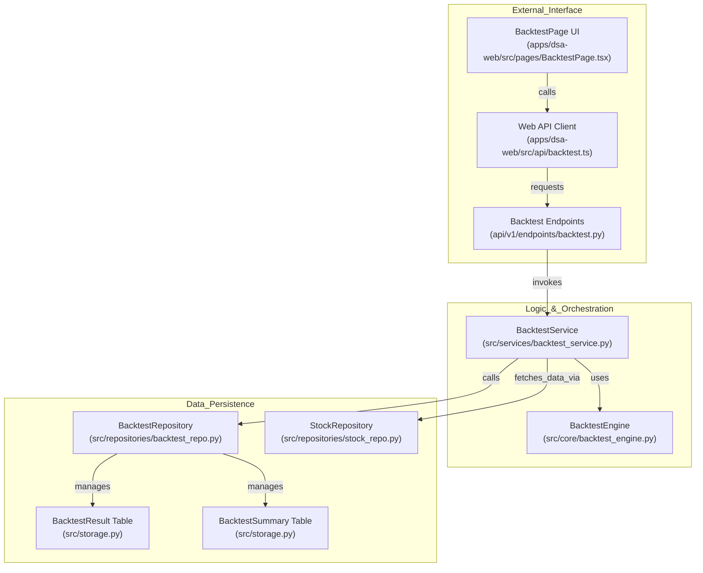
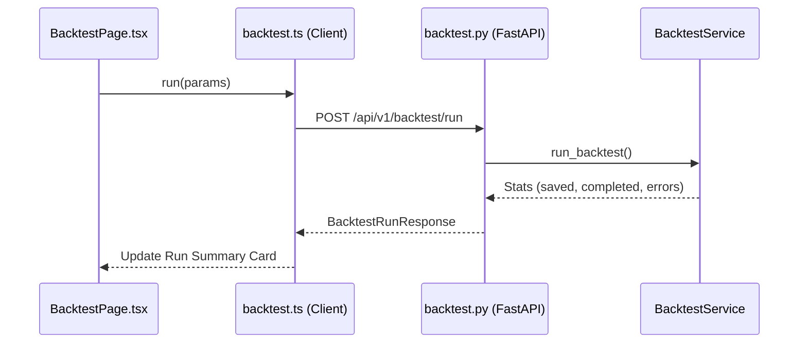

<!-- source: DeepWiki mcp.deepwiki.com · repo ZhuLinsen/daily_stock_analysis · page 4.8 Backtesting Engine · fetched 2026-10-29 -->

# Backtesting Engine

Relevant source files

The following files were used as context for generating this wiki page:

- [api/v1/endpoints/backtest.py](api/v1/endpoints/backtest.py)
- [api/v1/schemas/backtest.py](api/v1/schemas/backtest.py)
- [apps/dsa-web/src/api/backtest.ts](apps/dsa-web/src/api/backtest.ts)
- [apps/dsa-web/src/pages/BacktestPage.tsx](apps/dsa-web/src/pages/BacktestPage.tsx)
- [apps/dsa-web/src/pages/__tests__/BacktestPage.test.tsx](apps/dsa-web/src/pages/__tests__/BacktestPage.test.tsx)
- [apps/dsa-web/src/types/backtest.ts](apps/dsa-web/src/types/backtest.ts)
- [src/core/backtest_engine.py](src/core/backtest_engine.py)
- [src/repositories/backtest_repo.py](src/repositories/backtest_repo.py)
- [src/repositories/stock_repo.py](src/repositories/stock_repo.py)
- [src/services/backtest_service.py](src/services/backtest_service.py)
- [tests/test_backtest_engine.py](tests/test_backtest_engine.py)
- [tests/test_backtest_service.py](tests/test_backtest_service.py)

The Backtesting Engine validates the accuracy of AI-generated stock analysis recommendations by comparing them against actual market movements. It operates as a post-analysis evaluation system that measures direction accuracy, win rates, simulated returns, and stop loss/take profit trigger rates for historical predictions.

This document covers the backtesting system's architecture, evaluation logic, and integration points. For information about the AI analysis system that generates the recommendations being validated, see [AI Analysis Engine (4.3)]().

---

## System Overview

The backtesting engine implements an automated feedback loop that evaluates historical `AnalysisHistory` records after a cooling period (default 14 days) to ensure sufficient forward price data exists. [src/services/backtest_service.py:58-59](). It retrieves post-analysis K-line data, compares AI predictions with actual market movements, and persists performance metrics to `BacktestResult` and `BacktestSummary` tables. [src/services/backtest_service.py:88-144]().

### Code-to-Entity Mapping
The following diagram associates natural language concepts with specific code entities within the backtesting system.

**Sources:** [src/core/backtest_engine.py:52-53](), [src/services/backtest_service.py:27-35](), [src/repositories/backtest_repo.py:37-41](), [api/v1/endpoints/backtest.py:26-30](), [apps/dsa-web/src/pages/BacktestPage.tsx:4-7]()

---

## Core Logic: BacktestEngine

The `BacktestEngine` is a pure-logic, database-agnostic component that performs the mathematical and linguistic evaluation of a single analysis. [src/core/backtest_engine.py:52-53]().

### Direction Inference
The engine parses the `operation_advice` string using keyword matching and negation detection to determine the AI's intended market direction and position recommendation. [src/core/backtest_engine.py:113-155]().

| Keyword Category | Keywords | Position | Expected Direction |
|------------------|----------|----------|--------------------|
| **Bullish** | 买入, 加仓, strong buy, buy | `long` | `up` |
| **Bearish** | 卖出, 减仓, strong sell, sell | `cash` | `down` |
| **Hold** | 持有, hold, 震荡观望 | `long` | `not_down` |
| **Wait** | 观望, 等待, wait | `cash` | `flat` |

**Negation Handling:** The engine checks for prefixes like "not", "don't", "不要", "不" using `_NEGATION_PATTERNS` to avoid false positives (e.g., "do not buy"). [src/core/backtest_engine.py:94-97]().

### Evaluation Logic (evaluate_single)
The `evaluate_single` function performs the core calculation: [src/core/backtest_engine.py:158-168]().

1.  **Price Normalization:** Validates `start_price` and ensures `forward_bars` count matches `eval_window_days`. [src/core/backtest_engine.py:177-200]().
2.  **Outcome Classification:** Compares `stock_return_pct` against `neutral_band_pct` (default 2.0%). [src/core/backtest_engine.py:207-212]().
3.  **Target Simulation:** Iterates through `forward_bars` to find the first day where `low <= stop_loss` or `high >= take_profit`. [src/core/backtest_engine.py:215-225]().
4.  **Ambiguity Handling:** If both stop-loss and take-profit are hit on the same bar, it records `first_hit="ambiguous"` and assumes stop-loss for simulated return calculation. [src/core/backtest_engine.py:171-175]().

**Sources:** [src/core/backtest_engine.py:52-132](), [src/core/backtest_engine.py:158-225]()

---

## Service Layer: BacktestService

The `BacktestService` orchestrates the data flow between the repositories and the engine. [src/services/backtest_service.py:27-35]().

### Backtest Execution Pipeline
When `run_backtest` is called, the service follows these steps: [src/services/backtest_service.py:37-47]().

1.  **Candidate Selection:** Fetches `AnalysisHistory` records older than `min_age_days` (default 14) that haven't been backtested for the current `engine_version`. [src/repositories/backtest_repo.py:43-81]().
2.  **Data Preparation:** Resolves the `analysis_date` and retrieves `start_daily` price and `forward_bars` from `StockRepository`. [src/services/backtest_service.py:97-154]().
3.  **Engine Invocation:** Calls `BacktestEngine.evaluate_single` for each candidate. [src/services/backtest_service.py:186-194]().
4.  **Batch Persistence:** Saves results to the database in batches using `BacktestRepository.save_results_batch`. [src/services/backtest_service.py:210-213]().
5.  **Summary Refresh:** Triggers a recalculation of `BacktestSummary` for the affected stocks and the overall portfolio via `_refresh_summaries`. [src/services/backtest_service.py:215-220]().

**Sources:** [src/services/backtest_service.py:37-220](), [src/repositories/backtest_repo.py:43-81]()

---

## Metrics & Summaries

The system calculates aggregate performance metrics stored in the `BacktestSummary` table and exposed via the `PerformanceMetrics` schema. [api/v1/schemas/backtest.py:85-114]().

### Key Performance Indicators (KPIs)
The following metrics are calculated for both individual stocks and the overall portfolio: [api/v1/schemas/backtest.py:92-110]().

| Metric | Code Entity | Description |
|--------|-------------|-------------|
| **Win Rate** | `win_rate_pct` | Percentage of "win" outcomes vs total completed evaluations. |
| **Direction Accuracy** | `direction_accuracy_pct` | How often the actual movement matched the `direction_expected`. |
| **Avg Stock Return** | `avg_stock_return_pct` | Average return of the stock during the evaluation window. |
| **Avg Simulated Return** | `avg_simulated_return_pct` | Average return if following AI entry/exit (stop-loss/take-profit). |
| **Stop Loss Rate** | `stop_loss_trigger_rate` | Frequency of hitting the AI-suggested stop-loss price. |

**Sources:** [api/v1/schemas/backtest.py:85-114](), [apps/dsa-web/src/types/backtest.ts:83-112]()

---

## Web Interface & API

### API Endpoints
The `BacktestService` logic is exposed via FastAPI endpoints: [api/v1/endpoints/backtest.py:26-210]().

- `POST /api/v1/backtest/run`: Triggers the evaluation process for pending historical records. [api/v1/endpoints/backtest.py:45-72]().
- `GET /api/v1/backtest/results`: Retrieves paginated evaluation items with filtering by code and date. [api/v1/endpoints/backtest.py:89-128]().
- `GET /api/v1/backtest/performance`: Retrieves the overall portfolio performance summary. [api/v1/endpoints/backtest.py:144-177]().
- `GET /api/v1/backtest/performance/{code}`: Retrieves performance summary for a specific stock. [api/v1/endpoints/backtest.py:194-210]().

### Frontend Integration
The React-based `BacktestPage` provides a comprehensive dashboard for monitoring system performance. [apps/dsa-web/src/pages/BacktestPage.tsx:184-208]().

**Key UI Components:**
- **PerformanceCard**: Displays Win Rate, Direction Accuracy, and Return metrics. [apps/dsa-web/src/pages/BacktestPage.tsx:184-208]().
- **MetricRow**: Helper component for rendering individual KPI lines. [apps/dsa-web/src/pages/BacktestPage.tsx:159-164]().
- **Result Table**: Displays individual `BacktestResultItem` entries with visual indicators (badges) for WIN/LOSS and Direction Match. [apps/dsa-web/src/pages/BacktestPage.tsx:77-120]().

**Sources:** [api/v1/endpoints/backtest.py:45-210](), [apps/dsa-web/src/api/backtest.ts:14-127](), [apps/dsa-web/src/pages/BacktestPage.tsx:114-208]()

---

