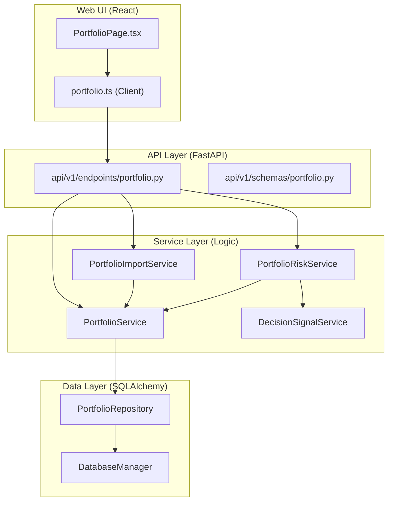
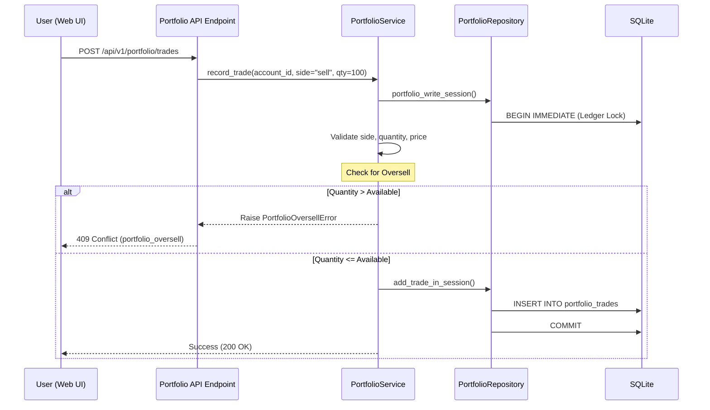

<!-- source: DeepWiki mcp.deepwiki.com · repo ZhuLinsen/daily_stock_analysis · page 4.9 Portfolio P0 System · fetched 2026-10-29 -->

# Portfolio P0 System

Relevant source files

The following files were used as context for generating this wiki page:

- [api/v1/endpoints/portfolio.py](api/v1/endpoints/portfolio.py)
- [api/v1/schemas/portfolio.py](api/v1/schemas/portfolio.py)
- [apps/dsa-web/src/api/portfolio.ts](apps/dsa-web/src/api/portfolio.ts)
- [apps/dsa-web/src/pages/PortfolioPage.tsx](apps/dsa-web/src/pages/PortfolioPage.tsx)
- [apps/dsa-web/src/pages/__tests__/PortfolioPage.test.tsx](apps/dsa-web/src/pages/__tests__/PortfolioPage.test.tsx)
- [apps/dsa-web/src/types/portfolio.ts](apps/dsa-web/src/types/portfolio.ts)
- [src/repositories/portfolio_repo.py](src/repositories/portfolio_repo.py)
- [src/services/portfolio_risk_service.py](src/services/portfolio_risk_service.py)
- [src/services/portfolio_service.py](src/services/portfolio_service.py)
- [tests/test_portfolio_api.py](tests/test_portfolio_api.py)
- [tests/test_portfolio_pr2.py](tests/test_portfolio_pr2.py)
- [tests/test_portfolio_service.py](tests/test_portfolio_service.py)

The Portfolio P0 system is a core ledger and accounting engine designed to track actual stock holdings, cash balances, and performance across multiple accounts and markets (A-share, HK, US, JP, KR, TW). It provides a "ground truth" for the user's portfolio, supporting manual trade entry, bulk CSV imports, and automated corporate action adjustments.

## System Overview

The system operates as a double-entry style ledger (though optimized for stock positions) where every change in position is derived from a series of discrete events: trades, cash movements, and corporate actions.

### Key Capabilities
*   **Multi-Market Support**: Native handling of `cn`, `hk`, `us`, `jp`, `kr`, and `tw` markets with base currency normalization [src/services/portfolio_service.py:33-33]().
*   **Cost Basis Accounting**: Supports both **FIFO** (First-In-First-Out) and **AVG** (Average Cost) methods for valuation [src/services/portfolio_service.py:35-35]().
*   **Corporate Actions**: Automated handling of cash dividends and stock splits/mergers [src/services/portfolio_service.py:38-38]().
*   **Risk Guardrails**: Real-time calculation of concentration, drawdowns, and stop-loss triggers [src/services/portfolio_risk_service.py:39-102]().
*   **Real-time Valuation**: Best-effort integration of real-time quotes to provide intraday P&L [src/services/portfolio_service.py:40-40]().

### Code Entity Mapping
The following diagram maps high-level system concepts to their specific implementation classes and files.

**Entity Relationship & Code Mapping**

**Sources**: [apps/dsa-web/src/pages/PortfolioPage.tsx:4-5](), [api/v1/endpoints/portfolio.py:41-46](), [src/services/portfolio_service.py:109-113](), [src/services/portfolio_risk_service.py:21-35](), [src/repositories/portfolio_repo.py:45-49]()

---

## Core Ledger Engine

The `PortfolioService` is responsible for replaying the event history to generate a "Snapshot" of current holdings.

### FIFO vs. AVG Implementation
*   **FIFO**: Maintains a queue of `PortfolioPositionLot` records [src/repositories/portfolio_repo.py:25-25](). Selling consumes the oldest lots first, allowing for precise realized P&L calculation based on historical purchase prices.
*   **AVG**: Updates an internal `_AvgState` [src/services/portfolio_service.py:94-97]() weighted average cost for the entire position whenever a "buy" occurs.

### The Oversell Interceptor
To maintain ledger integrity, the system implements an **Oversell Interceptor**. Before any `sell` trade is committed, the system simulates the position state. If the requested quantity exceeds the available shares, a `PortfolioOversellError` is raised [src/services/portfolio_service.py:70-91]().

**Data Flow: Recording a Trade**

**Sources**: [api/v1/endpoints/portfolio.py:169-196](), [src/services/portfolio_service.py:186-224](), [src/repositories/portfolio_repo.py:136-160]()

---

## Risk & Corporate Actions

### Risk Analysis System
The `PortfolioRiskService` computes several risk blocks on top of the replayed snapshot [src/services/portfolio_risk_service.py:39-102]():
1.  **Concentration**: Identifies if a single stock or sector exceeds the `concentration_alert_pct` [src/services/portfolio_risk_service.py:56-56]().
2.  **Drawdown**: Calculates max and current drawdown over a lookback period (default 180 days) [src/services/portfolio_risk_service.py:60-60]().
3.  **Stop-Loss**: Monitors if the current price is approaching or has triggered the stop-loss threshold [src/services/portfolio_risk_service.py:87-87]().
4.  **Decision Signal Alignment**: Cross-references held positions with active AI decision signals to flag "Sell" or "Reduce" recommendations [src/services/portfolio_risk_service.py:103-170]().

### FX Fail-Open Behavior
Since the system tracks global stocks, it must convert values to a `base_currency`.
*   **Real-time Refresh**: The `refresh_fx` endpoint attempts to update latest exchange rates [api/v1/endpoints/portfolio.py:382-398]().
*   **Fail-Open**: If rates are stale, the system marks the snapshot with `fx_stale: true` [api/v1/schemas/portfolio.py:195-195]() but continues valuation using the last known rates to ensure availability.

**Sources**: [src/services/portfolio_risk_service.py:39-102](), [api/v1/endpoints/portfolio.py:382-398](), [api/v1/schemas/portfolio.py:179-217]()

---

## Data Import & Deduplication

The `PortfolioImportService` allows bulk migration of trade history via CSV from brokers like Huatai, CITIC, and CMB [apps/dsa-web/src/pages/PortfolioPage.tsx:59-63]().

### Deduplication Logic
To prevent duplicate entries during repeated imports, the system uses two layers of identification [src/repositories/portfolio_repo.py:33-40]():
1.  **Trade UID**: A unique identifier provided by the broker (e.g., `HT-001`).
2.  **Dedup Hash**: A deterministic hash of trade attributes (date, symbol, quantity, price) used when the broker does not provide a unique ID [tests/test_portfolio_pr2.py:148-183]().

**Sources**: [src/services/portfolio_import_service.py:1-30](), [src/repositories/portfolio_repo.py:33-40](), [tests/test_portfolio_pr2.py:148-183]()

---

## Portfolio Web UI

The `PortfolioPage` (React) provides the primary interface for ledger management [apps/dsa-web/src/pages/PortfolioPage.tsx:182-182]().

### Key Features
*   **Account Management**: Create, update, and deactivate accounts with specific base currencies and markets [apps/dsa-web/src/api/portfolio.ts:109-130]().
*   **Unified Snapshot**: Displays aggregated equity, realized P&L, and market value across all or selected accounts [apps/dsa-web/src/types/portfolio.ts:81-97]().
*   **Position Analysis**: Trigger AI analysis directly for a specific held position [apps/dsa-web/src/api/portfolio.ts:139-149]().
*   **Visual Risk Metrics**: Uses `recharts` for concentration visualization and displays explicit limitations (e.g., "realtime_quote_best_effort") for specific markets [apps/dsa-web/src/pages/PortfolioPage.tsx:3-7, 85-98]().

**Sources**: [apps/dsa-web/src/pages/PortfolioPage.tsx:1-50](), [apps/dsa-web/src/api/portfolio.ts:108-206](), [apps/dsa-web/src/types/portfolio.ts:1-100]()

---

