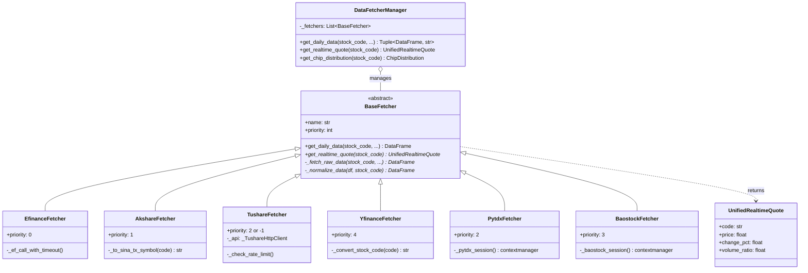
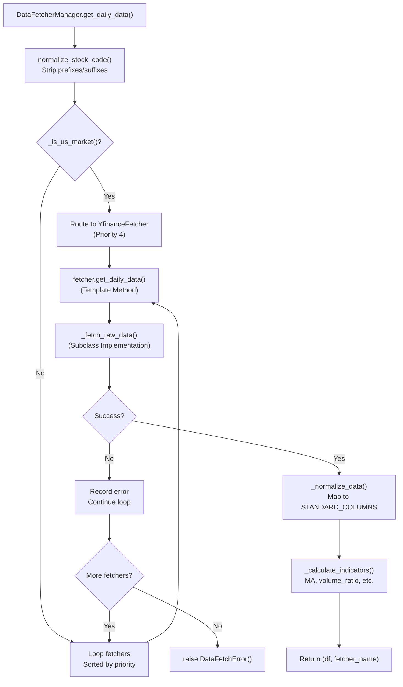

<!-- source: DeepWiki mcp.deepwiki.com · repo ZhuLinsen/daily_stock_analysis · page 5 Data Provider System · fetched 2026-10-29 -->

# Data Provider System

<details>
<summary>Relevant source files</summary>

The following files were used as context for generating this wiki page:

- [data_provider/akshare_fetcher.py](data_provider/akshare_fetcher.py)
- [data_provider/baostock_fetcher.py](data_provider/baostock_fetcher.py)
- [data_provider/base.py](data_provider/base.py)
- [data_provider/efinance_fetcher.py](data_provider/efinance_fetcher.py)
- [data_provider/pytdx_fetcher.py](data_provider/pytdx_fetcher.py)
- [data_provider/tushare_fetcher.py](data_provider/tushare_fetcher.py)
- [data_provider/yfinance_fetcher.py](data_provider/yfinance_fetcher.py)
- [docs/run-diagnostics-p0.md](docs/run-diagnostics-p0.md)
- [tests/test_a_share_fetcher_code_conversion.py](tests/test_a_share_fetcher_code_conversion.py)
- [tests/test_data_fetcher_prefetch_stock_names.py](tests/test_data_fetcher_prefetch_stock_names.py)
- [tests/test_stock_code_bse.py](tests/test_stock_code_bse.py)

</details>


## Purpose and Scope

The Data Provider System is a multi-source data acquisition layer that implements priority-based failover across 7+ stock market data providers. It provides a unified interface for fetching historical OHLCV data, real-time quotes, chip distribution, and market statistics for A-shares (including Beijing Stock Exchange), Hong Kong stocks, and US stocks.

This document covers the architecture, failover strategy, circuit breaker pattern, and data normalization pipeline. For individual data source implementations, see child pages:
*   [Data Fetcher Architecture](#5.1)
*   [EFinance Fetcher (Priority 0)](#5.2)
*   [AkShare Fetcher (Priority 1)](#5.3)
*   [Tushare Fetcher (Priority 2)](#5.4)
*   [Pytdx Fetcher (Priority 2)](#5.5)
*   [Baostock Fetcher (Priority 3)](#5.6)
*   [YFinance Fetcher (Priority 4)](#5.7)
*   [Longbridge Fetcher (Priority 5)](#5.8)
*   [Real-time Data & Circuit Breakers](#5.9)

---

## Architecture Overview

The system follows the **Strategy Pattern** with a central orchestrator (`DataFetcherManager`) that maintains a priority-ordered list of `BaseFetcher` implementations. Each fetcher encapsulates access to a specific data provider with provider-specific rate limiting, anti-scraping logic, and unique authentication requirements (Tokens or Login sessions).

### Key Design Patterns

| Pattern | Implementation | Purpose |
|---------|----------------|---------|
| **Strategy** | `BaseFetcher` abstract class + concrete fetchers | Unified interface for swappable providers [data_provider/base.py:7-9]() |
| **Manager/Orchestrator** | `DataFetcherManager` | Priority-based routing, failover, and field supplementation [data_provider/base.py:350-356]() |
| **Circuit Breaker** | `CircuitBreaker` (Real-time & Chip) | Fault isolation to avoid repeated slow failures [data_provider/realtime_types.py:33]() |
| **Cache** | `_realtime_cache`, `_etf_realtime_cache` | Reduces API pressure with 10-20 min TTL [data_provider/akshare_fetcher.py:84-95]() |
| **Template Method** | `BaseFetcher.get_daily_data()` | Standardized flow: fetch → normalize → clean → indicators [data_provider/base.py:196-255]() |

**Sources:** [data_provider/base.py:1-325](), [data_provider/realtime_types.py:33](), [data_provider/akshare_fetcher.py:84-95]()

---

## Class Hierarchy and Relationships

The following diagram maps the high-level system components to their respective code entities.



**Sources:** [data_provider/base.py:109-325](), [data_provider/efinance_fetcher.py:193-214](), [data_provider/akshare_fetcher.py:234-242](), [data_provider/tushare_fetcher.py:113-132](), [data_provider/yfinance_fetcher.py:57-76](), [data_provider/pytdx_fetcher.py:98-118](), [data_provider/baostock_fetcher.py:57-76]()

---

## Priority System and Automatic Failover

### Priority Assignment

The system assigns numeric priorities to each fetcher (lower number = higher priority). Priorities can be overridden via environment variables such as `TUSHARE_PRIORITY` or `PYTDX_PRIORITY` [data_provider/tushare_fetcher.py:131]().

| Fetcher | Default Priority | Conditions | Notes |
|---------|-----------------|------------|-------|
| `EfinanceFetcher` | 0 | Always | Primary source for A-shares [data_provider/efinance_fetcher.py:4-5]() |
| `AkshareFetcher` | 1 | Always | Primary fallback; handles EM/Sina/Tencent [data_provider/akshare_fetcher.py:4-5]() |
| `TushareFetcher` | -1 or 2 | -1 if Token set | Elevated to highest if `TUSHARE_TOKEN` is valid [data_provider/tushare_fetcher.py:185-201]() |
| `PytdxFetcher` | 2 | Always | Direct protocol connection to TDX servers [data_provider/pytdx_fetcher.py:118]() |
| `BaostockFetcher` | 3 | Always | Stable fallback; requires explicit login/logout [data_provider/baostock_fetcher.py:76]() |
| `YfinanceFetcher` | 4 | Always | Primarily for US stocks/indices [data_provider/yfinance_fetcher.py:76]() |

**Dynamic Priority Logic:**
The `TushareFetcher` implements dynamic priority elevation at runtime ([data_provider/tushare_fetcher.py:185-201]()):

```python
def _determine_priority(self) -> int:
    config = get_config()
    if config.tushare_token and self._api is not None:
        # Token 配置且 API 初始化成功，提升为最高优先级
        return -1
    return 2
```

**Sources:** [data_provider/base.py:358-405](), [data_provider/tushare_fetcher.py:185-201]()

---

## Failover Flow with Method Names

The following diagram illustrates the execution flow within the `DataFetcherManager` when requesting data.



**Sources:** [data_provider/base.py:70-149](), [data_provider/base.py:196-497]()

---

## Data Normalization Pipeline

### Standard Column Schema
All fetchers must normalize their data to a common schema defined in `data_provider/base.py`:
```python
STANDARD_COLUMNS = ['date', 'open', 'high', 'low', 'close', 'volume', 'amount', 'pct_chg']
```
[data_provider/base.py:40]()

### Implementation Examples
*   **Tushare:** Converts volume to standard units and handles `ts_code` suffixes [data_provider/tushare_fetcher.py:361-402]().
*   **YFinance:** Maps Yahoo column names to `STANDARD_COLUMNS` and handles `auto_adjust=True` prices [data_provider/yfinance_fetcher.py:225-255]().
*   **Baostock:** Converts result rows to DataFrame and ensures numeric types [data_provider/baostock_fetcher.py:239-278]().

---

## Real-time Quote System

### Unified Quote Structure
The `UnifiedRealtimeQuote` dataclass provides a common structure including price, change, volume, turnover, and valuation metrics (PE/PB) [data_provider/akshare_fetcher.py:48-52]().

### Multi-Source Strategy
`DataFetcherManager.get_realtime_quote()` implements a supplementation strategy:
1.  **Priority Chain:** Tries sources in order based on availability.
2.  **Field Supplementation:** If the primary source lacks critical fields (e.g., `turnover_rate`), it attempts to fetch them from a secondary source.
3.  **Circuit Breaker Integration:** Skips sources currently in a "cooling" state due to consecutive failures [data_provider/akshare_fetcher.py:19-20]().

---

## Code Normalization and Region Detection

### Normalization Functions
*   **`normalize_stock_code()`**: Strips exchange prefixes/suffixes and handles canonical HK formatting (e.g., `SH600519` -> `600519`, `1810.HK` -> `HK01810`) [data_provider/base.py:70-149]().
*   **`_is_hk_market()`**: Detects HK market codes via 5-digit logic or `HK` prefix [data_provider/base.py:163-178]().

### Region Detection
*   **US Market:** Detected via `_is_us_market()` checking indices and stock tickers [data_provider/base.py:155-161]().
*   **BSE (Beijing):** Detected via `is_bse_code()` checking 92/83/43 prefixes [data_provider/base.py:276-292]().
*   **ETF:** Detected via `_is_etf_code()` checking standard A-share ETF prefixes (51, 58, 15, etc.) [data_provider/base.py:258-266]().

---

## Anti-Scraping and Reliability

Free data sources implement multiple anti-ban techniques:
1.  **Rate Limiting:** Random sleep intervals (e.g., 2-5s for Akshare [data_provider/akshare_fetcher.py:16]()).
2.  **User-Agent Rotation:** Selection from a pool of `USER_AGENTS` [data_provider/akshare_fetcher.py:70-76]().
3.  **Exponential Backoff:** Using `tenacity` to retry with increasing wait times [data_provider/efinance_fetcher.py:35-41]().
4.  **Timeout Wrappers:** `_ef_call_with_timeout` prevents indefinite hangs in `efinance` calls [data_provider/efinance_fetcher.py:193-214]().

**Sources:** [data_provider/akshare_fetcher.py:15-76](), [data_provider/efinance_fetcher.py:35-214](), [data_provider/tushare_fetcher.py:215-250]()

---

