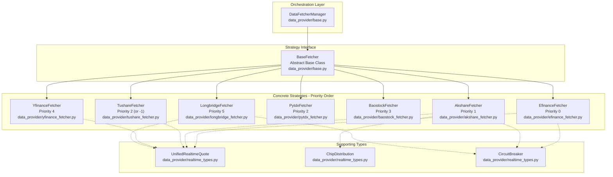
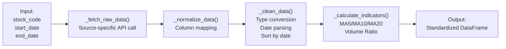
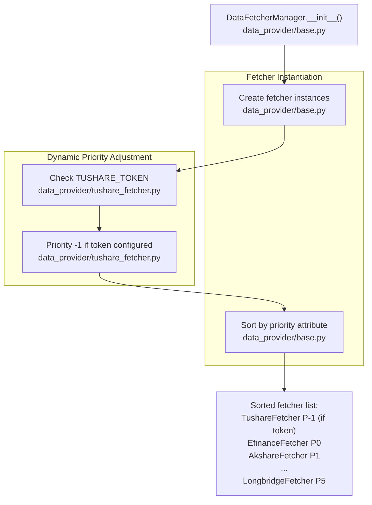

<!-- source: DeepWiki mcp.deepwiki.com · repo ZhuLinsen/daily_stock_analysis · page 5.1 Data Fetcher Architecture · fetched 2026-10-29 -->

# Data Fetcher Architecture

<details>
<summary>Relevant source files</summary>

The following files were used as context for generating this wiki page:

- [data_provider/akshare_fetcher.py](data_provider/akshare_fetcher.py)
- [data_provider/baostock_fetcher.py](data_provider/baostock_fetcher.py)
- [data_provider/base.py](data_provider/base.py)
- [data_provider/efinance_fetcher.py](data_provider/efinance_fetcher.py)
- [data_provider/longbridge_fetcher.py](data_provider/longbridge_fetcher.py)
- [data_provider/pytdx_fetcher.py](data_provider/pytdx_fetcher.py)
- [data_provider/realtime_types.py](data_provider/realtime_types.py)
- [data_provider/tushare_fetcher.py](data_provider/tushare_fetcher.py)
- [data_provider/yfinance_fetcher.py](data_provider/yfinance_fetcher.py)
- [docs/run-diagnostics-p0.md](docs/run-diagnostics-p0.md)
- [tests/test_a_share_fetcher_code_conversion.py](tests/test_a_share_fetcher_code_conversion.py)
- [tests/test_data_fetcher_prefetch_stock_names.py](tests/test_data_fetcher_prefetch_stock_names.py)
- [tests/test_fetcher_source_optimization.py](tests/test_fetcher_source_optimization.py)
- [tests/test_longbridge_fetcher.py](tests/test_longbridge_fetcher.py)
- [tests/test_stock_code_bse.py](tests/test_stock_code_bse.py)

</details>


## Purpose and Scope

This document describes the multi-source data acquisition architecture that powers the stock analysis system. The architecture implements a priority-based failover strategy across multiple data providers (efinance, akshare, tushare, pytdx, baostock, yfinance, longbridge) to ensure high availability and data quality.

For individual data source implementation details, see:
- [5.2 EFinance Fetcher (Priority 0)]()
- [5.3 AkShare Fetcher (Priority 1)]()
- [5.4 Tushare Fetcher (Priority 2)]()
- [5.5 Pytdx Fetcher (Priority 2)]()
- [5.6 Baostock Fetcher (Priority 3)]()
- [5.7 YFinance Fetcher (Priority 4)]()
- [5.8 Longbridge Fetcher (Priority 5)]()

For real-time data and circuit breaker patterns, see [5.9 Real-time Data & Circuit Breakers]().

---

## Architecture Overview

The data fetcher system follows the **Strategy Pattern** with a centralized orchestrator managing multiple interchangeable data sources.

### System Components and Code Entities


**Sources:** [data_provider/base.py:7-15](), [data_provider/efinance_fetcher.py:4-5](), [data_provider/akshare_fetcher.py:4-5](), [data_provider/tushare_fetcher.py:4-5](), [data_provider/pytdx_fetcher.py:4-5](), [data_provider/baostock_fetcher.py:4-5](), [data_provider/yfinance_fetcher.py:4-5](), [data_provider/longbridge_fetcher.py:4-9]()

---

## BaseFetcher Interface

The `BaseFetcher` abstract base class defines the contract that all data sources must implement.

### Core Abstract Methods

| Method | Purpose | Returns |
|--------|---------|---------|
| `_fetch_raw_data()` | Fetch OHLCV data from source | `pd.DataFrame` |
| `_normalize_data()` | Convert to standard schema | `pd.DataFrame` |

**Sources:** [data_provider/base.py:221-224](), [data_provider/base.py:236-239]()

### Standard Data Schema

All fetchers normalize their data to `STANDARD_COLUMNS`:

```python
STANDARD_COLUMNS = ['date', 'open', 'high', 'low', 'close', 'volume', 'amount', 'pct_chg']
```

**Sources:** [data_provider/base.py:40-40]()

### Public API Methods

| Method | Description |
|--------|-------------|
| `get_daily_data()` | Main entry point - orchestrates fetch → normalize → indicators |
| `get_realtime_quote()` | Fetch real-time market data (optional) |
| `get_chip_distribution()` | Fetch ownership cost analysis (optional) |
| `get_stock_name()` | Retrieve stock display name (optional) |
| `get_sector_rankings()` | Fetch sector performance rankings (optional) |

**Sources:** [data_provider/base.py:123-145](), [data_provider/base.py:151-161](), [data_provider/base.py:175-185](), [data_provider/base.py:187-197]()

### Data Processing Pipeline



**Sources:** [data_provider/base.py:123-145](), [data_provider/base.py:257-312]()

---

## DataFetcherManager Orchestration

The `DataFetcherManager` class implements the orchestration logic for multi-source failover.

### Initialization and Priority Sorting

The manager initializes all available fetchers and sorts them by priority. Some fetchers, like `TushareFetcher`, can dynamically elevate their priority if specific credentials (e.g., `TUSHARE_TOKEN`) are provided.



**Sources:** [data_provider/base.py:358-405](), [data_provider/tushare_fetcher.py:185-204](), [data_provider/longbridge_fetcher.py:4-9]()

### Stock Code Normalization

Before routing to fetchers, codes are normalized to strip exchange prefixes and standardize HK formats via `normalize_stock_code()`:

| Input Format | Normalized Output | Notes |
|--------------|-------------------|-------|
| `SH600519` | `600519` | Strip `SH` prefix [data_provider/base.py:108-112]() |
| `600519.SH` | `600519` | Strip `.SH` suffix [data_provider/base.py:146-147]() |
| `sz000001` | `000001` | Strip `sz` prefix (case-insensitive) [data_provider/base.py:108-112]() |
| `HK00700` | `HK00700` | Canonical 5-digit form [data_provider/base.py:105-105]() |
| `1810.HK` | `HK01810` | Canonical HK prefix form [data_provider/base.py:143-143]() |
| `AAPL` | `AAPL` | Preserve US stock tickers [data_provider/base.py:149-149]() |

**Sources:** [data_provider/base.py:70-149](), [tests/test_a_share_fetcher_code_conversion.py:114-124]()

---

## Priority System and Failover

### Priority Assignment

Priorities are primarily controlled by class attributes or environment variables:

| Fetcher | Default Priority | Env Variable | Dynamic Adjustment |
|---------|------------------|--------------|-------------------|
| EfinanceFetcher | 0 | `EFINANCE_PRIORITY` | None |
| AkshareFetcher | 1 | `AKSHARE_PRIORITY` | None |
| TushareFetcher | 2 | `TUSHARE_PRIORITY` | → -1 if `TUSHARE_TOKEN` configured |
| PytdxFetcher | 2 | `PYTDX_PRIORITY` | None |
| BaostockFetcher | 3 | `BAOSTOCK_PRIORITY` | None |
| YfinanceFetcher | 4 | `YFINANCE_PRIORITY` | None |
| LongbridgeFetcher | 5 | `LONGBRIDGE_PRIORITY` | Skip if credentials missing |

**Sources:** [data_provider/efinance_fetcher.py:21-21](), [data_provider/akshare_fetcher.py:4-5](), [data_provider/tushare_fetcher.py:131-131](), [data_provider/tushare_fetcher.py:185-204](), [data_provider/pytdx_fetcher.py:118-118](), [data_provider/baostock_fetcher.py:76-76](), [data_provider/yfinance_fetcher.py:76-76](), [tests/test_fetcher_source_optimization.py:102-156]()

### Failover Strategy

The `get_daily_data()` method implements automatic failover:

1. **US Market Routing**: If the code is identified as a US stock or index, it may bypass standard A-share priorities to use international-friendly sources like `YfinanceFetcher` or `LongbridgeFetcher`.
2. **Sequential Attempts**: For A-shares, the manager iterates through the sorted fetcher list.
3. **Error Handling**: If a fetcher raises `DataFetchError`, the manager catches it, logs the failure, and moves to the next available provider.

**Sources:** [data_provider/base.py:412-497](), [tests/test_fetcher_source_optimization.py:198-203]()

---

## Data Normalization Pipeline

Each fetcher must transform its source-specific schema to the standard schema.

### Technical Indicator Calculation

After normalization, `BaseFetcher._calculate_indicators()` adds indicators to the DataFrame:

| Indicator | Formula | Purpose |
|-----------|---------|---------|
| `ma5` | 5-day SMA of close | Short-term trend |
| `ma10` | 10-day SMA of close | Medium-term trend |
| `ma20` | 20-day SMA of close | Long-term trend |
| `volume_ratio` | `volume / avg_volume_5.shift(1)` | Volume surge detection |

**Sources:** [data_provider/base.py:287-312]()

---

## Stock Code Handling

The system supports multiple stock code formats across A-share, Hong Kong, and US markets.

### Code Type Detection Functions

The system uses specialized detection logic to route requests correctly:
- `_is_us_market()`: Detects US tickers and indices [data_provider/base.py:155-161]().
- `_is_hk_market()`: Detects Hong Kong stock codes [data_provider/base.py:163-178]().
- `_is_etf_code()`: Identifies A-share ETFs via prefixes like 51, 15, etc [data_provider/base.py:152-152]().

**Sources:** [data_provider/base.py:152-185]()

---

## Real-time Data Architecture

Real-time quotes use a unified data structure across all sources.

### UnifiedRealtimeQuote Retrieval

The `DataFetcherManager.get_realtime_quote()` method implements a multi-source strategy:
- **Source Selection**: Routes to the appropriate provider based on market (e.g., Longbridge for HK/US, EFinance for A-shares).
- **Field Supplementation**: If a primary source is missing specific fields (like valuation ratios), the system can merge data from secondary sources.
- **Circuit Breaker Check**: Each source's health is verified via `CircuitBreaker` before the call is made.

**Sources:** [data_provider/base.py:580-770](), [data_provider/realtime_types.py:110-184]()

### Caching Strategy

To reduce API pressure and avoid anti-scraping triggers:
- **AkShare**: Caches real-time quotes for 20 minutes [data_provider/akshare_fetcher.py:84-88]().
- **EFinance**: Caches real-time quotes for 10 minutes [data_provider/efinance_fetcher.py:135-139]().
- **Longbridge**: Caches `static_info` (market cap, etc.) for 24 hours by default [data_provider/longbridge_fetcher.py:42-55]().

---

## Circuit Breaker Pattern

The system implements circuit breakers to prevent cascading failures when a data source becomes unreliable.

### Implementation Details
Circuit breakers track failures per source. When a threshold (default 3) is reached, the source enters a "Cooldown" state for a specified duration (default 60s), during which all requests to that source are immediately rejected.

**Sources:** [data_provider/realtime_types.py:118-150](), [data_provider/akshare_fetcher.py:15-24](), [data_provider/realtime_types.py:4-15]()

---

