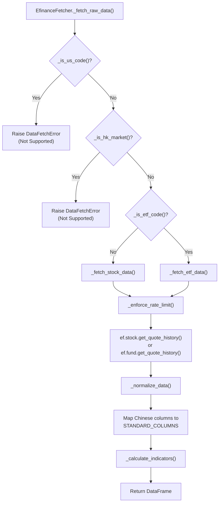
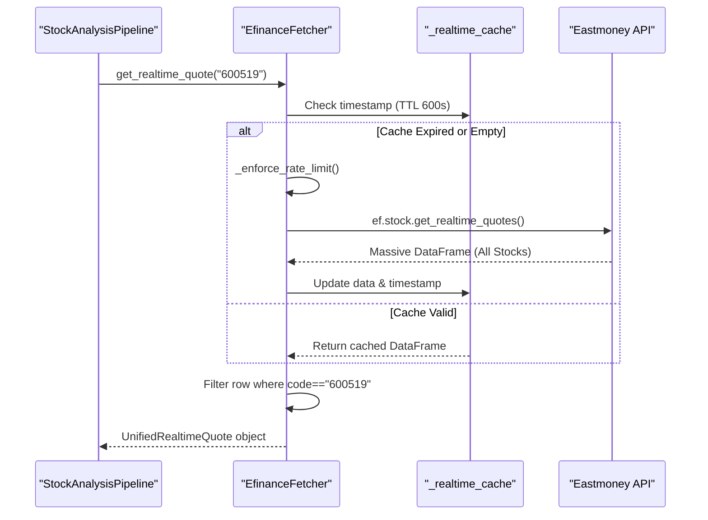

<!-- source: DeepWiki mcp.deepwiki.com · repo ZhuLinsen/daily_stock_analysis · page 5.2 EFinance Fetcher (Priority 0) · fetched 2026-10-29 -->

# EFinance Fetcher (Priority 0)

<details>
<summary>Relevant source files</summary>

The following files were used as context for generating this wiki page:

- [data_provider/akshare_fetcher.py](data_provider/akshare_fetcher.py)
- [data_provider/baostock_fetcher.py](data_provider/baostock_fetcher.py)
- [data_provider/base.py](data_provider/base.py)
- [data_provider/efinance_fetcher.py](data_provider/efinance_fetcher.py)
- [data_provider/pytdx_fetcher.py](data_provider/pytdx_fetcher.py)
- [data_provider/tushare_fetcher.py](data_provider/tushare_fetcher.py)
- [data_provider/yfinance_fetcher.py](data_provider/yfinance_fetcher.py)
- [docs/run-diagnostics-p0.md](docs/run-diagnostics-p0.md)
- [tests/test_a_share_fetcher_code_conversion.py](tests/test_a_share_fetcher_code_conversion.py)
- [tests/test_data_fetcher_prefetch_stock_names.py](tests/test_data_fetcher_prefetch_stock_names.py)
- [tests/test_stock_code_bse.py](tests/test_stock_code_bse.py)

</details>


## Purpose and Scope

This document describes the **EFinanceFetcher** data provider, the highest-priority data source (Priority 0) in the multi-source failover architecture. EFinanceFetcher wraps the `efinance` library to fetch A-share and ETF historical K-line data and real-time quotes from Eastmoney (东方财富) APIs.

**Scope**: This page covers the implementation, caching strategies, anti-scraping mechanisms, and integration points specific to EFinanceFetcher. For the broader multi-source architecture and failover logic, see [Data Fetcher Architecture (5.1)](). For other data sources, see [AkShare Fetcher (5.3)](), [Tushare Fetcher (5.4)](), [YFinance Fetcher (5.7)]().

**Sources**: [data_provider/efinance_fetcher.py:4-21](), [data_provider/base.py:327-335]()

---

## Class Architecture

`EfinanceFetcher` extends `BaseFetcher` and is instantiated by `DataFetcherManager` during initialization. The priority is configurable via the `EFINANCE_PRIORITY` environment variable (default: 0).

### Class Diagram: EFinance Integration

```mermaid
classDiagram
    class "BaseFetcher" {
        <<abstract>>
        +name: str
        +priority: int
        +get_daily_data(stock_code, start_date, end_date)
        +_fetch_raw_data(stock_code, start_date, end_date)* 
        +_normalize_data(df, stock_code)*
        +random_sleep(min, max)
    }
    
    class "EfinanceFetcher" {
        +name: "EfinanceFetcher"
        +priority: 0
        -sleep_min: float
        -sleep_max: float
        -_last_request_time: float
        +__init__(sleep_min, sleep_max)
        +is_available() bool
        +_fetch_raw_data() DataFrame
        +_normalize_data() DataFrame
        +get_realtime_quote(stock_code) UnifiedRealtimeQuote
        -_fetch_stock_data() DataFrame
        -_fetch_etf_data() DataFrame
        -_enforce_rate_limit()
    }
    
    class "DataFetcherManager" {
        -_fetchers: List[BaseFetcher]
        +get_daily_data()
        +get_realtime_quote()
        +prefetch_realtime_quotes()
    }
    
    class "UnifiedRealtimeQuote" {
        +code: str
        +name: str
        +price: float
        +change_pct: float
        +volume: int
        +amount: float
    }
    
    "BaseFetcher" <|-- "EfinanceFetcher"
    "DataFetcherManager" o-- "EfinanceFetcher"
    "EfinanceFetcher" ..> "UnifiedRealtimeQuote" : "returns"
```

**Key Implementation Details**:
- `EfinanceFetcher` main class: [data_provider/efinance_fetcher.py:254-664]()
- `BaseFetcher` abstract interface: [data_provider/base.py:109-150]()
- `DataFetcherManager` orchestration: [data_provider/base.py:327-406]()

**Sources**: [data_provider/efinance_fetcher.py:254-262](), [data_provider/base.py:109-150, 327-406]()

---

## Historical Data Fetching Pipeline

The historical data pipeline supports A-shares and ETFs but explicitly rejects US stocks and HK stocks to ensure correct routing to specialized providers.

### Data Flow: Historical K-Line Fetching



**Key Methods**:
- `_fetch_raw_data()`: Entry point that routes based on security type [data_provider/efinance_fetcher.py:254-282]().
- `_fetch_stock_data()`: Uses `ef.stock.get_quote_history` with `klt=101` (daily) and `fqt=1` (forward adjusted) [data_provider/efinance_fetcher.py:283-349]().
- `_fetch_etf_data()`: Uses `ef.fund.get_quote_history` for A-share ETFs [data_provider/efinance_fetcher.py:350-416]().
- `_is_etf_code()`: Identifies A-share ETFs via prefixes like 51, 58, 15, etc [data_provider/efinance_fetcher.py:152-166]().

**Sources**: [data_provider/efinance_fetcher.py:254-416](), [data_provider/efinance_fetcher.py:152-166]()

---

## Real-time Quote System

EfinanceFetcher implements a sophisticated caching strategy to minimize redundant API calls during batch stock analysis.

### Caching Strategy

| Cache Type | TTL | Purpose |
|------------|-----|---------|
| `_realtime_cache` | 600s | Stores all A-share real-time quotes in one DataFrame [data_provider/efinance_fetcher.py:135-139](). |
| `_etf_realtime_cache` | 600s | Stores all ETF real-time quotes separately [data_provider/efinance_fetcher.py:142-146](). |

### Sequence: Real-time Data Acquisition



**Sources**: [data_provider/efinance_fetcher.py:476-589](), [data_provider/efinance_fetcher.py:135-146]()

---

## Anti-Scraping & Resilience

EFinanceFetcher implements multiple defense layers against API rate limiting and scraping detection:

| Strategy | Implementation | Purpose |
|----------|----------------|---------|
| **Random Jitter** | `random_sleep(1.5, 3.0)` [data_provider/efinance_fetcher.py:238]() | Mimics human browsing patterns. |
| **User-Agent Rotation** | Pool of 5 browsers [data_provider/efinance_fetcher.py:124-130]() | Avoids fingerprinting. |
| **Call Timeout** | `_EF_CALL_TIMEOUT` (default 30s) [data_provider/efinance_fetcher.py:45-52]() | Prevents hanging on unreachable hosts via `ThreadPoolExecutor` [data_provider/efinance_fetcher.py:193-214](). |
| **Circuit Breaker** | `get_realtime_circuit_breaker()` [data_provider/efinance_fetcher.py:70]() | Auto-disables the fetcher if failures exceed thresholds [data_provider/efinance_fetcher.py:494-500](). |
| **Retry Policy** | `tenacity.retry` with exponential backoff [data_provider/efinance_fetcher.py:245-256]() | Handles transient network errors. |

**Sources**: [data_provider/efinance_fetcher.py:124-256](), [data_provider/efinance_fetcher.py:193-214]()

---

## Data Normalization

The fetcher maps Chinese column names from the `efinance` library to the internal `STANDARD_COLUMNS` format.

### Column Mapping Table

| Efinance Column (Chinese) | Standard Column | Note |
|---------------------------|-----------------|------|
| 日期 | `date` | YYYY-MM-DD |
| 开盘 | `open` | |
| 收盘 | `close` | |
| 最高 | `high` | |
| 最低 | `low` | |
| 成交量 | `volume` | |
| 成交额 | `amount` | |
| 涨跌幅 | `pct_chg` | |

**ETF Normalization**: If OHLC data is missing (common for fund NAV data), the fetcher approximates by setting `open`, `high`, and `low` equal to the `close` (NAV) value [data_provider/efinance_fetcher.py:453-457]().

**Sources**: [data_provider/efinance_fetcher.py:418-474](), [data_provider/base.py:40]()

---

## Configuration & Integration

### Environment Variables
- `EFINANCE_PRIORITY`: Defaults to `0`. Set to a higher number to demote this fetcher [data_provider/efinance_fetcher.py:274]().
- `EFINANCE_CALL_TIMEOUT`: Defaults to `30` seconds. Controls the maximum wait time for a single API call [data_provider/efinance_fetcher.py:46-52]().
- `ENABLE_EASTMONEY_PATCH`: When `true`, applies `eastmoney_patch()` to fix library-level API incompatibilities [data_provider/efinance_fetcher.py:54]().

### Failover Handling
EFinanceFetcher is the first line of defense. If `_fetch_raw_data` raises a `DataFetchError` (e.g., due to rate limiting or unsupported markets), the `DataFetcherManager` catches it and proceeds to the next fetcher in the priority list (usually `AkshareFetcher`) [data_provider/base.py:412-497]().

**Sources**: [data_provider/efinance_fetcher.py:43-56](), [data_provider/base.py:412-497]()

---

