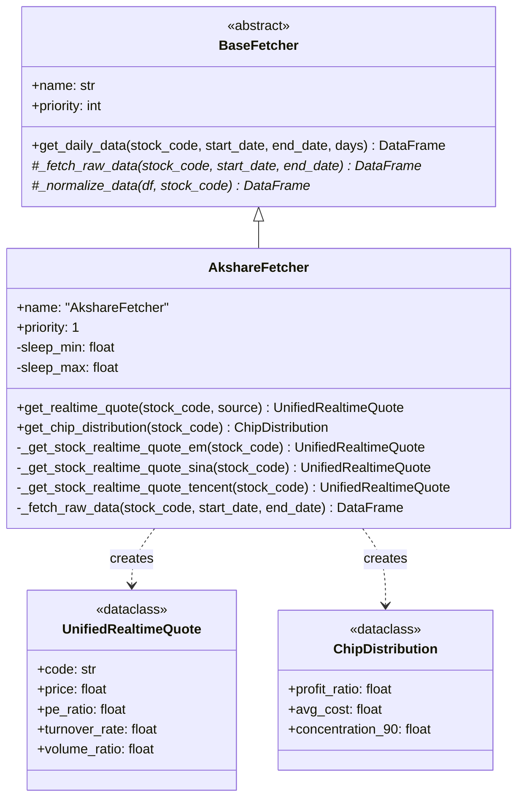
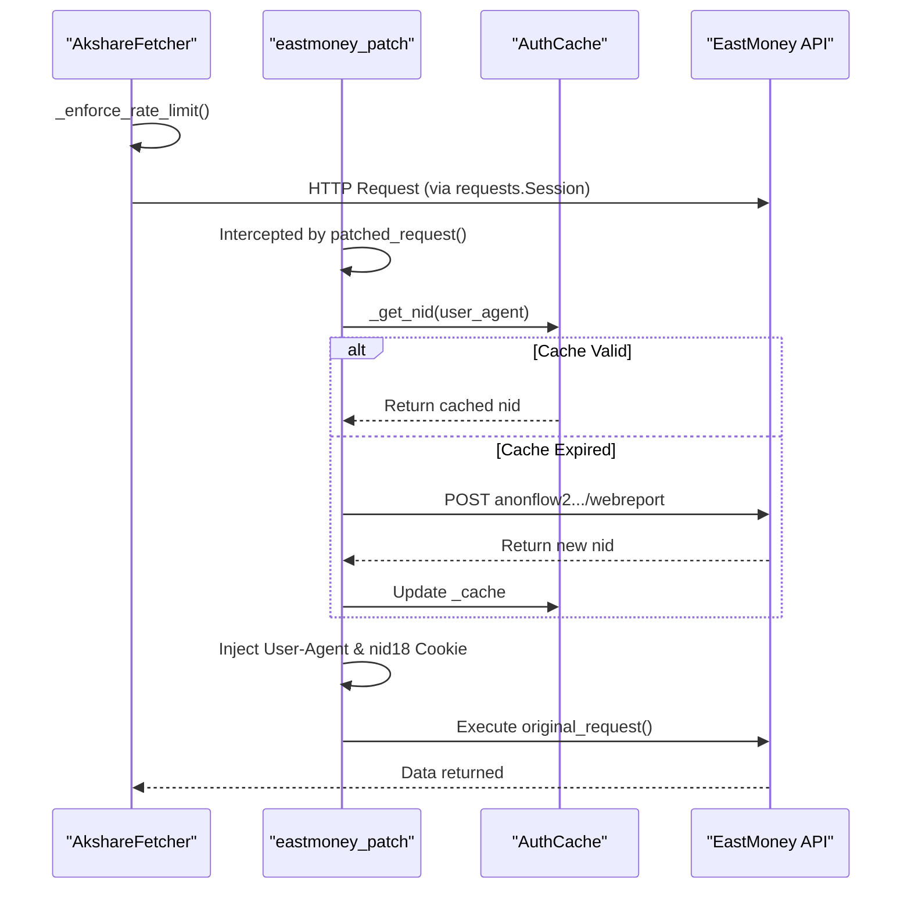

<!-- source: DeepWiki mcp.deepwiki.com · repo ZhuLinsen/daily_stock_analysis · page 5.3 AkShare Fetcher (Priority 1) · fetched 2026-10-29 -->

# AkShare Fetcher (Priority 1)

Relevant source files

The following files were used as context for generating this wiki page:

- [data_provider/akshare_fetcher.py](data_provider/akshare_fetcher.py)
- [data_provider/baostock_fetcher.py](data_provider/baostock_fetcher.py)
- [data_provider/base.py](data_provider/base.py)
- [data_provider/efinance_fetcher.py](data_provider/efinance_fetcher.py)
- [data_provider/pytdx_fetcher.py](data_provider/pytdx_fetcher.py)
- [data_provider/tushare_fetcher.py](data_provider/tushare_fetcher.py)
- [data_provider/yfinance_fetcher.py](data_provider/yfinance_fetcher.py)
- [docs/run-diagnostics-p0.md](docs/run-diagnostics-p0.md)
- [tests/test_a_share_fetcher_code_conversion.py](tests/test_a_share_fetcher_code_conversion.py)
- [tests/test_agent_orchestrator_sniper_fallback.py](tests/test_agent_orchestrator_sniper_fallback.py)
- [tests/test_akshare_history_timeout.py](tests/test_akshare_history_timeout.py)
- [tests/test_data_fetcher_prefetch_stock_names.py](tests/test_data_fetcher_prefetch_stock_names.py)
- [tests/test_stock_code_bse.py](tests/test_stock_code_bse.py)
- [tests/test_tushare_fetcher_followups.py](tests/test_tushare_fetcher_followups.py)

## Purpose and Scope

This document covers the `AkshareFetcher` class, the primary data source for the A-share Stock Intelligent Analysis System. The fetcher implements Priority 1 data acquisition from AkShare's free API, which primarily scrapes data from East Money Finance (东方财富). This document focuses on the anti-scraping strategies, User-Agent rotation, source routing (EM/Sina/Tencent), and enhanced data capabilities like chip distribution.

For the overall data provider architecture and failover system, see [5.1 Data Fetcher Architecture](). For alternative data sources, see [5.4 Tushare Fetcher](), [5.6 Baostock Fetcher](), and [5.7 YFinance Fetcher]().

## Overview

The `AkshareFetcher` class extends `BaseFetcher` to provide free, token-free access to comprehensive A-share market data. It is positioned as Priority 1 (highest default) in the data source hierarchy due to its completeness and lack of cost barriers.

**Key Characteristics:**
- **Data Source**: East Money Finance (东方财富) via AkShare library, with Sina/Tencent as realtime fallbacks [data_provider/akshare_fetcher.py:7-10]().
- **Cost**: Free, no API token required [data_provider/akshare_fetcher.py:12]().
- **Priority**: 1 [data_provider/akshare_fetcher.py:258]().
- **Risk**: Scraping mechanism subject to anti-bot blocking; mitigated by `eastmoney_patch` [data_provider/akshare_fetcher.py:13-19]().
- **Enhanced Features**: Real-time quotes with valuation metrics, chip distribution analysis [data_provider/akshare_fetcher.py:21-24]().

Sources: [data_provider/akshare_fetcher.py:1-24](), [data_provider/akshare_fetcher.py:254-258]()

---

## Class Architecture

The following diagram illustrates the relationship between the `AkshareFetcher` and the core data entities it produces.

**Code Entity Mapping: Fetcher to Data Types**

Sources: [data_provider/akshare_fetcher.py:254-262](), [data_provider/realtime_types.py:113-168](), [data_provider/realtime_types.py:214-231]()

---

## Anti-Scraping Strategy

AkShare relies on web scraping, making it vulnerable to anti-bot measures. The system implements a multi-layered defense.

### 1. User-Agent Rotation and Random Delays
The fetcher maintains a pool of `USER_AGENTS` [data_provider/akshare_fetcher.py:70-76]() and enforces random sleep between 2-5 seconds [data_provider/akshare_fetcher.py:16-19]().

### 2. EastMoney Authentication Patch
A critical component is the `eastmoney_patch.py`, which intercepts requests to East Money domains to inject valid authentication tokens (`nid18` cookie).

**Data Flow: Authentication Patching**

Sources: [src/patches/eastmoney_patch.py:154-183](), [src/patches/eastmoney_patch.py:44-141](), [data_provider/akshare_fetcher.py:15-24]()

---

## Real-Time Source Routing

The `AkshareFetcher` can route real-time requests to three different providers via `get_realtime_quote` [data_provider/akshare_fetcher.py:702-740]().

| Source | Function | Endpoint | Pros/Cons |
| :--- | :--- | :--- | :--- |
| **EM** | `_get_stock_realtime_quote_em` | `stock_zh_a_spot_em` | **Pros**: Full market data, valuation metrics. **Cons**: Slow (pulls all stocks). |
| **Sina** | `_get_stock_realtime_quote_sina` | `hq.sinajs.cn/list` | **Pros**: Fast, single-stock. **Cons**: Limited fields. |
| **Tencent** | `_get_stock_realtime_quote_tencent` | `qt.gtimg.cn/q` | **Pros**: Fast, includes turnover/PE. **Cons**: Volume normalization needed. |

### Caching Mechanism
To prevent frequent full-market pulls from East Money, the fetcher implements a 20-minute (1200s) TTL cache for both stocks (`_realtime_cache`) and ETFs (`_etf_realtime_cache`) [data_provider/akshare_fetcher.py:80-95]().

Sources: [data_provider/akshare_fetcher.py:79-95](), [data_provider/akshare_fetcher.py:702-740]()

---

## Enhanced Data: Chip Distribution

The fetcher provides `get_chip_distribution` [data_provider/akshare_fetcher.py:1152-1240](), which uses `ak.stock_cyq_em`. This data is critical for the AI analyzer to understand holder cost structures.

**Key Metrics Captured:**
- **Profit Ratio (`profit_ratio`)**: Percentage of holders currently in profit [data_provider/akshare_fetcher.py:1210]().
- **Average Cost (`avg_cost`)**: The weighted average price of all outstanding shares [data_provider/akshare_fetcher.py:1211]().
- **Concentration (`concentration_90`)**: Price range width containing 90% of chips [data_provider/akshare_fetcher.py:1214]().

### Circuit Breaker Protection
Chip distribution fetching is wrapped in a circuit breaker (`get_chip_circuit_breaker`) [data_provider/akshare_fetcher.py:1158](). If the East Money chip API fails repeatedly, the fetcher will skip this step to prevent slowing down the analysis pipeline.

Sources: [data_provider/akshare_fetcher.py:1152-1170](), [data_provider/akshare_fetcher.py:1200-1220](), [data_provider/realtime_types.py:214-231]()

---

## Data Normalization

Raw data from AkShare uses Chinese column names. The fetcher maps these to `STANDARD_COLUMNS` defined in the base class.

**Standard Mapping for Historical Data:**
- `日期` -> `date`
- `开盘` -> `open`
- `收盘` -> `close`
- `最高` -> `high`
- `最低` -> `low`
- `成交量` -> `volume`
- `成交额` -> `amount`
- `涨跌幅` -> `pct_chg`

This mapping occurs in `_normalize_data` [data_provider/akshare_fetcher.py:348-372]().

Sources: [data_provider/akshare_fetcher.py:348-372](), [data_provider/base.py:40]()

---

## Troubleshooting & Failure Handling

The fetcher uses `tenacity` for exponential backoff retries [data_provider/akshare_fetcher.py:269-274]().

**Retry Configuration:**
- **Stop Condition**: After 3 attempts [data_provider/akshare_fetcher.py:270]().
- **Wait Strategy**: Exponential (multiplier 1, min 2s, max 30s) [data_provider/akshare_fetcher.py:271]().
- **Retry Trigger**: `ConnectionError`, `TimeoutError`, or specific `RateLimitError` [data_provider/akshare_fetcher.py:272]().

**AkShare Specific Timeouts:**
Historical data calls to Sina and Tencent are wrapped in `_akshare_call_with_timeout` using the `spawn` multiprocessing method to ensure hung calls can be reaped [data_provider/akshare_fetcher.py:64-67](), [data_provider/akshare_fetcher.py:277-334]().

**Exception Classification:**
The helper `_classify_realtime_http_error` [data_provider/akshare_fetcher.py:245-252]() (partially shown in truncated source) categorizes failures to allow the `DataFetcherManager` to decide whether to retry or failover.

Sources: [data_provider/akshare_fetcher.py:269-274](), [data_provider/akshare_fetcher.py:277-334](), [tests/test_akshare_history_timeout.py:95-104]()

---

