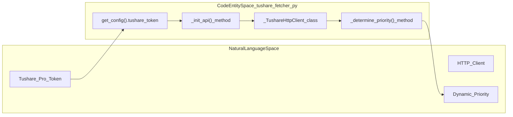
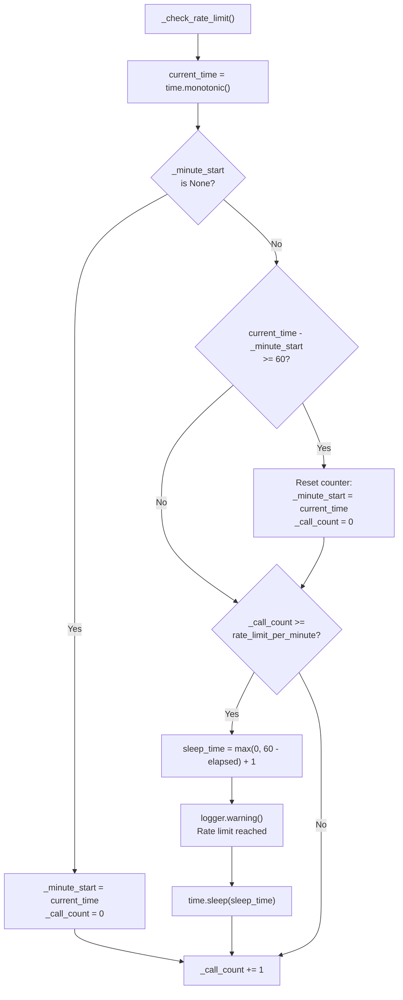
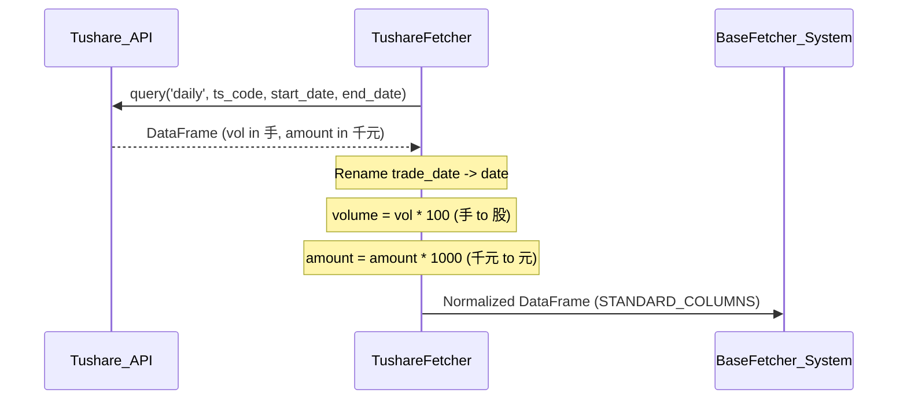

<!-- source: DeepWiki mcp.deepwiki.com · repo ZhuLinsen/daily_stock_analysis · page 5.4 Tushare Fetcher (Priority 2) · fetched 2026-10-29 -->

# Tushare Fetcher (Priority 2)

Relevant source files

The following files were used as context for generating this wiki page:

- [data_provider/akshare_fetcher.py](data_provider/akshare_fetcher.py)
- [data_provider/baostock_fetcher.py](data_provider/baostock_fetcher.py)
- [data_provider/base.py](data_provider/base.py)
- [data_provider/efinance_fetcher.py](data_provider/efinance_fetcher.py)
- [data_provider/pytdx_fetcher.py](data_provider/pytdx_fetcher.py)
- [data_provider/tushare_fetcher.py](data_provider/tushare_fetcher.py)
- [data_provider/yfinance_fetcher.py](data_provider/yfinance_fetcher.py)
- [docs/run-diagnostics-p0.md](docs/run-diagnostics-p0.md)
- [tests/test_a_share_fetcher_code_conversion.py](tests/test_a_share_fetcher_code_conversion.py)
- [tests/test_agent_orchestrator_sniper_fallback.py](tests/test_agent_orchestrator_sniper_fallback.py)
- [tests/test_akshare_history_timeout.py](tests/test_akshare_history_timeout.py)
- [tests/test_data_fetcher_prefetch_stock_names.py](tests/test_data_fetcher_prefetch_stock_names.py)
- [tests/test_stock_code_bse.py](tests/test_stock_code_bse.py)
- [tests/test_tushare_fetcher_followups.py](tests/test_tushare_fetcher_followups.py)

## Purpose and Scope

This document describes the `TushareFetcher` class implementation, which serves as a high-quality data source in the multi-source failover architecture. While historically Priority 2, the system features **Automatic Priority Elevation**: if a `TUSHARE_TOKEN` is detected and initialized successfully, the fetcher is promoted to **Priority -1**, making it the absolute primary data source, superseding even EFinance and AkShare.

The Tushare Fetcher provides access to Tushare Pro API (Waditu), a premium data provider requiring authentication tokens and enforcing strict rate limits (defaulting to the 80 calls/min free tier).

**Sources:** [data_provider/tushare_fetcher.py:1-15](), [data_provider/tushare_fetcher.py:185-204]()

---

## Overview

The `TushareFetcher` class extends `BaseFetcher` and implements a lightweight HTTP client to interact with Tushare Pro without requiring the official SDK. This reduces dependency overhead in Docker and virtual environments.

| Property | Value |
|----------|-------|
| Class Name | `TushareFetcher` |
| Module Path | `data_provider/tushare_fetcher.py` |
| Default Priority | 2 (Positioned after AkShare) |
| Elevated Priority | -1 (If token is configured) |
| Base Class | `BaseFetcher` |
| Rate Limit | 80 requests/minute (Configurable) |
| Authentication | Required (`TUSHARE_TOKEN`) |

### Natural Language to Code Entity Space: Initialization

The following diagram maps the logical initialization requirements to the specific code entities in the fetcher.

**Sources:** [data_provider/tushare_fetcher.py:75-112](), [data_provider/tushare_fetcher.py:153-183](), [data_provider/tushare_fetcher.py:185-204]()

---

## Configuration & Priority Elevation

### Dynamic Priority Logic

The fetcher determines its own priority during instantiation based on the environment configuration via the `_determine_priority` method.

1.  **Token Present:** If `TUSHARE_TOKEN` is found in the configuration and the API client initializes successfully, the priority is set to `-1`. This is logged as a priority elevation.
2.  **Token Missing:** If no token is provided, the fetcher remains at priority `2` (or the value of `TUSHARE_PRIORITY` env var) and `is_available()` will return `False`.

**Sources:** [data_provider/tushare_fetcher.py:130-131](), [data_provider/tushare_fetcher.py:185-204](), [data_provider/tushare_fetcher.py:206-213]()

### Lightweight HTTP Client

Instead of using `import tushare`, the system uses `_TushareHttpClient`. This class wraps `requests.post` to communicate with `http://api.tushare.pro`. It handles JSON serialization of the `api_name`, `token`, and `params` required by the Tushare Pro protocol, returning data as a `pandas.DataFrame`.

**Sources:** [data_provider/tushare_fetcher.py:75-112]()

---

## Rate Limiting Architecture

Tushare Pro enforces strict per-minute and per-day quotas. The `TushareFetcher` implements a "Minute Counter" strategy in `_check_rate_limit` to prevent `429` errors or account temporary bans.

### Rate Limit Enforcement Logic

**Sources:** [data_provider/tushare_fetcher.py:215-247]()

---

## Data Flow: Fetching and Normalization

### Stock Code Conversion

Tushare requires specific suffixes for A-shares and the Beijing Stock Exchange (BSE). The `_convert_stock_code` method handles this mapping, converting standard codes to the `TS_CODE` format (e.g., `600519.SH`).

| Input Format | Tushare Target | Rule |
| :--- | :--- | :--- |
| `600519` | `600519.SH` | Shanghai Main Board |
| `000001` | `000001.SZ` | Shenzhen Main Board |
| `920748` | `920748.BJ` | Beijing Stock Exchange (BSE) |
| `512400` | `512400.SH` | Shanghai ETF |
| `159919` | `159919.SZ` | Shenzhen ETF |

**Sources:** [data_provider/tushare_fetcher.py:249-299](), [tests/test_stock_code_bse.py:113-123](), [tests/test_a_share_fetcher_code_conversion.py:95-112]()

### Normalization Pipeline

The `_normalize_data` method transforms the Tushare API response into the system-wide `STANDARD_COLUMNS` format. It specifically handles unit conversions: volume is converted from "lots" (手) to "shares" (股), and amount is converted from "k-RMB" (千元) to "RMB" (元).

**Sources:** [data_provider/tushare_fetcher.py:348-403](), [data_provider/base.py:35-40]()

---

## Specialized Data Methods

Beyond standard K-line data, `TushareFetcher` provides advanced financial indicators:

*   **Chip Distribution:** `get_chip_distribution` uses the `cyq_chips` and `cyq_perf` endpoints to calculate profit ratios and concentration metrics. It requires multiple Tushare calls (trade calendar, chip data, and current price), each protected by rate limiting. [data_provider/tushare_fetcher.py:414-530](), [tests/test_tushare_fetcher_followups.py:129-155]()
*   **Sector Rankings:** `get_sector_rankings` retrieves industry money flow via the `moneyflow_ind_ths` endpoint. [data_provider/tushare_fetcher.py:532-585](), [tests/test_tushare_fetcher_followups.py:108-127]()
*   **Trade Calendar:** `get_trade_time` uses `trade_cal` to determine the most recent valid trading date. It handles cross-day refreshes and ensures that on non-trading days, it returns the most recent Friday rather than an older date. [data_provider/tushare_fetcher.py:587-650](), [tests/test_tushare_fetcher_followups.py:38-83]()

---

## Error Handling and Retries

The fetcher uses `tenacity` for robust error recovery in `_fetch_raw_data`.

*   **Retry Policy:** 3 attempts with exponential backoff (multiplier 1, min 2s, max 30s).
*   **Target Exceptions:** `ConnectionError`, `TimeoutError`.
*   **Quota Detection:** If the API response contains keywords like "quota", "limit", or "权限", it raises a specific `RateLimitError`. This allows the `DataFetcherManager` to stop trying Tushare and move to the next provider immediately.

**Sources:** [data_provider/tushare_fetcher.py:301-311](), [data_provider/tushare_fetcher.py:339-344]()

---

## Limitations

1.  **US Stocks:** TushareFetcher does not currently support US stock data; it will raise a `DataFetchError` if a US code is detected via `_is_us_code`, triggering failover. [data_provider/tushare_fetcher.py:313-320]()
2.  **HK Stocks:** While `_is_hk_market` checks exist, the primary focus is A-shares. [data_provider/tushare_fetcher.py:405-412]()
3.  **Real-time Quotes:** `get_realtime_quote` attempts to use the `quotation` endpoint but includes a fallback to the legacy `tushare.get_realtime_quotes` if the Pro API quota is exceeded. [data_provider/tushare_fetcher.py:652-730](), [tests/test_tushare_fetcher_followups.py:166-172]()

**Sources:** [data_provider/tushare_fetcher.py:313-320](), [data_provider/tushare_fetcher.py:405-412]()

---

