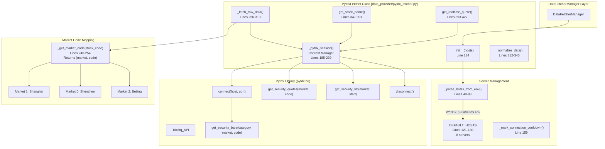
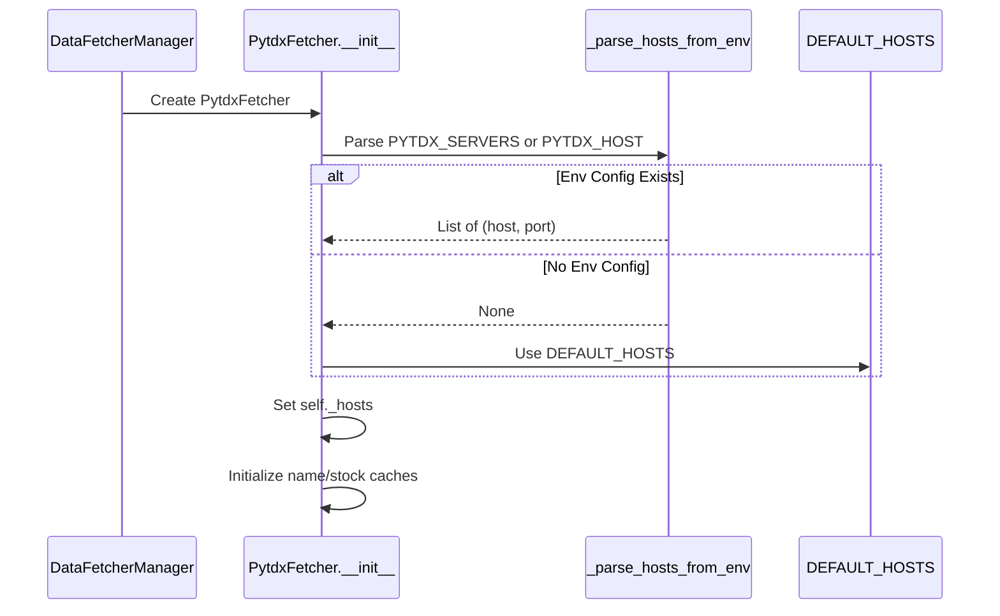
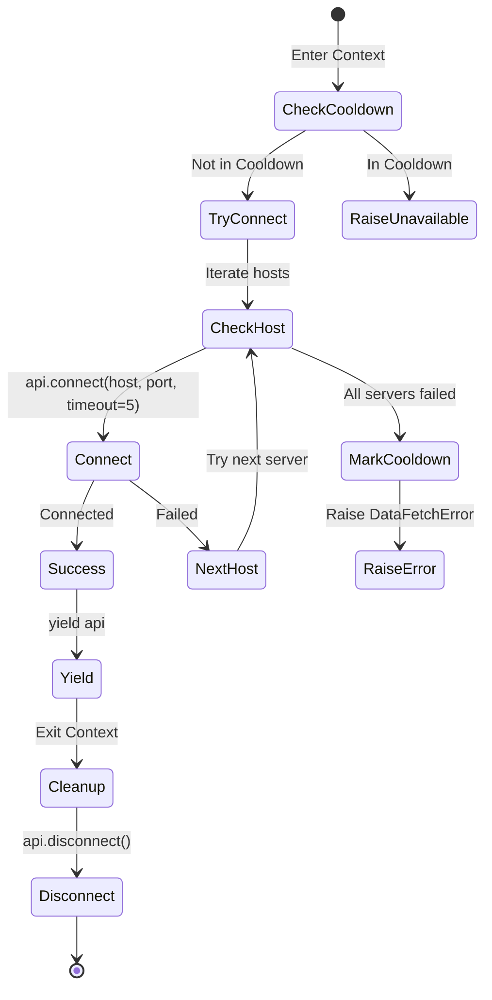
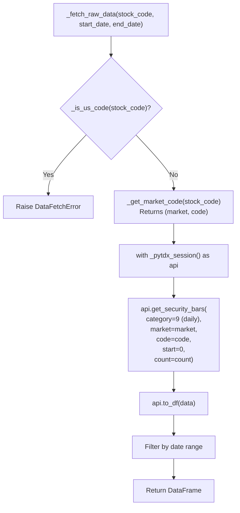

<!-- source: DeepWiki mcp.deepwiki.com · repo ZhuLinsen/daily_stock_analysis · page 5.5 Pytdx Fetcher (Priority 2) · fetched 2026-10-29 -->

# Pytdx Fetcher (Priority 2)

Relevant source files

The following files were used as context for generating this wiki page:

- [data_provider/akshare_fetcher.py](data_provider/akshare_fetcher.py)
- [data_provider/baostock_fetcher.py](data_provider/baostock_fetcher.py)
- [data_provider/base.py](data_provider/base.py)
- [data_provider/efinance_fetcher.py](data_provider/efinance_fetcher.py)
- [data_provider/pytdx_fetcher.py](data_provider/pytdx_fetcher.py)
- [data_provider/tushare_fetcher.py](data_provider/tushare_fetcher.py)
- [data_provider/yfinance_fetcher.py](data_provider/yfinance_fetcher.py)
- [docs/run-diagnostics-p0.md](docs/run-diagnostics-p0.md)
- [tests/test_a_share_fetcher_code_conversion.py](tests/test_a_share_fetcher_code_conversion.py)
- [tests/test_data_fetcher_prefetch_stock_names.py](tests/test_data_fetcher_prefetch_stock_names.py)
- [tests/test_stock_code_bse.py](tests/test_stock_code_bse.py)

**Purpose**: Document the Pytdx (通达信/Tongdaxin) data source integration, a Priority 2 fetcher that provides free, direct access to Chinese stock market data through Tongdaxin quote servers without requiring API tokens or rate-limited credentials.

**Scope**: This page covers the `PytdxFetcher` class implementation, server connection management, market code routing, and integration with the multi-source data fetching architecture. For the overall data provider system architecture, see [5.1](). For other Priority 2 sources, see [Tushare Fetcher (5.4)]().

---

## System Overview

The Pytdx fetcher directly connects to Tongdaxin quote servers (通达信行情服务器) to retrieve A-share market data. Unlike web scraping approaches (`efinance`, `akshare`), it uses a native TCP protocol for communication, providing stable data access without rate limiting or authentication requirements.

**Key Characteristics**:
- **Priority**: 2 (same as Tushare, configurable via `PYTDX_PRIORITY`) [[data_provider/pytdx_fetcher.py:118-118]()]
- **Dependencies**: `pytdx` library [[data_provider/pytdx_fetcher.py:171-182]()]
- **Market Coverage**: A-share stocks (Shanghai/Shenzhen), ETFs, and limited HK support [[data_provider/pytdx_fetcher.py:240-250]()]
- **Authentication**: None required (public quote servers)
- **Rate Limits**: None enforced by protocol, but includes a 15-second connection cooldown on failure [[data_provider/pytdx_fetcher.py:45-45]()]
- **Data Latency**: Real-time quote data available via quote server protocol [[data_provider/pytdx_fetcher.py:376-410]()]

Sources: `[data_provider/pytdx_fetcher.py:1-132]()`

---

## Architecture Overview

### Pytdx Integration Map

**Architecture Explanation**:

The `PytdxFetcher` follows a context-managed connection pattern to ensure proper resource cleanup [[data_provider/pytdx_fetcher.py:185-239]()]. The `_pytdx_session()` context manager handles server connection, automatic failover across multiple hosts, and guaranteed disconnection. It incorporates a circuit-breaker style cooldown mechanism: if all servers fail, the fetcher is marked unavailable for 15 seconds [[data_provider/pytdx_fetcher.py:159-166]()].

Sources: `[data_provider/pytdx_fetcher.py:37-239]()`, `[data_provider/base.py:15-34]()`

---

## Core Components

### PytdxFetcher Class

| Component | Type | Purpose |
|-----------|------|---------|
| `name` | Class Attribute | `"PytdxFetcher"` [[data_provider/pytdx_fetcher.py:117-117]()] |
| `priority` | Class Attribute | `int(os.getenv("PYTDX_PRIORITY", "2"))` [[data_provider/pytdx_fetcher.py:118-118]()] |
| `DEFAULT_HOSTS` | Class Attribute | List of 8 Tongdaxin servers (IP:port) [[data_provider/pytdx_fetcher.py:121-130]()] |
| `_hosts` | Instance Attribute | Active server list (env-derived or defaults) [[data_provider/pytdx_fetcher.py:143-147]()] |
| `_stock_name_cache` | Instance Attribute | Dict cache for `{code: name}` mappings [[data_provider/pytdx_fetcher.py:152-152]()] |
| `_unavailable_until` | Instance Attribute | Timestamp for connection cooldown [[data_provider/pytdx_fetcher.py:153-153]()] |

**Initialization Flow**:

Sources: `[data_provider/pytdx_fetcher.py:134-155]()`

---

## Server Connection Management

### Environment Variable Configuration

The system supports three configuration patterns for server selection in `_parse_hosts_from_env()` [[data_provider/pytdx_fetcher.py:48-83]()]:

| Environment Variable | Format | Example | Priority |
|---------------------|--------|---------|----------|
| `PYTDX_SERVERS` | `ip:port,ip:port,...` | `"119.147.212.81:7709,221.231.141.60:7709"` | Highest [[data_provider/pytdx_fetcher.py:57-73]()] |
| `PYTDX_HOST` + `PYTDX_PORT` | Two separate vars | `PYTDX_HOST="119.147.212.81"` `PYTDX_PORT="7709"` | Medium [[data_provider/pytdx_fetcher.py:75-81]()] |
| None (defaults) | N/A | Uses `DEFAULT_HOSTS` [[data_provider/pytdx_fetcher.py:147-147]()] | Lowest |

### Connection Context Manager & Cooldown

**Method**: `_pytdx_session()` [[data_provider/pytdx_fetcher.py:185-239]()]

The context manager implements automatic server failover and a 15-second cooldown if all servers are unreachable [[data_provider/pytdx_fetcher.py:159-166]()].

Sources: `[data_provider/pytdx_fetcher.py:157-239]()`

---

## Data Fetching Flow

### Historical Data Retrieval

**Method**: `_fetch_raw_data(stock_code, start_date, end_date)` [[data_provider/pytdx_fetcher.py:256-310]()]

The fetcher calculates the required number of bars based on the date range, capping at 800 bars [[data_provider/pytdx_fetcher.py:276-281]()].

Sources: `[data_provider/pytdx_fetcher.py:256-310]()`

### Data Normalization

**Method**: `_normalize_data(df, stock_code)` [[data_provider/pytdx_fetcher.py:312-345]()]

**Column Mapping**:
- `datetime` -> `date` (ISO 8601 format) [[data_provider/pytdx_fetcher.py:328-328]()]
- `vol` -> `volume` [[data_provider/pytdx_fetcher.py:328-328]()]
- `pct_chg` is calculated manually via `pct_change() * 100` [[data_provider/pytdx_fetcher.py:333-335]()]

Sources: `[data_provider/pytdx_fetcher.py:312-345]()`

---

## Market Code Mapping

### Exchange Routing Logic

**Method**: `_get_market_code(stock_code)` [[data_provider/pytdx_fetcher.py:240-254]()]

Pytdx uses specific market integers [[data_provider/pytdx_fetcher.py:244-247]()]:
- **Market 0**: Shenzhen (SZ)
- **Market 1**: Shanghai (SH)
- **Market 2**: Beijing (BJ)

The logic strips prefixes and assigns markets based on code patterns [[tests/test_a_share_fetcher_code_conversion.py:80-92]()]:
- `60xxxx`, `68xxxx` -> Market 1 (SH) [[data_provider/pytdx_fetcher.py:244-247]()]
- `00xxxx`, `30xxxx` -> Market 0 (SZ) [[data_provider/pytdx_fetcher.py:244-247]()]
- `8xxxxx`, `4xxxxx`, `92xxxx` -> Market 2 (BJ) via `is_bse_code()` [[data_provider/pytdx_fetcher.py:244-247]()]

Sources: `[data_provider/pytdx_fetcher.py:240-254]()`, `[tests/test_a_share_fetcher_code_conversion.py:76-93]()`

---

## Auxiliary Features

### Stock Name Lookup

**Method**: `get_stock_name(stock_code)` [[data_provider/pytdx_fetcher.py:347-391]()]

Uses a two-tier caching strategy:
1. **In-memory cache**: Checks `_stock_name_cache` [[data_provider/pytdx_fetcher.py:356-356]()].
2. **Bulk fetch**: If missing, it fetches the full security list from the server using `api.get_security_list()` in 1000-item pages to populate the cache [[data_provider/pytdx_fetcher.py:366-373]()].

### Real-time Quote

**Method**: `get_realtime_quote(stock_code)` [[data_provider/pytdx_fetcher.py:393-427]()]

Fetches current price and volume using `api.get_security_quotes([(market, code)])`. This data is prioritized for stock name enrichment during the prefetch phase [[tests/test_data_fetcher_prefetch_stock_names.py:137-161]()].

Sources: `[data_provider/pytdx_fetcher.py:347-427]()`, `[tests/test_data_fetcher_prefetch_stock_names.py:68-161]()`

---

