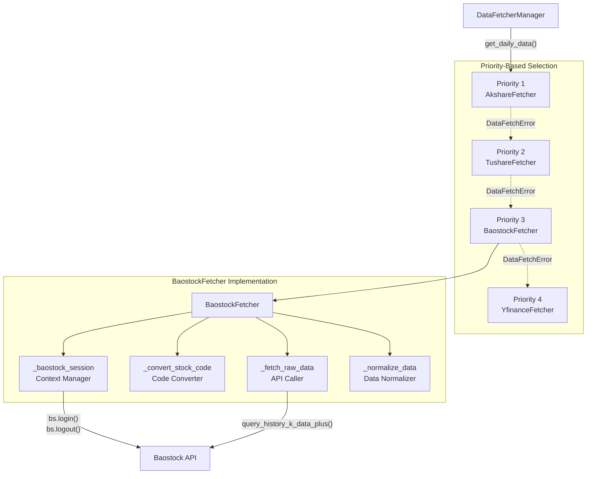
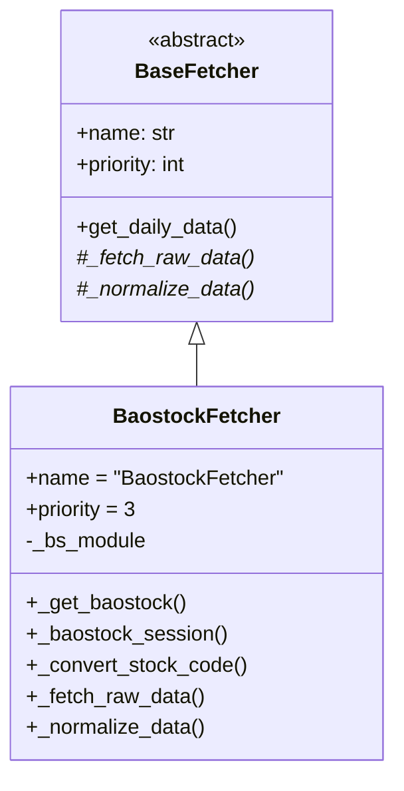
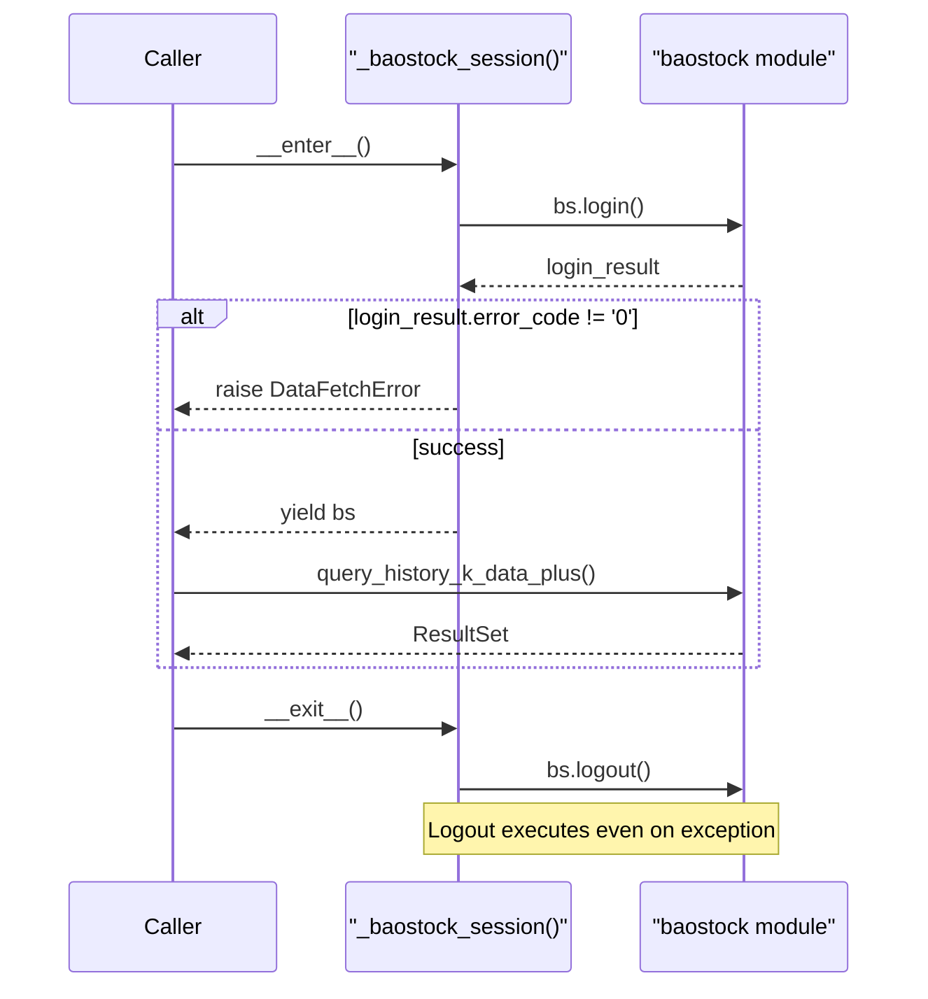

<!-- source: DeepWiki mcp.deepwiki.com · repo ZhuLinsen/daily_stock_analysis · page 5.6 Baostock Fetcher (Priority 3) · fetched 2026-10-29 -->

# Baostock Fetcher (Priority 3)

<details>
<summary>Relevant source files</summary>

The following files were used as context for generating this wiki page:

- [data_provider/akshare_fetcher.py](data_provider/akshare_fetcher.py)
- [data_provider/baostock_fetcher.py](data_provider/baostock_fetcher.py)
- [data_provider/base.py](data_provider/base.py)
- [data_provider/efinance_fetcher.py](data_provider/efinance_fetcher.py)
- [data_provider/pytdx_fetcher.py](data_provider/pytdx_fetcher.py)
- [data_provider/tushare_fetcher.py](data_provider/tushare_fetcher.py)
- [data_provider/yfinance_fetcher.py](data_provider/yfinance_fetcher.py)
- [docs/run-diagnostics-p0.md](docs/run-diagnostics-p0.md)
- [tests/test_a_share_fetcher_code_conversion.py](tests/test_a_share_fetcher_code_conversion.py)
- [tests/test_data_fetcher_prefetch_stock_names.py](tests/test_data_fetcher_prefetch_stock_names.py)
- [tests/test_stock_code_bse.py](tests/test_stock_code_bse.py)

</details>


## Purpose and Scope

This document details the `BaostockFetcher` implementation, which serves as the third-priority data source in the multi-source failover architecture. `BaostockFetcher` provides free access to A-share market data without requiring API tokens, making it a reliable backup when higher-priority sources (AkShare and Tushare) fail.

For information about the overall data fetcher architecture and failover strategy, see [Data Fetcher Architecture](). For details on higher-priority sources, see [AkShare Fetcher (Priority 1)]() and [Tushare Fetcher (Priority 2)](). For the final fallback option, see [YFinance Fetcher (Priority 4)]().

**Sources:** [data_provider/baostock_fetcher.py:1-15]()

---

## Overview

The `BaostockFetcher` class implements the `BaseFetcher` abstract interface to provide data from the Baostock (证券宝) API. Its key characteristics distinguish it from other data providers in the system:

| Characteristic | Detail |
|---------------|--------|
| **Priority** | 3 (configurable via `BAOSTOCK_PRIORITY`) |
| **Cost** | Free, no registration required |
| **Authentication** | Session-based login/logout (no token) |
| **Data Freshness** | T+1 delay (slightly behind real-time) |
| **Rate Limiting** | No explicit quota limits |
| **Stock Code Format** | Requires market prefix (`sh.600519`, `sz.000001`) |
| **Market Support** | A-shares (SH/SZ) and ETFs only (No HK/US/BSE) |

The fetcher activates when AkShare (Priority 1) and Tushare (Priority 2) fail, providing a stable fallback before resorting to YFinance (Priority 4).

**Sources:** [data_provider/baostock_fetcher.py:57-76](), [data_provider/baostock_fetcher.py:190-216]()

---

## Architecture and Integration

### Position in Failover Chain

The following diagram shows how `BaostockFetcher` integrates into the `DataFetcherManager`'s priority-based failover system:



**Sources:** [data_provider/baostock_fetcher.py:57-76](), [data_provider/baostock_fetcher.py:94-131](), [data_provider/base.py:303-315]()

### Class Hierarchy



**Sources:** [data_provider/baostock_fetcher.py:57-76](), [data_provider/base.py:254-260]()

---

## Key Implementation Components

### Session Management with Context Manager

`BaostockFetcher` uses a context manager pattern to ensure proper connection lifecycle management. Unlike token-based APIs, Baostock requires explicit `bs.login()` and `bs.logout()` calls.

#### `_baostock_session()` Context Manager

The `_baostock_session()` method at [data_provider/baostock_fetcher.py:94-131]() implements the context manager protocol:



**Key Implementation Details:**

| Component | Behavior |
|-----------|----------|
| **Entry (`__enter__`)** | Calls `bs.login()`, validates `error_code == '0'`, yields module reference [data_provider/baostock_fetcher.py:112-119](). |
| **Exit (`__exit__`)** | Always calls `bs.logout()` in a `finally` block to prevent connection leaks [data_provider/baostock_fetcher.py:121-131](). |
| **Error Handling** | Logs logout failures but suppresses them to preserve the original query exception [data_provider/baostock_fetcher.py:128-130](). |

**Sources:** [data_provider/baostock_fetcher.py:94-131]()

### Lazy Module Loading

The `_get_baostock()` method at [data_provider/baostock_fetcher.py:82-91]() implements lazy loading to prevent import errors when the `baostock` package is not installed:

- Stores module reference in `self._bs_module`.
- Only imports on first use via `import baostock as bs`.
- Allows the rest of the system to function if Baostock is unavailable.

**Sources:** [data_provider/baostock_fetcher.py:82-91]()

---

## Stock Code Conversion

Baostock requires stock codes in a specific format with market prefixes (`sh.` or `sz.`). The `_convert_stock_code()` method at [data_provider/baostock_fetcher.py:132-182]() handles this translation.

### Conversion Logic

- **Exclusions**: Explicitly rejects HK stocks via `_is_hk_market` check [data_provider/baostock_fetcher.py:150-151]().
- **Normalization**: Uses `normalize_stock_code` to strip existing SH/SZ prefixes before re-applying the required format [data_provider/baostock_fetcher.py:163]().
- **ETFs**: Maps Shanghai ETFs (51/52/56/58) to `sh.` and Shenzhen ETFs (15/16/18) to `sz.` [data_provider/baostock_fetcher.py:169-173]().
- **Stocks**: Maps 600/601/603/605/688 to `sh.` and 000/001/002/003/300/301 to `sz.` [data_provider/baostock_fetcher.py:176-179]().

**Sources:** [data_provider/baostock_fetcher.py:132-182](), [tests/test_a_share_fetcher_code_conversion.py:41-74]()

---

## Data Fetching and Normalization

### Raw Data Fetching Flow

The `_fetch_raw_data()` method at [data_provider/baostock_fetcher.py:190-252]() orchestrates the data retrieval:

1. **Market Validation**: Rejects US stocks [data_provider/baostock_fetcher.py:204-205](), HK stocks [data_provider/baostock_fetcher.py:208-209](), and BSE stocks [data_provider/baostock_fetcher.py:212-215]().
2. **Session Context**: Opens session via `_baostock_session()`.
3. **Query**: Calls `bs.query_history_k_data_plus` with `adjustflag="2"` (Forward Adjustment/前复权) and frequency `"d"` [data_provider/baostock_fetcher.py:226-233]().
4. **Iteration**: Iterates through `rs.next()` to build a row list from `rs.get_row_data()` [data_provider/baostock_fetcher.py:240-241]().

**Sources:** [data_provider/baostock_fetcher.py:190-252]()

### Data Normalization

The `_normalize_data()` method at [data_provider/baostock_fetcher.py:254-287]() transforms Baostock's output into the system's standard format:

- **Column Mapping**: Maps Baostock's `pctChg` to the standard `pct_chg` [data_provider/baostock_fetcher.py:267]().
- **Type Conversion**: Baostock returns all values as strings. The fetcher uses `pd.to_numeric` on OHLCV columns to ensure mathematical consistency [data_provider/baostock_fetcher.py:273-277]().

**Sources:** [data_provider/baostock_fetcher.py:254-287]()

---

## Error Handling and Retry Logic

### Retry Configuration

The `_fetch_raw_data()` method uses the `@retry` decorator from `tenacity` at [data_provider/baostock_fetcher.py:184-189]():

```python
@retry(
    stop=stop_after_attempt(3),
    wait=wait_exponential(multiplier=1, min=2, max=30),
    retry=retry_if_exception_type((ConnectionError, TimeoutError)),
    before_sleep=before_sleep_log(logger, logging.WARNING),
)
```

| Parameter | Behavior |
|-----------|----------|
| **Stop** | After 3 failed attempts |
| **Wait** | Exponential backoff (2s, 4s, 8s... up to 30s) |
| **Retry On** | Network-level `ConnectionError` or `TimeoutError` |

**Sources:** [data_provider/baostock_fetcher.py:184-189]()

---

## Advantages and Limitations

### Advantages
1. **No Token Required**: Unlike Tushare, Baostock is truly open and free for all users [data_provider/baostock_fetcher.py:8]().
2. **Stability**: Provides a reliable fallback when web-scraping based sources (AkShare) are blocked [data_provider/baostock_fetcher.py:9]().
3. **Clean Lifecycle**: Use of context managers prevents stale connections on the Baostock server [data_provider/baostock_fetcher.py:12-13]().

### Limitations
1. **Market Scope**: No support for HK, US, or Beijing Stock Exchange (BSE) [data_provider/baostock_fetcher.py:204-215]().
2. **Data Delay**: Updates are typically T+1, making it unsuitable for intraday real-time analysis [data_provider/baostock_fetcher.py:72]().
3. **Data Types**: All raw data is returned as strings, requiring numeric conversion [data_provider/baostock_fetcher.py:273-277]().

**Sources:** [data_provider/baostock_fetcher.py:1-287]()

---

