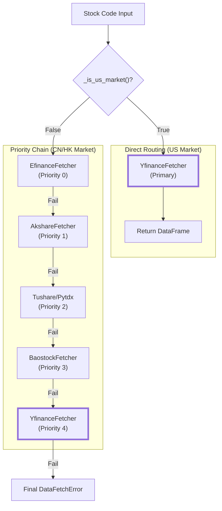
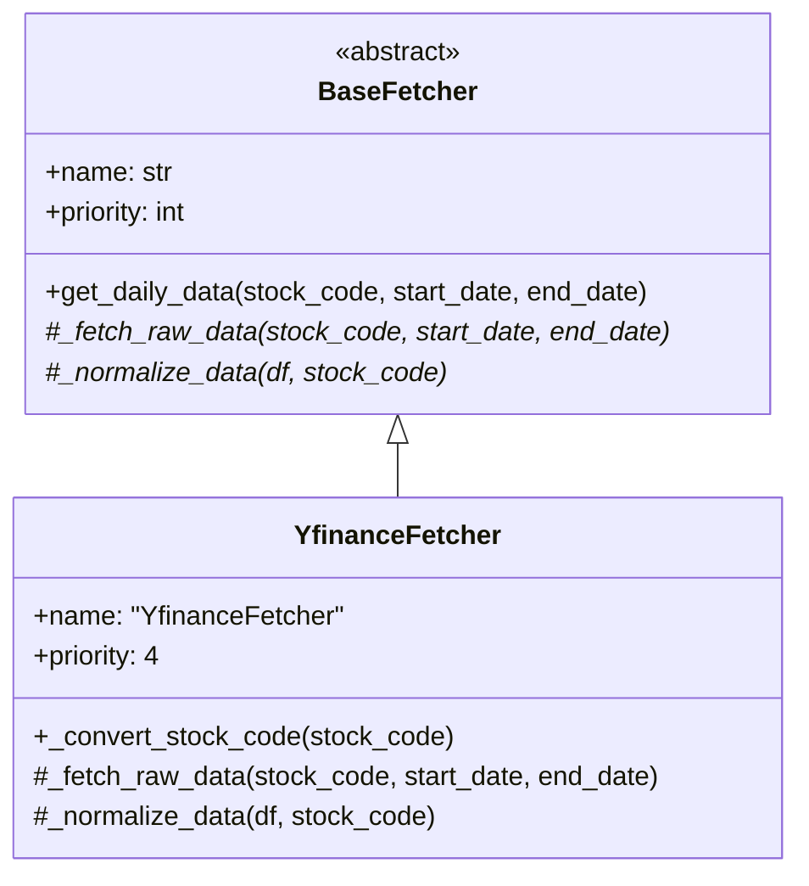
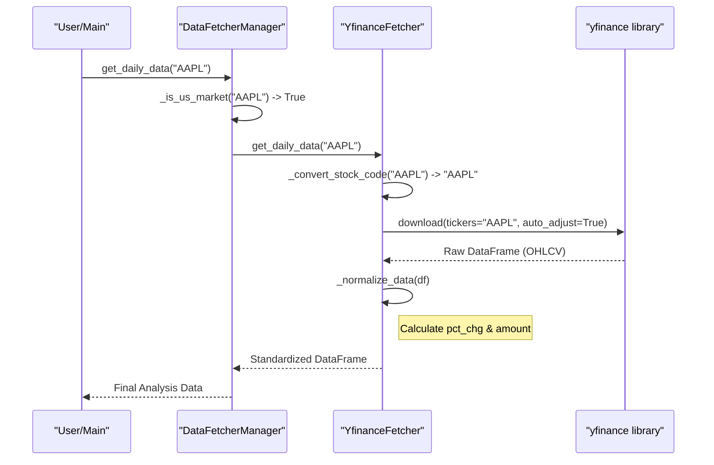

<!-- source: DeepWiki mcp.deepwiki.com · repo ZhuLinsen/daily_stock_analysis · page 5.7 YFinance Fetcher (Priority 4) · fetched 2026-10-29 -->

# YFinance Fetcher (Priority 4)

Relevant source files

The following files were used as context for generating this wiki page:

- [data_provider/akshare_fetcher.py](data_provider/akshare_fetcher.py)
- [data_provider/baostock_fetcher.py](data_provider/baostock_fetcher.py)
- [data_provider/base.py](data_provider/base.py)
- [data_provider/efinance_fetcher.py](data_provider/efinance_fetcher.py)
- [data_provider/pytdx_fetcher.py](data_provider/pytdx_fetcher.py)
- [data_provider/tushare_fetcher.py](data_provider/tushare_fetcher.py)
- [data_provider/yfinance_fetcher.py](data_provider/yfinance_fetcher.py)
- [data_provider/yfinance_fundamental_adapter.py](data_provider/yfinance_fundamental_adapter.py)
- [docs/run-diagnostics-p0.md](docs/run-diagnostics-p0.md)
- [tests/test_a_share_fetcher_code_conversion.py](tests/test_a_share_fetcher_code_conversion.py)
- [tests/test_data_fetcher_prefetch_stock_names.py](tests/test_data_fetcher_prefetch_stock_names.py)
- [tests/test_stock_code_bse.py](tests/test_stock_code_bse.py)
- [tests/test_yfinance_fundamental_adapter.py](tests/test_yfinance_fundamental_adapter.py)

## Purpose and Scope

The YFinance Fetcher has a **dual role** in the system's data acquisition architecture:

1. **PRIMARY data source for US stocks and US indices** - Directly routed, bypassing the priority chain. [data_provider/base.py:155-160](), [data_provider/yfinance_fetcher.py:129-131]()
2. **FALLBACK data source (Priority 4)** for A-share and HK stocks when domestic sources fail. [data_provider/yfinance_fetcher.py:4-9](), [data_provider/base.py:483-500]()

This fetcher uses the Yahoo Finance API via the `yfinance` Python library to retrieve stock data from an international data source. [data_provider/yfinance_fetcher.py:7-15](), [data_provider/yfinance_fetcher.py:190-191]()

**Key Characteristics:**
- **Direct routing** for US stocks (e.g., AAPL, TSLA) and US indices (e.g., SPX, DJI, IXIC, VIX). [data_provider/yfinance_fetcher.py:122-131]()
- **Expanded Market Support**: Handles JP (Japan), KR (Korea), and TW (Taiwan) markets via suffix detection. [data_provider/yfinance_fetcher.py:83-94]()
- **Fallback role** for A-shares (Priority 4, lowest) and HK stocks. [data_provider/yfinance_fetcher.py:75-76]()
- **Automatic code conversion**: Handles transformations from internal formats to Yahoo Finance suffixes (.SS, .SZ, .HK, .BJ). [data_provider/yfinance_fetcher.py:96-172]()
- **Adjusted Prices**: Uses `auto_adjust=True` to handle stock splits and dividends correctly. [data_provider/yfinance_fetcher.py:204]()
- **Resilience**: Implements exponential backoff retry for network failures using `tenacity`. [data_provider/yfinance_fetcher.py:173-178]()

Sources: [data_provider/yfinance_fetcher.py:1-178](), [data_provider/base.py:155-160](), [data_provider/base.py:483-500]()

---

## Position in Data Provider Architecture

The `YfinanceFetcher` is integrated into the `DataFetcherManager` with specific logic for market-based routing.

### Routing Architecture (Code to Entity Space)

The following diagram maps the logical routing decisions to the specific functions in the codebase.

**Routing Logic Details:**
- **US Market Detection**: The system uses `_is_us_market()` which delegates to `is_us_stock_code()` and `is_us_index_code()` from `us_index_mapping.py`. [data_provider/base.py:155-160]()
- **Priority Configuration**: The priority is configurable via the `YFINANCE_PRIORITY` environment variable, defaulting to `4`. [data_provider/yfinance_fetcher.py:76]()

Sources: [data_provider/base.py:155-160](), [data_provider/base.py:483-500](), [data_provider/yfinance_fetcher.py:75-76]()

---

## YfinanceFetcher Class Structure

The `YfinanceFetcher` class extends `BaseFetcher` and implements the standard data acquisition interface.

### Class Relationship (Entity Space)

**Key Implementation Details:**
- **Inheritance**: Inherits `get_daily_data` from `BaseFetcher` which manages the high-level flow (fetch -> normalize -> clean -> indicators). [data_provider/base.py:104-162]()
- **Standardization**: Uses `STANDARD_COLUMNS` defined in the base module to ensure data consistency. [data_provider/base.py:40](), [data_provider/yfinance_fetcher.py:241-242]()

Sources: [data_provider/yfinance_fetcher.py:57-76](), [data_provider/base.py:40](), [data_provider/base.py:104-162]()

---

## Stock Code Conversion Logic

Yahoo Finance requires specific suffixes for different exchanges. The `_convert_stock_code` method handles this mapping. [data_provider/yfinance_fetcher.py:96-172]()

### Conversion Mapping Table

| Market Category | Input Example | Output Format | Conversion Logic |
| :--- | :--- | :--- | :--- |
| **US Index** | `SPX` | `^GSPC` | `get_us_index_yf_symbol(code)` [data_provider/yfinance_fetcher.py:123-126]() |
| **US Stock** | `AAPL` | `AAPL` | `is_us_stock_code(code)` returns as-is [data_provider/yfinance_fetcher.py:129-131]() |
| **JP/KR/TW** | `7203.T` | `7203.T` | Suffix detection (JP/KR/TW) [data_provider/yfinance_fetcher.py:133-136]() |
| **HK Stock** | `HK00700` | `0700.HK` | Strip 'HK', pad to 4 digits + '.HK' [data_provider/yfinance_fetcher.py:139-143]() |
| **BSE (Beijing)** | `920748` | `920748.BJ` | `is_bse_code(code)` adds '.BJ' [data_provider/yfinance_fetcher.py:160-162]() |
| **A-share (SH)** | `600519` | `600519.SS` | Prefixes 600/601/603/688/51/52/56/58 [data_provider/yfinance_fetcher.py:154-155](), [data_provider/yfinance_fetcher.py:165-166]() |
| **A-share (SZ)** | `000001` | `000001.SZ` | Prefixes 000/002/300/15/16/18 [data_provider/yfinance_fetcher.py:156-157](), [data_provider/yfinance_fetcher.py:167-168]() |

Sources: [data_provider/yfinance_fetcher.py:96-172](), [data_provider/us_index_mapping.py](), [data_provider/base.py:166-184]()

---

## Fundamental Data Integration

The system includes a specialized `YfinanceFundamentalAdapter` to retrieve company information for HK/US markets. [data_provider/yfinance_fundamental_adapter.py:138-144]()

### Fundamental Bundle Components
The adapter returns a bundle mirroring the structure of domestic sources:
- **Growth**: YoY revenue and profit growth, ROE, and gross margins. [data_provider/yfinance_fundamental_adapter.py:187-192]()
- **Earnings**: Latest financial report details including revenue and operating cash flow, with currency handling. [data_provider/yfinance_fundamental_adapter.py:206-218]()
- **Dividends**: TTM dividend yield calculation and event history. [data_provider/yfinance_fundamental_adapter.py:220-255]()
- **Boards**: Derived from Yahoo's sector and industry fields. [data_provider/yfinance_fundamental_adapter.py:257-264]()

Sources: [data_provider/yfinance_fundamental_adapter.py:138-264]()

---

## Data Fetching and Normalization

### Fetching with `yfinance`
The `_fetch_raw_data` method utilizes `yf.download`. [data_provider/yfinance_fetcher.py:190-206]()

- **Retry Strategy**: Uses `tenacity` to retry on `ConnectionError` or `TimeoutError` up to 3 times with exponential backoff. [data_provider/yfinance_fetcher.py:173-178]()
- **Adjusted Prices**: `auto_adjust=True` ensures that OHLC data is adjusted for splits and dividends. [data_provider/yfinance_fetcher.py:204]()
- **Multi-ticker Handling**: Includes logic to handle `MultiIndex` columns that `yfinance` returns when downloading data. [data_provider/yfinance_fetcher.py:209-213]()

### Normalization to Standard Format
The `_normalize_data` method converts Yahoo's format to the system's `STANDARD_COLUMNS`. [data_provider/yfinance_fetcher.py:225-252]()

1. **Column Mapping**: Maps `Open`, `High`, `Low`, `Close`, `Volume` to lowercase standard names. [data_provider/yfinance_fetcher.py:241-248]()
2. **Pct Change**: Calculated manually using `df['close'].pct_change() * 100`. [data_provider/yfinance_fetcher.py:256-257]()
3. **Amount Estimation**: Since Yahoo does not provide transaction amount (成交额) for all markets, it is estimated as `volume * close`. [data_provider/yfinance_fetcher.py:262]()

Sources: [data_provider/yfinance_fetcher.py:173-262](), [data_provider/base.py:40]()

---

## Implementation Details: Error Handling

The fetcher is designed to fail fast but safely, allowing the `DataFetcherManager` to move to the next source if available.

| Scenario | Action | Code Reference |
| :--- | :--- | :--- |
| **Network Timeout** | Retry up to 3 times | [data_provider/yfinance_fetcher.py:173-178]() |
| **Empty Result** | Raise `DataFetchError` | [data_provider/yfinance_fetcher.py:215-216]() |
| **Unsupported Market** | Handled by code conversion or base manager | [data_provider/yfinance_fetcher.py:169-172]() |

### Data Flow Diagram (Natural Language to Code)

Sources: [data_provider/base.py:483-500](), [data_provider/yfinance_fetcher.py:173-252]()

---

