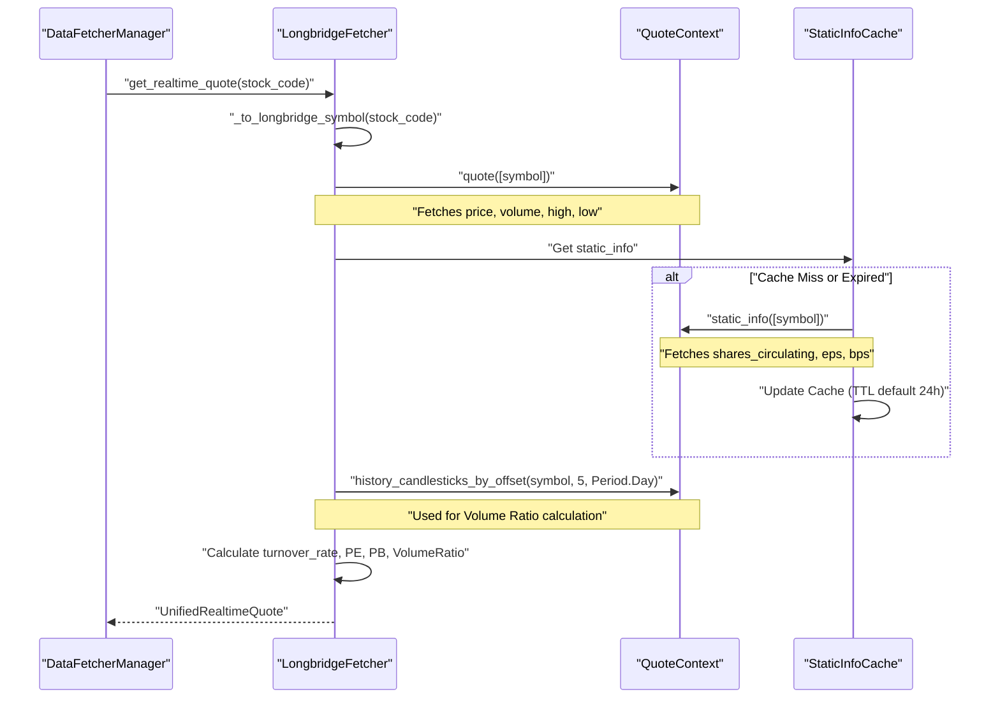
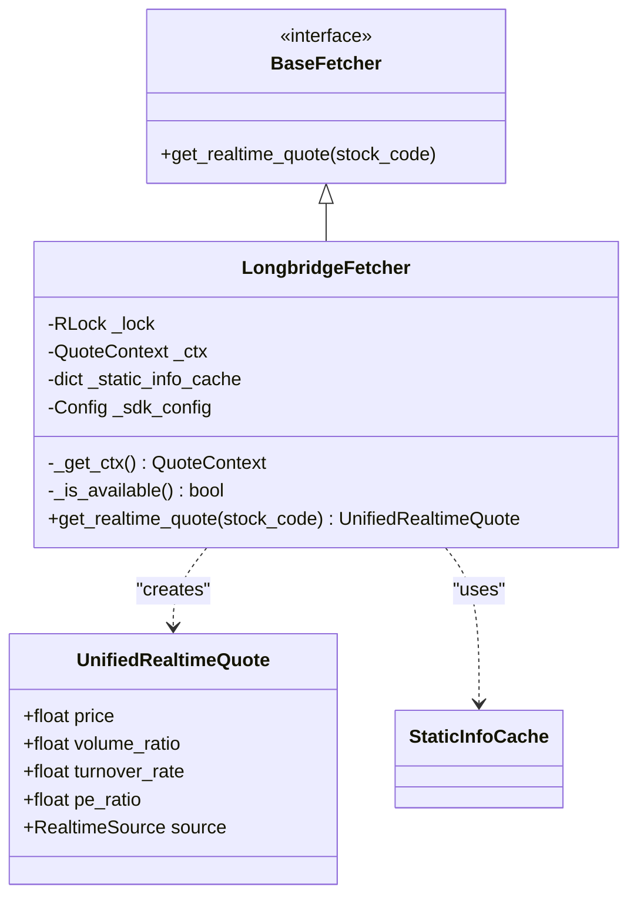

<!-- source: DeepWiki mcp.deepwiki.com · repo ZhuLinsen/daily_stock_analysis · page 5.8 Longbridge Fetcher (Priority 5) · fetched 2026-10-29 -->

# Longbridge Fetcher (Priority 5)

Relevant source files

The following files were used as context for generating this wiki page:

- [data_provider/akshare_fetcher.py](data_provider/akshare_fetcher.py)
- [data_provider/baostock_fetcher.py](data_provider/baostock_fetcher.py)
- [data_provider/base.py](data_provider/base.py)
- [data_provider/efinance_fetcher.py](data_provider/efinance_fetcher.py)
- [data_provider/longbridge_fetcher.py](data_provider/longbridge_fetcher.py)
- [data_provider/pytdx_fetcher.py](data_provider/pytdx_fetcher.py)
- [data_provider/tushare_fetcher.py](data_provider/tushare_fetcher.py)
- [data_provider/yfinance_fetcher.py](data_provider/yfinance_fetcher.py)
- [docs/run-diagnostics-p0.md](docs/run-diagnostics-p0.md)
- [tests/test_a_share_fetcher_code_conversion.py](tests/test_a_share_fetcher_code_conversion.py)
- [tests/test_data_fetcher_prefetch_stock_names.py](tests/test_data_fetcher_prefetch_stock_names.py)
- [tests/test_fetcher_source_optimization.py](tests/test_fetcher_source_optimization.py)
- [tests/test_longbridge_fetcher.py](tests/test_longbridge_fetcher.py)
- [tests/test_stock_code_bse.py](tests/test_stock_code_bse.py)

The `LongbridgeFetcher` is a high-priority data provider specifically designed for US and Hong Kong stock markets. It serves as the primary professional-grade source for these markets, offering advanced financial metrics (like real-time volume ratio and turnover) that are often missing from free providers like Yahoo Finance.

## Overview

The `LongbridgeFetcher` integrates with the **Longbridge OpenAPI** to provide high-quality real-time quotes, static company information, and historical candlestick data. While it is ranked as "Priority 5" in the global fetcher list, it is often the preferred source for HK/US stocks due to its accuracy and the depth of data available via the Longbridge SDK [data_provider/longbridge_fetcher.py:4-9]().

### Key Features
*   **Market Coverage**: Comprehensive support for US stocks (e.g., `AAPL.US`) and HK stocks (e.g., `0700.HK`) [data_provider/longbridge_fetcher.py:38-39]().
*   **Advanced Metrics**: Calculates `turnover_rate`, `pe_ratio`, `pb_ratio`, and `total_mv` by combining real-time quotes with static share information [data_provider/longbridge_fetcher.py:8-12]().
*   **Volume Ratio Calculation**: Derives current volume ratio by comparing real-time volume against the 5-day moving average volume fetched from historical data [data_provider/longbridge_fetcher.py:13]().
*   **Resource Efficiency**: Implements lazy initialization for the `QuoteContext` and a Time-To-Live (TTL) cache for static company info [data_provider/longbridge_fetcher.py:14-15]().
*   **OAuth 2.0 Support**: Prioritizes `LONGBRIDGE_OAUTH_CLIENT_ID` with local token caching, while maintaining compatibility with legacy API Key credentials [data_provider/longbridge_fetcher.py:17-18]().

Sources: [data_provider/longbridge_fetcher.py:4-21](), [data_provider/longbridge_fetcher.py:38-39]()

## System Integration & Data Flow

The fetcher acts as a bridge between the system's `UnifiedRealtimeQuote` standard and the Longbridge SDK's specific data structures.

### Logic Flow: Real-time Quote Acquisition
The following diagram illustrates how `get_realtime_quote` orchestrates multiple SDK calls to build a complete data object.

**Longbridge Data Enrichment Flow**

Sources: [data_provider/longbridge_fetcher.py:270-340](), [data_provider/longbridge_fetcher.py:365-420](), [data_provider/longbridge_fetcher.py:430-460]()

## Configuration

The fetcher requires valid OpenAPI credentials. It also supports region-specific optimizations for users in Mainland China (CN) versus other regions (HK).

### Credentials and Environment Variables
| Variable | Description | Default |
| :--- | :--- | :--- |
| `LONGBRIDGE_OAUTH_CLIENT_ID` | OAuth 2.0 Client ID (Preferred) | Optional |
| `LONGBRIDGE_APP_KEY` | Legacy API Key | Optional |
| `LONGBRIDGE_APP_SECRET` | Legacy API Secret | Optional |
| `LONGBRIDGE_ACCESS_TOKEN` | Legacy Access Token | Optional |
| `LONGBRIDGE_REGION` | `cn` or `hk` (affects endpoint URLs) | `hk` |
| `LONGBRIDGE_STATIC_INFO_TTL_SECONDS` | Cache duration for static data | `86400` (24h) |
| `LONGBRIDGE_CONNECTION_COOLDOWN_SECONDS` | Cooldown after connection failure | `15` |

### Environment Sanitization
The system performs a "sanitization" step (`_sanitize_longbridge_env`) to ensure empty strings from CI/CD environments (like GitHub Actions) do not break the Rust-based SDK. It also mirrors `LONGBRIDGE_REGION` to `LONGPORT_REGION` to satisfy internal SDK requirements [data_provider/longbridge_fetcher.py:82-95](), [data_provider/longbridge_fetcher.py:127-132]().

Sources: [data_provider/longbridge_fetcher.py:41-66](), [data_provider/longbridge_fetcher.py:82-144]()

## Implementation Details

### Lazy Context Initialization
To avoid unnecessary overhead and WebSocket connections, the `QuoteContext` is only initialized upon the first data request via `_get_ctx()`. This is managed using a thread-safe `threading.RLock` [data_provider/longbridge_fetcher.py:246-268]().

### Symbol Conversion
The fetcher internally converts internal stock codes to Longbridge-compatible symbols via `_to_longbridge_symbol`:
*   **US Stocks**: Appends `.US` (e.g., `AAPL` -> `AAPL.US`) [data_provider/longbridge_fetcher.py:488-490]().
*   **HK Stocks**: Normalizes to 4-digit code with `.HK` suffix (e.g., `HK00700` -> `0700.HK`) [data_provider/longbridge_fetcher.py:494-497]().

### Calculation Logic
1.  **Turnover Rate**: Calculated as `volume / circulating_shares * 100`. If `circulating_shares` is unavailable, it falls back to `total_shares` [data_provider/longbridge_fetcher.py:438-444]().
2.  **PE Ratio**: Derived using `current_price / eps_ttm` from the static info cache [data_provider/longbridge_fetcher.py:448]().
3.  **Volume Ratio**: Calculated by dividing current volume by the average volume of the last 5 trading days [data_provider/longbridge_fetcher.py:408-417]().

Sources: [data_provider/longbridge_fetcher.py:246-268](), [data_provider/longbridge_fetcher.py:408-417](), [data_provider/longbridge_fetcher.py:438-448](), [data_provider/longbridge_fetcher.py:480-505]()

## Class Structure

**LongbridgeFetcher Code Entities**

Sources: [data_provider/longbridge_fetcher.py:204-220](), [data_provider/realtime_types.py:109-150](), [data_provider/base.py:200-210]()

## Error Handling and Fallbacks

The `LongbridgeFetcher` implements several resilience patterns:
*   **Credential Validation**: `has_configured_credentials()` checks if any valid auth combination exists before attempting initialization [data_provider/longbridge_fetcher.py:228-238]().
*   **Connection Cooldown**: If the WebSocket or HTTP connection fails, the fetcher enters a cooldown period (default 15s) to prevent reconnect thrashing [data_provider/longbridge_fetcher.py:57-65]().
*   **Graceful Degradation**: If an API call fails or the fetcher is unconfigured, it returns `None`, allowing `DataFetcherManager` to fall back to lower-priority sources like `YFinanceFetcher` (Priority 4) [data_provider/base.py:1650-1670](), [data_provider/longbridge_fetcher.py:350-360]().

Sources: [data_provider/longbridge_fetcher.py:57-65](), [data_provider/longbridge_fetcher.py:228-238](), [data_provider/longbridge_fetcher.py:350-360](), [data_provider/base.py:1650-1670]()

---

