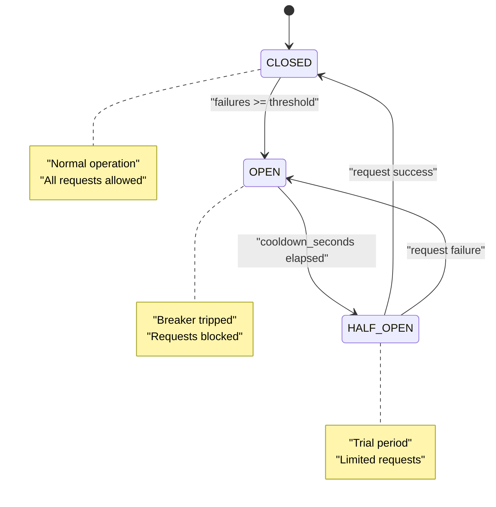
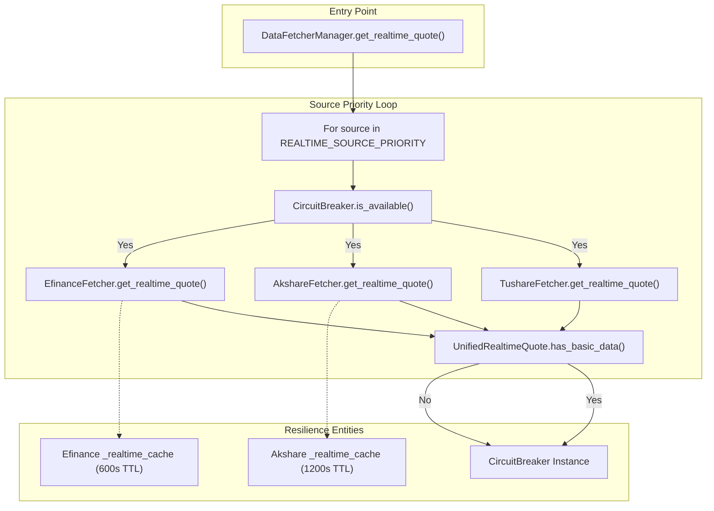

<!-- source: DeepWiki mcp.deepwiki.com · repo ZhuLinsen/daily_stock_analysis · page 5.9 Real-time Data & Circuit Breakers · fetched 2026-10-29 -->

# Real-time Data & Circuit Breakers

<details>
<summary>Relevant source files</summary>

The following files were used as context for generating this wiki page:

- [data_provider/akshare_fetcher.py](data_provider/akshare_fetcher.py)
- [data_provider/baostock_fetcher.py](data_provider/baostock_fetcher.py)
- [data_provider/base.py](data_provider/base.py)
- [data_provider/efinance_fetcher.py](data_provider/efinance_fetcher.py)
- [data_provider/pytdx_fetcher.py](data_provider/pytdx_fetcher.py)
- [data_provider/realtime_types.py](data_provider/realtime_types.py)
- [data_provider/tushare_fetcher.py](data_provider/tushare_fetcher.py)
- [data_provider/yfinance_fetcher.py](data_provider/yfinance_fetcher.py)
- [docs/run-diagnostics-p0.md](docs/run-diagnostics-p0.md)
- [tests/test_a_share_fetcher_code_conversion.py](tests/test_a_share_fetcher_code_conversion.py)
- [tests/test_data_fetcher_prefetch_stock_names.py](tests/test_data_fetcher_prefetch_stock_names.py)
- [tests/test_pipeline_realtime_indicators.py](tests/test_pipeline_realtime_indicators.py)
- [tests/test_stock_code_bse.py](tests/test_stock_code_bse.py)

</details>


**Purpose**: This document explains the real-time data acquisition subsystem, including the unified `UnifiedRealtimeQuote` and `ChipDistribution` data structures, the circuit breaker pattern for fault isolation, caching strategies, and multi-source failover logic for both real-time quotes and chip distribution data.

**Related Pages**:
- For historical data fetching architecture, see [Data Fetcher Architecture](5.1)
- For individual data source implementations, see [EFinance Fetcher](5.2), [AkShare Fetcher](5.3), [Tushare Fetcher](5.4)
- For configuration of data sources, see [Configuration Reference](2.2)

---

## UnifiedRealtimeQuote Structure

The `UnifiedRealtimeQuote` class provides a unified data structure for real-time stock quotes across all data sources (efinance, akshare, tushare, yfinance, tencent, sina). This abstraction ensures consistent data handling regardless of the underlying API differences. [data_provider/realtime_types.py:110-118]()

### Core Design Principles

1.  **Optional Fields**: All fields except `code` and `name` are `Optional`, allowing graceful degradation when sources provide incomplete data. [data_provider/realtime_types.py:124-162]()
2.  **Source Tracking**: The `source` field (type `RealtimeSource` enum) identifies the origin of data for debugging and quality assessment. [data_provider/realtime_types.py:121-121]()
3.  **Type Safety**: Conversion utilities `safe_float()` and `safe_int()` handle inconsistent data types (strings, NaN, None) from various sources. [data_provider/realtime_types.py:34-91]()

### Field Categories

| Category | Fields | Description |
| :--- | :--- | :--- |
| **Metadata** | `fetched_at`, `provider_timestamp`, `market`, `currency` | Data quality and provenance metadata. [data_provider/realtime_types.py:124-132]() |
| **Core Price** | `price`, `change_pct`, `change_amount` | Essential price and movement data. [data_provider/realtime_types.py:135-137]() |
| **Volume Metrics** | `volume`, `amount`, `volume_ratio`, `turnover_rate`, `amplitude` | Trading activity metrics. [data_provider/realtime_types.py:140-144]() |
| **Price Range** | `open_price`, `high`, `low`, `pre_close` | Intraday price bounds. [data_provider/realtime_types.py:147-150]() |
| **Valuation** | `pe_ratio`, `pb_ratio`, `total_mv`, `circ_mv` | Financial ratios (Eastmoney/Efinance only). [data_provider/realtime_types.py:153-156]() |

### Type Conversion Utilities

The system uses two utility functions to safely convert raw API responses into typed values:

```python
# data_provider/realtime_types.py
def safe_float(val: Any, default: Optional[float] = None) -> Optional[float] # [data_provider/realtime_types.py:34-34]()
def safe_int(val: Any, default: Optional[int] = None) -> Optional[int] # [data_provider/realtime_types.py:75-75]()
```

These functions handle:
*   `None` and empty strings/dashes (`""`, `"-"`, `"--"`) → `default` [data_provider/realtime_types.py:52-59]()
*   Pandas/NumPy NaN values → `default` [data_provider/realtime_types.py:63-68]()
*   String representations like `"123.45"` → `123.45` [data_provider/realtime_types.py:70-70]()

Sources: [data_provider/realtime_types.py:34-184]()

---

## ChipDistribution Structure

The `ChipDistribution` class represents ownership cost distribution data, reflecting holding costs and profit ratios. [data_provider/realtime_types.py:196-201]()

### Field Breakdown

| Field | Type | Description |
| :--- | :--- | :--- |
| `code` | `str` | Stock code. [data_provider/realtime_types.py:202-202]() |
| `date` | `str` | Data date. [data_provider/realtime_types.py:203-203]() |
| `profit_ratio` | `float` | Percentage of shareholders in profit (0.0-1.0). [data_provider/realtime_types.py:207-207]() |
| `avg_cost` | `float` | Average holding cost. [data_provider/realtime_types.py:208-208]() |
| `concentration_90` | `float` | 90% chip concentration (lower = more concentrated). [data_provider/realtime_types.py:213-213]() |

### Interpretation: `get_chip_status()`

The `get_chip_status(current_price)` method generates a human-readable description by analyzing profit ratios and concentration metrics. [data_provider/realtime_types.py:233-279]()

Sources: [data_provider/realtime_types.py:196-279]()

---

## Circuit Breaker Pattern

The `CircuitBreaker` class prevents cascading failures by isolating failing sources and enforcing cooldown periods. [data_provider/realtime_types.py:281-289]()

### State Machine

Title: Circuit Breaker State Transitions


### Configuration Parameters

| Parameter | Real-time Quotes | Chip Distribution | Purpose |
| :--- | :--- | :--- | :--- |
| `failure_threshold` | 3 | 2 | Consecutive failures before tripping. [data_provider/realtime_types.py:409-417]() |
| `cooldown_seconds` | 300 (5 min) | 600 (10 min) | Wait time before retry. [data_provider/realtime_types.py:410-418]() |

Sources: [data_provider/realtime_types.py:281-430]()

---

## Real-time Quote Acquisition Flow

The system uses a priority-based, multi-source strategy with caching and field supplementation.

### High-Level Flow Diagram

Title: Real-time Data Flow & Entity Mapping


### Caching Strategy

Both `EfinanceFetcher` and `AkshareFetcher` implement TTL-based caching for batch analysis.

**EfinanceFetcher Cache**: [data_provider/efinance_fetcher.py:135-146]()
*   TTL: 600 seconds (10 minutes).
*   Storage: `_realtime_cache` and `_etf_realtime_cache`.

**AkshareFetcher Cache**: [data_provider/akshare_fetcher.py:84-95]()
*   TTL: 1200 seconds (20 minutes).
*   Storage: `_realtime_cache` and `_etf_realtime_cache`.

Sources: [data_provider/efinance_fetcher.py:135-146](), [data_provider/akshare_fetcher.py:84-95]()

### Tushare Integration (Priority 2)

`TushareFetcher` can be elevated to Priority -1 if a token is configured. It implements a per-minute call counter to respect API rate limits (80 calls/min). [data_provider/tushare_fetcher.py:133-151](), [data_provider/tushare_fetcher.py:215-234]()

Sources: [data_provider/tushare_fetcher.py:133-242]()

---

## Chip Distribution Acquisition

Chip distribution data is acquired through a failover chain with circuit breaker protection.

### Source-Specific Implementations

*   **AkshareFetcher**: Provides enhanced data including `profit_ratio`, `avg_cost`, and `concentration_90`. [data_provider/akshare_fetcher.py:21-24]()
*   **Unified Structure**: All sources must map their specific response fields to the `ChipDistribution` dataclass. [data_provider/realtime_types.py:196-231]()

Sources: [data_provider/akshare_fetcher.py:21-24](), [data_provider/realtime_types.py:196-231]()

---

## Configuration

### Circuit Breaker Tuning

Circuit breaker parameters are initialized in `realtime_types.py`:

```python
# data_provider/realtime_types.py
_realtime_circuit_breaker = CircuitBreaker(failure_threshold=3, cooldown_seconds=300.0) # [data_provider/realtime_types.py:408-411]()
_chip_circuit_breaker = CircuitBreaker(failure_threshold=2, cooldown_seconds=600.0) # [data_provider/realtime_types.py:416-419]()
```

Sources: [data_provider/realtime_types.py:408-430]()

---

