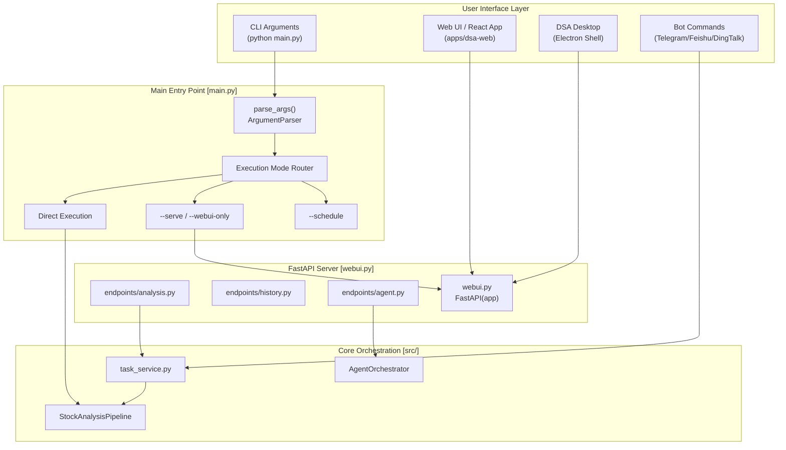
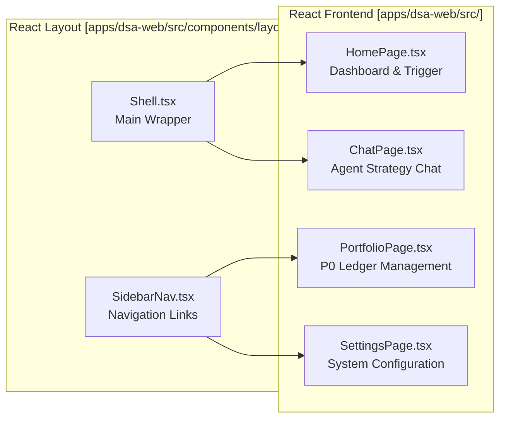

<!-- source: DeepWiki mcp.deepwiki.com · repo ZhuLinsen/daily_stock_analysis · page 6 User Interfaces · fetched 2026-10-29 -->

# User Interfaces

Relevant source files

The following files were used as context for generating this wiki page:

- [README.md](README.md)
- [apps/dsa-web/src/App.test.tsx](apps/dsa-web/src/App.test.tsx)
- [apps/dsa-web/src/App.tsx](apps/dsa-web/src/App.tsx)
- [apps/dsa-web/src/components/layout/Shell.tsx](apps/dsa-web/src/components/layout/Shell.tsx)
- [apps/dsa-web/src/components/layout/ShellHeader.tsx](apps/dsa-web/src/components/layout/ShellHeader.tsx)
- [apps/dsa-web/src/components/layout/SidebarNav.tsx](apps/dsa-web/src/components/layout/SidebarNav.tsx)
- [apps/dsa-web/src/components/theme/ThemeToggle.tsx](apps/dsa-web/src/components/theme/ThemeToggle.tsx)
- [docs/README_CHT.md](docs/README_CHT.md)
- [docs/README_EN.md](docs/README_EN.md)

## Purpose and Scope

This document provides an overview of all user-facing interfaces in the `daily_stock_analysis` system. The system offers four primary interaction methods: a command-line interface (CLI), a web-based graphical interface (FastAPI + React), bot platform integrations, and a dedicated desktop application. All interfaces converge on the same core execution engine to ensure consistent analysis logic across deployment methods.

For detailed documentation of specific interfaces:
- **CLI flags and arguments**: see [Command Line Interface](#6.1)
- **Web UI features and API endpoints**: see [Web UI (FastAPI + React)](#6.2)
- **Bot commands and Stream mode**: see [Bot Integration](#6.3)
- **Desktop Application architecture**: see [Desktop Application](#6.4)

---

## Entry Point Architecture

The system implements a unified entry point architecture where all user interfaces route through `main.py` or the FastAPI server as the central coordinator. This design ensures consistent behavior regardless of the interaction method.

### Interface Convergence Diagram

**Diagram: Entry Point Convergence Architecture**

**Sources:** [README.md:165-175](), [apps/dsa-web/src/App.tsx:74-93]()

---

## Command-Line Interface

The CLI is the primary interface for direct script execution and automated workflows (like GitHub Actions). It provides flags for controlling analysis scope, execution modes, and notification behavior.

### Key Functional Groups
*   **Analysis Scope**: `--stocks` for specific codes, `--market-review` for broad indices [README.md:110-111]().
*   **Execution Mode**: `--schedule` for cron-like behavior, `--serve` for launching the Web UI backend [README.md:150-151]().
*   **Control Flags**: `--debug` for verbose logging, `--dry-run` to skip AI calls.

For details, see [Command Line Interface](#6.1).

**Sources:** [README.md:146-151](), [README.md:172-173]()

---

## Web User Interface

The Web UI is a modern React application (`apps/dsa-web`) powered by a FastAPI backend. It provides an interactive dashboard for triggering analyses, viewing historical reports, and interacting with the AI Agent.

### Component-to-Code Mapping

**Diagram: Web UI Natural Language to Code Entity Mapping**

### Key Features
*   **Navigation & Shell**: The interface uses a `Shell` component to manage the layout, featuring a responsive `SidebarNav` that handles navigation to pages like `HomePage`, `ChatPage`, and `PortfolioPage` [apps/dsa-web/src/components/layout/Shell.tsx:16-69](), [apps/dsa-web/src/components/layout/SidebarNav.tsx:30-40]().
*   **Theming & Localization**: Supports light/dark modes via `ThemeToggle` and multi-language support (English/Chinese) via `UiLanguageToggle` [apps/dsa-web/src/components/theme/ThemeToggle.tsx:43-51](), [apps/dsa-web/src/contexts/UiLanguageContext.tsx:1-10]().
*   **Protected Routes**: Integrated authentication flow that redirects unauthenticated users to a `LoginPage` if `authEnabled` is set [apps/dsa-web/src/App.tsx:57-67]().
*   **Feature Gating**: The sidebar dynamically shows or hides features like `screening` (AlphaSift) based on system configuration [apps/dsa-web/src/components/layout/SidebarNav.tsx:47-76]().

For details, see [Web UI (FastAPI + React)](#6.2).

**Sources:** [apps/dsa-web/src/App.tsx:15-26](), [apps/dsa-web/src/components/layout/SidebarNav.tsx:30-40](), [apps/dsa-web/src/components/layout/Shell.tsx:39-70]()

---

## Bot Integration

The system supports bidirectional communication with bot platforms, allowing users to trigger analyses and receive reports directly in chat applications.

### Supported Platforms
*   **Enterprise**: WeChat Work (企业微信), Feishu (飞书), DingTalk (钉钉) [README.md:97-98]().
*   **Social**: Telegram, Discord, Slack [README.md:99-102]().

### Bot Interaction
Bots support a command pattern (e.g., `/ask`, `/analyze`, `/market`, `/chat`) and can operate in **Stream Mode** to bypass firewall/NAT restrictions for incoming messages [README.md:46-48]().

For details, see [Bot Integration](#6.3).

**Sources:** [README.md:16-18](), [README.md:94-104]()

---

## Desktop Application

The `dsa-desktop` application provides a packaged Electron-based experience for Windows and macOS.

### Architecture Highlights
*   **Electron Shell**: Wraps the React UI and manages a local FastAPI backend process.
*   **Portable Mode**: Co-locates the `.env` configuration and database with the executable for easy distribution [README.md:152-167]().
*   **Automated Builds**: Uses GitHub Actions for cross-platform packaging and release [README.md:6-10]().

For details, see [Desktop Application](#6.4).

**Sources:** [README.md:45-48](), [README.md:152-154]()

---

