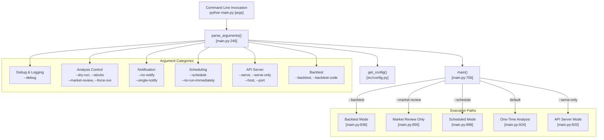
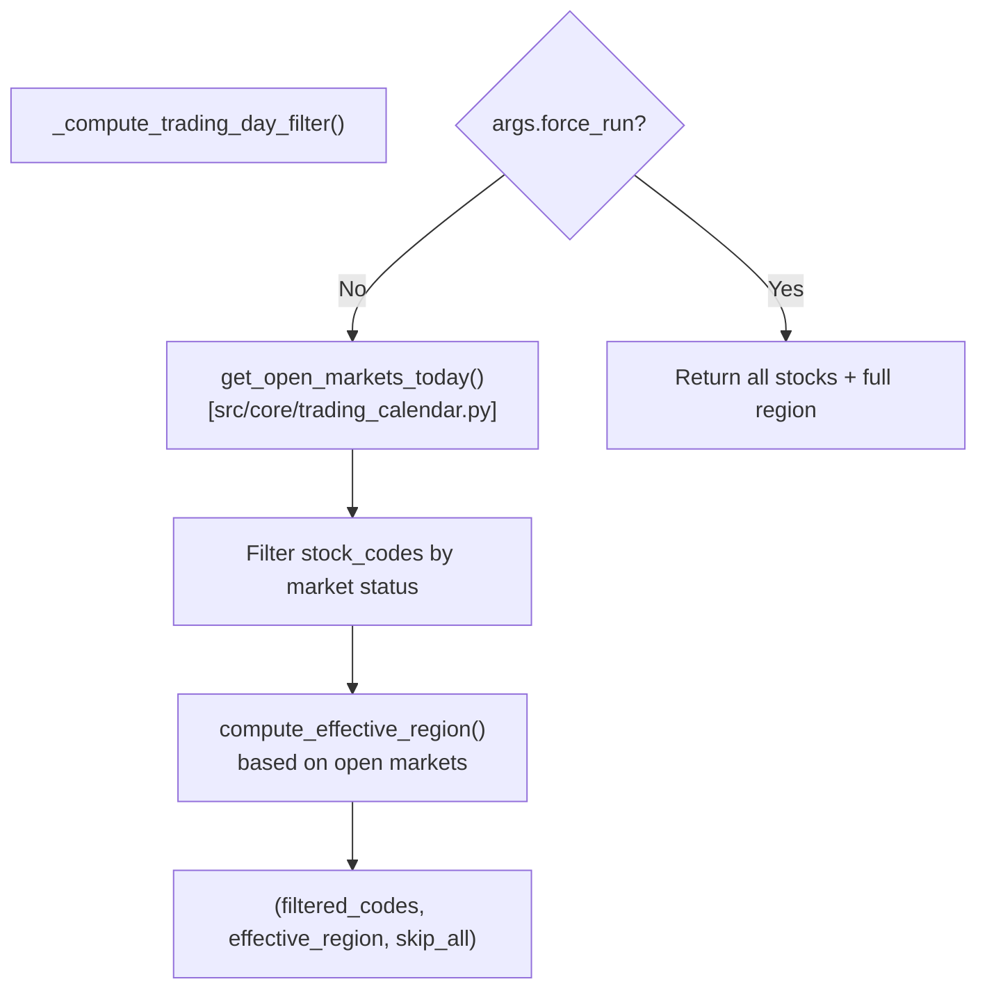

<!-- source: DeepWiki mcp.deepwiki.com · repo ZhuLinsen/daily_stock_analysis · page 6.1 Command Line Interface · fetched 2026-10-29 -->

# Command Line Interface

<details>
<summary>Relevant source files</summary>

The following files were used as context for generating this wiki page:

- [README.md](README.md)
- [docs/README_CHT.md](docs/README_CHT.md)
- [docs/README_EN.md](docs/README_EN.md)
- [main.py](main.py)
- [tests/test_main_schedule_mode.py](tests/test_main_schedule_mode.py)

</details>


The Command Line Interface (CLI) is the primary entrypoint for executing the stock analysis system. It provides comprehensive control over analysis modes, data acquisition, notification behavior, scheduling, and system configuration through command-line arguments. The CLI is implemented in `main.py` and supports one-time execution, scheduled operation, API server mode, and various specialized workflows.

For information about the web-based interface, see [Web UI (FastAPI + React)](#6.2). For deployment-specific execution instructions, see [Deployment Overview](#7.1).

---

## Basic Invocation

The system is invoked via `main.py` with optional arguments:

```bash
# Full analysis (stocks + market review)
python main.py

# With configuration from environment
python main.py --debug

# Specific stocks only
python main.py --stocks 600519,AAPL

# Market review only
python main.py --market-review

# Force run skipping trading day check
python main.py --force-run
```

The argument parser is implemented in `parse_arguments()` [main.py:246-374]() using Python's `argparse` module. Arguments control execution mode, analysis scope, notification behavior, and logging verbosity.

**Sources:** [main.py:246-374]()

---

## CLI Architecture

### Argument Parsing Flow



**Sources:** [main.py:246-374](), [main.py:756-950]()

### Trading Day Logic & Filtering

The CLI includes logic to determine if analysis should proceed based on the trading calendar. The function `_compute_trading_day_filter` [main.py:377-417]() calculates which stocks to analyze and which market regions to review based on whether the respective markets (A-share, HK, US, JP, KR, etc.) are open.



**Sources:** [main.py:377-417](), [main.py:72]()

---

## CLI Arguments Reference

All arguments are optional. The system uses defaults from environment variables when arguments are not specified.

### Analysis Control

| Argument | Type | Description | Default |
|----------|------|-------------|---------|
| `--stocks CODE1,CODE2` | string | Comma-separated stock codes to analyze (overrides `STOCK_LIST`) | From config |
| `--dry-run` | flag | Fetch and save data only, skip AI analysis | false |
| `--market-review` | flag | Execute only market review analysis | false |
| `--no-market-review` | flag | Skip market review analysis | false |
| `--force-run` | flag | Skip trading day check, force execution | false |
| `--workers N` | integer | Number of concurrent threads for stock analysis | From config |
| `--no-context-snapshot`| flag | Skip daily market context snapshot | false |

The `--stocks` argument uses `resolve_index_stock_code_for_analysis` [main.py:72]() to normalize codes. Implementation logic for filtering based on these codes is found in `_compute_trading_day_filter` [main.py:377-417]().

**Sources:** [main.py:271-297](), [main.py:377-417]()

### Notification Control

| Argument | Type | Description | Default |
|----------|------|-------------|---------|
| `--no-notify` | flag | Suppress all notifications | false |
| `--single-notify` | flag | Push notification after each stock completes | false |
| `--check-notify` | flag | Send a test notification to verify channel config | false |

The `--single-notify` flag [main.py:289-293]() allows for immediate feedback during long-running batch analyses.

**Sources:** [main.py:283-293]()

### Scheduling

| Argument | Type | Description | Default |
|----------|------|-------------|---------|
| `--schedule` | flag | Enable daily scheduled execution at `SCHEDULE_TIME` | false |
| `--no-run-immediately` | flag | In scheduled mode, wait until scheduled time | false |

Scheduled mode [main.py:898-921]() uses an internal loop. In scheduled runs, the system attempts to reload environment variables to preserve overrides [main.py:224-243]().

**Sources:** [main.py:299-309](), [main.py:224-243](), [main.py:898-921]()

### API Server Mode

| Argument | Type | Description | Default |
|----------|------|-------------|---------|
| `--serve` | flag | Start FastAPI server + execute analysis once | false |
| `--serve-only` | flag | Start FastAPI server only | false |
| `--webui` | flag | Alias for `--serve` (FastAPI + React frontend) | false |
| `--webui-only` | flag | Alias for `--serve-only` | false |
| `--host HOST` | string | FastAPI server bind address | `0.0.0.0` |
| `--port PORT` | integer | FastAPI server port | `8000` |

The `--webui` flags trigger the preparation of frontend assets via `prepare_webui_frontend_assets()` [main.py:68]() before starting the server in `main()` [main.py:820-833]().

**Sources:** [main.py:330-365](), [main.py:68](), [main.py:820-833]()

### Backtest

| Argument | Type | Description | Default |
|----------|------|-------------|---------|
| `--backtest` | flag | Execute backtest on historical analysis records | false |
| `--backtest-code CODE` | string | Backtest specific stock code only | All stocks |
| `--backtest-days N` | integer | Evaluation window in trading days | From config |
| `--backtest-force` | flag | Force recalculation of backtest results | false |

**Sources:** [main.py:315-328](), [main.py:836-852]()

---

## Execution Modes

The CLI supports five distinct execution modes:

### Mode 1: One-Time Analysis (Default)

**Invocation:** `python main.py`

**Behavior:**
- Executes full analysis once (individual stocks + market review) [main.py:924-929]().
- Sends notifications to all configured channels.
- Exits after completion.

**Control Flow:**
1. Parse arguments and load config.
2. Call `run_full_analysis()` [main.py:420-552]().
3. Pipeline runs stocks via `StockAnalysisPipeline.run()`.
4. Market review via `run_market_review()`.

**Sources:** [main.py:420-552](), [main.py:924-929]()

### Mode 2: Scheduled Mode

**Invocation:** `python main.py --schedule`

**Behavior:**
- Runs once immediately (unless `--no-run-immediately` specified).
- Repeats daily based on `SCHEDULE_TIME`.
- Hot-reloads configuration values on every run [main.py:443]().

**Sources:** [main.py:898-921](), [main.py:443]()

### Mode 3: Market Review Only

**Invocation:** `python main.py --market-review`

**Behavior:**
- Skips individual stock analysis.
- Executes only market review (indices, sectors, sentiment) [main.py:855-895]().
- Sends market report notification.

**Sources:** [main.py:855-895]()

### Mode 4: API Server Mode

**Invocation:** `python main.py --serve-only` or `python main.py --webui-only`

**Behavior:**
- Starts FastAPI server on specified host/port.
- Stays resident, awaiting HTTP requests [main.py:820-833]().

**Sources:** [main.py:820-833]()

### Mode 5: Backtest Mode

**Invocation:** `python main.py --backtest`

**Behavior:**
- Evaluates historical analysis records against actual outcomes [main.py:836-852]().
- Calculates accuracy metrics and saves to database.

**Sources:** [main.py:836-852]()

---

## Exit Codes & Logging

The CLI returns standard exit codes and manages logging levels:

| Code | Meaning | Condition |
|------|---------|-----------|
| `0` | Success | Normal execution completed |
| `1` | Error | Unhandled exception during execution |

Logging is initialized via `setup_logging()` [main.py:70](). If `--debug` is provided, the log level is set to `DEBUG` [main.py:173](). Global exception handling in `main()` ensures appropriate exit codes [main.py:936-950]().

**Sources:** [main.py:70](), [main.py:173](), [main.py:936-950]()

---

