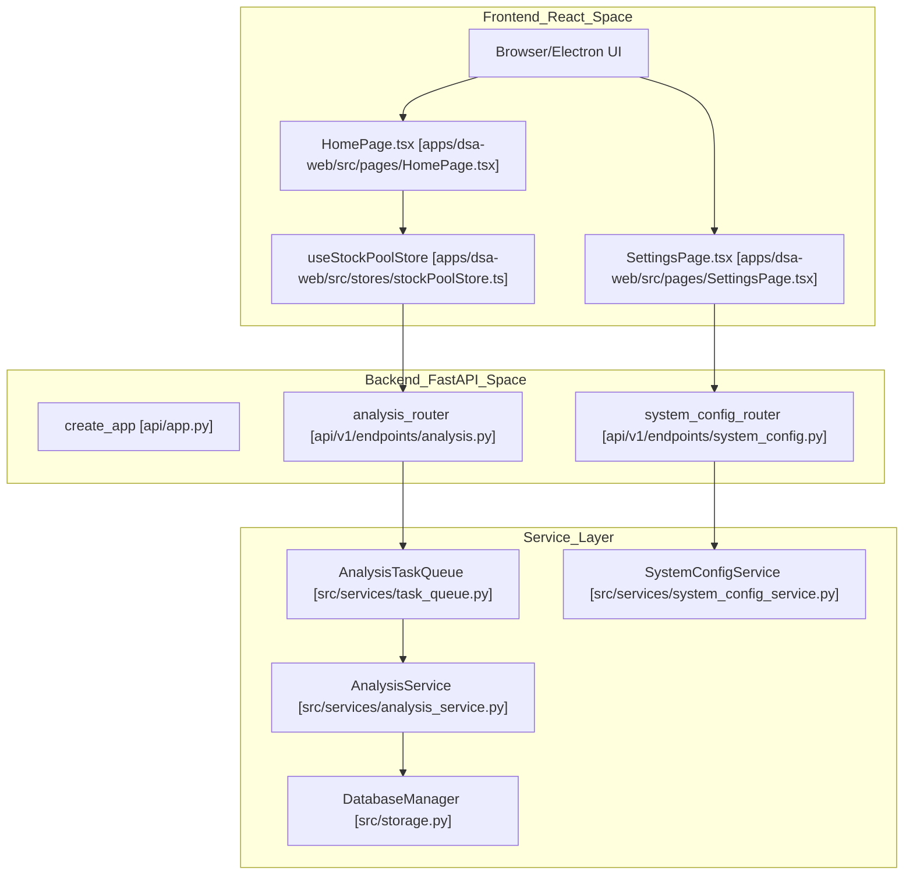
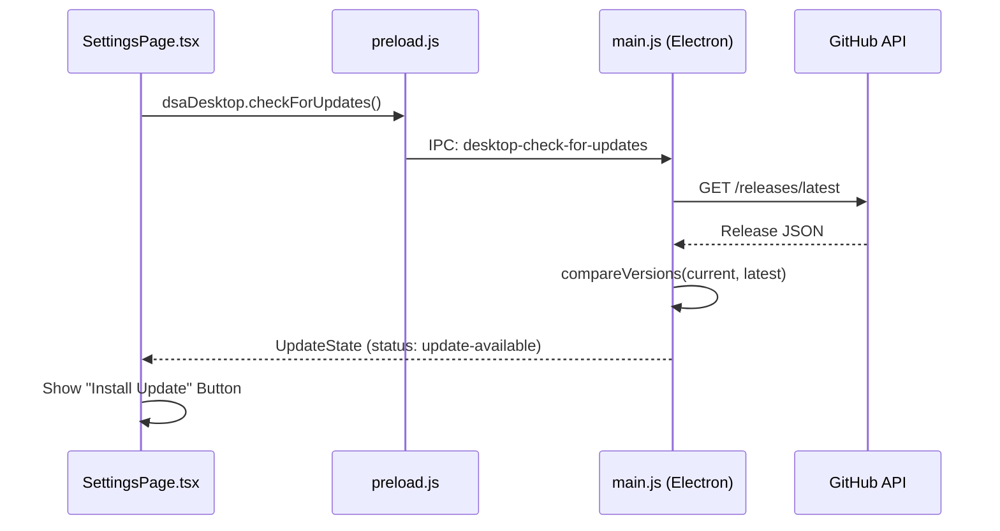

<!-- source: DeepWiki mcp.deepwiki.com · repo ZhuLinsen/daily_stock_analysis · page 6.2 Web UI (FastAPI + React) · fetched 2026-10-29 -->

# Web UI (FastAPI + React)

Relevant source files

The following files were used as context for generating this wiki page:

- [api/app.py](api/app.py)
- [api/middlewares/auth.py](api/middlewares/auth.py)
- [api/v1/endpoints/__init__.py](api/v1/endpoints/__init__.py)
- [api/v1/endpoints/alerts.py](api/v1/endpoints/alerts.py)
- [api/v1/endpoints/auth.py](api/v1/endpoints/auth.py)
- [api/v1/router.py](api/v1/router.py)
- [apps/dsa-desktop/installer.nsh](apps/dsa-desktop/installer.nsh)
- [apps/dsa-desktop/main.js](apps/dsa-desktop/main.js)
- [apps/dsa-desktop/preload.js](apps/dsa-desktop/preload.js)
- [apps/dsa-desktop/tests/main.test.js](apps/dsa-desktop/tests/main.test.js)
- [apps/dsa-desktop/tests/preload.test.js](apps/dsa-desktop/tests/preload.test.js)
- [apps/dsa-web/e2e/smoke.spec.ts](apps/dsa-web/e2e/smoke.spec.ts)
- [apps/dsa-web/src/api/auth.ts](apps/dsa-web/src/api/auth.ts)
- [apps/dsa-web/src/components/settings/SettingsCategoryNav.tsx](apps/dsa-web/src/components/settings/SettingsCategoryNav.tsx)
- [apps/dsa-web/src/components/settings/SettingsField.tsx](apps/dsa-web/src/components/settings/SettingsField.tsx)
- [apps/dsa-web/src/components/settings/SettingsSectionCard.tsx](apps/dsa-web/src/components/settings/SettingsSectionCard.tsx)
- [apps/dsa-web/src/components/settings/__tests__/SettingsField.test.tsx](apps/dsa-web/src/components/settings/__tests__/SettingsField.test.tsx)
- [apps/dsa-web/src/contexts/AuthContext.tsx](apps/dsa-web/src/contexts/AuthContext.tsx)
- [apps/dsa-web/src/contexts/__tests__/AuthContext.test.tsx](apps/dsa-web/src/contexts/__tests__/AuthContext.test.tsx)
- [apps/dsa-web/src/hooks/__tests__/useDashboardLifecycle.test.tsx](apps/dsa-web/src/hooks/__tests__/useDashboardLifecycle.test.tsx)
- [apps/dsa-web/src/hooks/useDashboardLifecycle.ts](apps/dsa-web/src/hooks/useDashboardLifecycle.ts)
- [apps/dsa-web/src/hooks/useHomeDashboardState.ts](apps/dsa-web/src/hooks/useHomeDashboardState.ts)
- [apps/dsa-web/src/index.css](apps/dsa-web/src/index.css)
- [apps/dsa-web/src/pages/HomePage.tsx](apps/dsa-web/src/pages/HomePage.tsx)
- [apps/dsa-web/src/pages/SettingsPage.tsx](apps/dsa-web/src/pages/SettingsPage.tsx)
- [apps/dsa-web/src/pages/__tests__/HomePage.test.tsx](apps/dsa-web/src/pages/__tests__/HomePage.test.tsx)
- [apps/dsa-web/src/pages/__tests__/SettingsPage.test.tsx](apps/dsa-web/src/pages/__tests__/SettingsPage.test.tsx)
- [apps/dsa-web/src/stores/__tests__/stockPoolStore.test.ts](apps/dsa-web/src/stores/__tests__/stockPoolStore.test.ts)
- [apps/dsa-web/src/stores/stockPoolStore.ts](apps/dsa-web/src/stores/stockPoolStore.ts)
- [apps/dsa-web/tests/system_config_i18n.test.ts](apps/dsa-web/tests/system_config_i18n.test.ts)
- [docs/desktop-package.md](docs/desktop-package.md)
- [src/auth.py](src/auth.py)
- [tests/test_api_health.py](tests/test_api_health.py)
- [tests/test_auth.py](tests/test_auth.py)
- [tests/test_auth_api.py](tests/test_auth_api.py)
- [tests/test_cwe345_xff_bypass.py](tests/test_cwe345_xff_bypass.py)
- [tests/test_desktop_installer_config.py](tests/test_desktop_installer_config.py)
- [tests/test_static_assets_consistency.py](tests/test_static_assets_consistency.py)

The Web UI provides a browser-based interface for managing stock analysis, triggering tasks, monitoring execution progress, viewing historical results, and managing system configurations. The system uses a FastAPI backend serving a React single-page application, with specialized support for the Electron desktop environment.

---

## System Architecture

The Web UI is structured as a decoupled frontend and backend system. The FastAPI server handles API requests and serves compiled React static assets from the `static/` directory.

### Component Interaction Diagram

**Sources:** [api/app.py:155-161](), [apps/dsa-web/src/pages/HomePage.tsx:46-138](), [apps/dsa-web/src/stores/stockPoolStore.ts:53-123](), [apps/dsa-web/src/pages/SettingsPage.tsx:1-24]()

---

## Analysis Management

### Analysis Workflow
The `HomePage` component orchestrates analysis via `useHomeDashboardState` and the `stockPoolStore` [apps/dsa-web/src/pages/HomePage.tsx:93-138](). It supports manual entry, autocomplete, and batch triggers.

- **Asynchronous Execution:** Analysis is submitted via `analyzeAsync` [apps/dsa-web/src/stores/stockPoolStore.ts:2](). The backend returns a `taskId` and places the request in the `AnalysisTaskQueue` [src/services/task_queue.py:125-136]().
- **Task Monitoring:** The `TaskPanel` displays real-time progress [apps/dsa-web/src/pages/HomePage.tsx:18](). The frontend uses `refreshActiveTasks` to poll or stream status updates [apps/dsa-web/src/stores/stockPoolStore.ts:118]().
- **Duplicate Prevention:** If a stock is already being analyzed, the store catches `DuplicateTaskError` and sets a `duplicateError` state to notify the user [apps/dsa-web/src/stores/stockPoolStore.ts:58](), [apps/dsa-web/src/pages/HomePage.tsx:152-167]().

### Image-to-Stock Extraction
The UI supports an "Intelligent Import" feature where users can paste text or provide data that is parsed into a standardized stock list [apps/dsa-web/src/pages/SettingsPage.tsx:15](). The utility `parseStockListValue` is used to normalize these inputs [apps/dsa-web/src/pages/SettingsPage.tsx:26]().

**Sources:** [apps/dsa-web/src/pages/HomePage.tsx:93-138](), [apps/dsa-web/src/stores/stockPoolStore.ts:2-58](), [apps/dsa-web/src/pages/SettingsPage.tsx:15-26]()

---

## System Configuration & Admin

The `SettingsPage` is the central hub for system management, including authentication, LLM provider setup, and notification testing.

### LLM Channel Editor
A critical feature is the `LLMChannelEditor`, which allows users to configure multiple AI backends (Gemini, OpenAI, DeepSeek, etc.) [apps/dsa-web/src/pages/SettingsPage.tsx:16](). 
- **Runtime Keys:** Certain keys like `LITELLM_MODEL` and `VISION_MODEL` are identified as runtime-critical [apps/dsa-web/src/pages/SettingsPage.tsx:90-96]().
- **Draft Management:** The editor maintains a "draft" state of configuration changes before they are persisted to the backend via `systemConfigApi.update` [apps/dsa-web/src/pages/SettingsPage.tsx:136-168]().

### Configuration Categories
Settings are organized into logical categories to improve UX:
- **Generation Backend:** Controls which AI models are used for analysis [apps/dsa-web/src/pages/SettingsPage.tsx:97-133]().
- **Notification:** Configures channels like Telegram, Feishu, and Email [apps/dsa-web/src/pages/SettingsPage.tsx:17]().
- **Auth:** Manages `ADMIN_AUTH_ENABLED` and password changes [apps/dsa-web/src/pages/SettingsPage.tsx:12-13]().

**Sources:** [apps/dsa-web/src/pages/SettingsPage.tsx:90-168](), [apps/dsa-web/src/components/settings/SettingsField.tsx:71-212]()

---

## Desktop Integration (Electron)

When running in the desktop application, the Web UI gains additional capabilities through a bridge provided in `preload.js`.

### Desktop Update Lifecycle

- **Version Management:** The desktop app uses semantic versioning comparison via `compareVersions` to determine if an update is required [apps/dsa-desktop/main.js:123-164]().
- **Portable Config:** In Windows portable mode, the `.env` and `stock_analysis.db` are co-located with the executable [docs/desktop-package.md:9](). The `SettingsPage` detects this environment and adjusts the UI accordingly [apps/dsa-web/src/pages/SettingsPage.tsx:39-48]().
- **Asset Consistency:** On startup, the FastAPI backend performs a self-check via `_check_frontend_assets_consistency` to ensure `index.html` references valid JS/CSS bundles, preventing "blank page" errors in packaged apps [api/app.py:65-102]().

**Sources:** [apps/dsa-desktop/main.js:123-164](), [docs/desktop-package.md:1-11](), [api/app.py:65-102](), [apps/dsa-web/src/pages/SettingsPage.tsx:39-64]()

---

## Data Flow: History & Trends

Historical analysis results are managed via the `historyApi` and displayed in the `StockHistoryTrendDrawer` [apps/dsa-web/src/pages/HomePage.tsx:13]().

1. **Initial Load:** `loadInitialHistory` fetches the most recent records [apps/dsa-web/src/stores/stockPoolStore.ts:99]().
2. **Trend View:** When a stock is selected, `openHistoryTrend` fetches a paginated list of previous analyses for that specific code to visualize sentiment trends [apps/dsa-web/src/stores/stockPoolStore.ts:95]().
3. **Markdown Rendering:** Full reports are rendered from Markdown using the `ReportMarkdownDrawer` [apps/dsa-web/src/pages/HomePage.tsx:14]().

**Sources:** [apps/dsa-web/src/stores/stockPoolStore.ts:95-106](), [apps/dsa-web/src/pages/HomePage.tsx:13-17](), [apps/dsa-web/src/stores/stockPoolStore.ts:186-213]()

---

