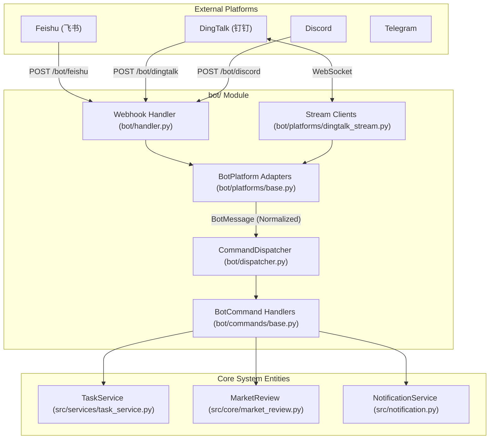
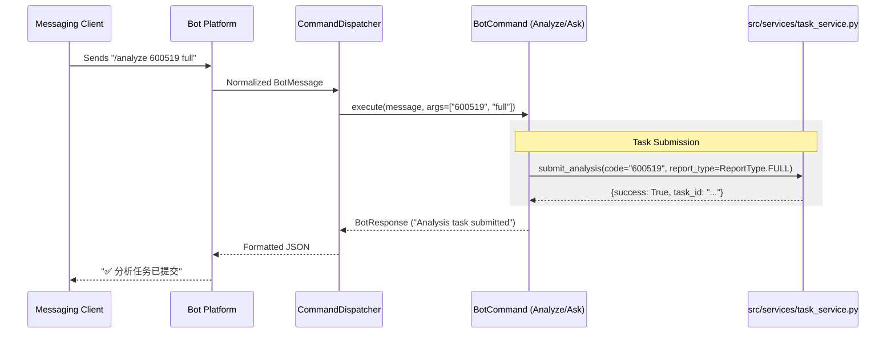

<!-- source: DeepWiki mcp.deepwiki.com · repo ZhuLinsen/daily_stock_analysis · page 6.3 Bot Integration · fetched 2026-10-29 -->

# Bot Integration

Relevant source files

The following files were used as context for generating this wiki page:

- [bot/__init__.py](bot/__init__.py)
- [bot/commands/__init__.py](bot/commands/__init__.py)
- [bot/commands/analyze.py](bot/commands/analyze.py)
- [bot/commands/ask.py](bot/commands/ask.py)
- [bot/commands/base.py](bot/commands/base.py)
- [bot/commands/chat.py](bot/commands/chat.py)
- [bot/commands/help.py](bot/commands/help.py)
- [bot/commands/market.py](bot/commands/market.py)
- [bot/commands/status.py](bot/commands/status.py)
- [bot/handler.py](bot/handler.py)
- [bot/platforms/base.py](bot/platforms/base.py)
- [bot/platforms/dingtalk_stream.py](bot/platforms/dingtalk_stream.py)
- [bot/platforms/discord.py](bot/platforms/discord.py)
- [docs/bot-command.md](docs/bot-command.md)
- [docs/bot-command_EN.md](docs/bot-command_EN.md)
- [docs/bot/discord-bot-config.md](docs/bot/discord-bot-config.md)
- [src/agent/skills/aggregator.py](src/agent/skills/aggregator.py)
- [src/agent/skills/router.py](src/agent/skills/router.py)
- [tests/test_ask_command.py](tests/test_ask_command.py)
- [tests/test_bot_status_command.py](tests/test_bot_status_command.py)
- [tests/test_skill_load_warning.py](tests/test_skill_load_warning.py)

## Purpose and Scope

This document explains how the stock analysis system integrates with messaging platform bots (Telegram, DingTalk, Feishu, Discord, WeChat Work) to enable interactive stock analysis through chat commands. Users can trigger analysis, query market data, and receive notifications via bot conversations. The system supports both **Webhook Mode** (push-based) and **Stream Mode** (WebSocket-based, no public IP required).

For notification-only functionality (one-way push without commands), see section 4.7 Notification Service.

---

## Supported Bot Platforms

The system provides a unified abstraction for multiple messaging platforms:

| Platform | Mode Support | Stream Mode | Webhook Mode | Configuration Keys |
|----------|-------------|-------------|--------------|-------------------|
| **DingTalk (钉钉)** | App Bot | ✅ | ✅ | `DINGTALK_APP_KEY`, `DINGTALK_APP_SECRET` [docs/bot-command.md:252-254]() |
| **Feishu (飞书)** | App Bot | ✅ | ✅ | `FEISHU_APP_ID`, `FEISHU_APP_SECRET` [docs/bot-command.md:247-248]() |
| **Discord** | Bot API / Webhook | ❌ | ✅ | `DISCORD_BOT_TOKEN`, `DISCORD_INTERACTIONS_PUBLIC_KEY` [bot/platforms/discord.py:33-38]() |
| **Telegram** | Bot API | ❌ | ✅ | `TELEGRAM_BOT_TOKEN`, `TELEGRAM_WEBHOOK_SECRET` [docs/bot-command.md:261-262]() |
| **WeChat Work** | App Bot | ❌ | ✅ | `WECOM_TOKEN`, `WECOM_ENCODING_AES_KEY` [docs/bot-command.md:257-258]() |

**Stream Mode vs Webhook Mode**:
- **Stream Mode**: Uses a WebSocket long connection to receive messages. It does not require a public IP or domain name, making it ideal for internal network deployments [bot/platforms/dingtalk_stream.py:9-13]().
- **Webhook Mode**: Requires the platform to send HTTP POST requests to a public endpoint on your server [docs/bot-command.md:225-235]().

Sources: [bot/platforms/dingtalk_stream.py:1-20](), [bot/platforms/discord.py:29-43](), [docs/bot-command.md:225-263]()

---

## System Architecture

The bot module follows a layered architecture to normalize platform-specific data into a unified format.

### Message Flow Architecture

### Data Normalization

The system uses two primary data structures to bridge the "Natural Language Space" (chat) to "Code Entity Space":

1.  **`BotMessage`**: A unified model containing platform, user ID, chat ID, and the text content [bot/models.py:75-86]().
2.  **`BotResponse`**: A unified response model containing text, markdown flags, and mention instructions [bot/models.py:88-93]().

Sources: [docs/bot-command.md:5-39](), [bot/models.py:71-93](), [bot/platforms/discord.py:173-189]()

---

## Implementation Details

### Platform Adapters (`BotPlatform`)

Every platform must implement the `BotPlatform` abstract base class [docs/bot-command.md:98-121](). 

- **Discord Implementation**: `DiscordPlatform` handles Ed25519 signature verification using `DISCORD_INTERACTIONS_PUBLIC_KEY` [bot/platforms/discord.py:45-112](). It parses Slash commands into `BotMessage` content [bot/platforms/discord.py:152-154]().
- **DingTalk Stream**: `DingtalkStreamHandler` converts SDK callbacks into `BotMessage` objects and handles reply logic using `reply_markdown` or `reply_text` [bot/platforms/dingtalk_stream.py:44-118]().

### Command Dispatcher (`CommandDispatcher`)

The `CommandDispatcher` routes messages to the correct logic [docs/bot-command.md:162-180]().

- **Command Parsing**: Extracts the command (e.g., `analyze`) and arguments using the `command_prefix` [bot/commands/help.py:65]().
- **Registration**: Commands register themselves and their aliases (e.g., `/a` for `/analyze`) [bot/commands/analyze.py:37-38]().

Sources: [bot/platforms/discord.py:29-189](), [bot/platforms/dingtalk_stream.py:44-190](), [docs/bot-command.md:98-180]()

---

## Bot Commands

The system supports several built-in commands. Each command inherits from `BotCommand` [docs/bot-command.md:126-157]().

| Command | Aliases | Description | Example |
|---------|---------|-------------|---------|
| `/ask` | `问股` | Analyze stock using specific Agent skills [bot/commands/ask.py:35-44]() | `/ask 600519 缠论` |
| `/analyze` | `a`, `分析`, `查` | Basic stock analysis (simple/full) [bot/commands/analyze.py:33-42]() | `/analyze 600519 full` |
| `/market` | `m`, `大盘`, `复盘` | Market overview analysis [bot/commands/market.py:35-44]() | `/market` |
| `/chat` | - | Multi-turn strategy chat [docs/bot-command_EN.md:158]() | `/chat` |
| `/research` | - | Deep research agent execution [docs/bot-command_EN.md:156]() | `/research 行业分析` |
| `/status` | `s`, `状态` | Show system health and AI status [bot/commands/status.py:30-39]() | `/status` |
| `/help` | `h`, `帮助`, `?` | Show available commands [bot/commands/help.py:29-42]() | `/help analyze` |

### Command Logic Flow

### Specialized Commands Detail

- **`/ask`**: Supports multi-stock analysis (up to 5 stocks) and skill selection via aliases [bot/commands/ask.py:104-122](). It merges code arguments like `AAPL vs TSLA` into a comma-separated list [bot/commands/ask.py:50-86]().
- **`/analyze`**: Triggers an asynchronous analysis task via `TaskService` [bot/commands/analyze.py:86-90](). Supports code validation for A-shares, HK, and US markets [bot/commands/analyze.py:53-65]().
- **`/market`**: Executes market review in a background thread to avoid blocking the bot response [bot/commands/market.py:57-61](). It checks for trading days before execution [bot/commands/market.py:96-113]().
- **`/status`**: Diagnoses AI availability across high-priority (LiteLLM YAML/Channels) and legacy (API Keys) sources [bot/commands/status.py:71-104]().

Sources: [bot/commands/analyze.py:21-107](), [bot/commands/ask.py:27-205](), [bot/commands/market.py:20-159](), [bot/commands/status.py:19-143]()

---

## Configuration

Bot integration is controlled by environment variables in the configuration system:

- `BOT_ENABLED`: Global toggle for bot features [docs/bot-command.md:243]().
- `BOT_COMMAND_PREFIX`: Character that triggers commands (default `/`) [docs/bot-command.md:244]().
- `DISCORD_BOT_TOKEN`: Token for Discord Bot API [docs/bot/discord-bot-config.md:54]().
- `DISCORD_INTERACTIONS_PUBLIC_KEY`: Used for validating Discord webhook signatures [bot/platforms/discord.py:36-38]().
- `DINGTALK_APP_KEY` / `DINGTALK_APP_SECRET`: Credentials for DingTalk Stream/Webhook modes [bot/platforms/dingtalk_stream.py:208-210]().

Sources: [docs/bot-command.md:241-263](), [docs/bot/discord-bot-config.md:48-62](), [bot/platforms/discord.py:32-39]()

---

