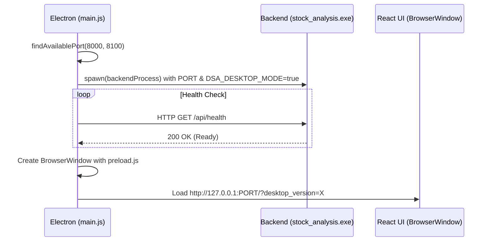
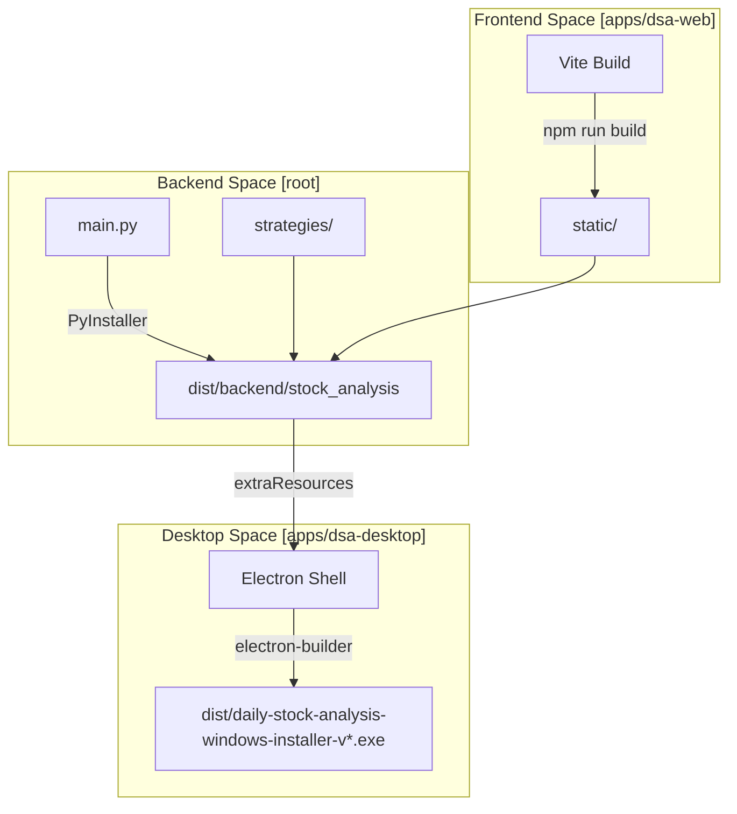

<!-- source: DeepWiki mcp.deepwiki.com · repo ZhuLinsen/daily_stock_analysis · page 6.4 Desktop Application · fetched 2026-10-29 -->

# Desktop Application

Relevant source files

The following files were used as context for generating this wiki page:

- [.github/scripts/build_release_notes.py](.github/scripts/build_release_notes.py)
- [.github/workflows/create-release.yml](.github/workflows/create-release.yml)
- [.github/workflows/desktop-release.yml](.github/workflows/desktop-release.yml)
- [apps/dsa-desktop/installer.nsh](apps/dsa-desktop/installer.nsh)
- [apps/dsa-desktop/main.js](apps/dsa-desktop/main.js)
- [apps/dsa-desktop/package-lock.json](apps/dsa-desktop/package-lock.json)
- [apps/dsa-desktop/package.json](apps/dsa-desktop/package.json)
- [apps/dsa-desktop/preload.js](apps/dsa-desktop/preload.js)
- [apps/dsa-desktop/tests/main.test.js](apps/dsa-desktop/tests/main.test.js)
- [apps/dsa-desktop/tests/preload.test.js](apps/dsa-desktop/tests/preload.test.js)
- [apps/dsa-web/src/pages/SettingsPage.tsx](apps/dsa-web/src/pages/SettingsPage.tsx)
- [apps/dsa-web/src/pages/__tests__/SettingsPage.test.tsx](apps/dsa-web/src/pages/__tests__/SettingsPage.test.tsx)
- [docs/desktop-package.md](docs/desktop-package.md)
- [scripts/build-backend-macos.sh](scripts/build-backend-macos.sh)
- [scripts/build-backend.ps1](scripts/build-backend.ps1)
- [scripts/build-desktop-macos.sh](scripts/build-desktop-macos.sh)
- [scripts/build-desktop.ps1](scripts/build-desktop.ps1)
- [scripts/verify-desktop-updater-artifacts.ps1](scripts/verify-desktop-updater-artifacts.ps1)
- [tests/test_agent_frozen_context.py](tests/test_agent_frozen_context.py)
- [tests/test_build_release_notes.py](tests/test_build_release_notes.py)
- [tests/test_desktop_installer_config.py](tests/test_desktop_installer_config.py)
- [tests/test_history_loader.py](tests/test_history_loader.py)
- [tests/test_packaging_build_scripts.py](tests/test_packaging_build_scripts.py)

The Daily Stock Analysis (DSA) desktop application (`dsa-desktop`) is a cross-platform distribution of the system built using **Electron**. It encapsulates the React-based Web UI and the FastAPI backend into a single executable, providing a "portable mode" experience where user configurations, databases, and logs are co-located with the application.

## System Architecture

The desktop application operates as a hybrid shell that manages the lifecycle of the Python backend and the frontend presentation.

### Architecture Components
1.  **Electron Shell (`main.js`)**: Acts as the orchestrator. It is responsible for finding an available port (range 8000-8100), spawning the backend process, monitoring health, and creating the browser window [apps/dsa-desktop/main.js:10-23](), [apps/dsa-desktop/main.js:281-340]().
2.  **FastAPI Backend**: Packaged via **PyInstaller** into a standalone executable (`stock_analysis.exe`). It hosts the API and serves the static React assets [scripts/build-backend.ps1:117-130]().
3.  **React UI**: Built as static assets via Vite and embedded within the backend's `static/` directory [scripts/build-backend.ps1:3-9]().

### Process Startup Sequence

Title: Desktop Startup and Health Check Flow

Sources: [apps/dsa-desktop/main.js:281-340](), [apps/dsa-desktop/main.js:525-580](), [apps/dsa-desktop/main.js:630-680](), [docs/desktop-package.md:5-10]()

## Portable Mode & Data Flow

The application is designed for portability. On Windows, it prioritizes the application directory for data persistence to ensure that moving the folder preserves the user's state.

### File Locations
-   **Configuration**: `.env` is copied from `.env.example` on the first run and stored next to the main executable on Windows [apps/dsa-desktop/main.js:90-105](), [docs/desktop-package.md:241-245]().
-   **Database**: `data/stock_analysis.db` is stored in the application directory on Windows and in the Electron user data directory on macOS [apps/dsa-desktop/main.js:50-60](), [docs/desktop-package.md:241-245]().
-   **Logs**: `logs/desktop.log` captures Electron-level events, while backend logs are handled by the spawned process [apps/dsa-desktop/main.js:59]().

### Directory Structure (Windows Unpacked)
| Path | Description |
| :--- | :--- |
| `Daily Stock Analysis.exe` | Main Electron entry point [docs/desktop-package.md:227]() |
| `.env` | User-specific API keys and stock lists [docs/desktop-package.md:228]() |
| `data/` | SQLite database and AlphaSift hotspots [docs/desktop-package.md:229-232]() |
| `logs/` | Runtime logs for troubleshooting [docs/desktop-package.md:233-234]() |
| `resources/backend/` | Contains the PyInstaller-packaged FastAPI service [docs/desktop-package.md:237-238]() |

Sources: [docs/desktop-package.md:223-240](), [apps/dsa-desktop/main.js:50-60]()

## Build Process

The build process is multi-staged, requiring synchronization between Node.js and Python environments.

### Backend Packaging (PyInstaller)
The backend is bundled using `scripts/build-backend.ps1` (Windows) or `scripts/build-backend-macos.sh` (macOS). Key configurations include:
-   **Hidden Imports**: Explicitly includes `multipart`, `tiktoken`, `json_repair`, and internal `api.*` modules [scripts/build-backend.ps1:72-114]().
-   **Data Collection**: Bundles `litellm` and `tiktoken` data files and the entire `alphasift` package [scripts/build-backend.ps1:117-128]().
-   **Verification**: The script verifies that the packaged executable can successfully import `alphasift.dsa_adapter` before completing [scripts/build-backend.ps1:144-162]().

### Desktop Packaging (Electron Builder)
The `apps/dsa-desktop/package.json` defines the `electron-builder` configuration:
-   **Extra Resources**: Copies the `.env.example` and the built backend artifact into the Electron `resources` folder [apps/dsa-desktop/package.json:29-38]().
-   **NSIS Installer**: Configured for per-user installation (`allowElevation: false`) and allows changing the installation directory [apps/dsa-desktop/package.json:39-55]().

### Build Pipeline Entity Mapping

Title: Build Pipeline Entity Mapping

Sources: [scripts/build-backend.ps1:3-136](), [apps/dsa-desktop/package.json:18-59](), [docs/desktop-package.md:49-61]()

## Auto-Update Mechanism

The application features an integrated auto-update system using `electron-updater` and GitHub Releases.

### Update Workflow
1.  **Check**: Electron checks the GitHub Release API for a newer version [apps/dsa-desktop/main.js:31](), [apps/dsa-desktop/main.js:705-750]().
2.  **Download**: If an update is found and the user is on an NSIS installation, it downloads the `.exe` and `.blockmap` files [apps/dsa-desktop/main.js:755-780]().
3.  **Backup & Install**: Before installing, the app stops the backend and creates a backup of runtime files (`.env`, database) in `.dsa-desktop-update-backup` to prevent data loss during the silent installation [apps/dsa-desktop/main.js:33-34](), [apps/dsa-desktop/main.js:800-850]().
4.  **UI Integration**: Users can monitor update status and trigger installations from the **SettingsPage** [apps/dsa-web/src/pages/SettingsPage.tsx:40-80]().

Sources: [apps/dsa-desktop/main.js:62-76](), [apps/dsa-desktop/main.js:705-850](), [docs/desktop-package.md:73-74]()

## Platform Specifics

### Windows
The Windows installer uses an NSIS script (`installer.nsh`) to prevent installation into system-protected directories like `C:\Program Files`. This ensures the application has write access to its own directory for the `.env` and SQLite database without requiring administrative privileges [docs/desktop-package.md:61]().

### macOS
On macOS, the application is distributed as a DMG. Due to the read-only nature of DMG mounts, runtime files (`.env`, `data/`, `logs/`) are stored in the Electron user data directory (`~/Library/Application Support/daily-stock-analysis-desktop/`) [docs/desktop-package.md:243-245]().

## Release Workflow
The system utilizes GitHub Actions (`.github/workflows/desktop-release.yml`) to automate distribution:
1.  **Trigger**: Pushing a semantic version tag (e.g., `v3.21.0`) or manual dispatch [ .github/workflows/desktop-release.yml:3-12]().
2.  **Artifacts**: Generates Windows installers, Windows no-install ZIPs, and macOS DMG files for both Intel and Apple Silicon [ .github/workflows/desktop-release.yml:70-125](), [ .github/workflows/desktop-release.yml:180-230]().
3.  **Verification**: The workflow validates that `latest.yml` version and installer paths match the release tag before uploading [ .github/workflows/desktop-release.yml:93-118]().

Sources: [docs/desktop-package.md:64-76](), [ .github/workflows/desktop-release.yml:1-230]()

---

