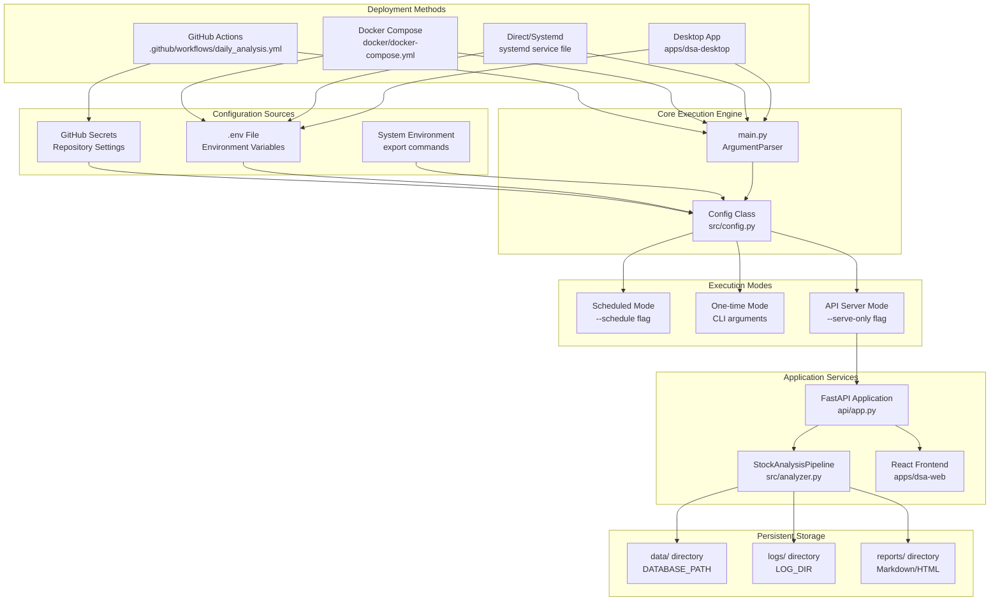
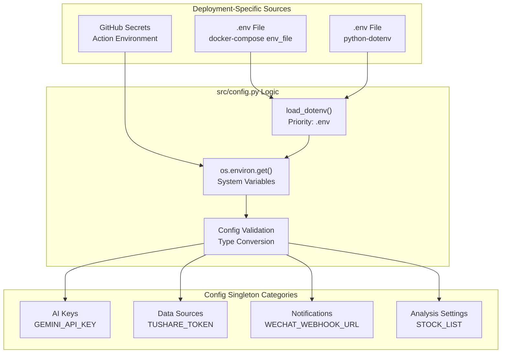
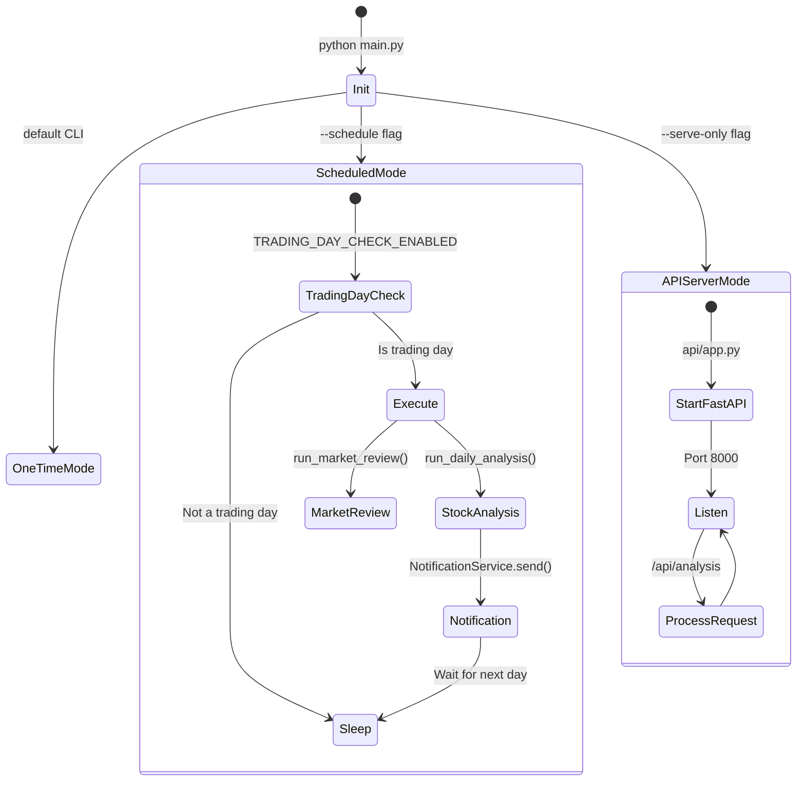

<!-- source: DeepWiki mcp.deepwiki.com · repo ZhuLinsen/daily_stock_analysis · page 7 Deployment Guide · fetched 2026-10-29 -->

# Deployment Guide

Relevant source files

The following files were used as context for generating this wiki page:

- [.dockerignore](.dockerignore)
- [.github/FUNDING.yml](.github/FUNDING.yml)
- [.github/ISSUE_TEMPLATE/bug_report.md](.github/ISSUE_TEMPLATE/bug_report.md)
- [.github/ISSUE_TEMPLATE/config.yml](.github/ISSUE_TEMPLATE/config.yml)
- [.github/ISSUE_TEMPLATE/feature_request.md](.github/ISSUE_TEMPLATE/feature_request.md)
- [.github/workflows/ci.yml](.github/workflows/ci.yml)
- [docker/Dockerfile](docker/Dockerfile)
- [docker/docker-compose.yml](docker/docker-compose.yml)
- [docs/DEPLOY.md](docs/DEPLOY.md)
- [docs/DEPLOY_EN.md](docs/DEPLOY_EN.md)
- [docs/docker/zeabur-deployment.md](docs/docker/zeabur-deployment.md)

## Purpose and Scope

This guide provides comprehensive instructions for deploying the A股/港股/美股智能分析系统 (Intelligent Stock Analysis System) in production environments. It covers four primary deployment methods: **GitHub Actions** (serverless), **Docker Compose** (containerized), **Direct/Systemd** (bare metal), and **Desktop Application** (Electron-based). All methods converge on the same execution engine (`main.py`) but differ in infrastructure management and operational characteristics.

For detailed configuration of individual components:
- AI models, data sources, and search engines: See [Configuration Reference](#2.2)
- Notification channels: See [Notification Channels](#8)
- Command-line interface options: See [Command Line Interface](#6.1)
- Web UI setup: See [Web UI (FastAPI + React)](#6.2)

---

## Deployment Architecture Overview

All deployment methods share the same core architecture, differing only in how they manage the execution environment and trigger mechanisms.

Title: Deployment Architecture and Code Mapping

**Key Insights:**

- **Single Entry Point**: All deployment methods invoke `main.py` as the primary entry point [main.py:1-250]().
- **Configuration Convergence**: The system normalizes configuration from different sources like GitHub Secrets, `.env` files, and system environment variables via the `Config` singleton [src/config.py:1-100]().
- **Mode Selection**: Execution mode is determined by command-line flags such as `--schedule`, `--serve-only`, or `--webui` parsed in `main.py` [main.py:50-150]().
- **Shared Storage**: All methods require persistent directories (`data/`, `logs/`, `reports/`) for state management, which are mapped as volumes in Docker [docker/docker-compose.yml:24-27]() and defined by environment variables [docker/Dockerfile:78-80]().

**Sources:** [docker/docker-compose.yml:1-73](), [main.py:1-150](), [docs/DEPLOY.md:1-15](), [docker/Dockerfile:1-101]()

---

## Deployment Method Comparison

The following table compares the four supported deployment methods across key operational dimensions:

| Dimension | GitHub Actions | Docker Compose ⭐ | Direct/Systemd | Desktop App |
|-----------|---------------|----------------|----------------|-------------|
| **Infrastructure** | Zero-cost serverless | Requires Docker daemon | Python 3.11+ runtime | Windows/macOS |
| **Initial Setup** | 5 mins (fork + secrets) | 10 mins (Docker + .env) | 15 mins (venv) | 2 mins (Installer) |
| **Configuration** | GitHub Secrets | `.env` file | `.env` / System Env | Built-in Settings UI |
| **Persistence** | Artifacts (stateless) | Persistent volumes | Host filesystem | Local app data |
| **API Server** | ❌ No | ✅ Yes (`server` service) | ✅ Yes (systemd unit) | ✅ Yes (embedded) |
| **Upgrade Path** | `git pull` | `docker-compose build` | `git pull` + restart | Download new version |
| **Best For** | Free automation | **Recommended**: Server | Advanced Linux users | Desktop/GUI users |

**Decision Matrix:**

- **Choose GitHub Actions** if: You want zero infrastructure management and don't need a real-time Web UI [docs/DEPLOY.md:7-14]().
- **Choose Docker Compose** if: You want a production-grade deployment with easy migration and the full Web UI experience [docs/DEPLOY.md:18-58]().
- **Choose Direct/Systemd** if: You need maximum control over the runtime environment or are running on a resource-constrained system [docs/DEPLOY.md:159-187]().
- **Choose Desktop App** if: You prefer a local application interface without managing servers or command lines.

**Sources:** [docker/docker-compose.yml:10-73](), [docs/DEPLOY.md:5-15](), [docs/DEPLOY.md:18-58](), [docs/DEPLOY.md:159-187]()

---

## Configuration Management Architecture

The system uses a layered configuration strategy where deployment-specific sources are normalized by the `Config` singleton:

Title: Configuration Loading Flow

**Configuration Priority (Highest to Lowest):**

1. **Environment Variables**: Set via `export` or `docker-compose.yml` environment section [docker/docker-compose.yml:35-44]().
2. **`.env` File**: Loaded from the project root via `env_file` in Compose [docker/docker-compose.yml:21-22]().

**Critical Configuration Points:**

- **AI Keys**: `GEMINI_API_KEY` or `ANSPIRE_API_KEYS` is the primary requirement for analysis [docs/DEPLOY.md:211-215]().
- **Stock List**: `STOCK_LIST` defines which tickers to analyze (comma-separated) [docs/DEPLOY.md:216]().
- **Notifications**: At least one channel must be configured for reports [docs/DEPLOY.md:217]().

**Sources:** [src/config.py:1-100](), [docker/docker-compose.yml:19-27](), [docs/DEPLOY.md:209-232]()

---

## Execution Mode Lifecycle

The system supports different execution lifecycles depending on the deployment configuration:

Title: System Lifecycle States

**Mode Selection Logic:**

| Mode | Trigger | Typical Deployment |
|------|---------|-------------------|
| **Scheduled** | `--schedule` | Docker `analyzer` service, Systemd [docker/docker-compose.yml:60-63]() |
| **API Server** | `--serve-only` | Docker `server` service [docker/docker-compose.yml:66-72]() |
| **One-time** | Manual execution | CLI testing, Manual run in Docker [docs/DEPLOY.md:139-140]() |

**Docker Compose Service Mapping:**

- **`analyzer` service**: Runs the system in scheduled mode, checking for trading days and executing at the configured time [docker/docker-compose.yml:60-63]().
- **`server` service**: Launches the FastAPI backend to serve the React Web UI on port 8000 [docker/docker-compose.yml:66-72]().

**Sources:** [main.py:50-200](), [docker/docker-compose.yml:59-73](), [docker/Dockerfile:100-101](), [docs/DEPLOY.md:138-153]()

---

## Critical Deployment Considerations

### Resource Requirements
- **CPU/RAM**: The system recommends `1G` RAM for standard analysis. `512M` is the minimum for lightweight scenarios with `MAX_WORKERS=1` [docs/DEPLOY.md:62-71]().
- **Storage**: Persistent storage is required for the SQLite database (`/app/data`), logs (`/app/logs`), and generated reports (`/app/reports`) [docker/docker-compose.yml:24-27]().
- **Dependencies**: System-level dependencies like `wkhtmltopdf` are required for generating image-based reports [docker/Dockerfile:28-39]().

### Network and Proxy Configuration
If deploying in a region with restricted access to AI APIs (like Gemini):
- **Docker**: Configure `http_proxy` and `https_proxy` in the `environment` section of `docker-compose.yml` [docs/DEPLOY.md:238-245]().
- **Direct**: Set environment variables before running `main.py` [docs/DEPLOY.md:247-253]().

### Health Monitoring
- **FastAPI Health**: The Docker image includes a health check that queries `/api/health` or `/health` [docker/Dockerfile:91-94]().
- **Logs**: Logs are stored in the `logs/` directory and can be followed using `docker-compose logs -f` [docs/DEPLOY.md:259-267]().

### WebUI Asset Preparation
The system includes a multi-stage Docker build to ensure the React frontend is built and bundled into the final image [docker/Dockerfile:8-17]().
- **Docker**: Assets are copied from the `web-builder` stage to the final `/app/static/` directory [docker/Dockerfile:58]().
- **Permissions**: The entrypoint script repairs permissions for the non-root `dsa` user [docker/Dockerfile:96-98]().

**Sources:** [docker/docker-compose.yml:52-58](), [docker/Dockerfile:28-44](), [docker/Dockerfile:88-94](), [docs/DEPLOY.md:62-71](), [docs/DEPLOY.md:234-255]()

---

## Next Steps

For detailed deployment instructions, navigate to the child pages:

- **[Deployment Overview](#7.1)** — Detailed pros/cons and scenario-based recommendations.
- **[GitHub Actions Deployment](#7.2)** — How to set up the free, serverless automation.
- **[Docker Compose Deployment](#7.3)** — Best practices for containerized production setup.
- **[Direct & Systemd Deployment](#7.4)** — Running on bare metal Linux servers.
- **[Environment Variables Guide](#7.5)** — Exhaustive list of all configuration keys.
- **[Execution Modes](#7.6)** — Deep dive into scheduled vs. on-demand execution.

**Sources:** [docs/DEPLOY.md:1-330](), [docker/docker-compose.yml:1-73]()

---

