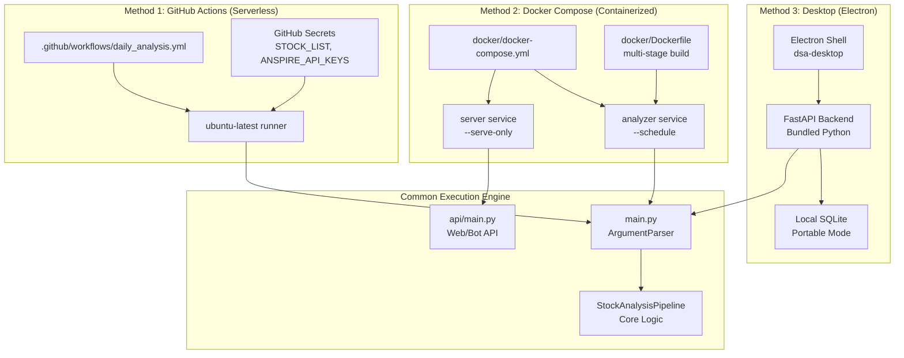
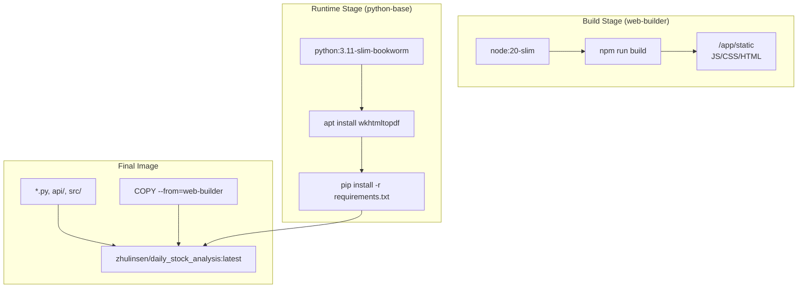
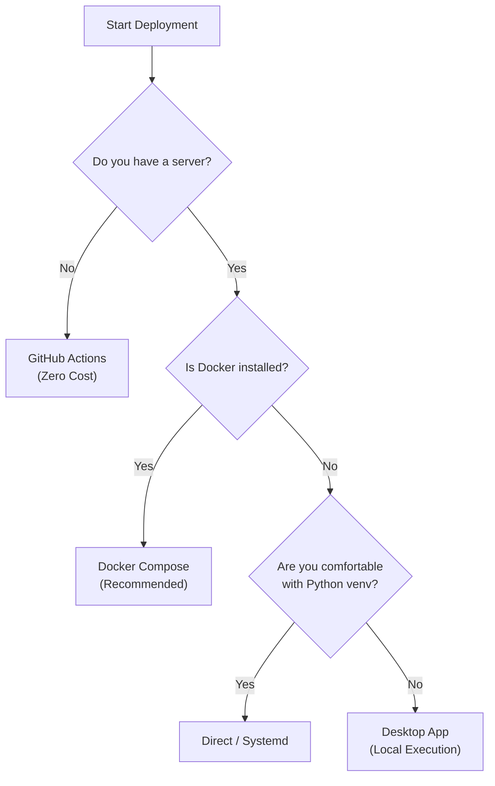

<!-- source: DeepWiki mcp.deepwiki.com · repo ZhuLinsen/daily_stock_analysis · page 7.1 Deployment Overview · fetched 2026-10-29 -->

# Deployment Overview

Relevant source files

The following files were used as context for generating this wiki page:

- [README.md](README.md)
- [docker/docker-compose.yml](docker/docker-compose.yml)
- [docs/DEPLOY.md](docs/DEPLOY.md)
- [docs/DEPLOY_EN.md](docs/DEPLOY_EN.md)
- [docs/README_CHT.md](docs/README_CHT.md)
- [docs/README_EN.md](docs/README_EN.md)
- [docs/docker/zeabur-deployment.md](docs/docker/zeabur-deployment.md)

This document compares the primary deployment methods for the stock analysis system: GitHub Actions, Docker Compose, Direct/Systemd, and the Desktop application. It provides technical guidance on selecting the appropriate method based on infrastructure requirements, operational characteristics, and data flow needs.

For step-by-step deployment instructions, see:
- GitHub Actions deployment: [7.2]()
- Docker Compose deployment: [7.3]()
- Direct and Systemd deployment: [7.4]()
- Desktop Application: [6.4]()

---

## Deployment Architecture Overview

The system supports four distinct deployment methods. While they all converge on the same core execution engine (`main.py`), they differ significantly in how they handle environment isolation, persistence, and user interaction.

### Deployment Convergence Diagram

**Deployment Architecture Diagram**: Shows how different entry points (Workflows, Containers, Electron) converge on the `main.py` orchestrator and `StockAnalysisPipeline`.

**Sources**: [docker/docker-compose.yml:10-73](), [README.md:65-151](), [docs/DEPLOY.md:5-15](), [docs/docker/zeabur-deployment.md:80-102]()

---

## Deployment Method Comparison

| Deployment Method | Infrastructure | Setup Time | Cost | Persistence | Best For |
|-------------------|---------------|------------|------|-------------|----------|
| **GitHub Actions** | None | 5 mins | Free | Ephemeral | Individual users, zero cost |
| **Docker Compose** ⭐ | Docker Host | 10 mins | Server Cost | Volumes | **Recommended**: Servers/NAS/Cloud |
| **Direct/Systemd** | Linux Server | 20 mins | Server Cost | Filesystem | Maximum control, bare metal |
| **Desktop App** | PC/Mac | 2 mins | Local | Local Disk | Non-technical users, local UI |

**Sources**: [docs/DEPLOY.md:5-14](), [README.md:65-152](), [docs/DEPLOY_EN.md:5-14]()

---

## Deployment Method 1: GitHub Actions (Serverless)

GitHub Actions provides a zero-cost, serverless execution environment. The system uses repository secrets to inject configuration into the runner environment.

**Key Technical Details:**
- **Execution**: Triggered by `cron` schedules (default 18:00 UTC+8) or manual `workflow_dispatch` [README.md:144-151]().
- **Environment**: Standard `ubuntu-latest` runner.
- **Persistence**: No long-term state on the runner. Reports are sent via notification channels (Telegram, Discord, etc.) or saved as job artifacts [README.md:93-104]().
- **Configuration**: Managed via `Settings` -> `Secrets and variables` -> `Actions` [README.md:74-77]().

**Sources**: [README.md:65-151](), [docs/DEPLOY.md:209-232]()

---

## Deployment Method 2: Docker Compose (Containerized)

The Docker deployment uses a multi-stage build to optimize the final image size and separate frontend compilation from the runtime environment.

### Docker Build & Runtime Flow

**Docker Build Pipeline**: Illustrates the multi-stage build process where the React frontend is built in a Node environment and then copied into the Python runtime.

### Service Orchestration
The `docker-compose.yml` defines two primary services:
1.  **analyzer**: Runs with default entrypoint (typically `--schedule`) to perform periodic analysis [docker/docker-compose.yml:61-63]().
2.  **server**: Runs with `--serve-only` to provide the FastAPI WebUI and Bot API [docker/docker-compose.yml:66-69]().

**Resource Management**: Default limits are set to `1G` memory with `512M` reservation. For high-load scenarios (Market Review + News Expansion), `2G+` is recommended [docker/docker-compose.yml:52-57](), [docs/DEPLOY.md:62-71]().

**Sources**: [docker/docker-compose.yml:10-73](), [docs/DEPLOY.md:18-106](), [docs/docker/zeabur-deployment.md:68-77]()

---

## Deployment Method 3: Direct & Systemd (Bare Metal)

Direct deployment is suitable for users who prefer managing a Python virtual environment (`venv`) manually.

**Systemd Integration**:
The system is managed as a unit file for auto-start and crash recovery [docs/DEPLOY.md:159-186]().
- **Working Directory**: `/opt/stock-analyzer` [docs/DEPLOY.md:178]().
- **ExecStart**: Points to the `python` binary inside the `venv` with the `--schedule` flag [docs/DEPLOY.md:180]().
- **Restart**: Configured to `always` with a 30s delay [docs/DEPLOY.md:181-182]().

**Sources**: [docs/DEPLOY.md:108-153](), [docs/DEPLOY.md:159-205]()

---

## Deployment Method 4: Desktop Application

The Desktop application wraps the system into an Electron shell, making it portable and easy to use on Windows and macOS.

**Technical Architecture**:
- **Backend**: A bundled FastAPI server running locally on `127.0.0.1`.
- **Frontend**: React-based UI communicating with the local backend.
- **Portable Mode**: The application co-locates the `.env` file and the SQLite database (`data/stock_analysis.db`) with the executable for easy migration.
- **Asset Handling**: The system checks for `static/` directory presence to serve the WebUI. If assets are missing, it triggers a warning to prevent "bare HTML" rendering [docs/DEPLOY.md:325-340]().

**Sources**: [README.md:45-48](), [docs/DEPLOY.md:325-345](), [docs/docker/zeabur-deployment.md:60-67]()

---

## Decision Matrix: Selecting a Deployment Method

**Selection Logic**: Guide for choosing the deployment strategy based on technical constraints and infrastructure availability.

**Sources**: [docs/DEPLOY.md:5-14](), [docs/DEPLOY_EN.md:5-14]()

---

