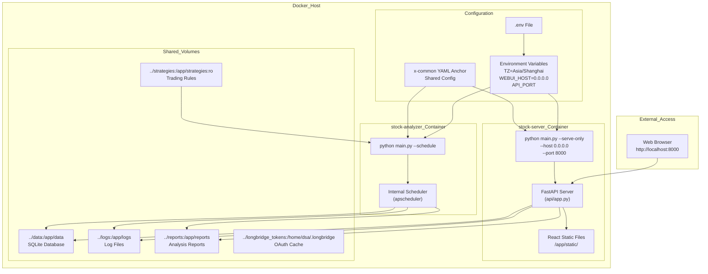
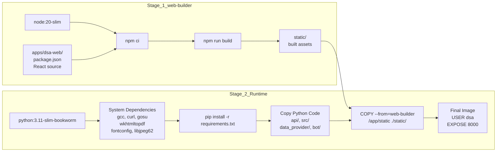
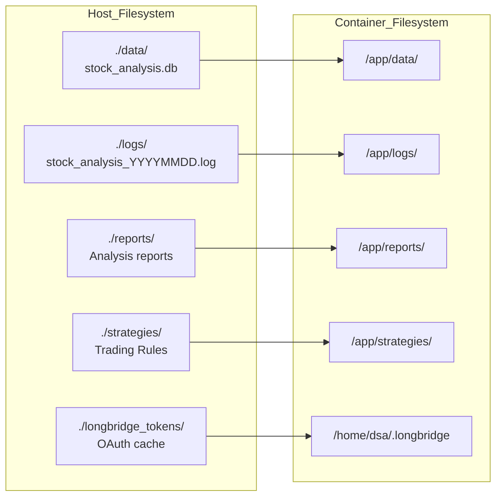

<!-- source: DeepWiki mcp.deepwiki.com · repo ZhuLinsen/daily_stock_analysis · page 7.3 Docker Compose Deployment · fetched 2026-10-29 -->

# Docker Compose Deployment

<details>
<summary>Relevant source files</summary>

The following files were used as context for generating this wiki page:

- [.dockerignore](.dockerignore)
- [.github/FUNDING.yml](.github/FUNDING.yml)
- [.github/ISSUE_TEMPLATE/bug_report.md](.github/ISSUE_TEMPLATE/bug_report.md)
- [.github/ISSUE_TEMPLATE/config.yml](.github/ISSUE_TEMPLATE/config.yml)
- [.github/ISSUE_TEMPLATE/feature_request.md](.github/ISSUE_TEMPLATE/feature_request.md)
- [.github/workflows/ci.yml](.github/workflows/ci.yml)
- [docker/Dockerfile](docker/Dockerfile)
- [docker/docker-compose.yml](docker/docker-compose.yml)
- [docs/DEPLOY.md](docs/DEPLOY.md)
- [docs/DEPLOY_EN.md](docs/DEPLOY_EN.md)
- [docs/docker/zeabur-deployment.md](docs/docker/zeabur-deployment.md)

</details>


This document covers deploying the stock analysis system using Docker Compose, which provides containerized execution with two primary service modes: scheduled analysis (`analyzer`) and web API (`server`). For comparison with other deployment methods, see [Deployment Overview](). For environment variable configuration details, see [Environment Variables Guide]().

---

## Overview

The Docker Compose deployment utilizes a multi-stage build process that compiles the React frontend during the image build and provides two service modes that share the same base configuration but run different commands.

**Key Files:**
- [docker/docker-compose.yml:10-73]() - Service definitions with YAML anchor for shared configuration.
- [docker/Dockerfile:1-101]() - Multi-stage build with Node.js frontend builder and Python runtime.
- `.env.example` - Environment variable template.

**Two Service Modes:**

| Service | Container Name | Command | Purpose | Port |
|---------|---------------|---------|---------|------|
| `analyzer` | `stock-analyzer` | `python main.py --schedule` | Scheduled daily analysis (Default) | - |
| `server` | `stock-server` | `python main.py --serve-only --host 0.0.0.0 --port ${API_PORT:-8000}` | FastAPI web interface + API | 8000 |

Sources: [docker/docker-compose.yml:59-73](), [docs/DEPLOY.md:7-14](), [docker/Dockerfile:101]()

---

## Docker Compose Service Architecture

Title: Docker Compose Service Interaction


**Architecture Notes:**
- Both services use the `x-common` YAML anchor for DRY configuration [docker/docker-compose.yml:13-58]().
- Services share volumes for data persistence but run independently [docker/docker-compose.yml:24-33]().
- `analyzer` runs the internal scheduler; `server` exposes the HTTP API [docker/docker-compose.yml:61-69]().
- Environment variable `API_PORT` defaults to 8000 if not specified in `.env` [docker/docker-compose.yml:69-72]().

Sources: [docker/docker-compose.yml:10-73](), [docker/Dockerfile:81-86]()

---

## Multi-Stage Dockerfile Build Process

The Dockerfile uses a two-stage build to separate frontend compilation from runtime execution.

Title: Multi-Stage Build Pipeline


**Build Stages:**

1. **web-builder** [docker/Dockerfile:8-16]():
   - Base: `node:20-slim`.
   - Runs `npm ci` [docker/Dockerfile:13]() and `npm run build` [docker/Dockerfile:16]() in `apps/dsa-web/`.
   - Outputs compiled React app to `/app/static`.

2. **Runtime** [docker/Dockerfile:19-101]():
   - Base: `python:3.11-slim-bookworm` (pinned to ensure `wkhtmltopdf` availability) [docker/Dockerfile:19]().
   - Installs system dependencies including `wkhtmltopdf` for Markdown-to-image conversion and `gosu` for privilege dropping [docker/Dockerfile:28-39]().
   - Creates a non-root user `dsa` (UID 1000) for security [docker/Dockerfile:42-43]().
   - Copies built static files from the builder stage [docker/Dockerfile:58]().
   - Uses a custom `docker-entrypoint.sh` to fix volume permissions before dropping privileges [docker/Dockerfile:98]().

**Health Check Configuration:**

The Dockerfile includes a health check to monitor service availability [docker/Dockerfile:92-94]():
- Interval: 30s.
- Command: `curl -f http://localhost:8000/api/health || curl -f http://localhost:8000/health || python -c "import sys; sys.exit(0)"`.

Sources: [docker/Dockerfile:1-101](), [docs/docker/zeabur-deployment.md:209-221]()

---

## YAML Anchor Configuration Pattern

The `docker-compose.yml` uses YAML anchors (`x-common`) to share common service configurations [docker/docker-compose.yml:13-58]().

**Shared Configuration:**

| Property | Value | Purpose |
|----------|-------|---------|
| `build.context` | `..` | Root directory for build context [docker/docker-compose.yml:15](). |
| `build.dockerfile` | `docker/Dockerfile` | Path to the multi-stage Dockerfile [docker/docker-compose.yml:16](). |
| `restart` | `unless-stopped` | Policy to ensure services stay up [docker/docker-compose.yml:17](). |
| `env_file` | `../.env` | Loads host-side environment variables [docker/docker-compose.yml:21-22](). |
| `environment.TZ` | `Asia/Shanghai` | Sets timezone for scheduled tasks [docker/docker-compose.yml:36](). |
| `volumes` | `data/`, `logs/`, `reports/`, `strategies/`, `longbridge_tokens/` | Persistent storage mapping [docker/docker-compose.yml:24-31](). |
| `deploy.resources` | 1G Limit / 512M Res | Memory constraints for stability [docker/docker-compose.yml:52-57](). |

**Service-Specific Overrides:**

- **analyzer** [docker/docker-compose.yml:61-63](): Inherits all common settings and uses the default Dockerfile command (`--schedule`).
- **server** [docker/docker-compose.yml:66-72](): Overrides the command to `--serve-only` [docker/docker-compose.yml:69]() and maps the `API_PORT` from host to container [docker/docker-compose.yml:71-72]().

Sources: [docker/docker-compose.yml:13-73](), [docs/DEPLOY.md:62-70]()

---

## Volume Mount Structure

Title: Volume Persistence Mapping


**Volume Definitions** [docker/docker-compose.yml:24-31]():

| Host Path | Container Path | Purpose | Referenced By |
|-----------|---------------|---------|---------------|
| `../data` | `/app/data` | SQLite database persistence | `DATABASE_PATH` [docker/Dockerfile:80]() |
| `../logs` | `/app/logs` | Application logs | `LOG_DIR` [docker/Dockerfile:79]() |
| `../reports` | `/app/reports` | Generated analysis reports | `NotificationService` |
| `../strategies`| `/app/strategies`| YAML trading rules (Read-only) | Analysis Logic [docker/docker-compose.yml:28]() |
| `../longbridge_tokens`| `/home/dsa/.longbridge`| Longbridge OAuth cache | `LongbridgeFetcher` [docker/docker-compose.yml:31]() |

Sources: [docker/docker-compose.yml:24-31](), [docker/Dockerfile:79-89](), [docs/DEPLOY.md:93-99]()

---

## Quick Start Commands

### Initial Setup

```bash
# 1. Clone repository
git clone <your-repo-url> /opt/stock-analyzer
cd /opt/stock-analyzer

# 2. Configure environment
cp .env.example .env
vim .env  # Edit API keys, stock list, etc.

# 3. Build and start services
docker-compose -f ./docker/docker-compose.yml up -d
```

### Service Management

| Command | Purpose |
|---------|---------|
| `docker-compose -f ./docker/docker-compose.yml logs -f` | Tail logs for all services [docs/DEPLOY.md:52]() |
| `docker-compose -f ./docker/docker-compose.yml ps` | View running status [docs/DEPLOY.md:55]() |
| `docker-compose -f ./docker/docker-compose.yml restart` | Restart containers [docs/DEPLOY.md:79]() |
| `docker-compose -f ./docker/docker-compose.yml build --no-cache` | Force rebuild [docs/DEPLOY.md:83]() |
| `docker-compose -f ./docker/docker-compose.yml exec -u dsa stock-analyzer python main.py --no-notify` | Trigger manual analysis [docs/DEPLOY.md:90]() |

Sources: [docs/DEPLOY.md:45-91](), [docker/docker-compose.yml:5-8]()

---

## Troubleshooting

### WebUI Display Issues
If the Web UI loads but the layout is broken (oversized elements), it indicates missing static assets [docs/DEPLOY.md:325-330]().
- **Solution**: Rebuild the image with `docker-compose -f ./docker/docker-compose.yml build --no-cache` to ensure the frontend build stage completes correctly [docs/DEPLOY.md:333-338]().

### Permission Errors
The system runs as non-root user `dsa` [docker/Dockerfile:42](). If using specific storage backends (NFS, rootless Docker), ensure host directories are writable by UID 1000 [docs/DEPLOY.md:100-104](). The `entrypoint.sh` attempts to fix permissions automatically for standard bind mounts [docker/Dockerfile:96-98]().

### Resource Constraints
The default configuration allocates `1G` memory limit [docker/docker-compose.yml:55]().
- **Low Memory (512M)**: Set `MAX_WORKERS=1` and avoid running `analyzer` and `server` simultaneously [docs/DEPLOY.md:66-70]().
- **High Load (2G+)**: Required for multi-stock analysis with news expansion, image reports, or AlphaSift integration [docs/DEPLOY.md:68]().

### Database Lock
If SQLite reports a locked database, stop the containers and manually remove any `.lock` files from the host's `./data/` directory [docs/DEPLOY.md:304-309]().

Sources: [docs/DEPLOY.md:291-340](), [docker/Dockerfile:41-75](), [docker/docker-compose.yml:50-58]()

---

