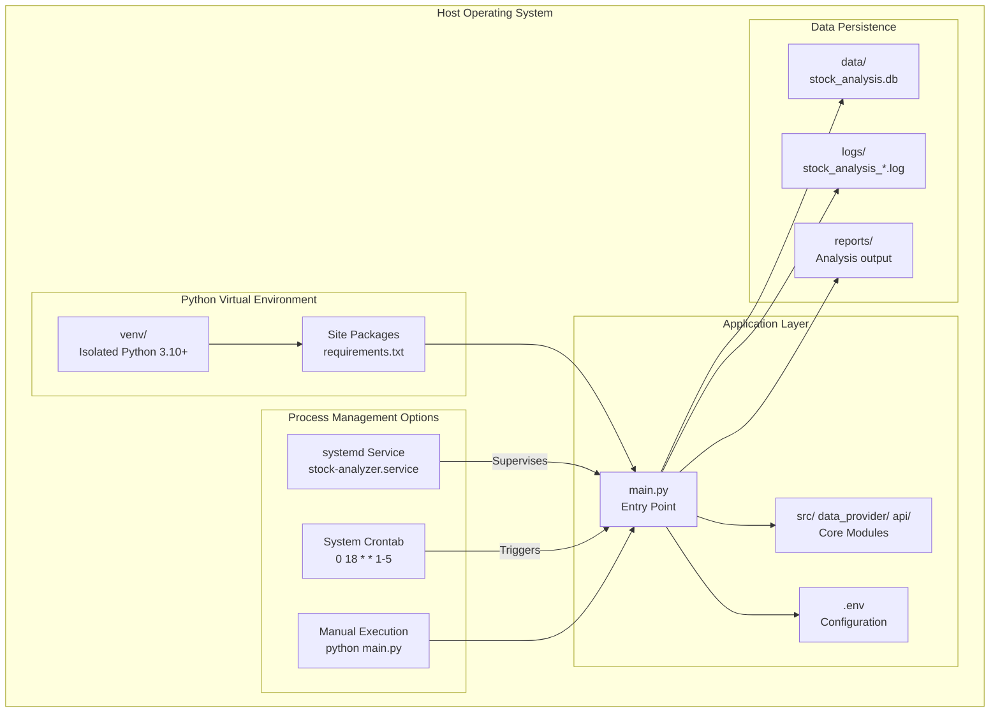
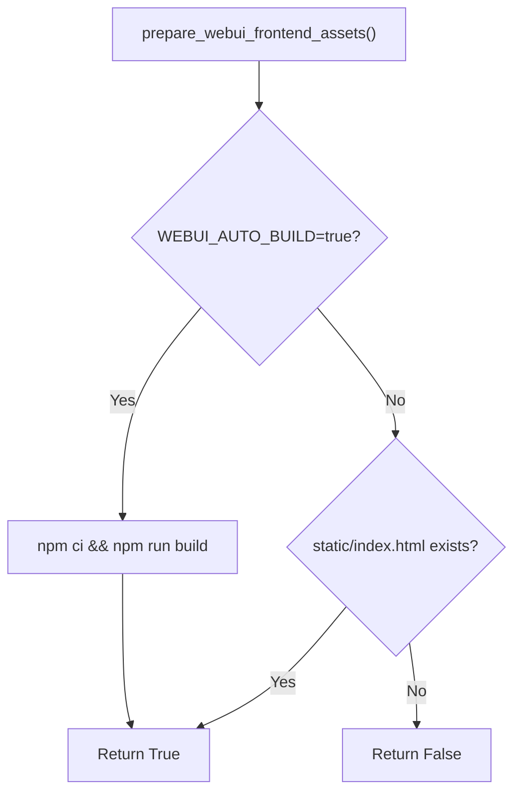
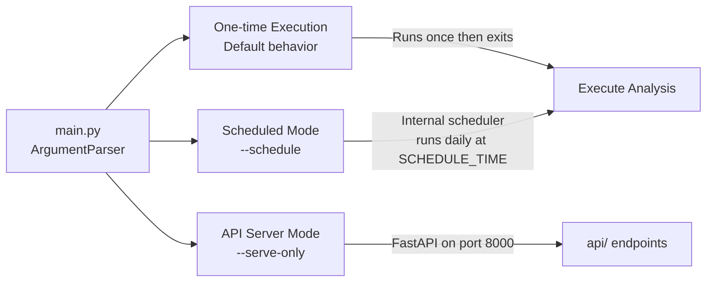

<!-- source: DeepWiki mcp.deepwiki.com · repo ZhuLinsen/daily_stock_analysis · page 7.4 Direct & Systemd Deployment · fetched 2026-10-29 -->

# Direct & Systemd Deployment

<details>
<summary>Relevant source files</summary>

The following files were used as context for generating this wiki page:

- [docker/docker-compose.yml](docker/docker-compose.yml)
- [docs/DEPLOY.md](docs/DEPLOY.md)
- [docs/DEPLOY_EN.md](docs/DEPLOY_EN.md)
- [docs/docker/zeabur-deployment.md](docs/docker/zeabur-deployment.md)
- [main.py](main.py)
- [tests/test_main_schedule_mode.py](tests/test_main_schedule_mode.py)

</details>


This page covers bare metal deployment of the stock analysis system using Python virtual environments and systemd service management. This deployment method provides maximum control over the execution environment and is suitable for dedicated servers or long-running production deployments.

**Scope**: This page focuses on direct installation and systemd service configuration. For containerized deployment, see [Docker Compose Deployment](7.3). For serverless deployment, see [GitHub Actions Deployment](7.2). For execution mode details (`--schedule`, `--serve`, etc.), see [Execution Modes](7.6).

---

## Deployment Architecture

Direct deployment runs the Python application directly on the host operating system, with optional systemd integration for process supervision and automatic restarts.

### Deployment Structure Diagram

Sources: [docs/DEPLOY.md:108-159](), [docker/docker-compose.yml:24-31]()

---

## Prerequisites

### System Requirements

| Component | Requirement | Notes |
|-----------|-------------|-------|
| Operating System | Linux (Ubuntu 20.04+, Debian 11+, CentOS 8+) | macOS also supported |
| Python | 3.10 or higher | 3.11 recommended |
| Node.js | 18+ (Optional) | Required for manual WebUI frontend builds |
| Disk Space | 500 MB minimum | For application + logs + data |
| Memory | 512 MB minimum | 1GB+ recommended for full analysis [docs/DEPLOY.md:62-68]() |
| Network | Outbound HTTPS | For AI APIs and data sources |

### Required System Packages

```bash
# Ubuntu/Debian
sudo apt update
sudo apt install -y python3.10 python3.10-venv python3-pip

# CentOS/RHEL
sudo yum install -y python3.10 python3.10-devel
```

**Optional packages for advanced features**:

| Package | Purpose | Installation |
|---------|---------|--------------|
| `wkhtmltopdf` | Markdown to image conversion | `apt install wkhtmltopdf` (Debian/Ubuntu) |
| `fontconfig` | Font rendering for images | Included with wkhtmltopdf |

Sources: [docs/DEPLOY.md:110-116](), [docs/DEPLOY_EN.md:109-112]()

---

## Installation Steps

### 1. Clone Repository and Create Virtual Environment

```bash
# Clone the repository
git clone <your-repo-url> /opt/stock-analyzer
cd /opt/stock-analyzer

# Create isolated Python virtual environment
python3.10 -m venv venv

# Activate virtual environment
source venv/bin/activate
```
Sources: [docs/DEPLOY.md:112-120]()

### 2. Install Python Dependencies

```bash
# Upgrade pip and install requirements
pip install --upgrade pip
pip install -r requirements.txt -i https://pypi.tuna.tsinghua.edu.cn/simple
```
Sources: [docs/DEPLOY.md:122-127]()

### 3. Configure Environment Variables

```bash
# Copy example configuration
cp .env.example .env

# Edit configuration with your API keys
vim .env
```

**Minimum required configuration**:
- `ANSPIRE_API_KEYS` or `GEMINI_API_KEY`: Required for AI analysis [docs/DEPLOY.md:215]().
- `STOCK_LIST`: Comma-separated stock codes [docs/DEPLOY.md:216]().
- `WEBUI_HOST`: Set to `0.0.0.0` for cloud server access [docs/DEPLOY.md:148]().

### 4. Verify Installation

```bash
# Test single execution
python main.py --no-notify
```
Sources: [docs/DEPLOY.md:136-140]()

---

## WebUI Frontend Preparation

For direct deployment, the frontend assets must be present in the `static/` directory. The system includes logic in `main.py` to prepare these assets.

### Frontend Asset Logic

Sources: [src/webui_frontend.py:168-201](), [main.py:68-68]()

---

## Execution Modes

The `main.py` entry point supports multiple execution modes via command-line arguments:

### Execution Mode Logic

Sources: [docs/DEPLOY.md:136-153](), [main.py:13-23]()

---

## Systemd Service Configuration

Systemd provides process supervision, automatic restarts, and boot-time initialization.

### Create Service File
Create `/etc/systemd/system/stock-analyzer.service`:

```ini
[Unit]
Description=A股自选股智能分析系统
After=network.target

[Service]
Type=simple
User=root
WorkingDirectory=/opt/stock-analyzer
Environment="PATH=/opt/stock-analyzer/venv/bin"
ExecStart=/opt/stock-analyzer/venv/bin/python main.py --schedule
Restart=always
RestartSec=30

[Install]
WantedBy=multi-user.target
```
Sources: [docs/DEPLOY.md:166-186]()

### Service Management
```bash
sudo systemctl daemon-reload
sudo systemctl enable stock-analyzer
sudo systemctl start stock-analyzer
sudo systemctl status stock-analyzer
journalctl -u stock-analyzer -f
```
Sources: [docs/DEPLOY.md:188-204]()

---

## Web UI Access & Security

When deploying on a cloud server, the Web UI requires specific configuration to be accessible from the internet.

### Network Configuration
1. **Host Binding**: In `.env`, set `WEBUI_HOST=0.0.0.0` [docs/DEPLOY.md:148]().
2. **Port**: Default is `8000`, configurable via `API_PORT` or `WEBUI_PORT` [main.py:107-111]().

### Authentication
The system checks for authentication status before binding to public interfaces. If `ADMIN_AUTH_ENABLED` is false and the host is public, a warning is issued [main.py:91-104]().

---

## Data Persistence & Maintenance

### File System Layout
- **Database**: Defined by `DATABASE_PATH`, usually `data/stock_analysis.db` [docs/docker/zeabur-deployment.md:142]().
- **Logs**: Defined by `LOG_DIR`, usually `logs/` [docs/docker/zeabur-deployment.md:141]().
- **Reports**: Stored in `reports/` [docs/DEPLOY.md:98]().

### Maintenance Commands
```bash
# Clean old logs (7 days)
find /opt/stock-analyzer/logs -mtime +7 -delete

# Clean old reports (30 days)
find /opt/stock-analyzer/reports -mtime +30 -delete
```
Sources: [docs/DEPLOY.md:282-287]()

---

## Troubleshooting

| Issue | Cause | Solution |
|-------|-------|----------|
| `Database is locked` | Concurrent access or stale lock | Delete `data/*.lock` files [docs/DEPLOY.md:307-309](). |
| `Connection Timeout` | Firewall or Proxy issue | Check `USE_PROXY` and `PROXY_HOST` in `.env` [main.py:40-46](). |
| `Web UI 404/Refused` | `WEBUI_HOST` is `127.0.0.1` | Change `WEBUI_HOST` to `0.0.0.0` in `.env` [docs/DEPLOY.md:148](). |
| `Memory Errors` | Insufficient RAM | Increase memory or set `MAX_WORKERS=1` [docs/DEPLOY.md:312-323](). |

Sources: [docs/DEPLOY.md:291-323](), [main.py:40-46]()

---

